# Customer-facing proposals, October 2026: Stages 1 and 2

Stage 2 (before and after) added 2026-10-20 for the items the owner kept. Nothing is built until the owner approves each item.

Stage 1: findings from the code. Version 3.2.0. Owner approval needed before Stage 2.

## Summary

| # | Item | Confirmed? | Change type | Native code? | Server migration? | Effort | Risk | Owner questions |
|---|------|------------|-------------|--------------|-------------------|--------|------|-----------------|
| 2 | Same sign-in options on iPhone and Android | Partly confirmed | logic + UI + native config (app.json plugin option) + console setup | n (config option only) | n (dashboard auth settings only) | M-L | M-H | 5 |
| 3 | Training-focus setup step | Partly confirmed | wording (label, copy) / UI (if reorder or split) | n | n for wording; y for a 9th step | S (relabel), M (split) | L (relabel), M (split) | 5 |
| 4 | Sensitive questions and "Prefer not to say" for sex | Partly confirmed | wording (helper lines) / logic (any unknown-sex path) | n | n for helper text and null; y if a new stored value | S (helper lines), L (unknown sex end to end) | L (copy), H (unknown sex) | 4 |
| 5 | Fastest route to a first workout (three start routes) | Confirmed | none | n | n | n/a | n/a | 1 |
| 6 | Coaching autonomy levels | Confirmed | n/a (report only) | n | n | n/a | n/a | 3 |
| 8 | "Injuries & limitations" offer on Today | Partly confirmed | UI (A: move; B: UI + step flow) | n | n | A S, B M | A L, B M | 4 |
| 10 | Two screens that change the same setup | Confirmed | UI + logic (navigation, save order) | n | n | M (B) to L (A) | M | 4 |
| 11 | Settings layout, reminders, units, haptics | Partly confirmed | UI (grouping, merged screens) plus small logic (haptics pref) | n | n for layout; haptics pref only if synced (owner's choice) | M (L if both reminder screens merged) | M | 5 |
| 12 | Ticks and confidence that don't match the data | Confirmed | wording + UI, with logic for the food-day threshold | n | n (a new basis field would be additive, if chosen) | S (markers, wording) to M (basis + threshold) | M | 5 |
| 14 | One set of words and colours for muscle-volume status | Partly confirmed | wording + UI (colour tokens) | n | n | S (labels), M if colours re-tokened | L-M | 4 |
| 15 | Coaching decision explanations | Partly confirmed | wording + UI (collapse rule, rows); a few items need logic or data | n | n | M to L (L if engine output gains new fields) | M | 5 |
| 16 | Rename "Help" in the exercise card | Confirmed | wording (from its "- Change:" line) | n | n | S | L | 1 |
| 17 | Weight and rep suggestions in the logger | Confirmed | logic (cases 8, 10, 11 if changed) and/or wording (reason text) | n | n | M (logic + scenario tests); S for reason line only | M | 4 |
| 18 | Make exercise instructions easier to find | Confirmed | UI | n | n | S (A), S to M (B, C) | L | 4 |
| 20 | Rest timer when the phone is locked | Partly confirmed | wording for stage 1; native for stage 3 | n for stage 1 and wording; y for stage 3 | n | S (confirm/wording), L (stage 3) | L (wording), H (stage 3) | 3 |
| 22 | Empty "Meal 1-4" cards in the diary | Partly confirmed | UI/logic (view only) | n | n | M | M | 3 |
| 23 | Seasoning tips in the diary | Confirmed (owner premise does not match code) | none (report only); logic if restricted to meal plans | n | n | S (gate) / M (source marker) | L | 2 |
| 24 | "Add this day / Add this week" skip rule | Partly confirmed | wording (card) plus logic (skip/replace rules, summary toast); optional local schema addition | n | n expected (planned rows local-only, db.js:970-972; cloud not checked) | M | M | 4 |
| 25 | Weekly cap on oily fish in meal plans | Partly confirmed | logic (engine + preference UI) | n | n (local profile key); y only if the setting must sync | M | M | 6 |
| 26 | Meal plan readability | Confirmed | wording / UI | n | n | S | L | 4 |
| 27 | More raw/cooked weight conversions | Partly confirmed | logic (pair data + STATE entries) + wording/UI (label) | n | n | S (data, label); M if label on three surfaces with accessibility checks | L-M | 5 |
| 28 | Taps to log a repeat meal | Confirmed | UI (possibly navigation only) | n | n | S (close-after-add) to M (new chip) | L | 2 |
| 30 | Privacy and transparent coaching in the app's own words | Partly confirmed | wording | n | n | S | M | 4 |
| 31 | Community defaults | Partly confirmed | UI + logic (defaults) | n | n (optional y if server fallback is changed) | M | M | 5 |
| 32 | Challenge screen | Partly confirmed | UI (footer padding) + wording (title) | n | n (y only if a listable count is needed) | S | L | 3 |
| 34 | "Free for life" and other "free" wording | Partly confirmed | wording (strings) + server (grant rule) + docs/legal | n | y only if the grant moves to completion (owner-run) | L | H | 6 |
| 36 | Calm mode everywhere | Partly confirmed | logic + server (post check) + wording (Settings text) | n | y for the post check; n for handler and Settings text | M (handler + text), L with the server migration | H | 4 |
| 41 | Over-the-air updates | Partly confirmed | native config (app.json, eas.json) + logic (App.js update alert) | y | n | M | M | 3 |

## Stage 2 summary

| # | Item | Status | Change type | Native code? | Server migration? | Effort | Risk | Prototype branch | Owner questions |
|---|---|---|---|---|---|---|---|---|---|
| F1 | Stale form overwrites newer setup | Confirmed (run on the real screen) | logic (form reloads when the saved profile changes) | n | n | S | Low | proposal/10-setup-screens | 1 |
| F2 | Old weight written back | Confirmed (read, then run) | logic (save write) | n | n | S | Low | proposal/10-setup-screens | 0 |
| F3 | Add-food default meal (route with no meal) | Built (prototype); no live route found that reaches it | logic (default meal slot) | n | n | part of 22 | part of 22 | proposal/22-diary | see 22 |
| F4 | Add this day / Add this week card and alert strings | Built (prototype), part of 24 | wording + logic (see 24) | n | n | part of 24 | part of 24 | proposal/22-diary | see 24 |
| F5 | Tip pointing at a deleted row | Confirmed | wording | n | n | S | Low | none (no code changed) | 1 |
| F6 | Nutrition Targets: no silent male default | Confirmed | logic (initial state and prefill guard) | n | n | S | Low to Medium | proposal/03-setup-wording | 2 |
| F7 | "Date of birth" on an age field | Confirmed | wording | n | n | S | Low | none (no code changed) | 0 |
| F8 | Website still sells Pro | Confirmed | wording (four public pages and the privacy mirror) | n | n | M | Medium | none (no code changed) | 4 |
| F9 | Update-check error reporting | Partly confirmed (with 41) | logic (stage-tagged error report) | y (with 41) | n | part of 41 | part of 41 | proposal/02-sign-in | see 41 |
| 2 | Same sign-in options on iPhone and Android | Partly confirmed | logic + UI + native config (iOS plugin option) + console setup | y (iOS plugin option only) | n (dashboard auth settings only) | L | Medium-High | proposal/02-sign-in | 3 |
| 3 | Training-focus setup step | Confirmed | wording (chip label) + logic (draft-resume clamp) | n | n | S | Low | proposal/03-setup-wording | 3 |
| 4 | Sensitive questions and "Prefer not to say" for sex | Confirmed (wording) | wording (one line under each field) | n | n | S | Low | proposal/03-setup-wording | 3 |
| 6 | Coaching autonomy levels | Confirmed (Coached copy); deload branch is not dead | wording (copy) + decision on the deload branch | n | n | S (copy); S to M (deload) | Low (copy); Medium for deload options (b) or (c) | proposal/03-setup-wording | 2 |
| 8 | "Injuries & limitations" offer on Today | Confirmed | UI (position) | n | n | S | Low | proposal/08-today-settings-community | 1 |
| 10 | Two screens that change the same setup | Confirmed; prototyped | UI + logic (save order, form reload) | n | n | M-L | Medium | proposal/10-setup-screens | 4 |
| 11 | Settings layout, reminders, units, haptics | Confirmed | UI (grouping, new Units screen) + wording; haptics switch (logic) | n | n | M | Low to Medium | proposal/08-today-settings-community | 3 |
| 12 | Ticks and confidence that don't match the data | Confirmed; prototyped | wording + UI (neutral marks, suppression) | n | n | S to M | Low-Medium | proposal/12-ticks-decisions | 2 |
| 14 | One set of words and colours for muscle-volume status | Confirmed; built as prototype | wording + UI (colour tokens) | n | n | M | Low-Medium | proposal/14-volume-instructions | 3 |
| 15 | Coaching decision explanations | Prototyped (main decision types) | wording + UI (card rows, collapse rule, footer) | n | n | M | Medium | proposal/12-ticks-decisions | 3 |
| 16 | Rename "Help" in the exercise card | Confirmed | wording (plus 2 pinned test edits) | n | n | S | Low | none (no code changed) | 0 |
| 17 | Weight and rep suggestions in the logger | Confirmed | logic (layoff, topped hold, recovery anchor) + wording (reason text) | n | n | M | Medium | proposal/17-suggestions | 5 |
| 18 | Make exercise instructions easier to find | Built (prototype) | UI (header icon) + wording (two Watch lines) | n | n | S | Low | proposal/14-volume-instructions | 0 |
| 22 | Empty "Meal 1-4" cards in the diary | Confirmed | UI (view-only folding and labels) + logic (slot fold) | n | n | M | Medium | proposal/22-diary | 1 |
| 23 | Seasoning tips in the diary | Confirmed | wording (tip text) + logic (planned rows only) | n | n | S | Low | proposal/22-diary | 0 |
| 24 | "Add this day / Add this week" skip rule | Partly confirmed | wording (card and alerts) + logic (skip and replace rules, toast) | n | n | M | Medium | proposal/22-diary | 1 |
| 25 | Weekly cap on oily fish in meal plans | Confirmed; prototype built | logic (engine cap; setting UI not built) | n | n | M | Medium | proposal/25-meal-plans | 3 |
| 26 | Meal plan readability | Confirmed; prototype built | wording + UI (number format, hint, button) | n | n | S | Low | proposal/25-meal-plans | 1 |
| 27 | More raw/cooked weight conversions | Partly confirmed; prototype built | logic (pair data) + wording (label) | n | n | S | Low | proposal/25-meal-plans | 1 |
| 28 | Taps to log a repeat meal | Not confirmed on a device (inferred) | UI (navigation only) | n | n | S | Low | proposal/22-diary | 0 |
| 30 | Privacy and transparent coaching in the app's own words | Confirmed | wording (Welcome lines) | n | n | S | Medium | none (no code changed) | 2 |
| 31 | Community defaults | Confirmed, with one correction to Stage 1 | UI + logic (feed and audience defaults) + wording | n | n | S to M | Medium | proposal/08-today-settings-community | 2 |
| 32 | Challenge screen | Built (prototype) | UI (footer padding, board title) | n | n | S | Low | proposal/14-volume-instructions | 1 |
| 34 | "Free for life" and other "free" wording | Partly confirmed | wording (strings; grant rule not in this batch) | n | n (not in this batch) | S now; L with the rule | High | none (no code changed) | 2 |
| 36 | Calm mode everywhere | Partly confirmed | wording (Settings text only) | n | n | S | Low | none (no code changed) | 2 |
| 41 | Over-the-air updates | Partly confirmed | native config (app.json, eas.json) + logic (App.js update check) | y | n | M | Medium | proposal/02-sign-in | 3 |
| 20 (checklist only) | Rest timer when the phone is locked | Checklist only; behaviour already in the repo | none (verification checklist) | n | n | S | Low | none | 0 |

## 02. Same sign-in options on iPhone and Android
Status: Partly confirmed (code side confirmed; Supabase dashboard and Google/Apple console state is not in the repo, so Not confirmed)

### Answers to "Confirm"
- **How providers are chosen per platform.** OBSERVED: purely a render-time `Platform.OS` split in `src/components/auth/OAuthButtons.js`. Apple button only when `Platform.OS === 'ios'` (:41); Google button only when `Platform.OS !== 'ios'` (:70). The comment at :65-69 gives the reason: Google native sign-in on iOS fails ("failed to determine clientID") because no iOS OAuth client id is wired. Used by `AuthSheet` (:359, used from `WelcomeScreen.js` and `LoginScreen.js`), `ProOnboardingScreen.js:2518` (account step, OAuth only, no email) and the dormant `ProUpgradeScreen.js:572`. Email/password is in `AuthSheet` only (`signInWithEmail`/`signUpWithEmail`, `src/lib/supabase.js:424,434`); the onboarding account step comment (:2511-2515) still says email was removed, now stale vs CLAUDE.md (re-added 2026-07-21).
- **Handlers.** Google: `signInWithGoogle` `src/lib/supabase.js:560`, native `@react-native-google-signin/google-signin`, `GoogleSignin.configure({ webClientId })` only (:574, web client id const :549), then `signInWithIdToken({provider:'google'})` (:590). No `iosClientId` anywhere (grep of app.json, eas.json, plugins, src: none). Apple: `signInWithApple` :637. On iOS uses `expo-apple-authentication` then `signInWithIdToken({provider:'apple'})` (:668). On non-iOS (and if the native module or availability is missing on iOS) it calls `_signInWithOAuthProvider('apple')` (:639, :650, :658), the Supabase web OAuth flow via `expo-web-browser` with redirect `volyume://` (`OAUTH_REDIRECT_URL` :387, flow :500-540). So the Android Apple code path already exists and is only unreachable because the button is not rendered.
- **Google-on-Android user opening iPhone.** OBSERVED: iPhone shows Apple only (plus email in AuthSheet). No Google option, so they cannot reach the Google-created account unless they use email with the same address, which only works if that account has a password (see below). INFERRED: Apple with the same real email may auto-link in Supabase (see linking).
- **Apple user opening Android.** OBSERVED: Android shows Google only (plus email). Apple is not offered. Same consequence.
- **Identity linking.** OBSERVED: not used. No `linkIdentity`, `unlinkIdentity` or `getUserIdentities` anywhere in `src` or `App.js`. The only `identities` reads are `src/lib/appleIdentity.js:70,109` (detect an Apple identity, read its name) and `src/lib/authErrorCopy.js:96` (duplicate-signup detection: empty `identities` array on signUp, used `AuthSheet.js:237-248`). No manual-linking or auto-link setting in the repo (`supabase/` has no auth config file; grep for link/manual_linking found nothing). Not confirmed: whether the hosted project has automatic same-email linking or manual linking enabled; that is dashboard state (Authentication settings), the owner must read it.
- **Same email on a second provider.** INFERRED (Supabase documented default, not verified against this project): a sign-in whose provider returns the same verified email is attached to the existing user rather than creating a second one; a mismatch or unverified email creates a second user. App code does nothing special in either case; there is no pre-check and no "link instead" prompt. Email sign-up with an existing address is handled: `isDuplicateSignup` -> `AUTH_COPY.duplicate` "That email already has an account. Try signing in instead." (`src/lib/authErrorCopy.js:30,77`).
- **Apple "Hide my email".** OBSERVED: the app knows relay addresses exist (`isApplePrivateRelayEmail`, `src/lib/appleIdentity.js`, tests `appleIdentity.test.js:14,104`), and migrate_173 refers to `privaterelay.appleid.com` (`migrate173.rpcOnly.guard.test.js:151`). Nothing links a relay address to another provider. INFERRED: a relay address is a different email from the person's Google email, so it cannot match; it would be a separate account, and Android users could never reach it without Apple on Android. This is the hardest row of the scenario table.
- **Password reset for email accounts.** Partly confirmed. OBSERVED: request half exists. "Forgot your password?" in sign-in mode (`AuthSheet.js:455-475`, handler :269) calls `resetPassword` (`supabase.js:467`), identity-bound by `authCallbackState` (kind `recovery`). Copy: "If that email has an account, we have sent a link to get back in. Open it on this phone, then come back here. If it is not in your inbox, look in your spam or junk folder." (:287). OBSERVED gap: the link only signs the person in (`authDeepLink.js:168` `setSession`, returns `signedIn`). There is no `updateUser` and no new-password screen anywhere in `src` or `App.js` (grep: none). So a reset signs them in but never lets them choose a new password; the comment at `AuthSheet.js:262-268` says "request half only". Also, an Apple or Google account has no password, so the reset email for such an address would not give them a way into that provider account (INFERRED).
- **Native setup per change.**
  - Google on iPhone (INFERRED from package behaviour, Not confirmed in this repo): an iOS OAuth client in Google Cloud (bundle `app.volyume`, `app.json:24`), its client id passed as `iosClientId` to `GoogleSignin.configure` (JS change, `supabase.js:574`), and the reversed client id URL scheme added through the plugin entry. The plugin is currently a bare string `"@react-native-google-signin/google-signin"` (`app.json:254`) with no options, so the `iosUrlScheme` option (or `GoogleService-Info.plist`) would be an `app.json` native change. Supabase's Google provider must also accept the iOS client id as an authorised audience (dashboard, "skip nonce"/client id list). Needs a store build.
  - Apple on Android: no new native module (web flow code exists, `supabase.js:639`). Needs an Apple Services ID with `https://<project>.supabase.co/auth/v1/callback` as return URL, the Apple provider configured in Supabase with that Services ID and a signing key/secret (INFERRED: Apple secrets expire at most every 6 months, a recurring owner task), and `volyume://` in Supabase Redirect URLs (already needed for Google web flow, per comment :477-481). `expo-web-browser` is already used. Native code: none. Console/dashboard work: yes.
  - Linking UI (`linkIdentity`) uses the same flows; for ID-token providers INFERRED that supabase-js `linkIdentity` only supports the browser OAuth flow, which would route Google-on-iPhone linking through web OAuth rather than the native sheet (Not confirmed; verify against installed supabase-js version before planning).

### Today (before): phone-switch scenario table (today only)
| Scenario | What the person sees on the new phone today | Result |
|---|---|---|
| Google on Android, now on iPhone | Apple button + email only (`OAuthButtons.js:41,70`) | Cannot use Google. Apple with the same real email: INFERRED may join the same account if the project auto-links and Apple returns that email; if Apple returns a relay or a different address, a new empty account is created. Email route works only if they set a password (sign-up with that email returns the duplicate message `authErrorCopy.js:30`, and a reset link only signs them in, no password can be set). |
| Apple, real email, on iPhone, now on Android | Google button + email only | Same mirror: Google with the same email INFERRED may join; otherwise new account. |
| Apple with "Hide my email" on iPhone, now on Android | Google + email only | OBSERVED no route. INFERRED relay address cannot match any Google email, so Google sign-in makes a different, empty account; the Apple account is unreachable from Android. |
| Email account, either platform | Email form is present on both (AuthSheet) | Works. Forgot password sends a link that signs them in but offers no new-password step (`authDeepLink.js:168`, no `updateUser`). |
| Apple to Apple, Google to Google (same platform family) | Own provider shown | Works. |
Note: sign-out wipes local data and every sign-in is a fresh cloud pull (`docs/IDENTITY_AND_OWNERSHIP_LOCKED.md`), so a second empty account means the person sees none of their data.

### Starting proposal viability
- "Offer Apple and Google on both": viable. Android Apple is mostly console setup; iPhone Google needs an iOS client id, `iosClientId` in JS and an `app.json` plugin option (native config change). Guideline 4.8 stays satisfied (Apple remains on iOS).
- "Sign-in methods" section in Account (link/unlink): viable but depends on Supabase manual linking being enabled (dashboard, Not confirmed) and on the supabase-js `linkIdentity` flow type (see above). Unlinking the last method must be blocked. Currently `SettingsAccountScreen.js:25` shows only email or "Signed in".
- "Explain and offer to link instead" for a second account: gap. There is no signal on the sign-in path that an existing account has the same email; for different emails (relay) it cannot be detected at all. Linking requires an already-signed-in session, so it cannot fix a sign-in that has already created a second account. Needs an owner decision on what "offer to link" means then.
- Safety rules touched: Consent gate (new sign-in paths must still pass through `RootNavigator` consent, unchanged); Identity lock (no anonymous, sign-out wipe unchanged; a linking feature must not mutate `user_id`, `IDENTITY_AND_OWNERSHIP_LOCKED.md`); EU residency (Apple and Google tokens exchange with Supabase Dublin; no new third-party data store). Free access, calorie, ED rules: not touched.

Change type: logic + UI + native config (app.json plugin option) + dashboard/console setup. Native code: n (config option only; no new native module). Server migration: n (no schema; dashboard auth settings only, none in repo). Effort M-L. Risk M-H: a wrong linking rule could merge or strand accounts that hold health data.

### Questions for the owner
1. Should an Apple "Hide my email" account be reachable from Android? (a) Yes, via Apple on Android plus linking; (b) Yes, by also supporting a manual "merge accounts" request; (c) Accept as unreachable and say so in the sign-in screen.
2. If a sign-in would create a second account for the same real email, what should happen? (a) Block and ask them to sign in with the original method; (b) Auto-join them (provider setting); (c) Offer to link after they are in, with the new empty account discarded.
3. Which setup are you willing to do: Google iOS client id (Google Cloud), Apple Services ID and key (Apple Developer), Supabase manual-linking setting? Which of the three should the app not depend on?
4. Password reset: should the recovery link also let people set a new password (needs a new screen, `updateUser`), or is sign-in-only acceptable?
5. May "Sign-in methods" allow removing a method, given the last method can never be removed?

## 03. Training-focus setup step
Status: Partly confirmed (step count and "Step 6 of 7" confirmed; the owner's "seven coaching setup steps" is only true for one of two modes, see Q1)

### Answers to "Confirm"
- **The setup steps and their fields (OBSERVED).** The wizard has 8 internal steps, `TOTAL_STEPS = 8` (POS:124), labels at POS:132: 1 Account, 2 Baseline, 3 Body composition, 4 Training week, 5 Your gym, 6 Injuries & limitations, 7 Targets, 8 Check-in rhythm.
  - Step 1 Account is never shown to a signed-in person: the initial step is 2 when a real user exists (POS:528). It is also never saved in a draft.
  - 2 "Set your starting baseline" (POS:2538): first name (optional), biological sex, age, height, current body weight. Required: sex, age 13 to 100, height, weight 30 to 300 kg (validateStep2 POS:628-639).
  - 3 "Add your starting body composition" (POS:2784): body fat % and source, both optional, Continue and "Skip for now".
  - 4 "Shape your training week" (POS:2875): experience, session length, days per week, equipment. All four required (validateStep4 POS:640-646).
  - 5 "Where you train, and Community" (POS:2986): gym venue, handle, display name, join choice. Nothing required (POS:1394-1401 comment). Does not exist under 18.
  - 6 "Anything Volyume should build around?" (POS:3182): injuries and limitations entry, optional, skippable.
  - 7 "Set your training focus" (POS:3236): see next bullet.
  - 8 "Your reminders" (POS:3680), with a "Plan fit" sub-screen (POS:3441) shown only when the schedule cannot carry the plan. Morning hour, check-in day, notification permission. Nothing required (POS:1855 comment).
- **Step 7 field order and dependencies (OBSERVED, POS:3223-3405).**
  1. "What are you focused on right now?" (phase). Required (POS:649). Options from `TRAINING_PHASES` (`src/lib/coachingGoals.js:229+`): lean_gain, bulk, strength_size, weak_point, cut, recomp, maintain. No default (POS:786).
  2. "Competing in a category? (optional)" dropdown (`trainingGoal`), default `'general'`, placeholder "Not competing, General" (POS:769, 3265). Options are `PHYSIQUE_GOALS`: General, Men's Physique, Classic Physique, Bodybuilding, Bikini, Wellness, Figure, Women's Physique, Women's Bodybuilding.
  3. "Your training style" picker (six styles). Shown only when `archetypeApplies(trainingGoal)`, i.e. category resolves to `general` (`src/lib/trainingArchetypes.js:25`). Required when shown (POS:651). Hidden for a competing category, and `effectiveArchetype` is null then (POS:775).
  4. "Anything to bring up? (optional, up to 3)" muscle chips. Shown when `GOALS_WITH_WEAK_POINTS.includes(trainingGoal)` (POS:3305). `general` has `weakPointsEnabled: true` (`coachingGoals.js:~30`), so non-competitors see it too. Changing category drops chips the new category does not offer (changeGoal POS:870-875).
  5. "Protein target" collapsible, default "set for you": `advanced` if category is in `ADVANCED_PROTEIN_GOALS`, else `optimised` (POS:799; `nutritionEngine.js:899`). Optional override of three tiers.
  - Also on screen: a "Provisionally about N kcal" line under the phase (POS:3254), and a "Still needed" hint for phase and style (POS:3376).
- **Required fields on step 7 (OBSERVED).** Phase, and style only when not competing. Nothing else.
- **How "Step N of 7" is produced (OBSERVED, POS:362-388, 330-333).** `ProOnboardingHeader` prints `Step ${n} of ${total} - ${STEP_LABELS[step-1]}`; the "chip" is that label text, "Targets" for internal step 7. `displayStepOf` (POS:329):
  - Adult, full mode: n = step - 1, total 7. Internal 7 is "Step 6 of 7 - Targets". Internal 8 is "Step 7 of 7 - Check-in rhythm". Matches the map.
  - Under 18 (`isMinorAnswer`, POS:340): gym step skipped, steps 2,3,4,6,7,8 run, n = step-2 from 6 up, total 6. Internal 7 is "Step 5 of 6 - Targets". Correct on that path.
  - Coaching mode (route `CoachingSetup`, `mode: 'coaching'`, RootNavigator:727): header uses `COACHING_STEPS = [2,3,4,7,8]` (POS:361), so internal 7 is "Step 4 of 5 - Targets". Correct on the clean path.
  - Separately, a progress bar uses the same `displayStepOf` (hidden in coaching mode, POS:384).
  - **Where the number is wrong (INFERRED):** coaching mode restores a saved draft with `Math.max(s, draft.step)` (POS:1059). The draft key is per user, not per mode (`proOnboardingDraft.js:21`). A draft left at step 5 or 6 by a full-mode run, then resumed through the Coach tab "Set up coaching", would show step 5 or 6 in a mode that skips them, and `COACHING_STEPS.indexOf` returns -1, giving "Step 0 of 5". Not run; Not confirmed on device.
- **Title versus label (OBSERVED).** Title "Set your training focus" (POS:3236), label "Targets" (POS:132), "This step sets" chips "Goal phase / Muscle priorities / Nutrition target" (POS:157-161). The label is pinned by a source test: `src/screens/__tests__/ProOnboardingScreen.communityStep.guard.test.js:50` asserts the exact `STEP_LABELS` array, and :49 asserts `TOTAL_STEPS = 8`, :246 the skipGym arithmetic.
- **Drafts and resume (OBSERVED).** `src/lib/proOnboardingDraft.js`: AsyncStorage key `@volyume_pro_onboarding_draft_<userId>`, saved 600 ms after any answer change (POS:1073-1092), only for steps 2 to 7 (`MIN_STEP 2`, `MAX_STEP 7`, draft file :31-32), so a person on step 8 resumes on step 7. Restore (POS:1000-1060): all answers incl. phase, category, style, weak points, protein override, then step = max(current, draft step). Safeguards: sex must be a valid value or the step clamps to 2; a minor parked on step 5 resumes on 4. `StartChoiceScreen` also reads the draft: any saved answer sends a returning person straight to `ProOnboarding`, skipping the choice (StartChoice:70-79). The draft is cleared at completion.

### Today (before)
Order on step 7 is already: focus, then competing category, then style (only if not competing), then bring-up areas, then protein (above). Strings: title "Set your training focus"; sub "Your goal sets the calorie direction, training bias and nutrition target." (POS:3237); category label "Competing in a category? (optional)"; its hint "Only if you are chasing a competitive physique. It biases the plan towards the muscles that category is judged on." (POS:3266); style hint "How your plan shares out its work. The muscle map shows where the extra work goes. You can change it later." (POS:3292); weak points "Pick one to three muscles you want to bring up. Not sure? Leave it blank for a balanced plan." (POS:3311); protein "{label} - {range}. Set for you, tap to change." (POS:3338).

### Starting proposal viability
- Viable: keep all fields; relabel "Targets" (one string, but the guard test at the path above must change with it); the owner's chain goal, competing, category or style, bring-up areas, protein is the order the screen already has, so a reorder gains nothing and the change is mostly the label and copy. Gaps to flag: the "competing?" question is a dropdown whose "not competing" answer is the placeholder or "General", not a yes/no; the `weak_point` phase ("Bring up a weak point") overlaps the bring-up chips, and picking that phase does not require any chips (validateStep7 POS:648-652).
- Protein placement: it depends on the category (default tier changes with category, POS:799), so it must stay after it; it has no dependency on the nutrition step, but Nutrition Targets also has a protein approach (`NutritionTargetsScreen.js`, `PROTEIN_APPROACHES`). Whether it lives here or there is an owner call.
- Splitting into two screens (blockers, OBSERVED): `TOTAL_STEPS`, `STEP_LABELS`, `STEP_OUTCOMES`, `COACHING_STEPS`, `displayStepOf`, goBack and every `setStep` are keyed by number; the draft ceiling `MAX_STEP = 7` would need to move; telemetry `onboarding_step_viewed/validation_blocked` has `step: int(1, 8)` in `src/lib/telemetry/schema.js:106-108` and the server catalogue copy in `supabase/migrate_200_growth_telemetry.sql:176` has `"max":8`, so a 9th internal step needs both widened (the server one is a migration). Two screens would also change "of 7" to "of 8" (adult) and "of 6" to "of 7" (minor) and "of 5" to "of 6" (coaching). Existing drafts at internal step 7 or 8 would land on a different screen (INFERRED).
- Safety rules touched: none directly. Calorie floors untouched; the screen only reads `calculateNutritionTargets` for the provisional kcal line. Usage data: step events already declared; a new step number or a changed enum needs schema and server catalogue change.

Change type: wording (label, copy) / UI (if reorder or split). Native: n. Server migration: n for wording; y for a 9th step (telemetry catalogue, migrate_200 line 176, or a new one). Effort S for relabel, M for split. Risk L for relabel (guard test must move); M for split (draft, step arithmetic, funnel).

### Questions for the owner
1. Which setup do you mean by "seven steps"? (a) The full setup reached from "Set up coaching" on "How do you want to start?": 7 shown steps for adults, 6 under 18. (b) The shorter setup later from the Coach tab: 5 steps. Today's header says "of 7" for (a) and "of 5" for (b).
2. Label for internal step 7: (a) "Training focus" to match the title; (b) "Goal and targets"; (c) other wording you give.
3. Protein: (a) stay on this step after the category; (b) move to Nutrition Targets only; (c) stay here but behind the same collapsible with no change.
4. The competing question: (a) keep the current dropdown; (b) make it an explicit Yes/No before the category list; (c) other.
5. Split into two screens: (a) no, one screen; (b) yes, accept the telemetry widening to 9 and the step-count change.

## 04. Sensitive questions and "Prefer not to say" for sex
Status: Partly confirmed. Helper text exists on some fields, not others; an unknown-sex path is NOT defined end to end (table below).

### Every sensitive field and its current helper text (OBSERVED)
Setup (POS step 2):
- Biological sex (POS:2601-2602): "Used by the calorie formula and safety floors. This stays private." Two options only (`SEX_OPTIONS`, POS:~190), required, no default.
- Age (POS:2614-2615): "Used with your height and weight to set your calorie targets." Setup asks age, not date of birth; a DOB is derived (`dateOfBirthFromAgeYears`).
- Height (POS:~2630): "Used with your weight and age to set your calorie targets."
- Current body weight (POS:2689-2691): "This sets your starting trend and first calorie target. Update it from Today once setup is complete."
- Body fat % (step 3, POS:2805-2808): "Enter your best current estimate or a measured value. Leave it blank only if you genuinely do not know." No statement of who sees it.
- Training status (Natural/Enhanced): not in setup. Only on Nutrition Targets (`NutritionTargetsScreen.js:1265-1273`), hidden when calm mode or an open ED flag: "Kept on this phone only. Enhanced lets the weekly coach accept faster weight gain during a building phase."
- Cycle tracking: not in setup. Settings > Coaching (`SettingsCoachingScreen.js:287-300`), only rendered when sex is female: "Adds an optional weekly check-in question so your coach can steady targets around your period."
Profile (Settings > Profile, `SettingsProfileScreen.js`):
- Biological sex (:241-242): "Used for calorie floors and nutrition targets. Changes apply on your next weekly check-in." Tapping the other option opens an alert (:199): "Set biological sex to X. This affects your daily calorie estimate, your minimum calories and your future nutrition targets. Your current targets are not recalculated until the next weekly check-in."
- Height (:~277): "Used for calorie floors and nutrition targets."
- Date of birth (:288-289): "Enter your age. Used for calorie floors and nutrition targets." (label says Date of birth, field takes an age.)
- Weight and body fat: not on Settings > Profile.
Nutrition Targets: Sex, Age, Height have NO helper text (:1088-1105, 1177-1200); weight has only "Entered in kilograms, whatever unit you display elsewhere." (:1112); body fat has none (:1225). Its sex pill defaults to Male before a profile loads (`NutritionTargetsScreen.js:405`, replaced at :597 if the profile has sex).
None of these lines says who can see the value, apart from "This stays private" on setup sex and "Kept on this phone only" on training status.

### Every place sex changes a calculation or screen (OBSERVED)
| Place | file:line | With sex | Sex unknown (null or anything not male/female) |
|---|---|---|---|
| BMR constant (Mifflin) | `nutritionEngine.js:628-632` | male +5, female -161 | Takes the female branch (-161), 166 kcal/day lower BMR than male, about 200 to 290 kcal after the activity multipliers 1.2 to 1.725 (:24-30). Not Katch-McArdle cases (body fat from a baseline source, :612-626) which ignore sex. |
| Formula-only maintenance prior | `nutritionEngine.js:637-645` | computed | Returns null. `resolveEffectiveMaintenance` then returns status INVALID, reason `formula_prior_unavailable`, null maintenance (`effectiveMaintenance.js:226-240`). In the weekly coach the adaptive-maintenance block is guarded by a truthy maintenance (`weeklyCoach.js:1493`), so it silently does not run. Other consumers of null maintenance: Not confirmed. |
| Nutrition target calc | `calculateNutritionTargets` `nutritionEngine.js:~925` | uses calcBMR | Still runs, female constant; the app logs `nutrition.sexMissing` to the error log (`coachingGoals.js:375-379`) but does not stop. |
| FFM estimate when body fat unknown | `nutritionEngine.js:133-137, 703` | male 0.78, female 0.72 | Falls to male 0.78 (:703), i.e. the higher FFM and so the higher floor. |
| FFM energy floor | 30 kcal/kg x FFM (:127) | as above | Uses the male fraction. |
| Calorie floor | `kcalFloorForSex` :721-723 | male 1500, female 1200 | 1500. All floors route here: coachApply (:48), calorieBank (:155-162), Diary (`safeDayFloorKcal`), energy choice (`energyChoice.js:58`), coach apply view. |
| Energy availability caution | `nutritionEngine.js:779, 802-806` | male 35, female 40 | 40 (the female line), floor 1500. |
| Energy choice bounds | `energyChoice.js:116-121` | built | Returns null when sex missing, so no saved-floor input is read. Consequence downstream: Not confirmed. |
| Cycle tracking question and annotation | `cyclePrefs.js:37`, `cyclePhase.js:37`, `weeklyCoach.js:2424`, `SettingsCoachingScreen.js:288` | female only | Hidden and off. |
| Female nutrition awareness (iron etc.) | `femaleNutritionAwareness.js:~25`, shown at `NutritionTargetsScreen.js:1914` | female only | Not shown. |
| Progress scan body-fat estimate | `progressScanAnalysis.js:280, 1493-1494, 1563, 1598` | female coefficient and curve; bias flag for female | Estimator unavailable; copy "The Volyume Score can still be used as photo context." |
| Plan library "For women" / "For men" | `PlanLibraryScreen.js:63-64, 190-191, 841-842` | Not sex-driven: they filter on plan tags `gender:women/men`; no read of the person's sex in this file. The onboarding quiz "never asks gender" (`freeStarter.js:177`). | Same. Nothing to fall back. |
| Cloud storage | `migrate_094:41` CHECK (`users_profile.sex` null or male/female); `sync/tables/profiles.js:64-66, 253-256` (sex never unsets); `user_body_profile.sex` TEXT, no check (`migrate_012:161`) | stored | Null is storable; any third value is rejected by the users_profile CHECK and becomes null in sync (`_validSex`). |
| Setup and later coaching gates | `validateStep2` POS:629; `coachingSetup.js:34` `missingCoachingFields` | required | Blocks. A quick-start person has no sex at all (StartChoice:101 saves only `coachingDeferred: true`), and the coach and nutrition are closed until setup (`coachingSetup.js:9-12`). |
| Weekly coach input and ED/FFM gate | `CoachOutputScreen.js:2095` passes sex; `weeklyCoach.js:1516, 1783-1790` | used | FFM floor and EA use the male fraction and 1500/40 per rows above. |
| Goal change recalculation | `ProGoalSetupScreen.js:535-600` | recalculates | Skipped with a toast when sex is missing (stored targets stay). |
| Strength standards, algorithms | `strengthStandards.js:6`, `algorithms.js:140` | not sex-dependent | n/a |

### Does an unknown-sex path work end to end? (answer)
No, not as one defined path. OBSERVED: the safety pieces (floor 1500, FFM 0.78, EA 40) already take the cautious value. Gaps:
1. BMR uses the female constant for unknown sex, which gives a lower maintenance estimate. Whether lower is "cautious" depends on phase (lower maintenance gives a smaller surplus in a gain phase and a lower deficit target in a cut that the 1500 floor then lifts). This is a product and clinical-policy call, not decided in code. A male who chose "prefer not to say" would be under-fed by about 200 to 290 kcal in a gain phase and a female over-fed by nothing.
2. The maintenance resolver refuses unknown sex (null prior), so the weekly coach's adaptive maintenance learning silently turns off.
3. `energyChoiceBounds` source returns null with no sex; effect on the saved-floor logic not traced.
4. Cloud: a third stored value is not allowed by the `users_profile` CHECK (a new value needs a migration; storing null needs none).
5. Every screen reading sex as "male or female only": onboarding validator (POS:629), `ACCEPTED_SEX_VALUES` draft clamp (POS:~190), Settings Profile chips, Nutrition Targets pills (default 'male'), `missingCoachingFields`, `_validSex`, `calculateFormulaMaintenance`. Each pinned by tests including `proOnboarding.sexGate.test.js` (founder rule, never default).
6. Nutrition Targets screen's local default `'male'` would make "unknown" look like male there.

### Starting proposal viability
- Helper line under each sensitive field: viable, wording only, except that "who can see it" must be checked per field: sex syncs to the cloud (profiles handler) and body profile syncs; training status is local only; DOB/age is synced. Each line needs the owner's wording approval.
- "Prefer not to say": the owner's own condition (every path has a defined cautious fallback) is not met today (gaps 1 to 6). Per the starting proposal, list the gaps and do not propose it yet.
- Safety rules touched: calorie floors, FFM floor and EA lines live in `nutritionEngine.js` and `coachApply.js` and are not to change; any unknown-sex change must route through `kcalFloorForSex` unchanged. Sex is required by the onboarding-enforcement law (CLAUDE.md section 2) and a sexGate test pins it, so an opt-out is a change to a founder-pinned rule. Usage data: no sex value in telemetry (none found); keep it so. Error reports: `sentryScrub` coverage of any new key not checked.

Change type: wording (helper lines) / logic (any unknown-sex path). Native: n. Server migration: n for helper text and for null; y if a new stored value is used. Effort S for helper lines; L for unknown sex end to end. Risk: L for copy; H for unknown sex (touches the ED-safety formulas and a pinned founder rule).

### Questions for the owner
1. Helper lines now: (a) add to every sensitive field in setup, Profile and Nutrition Targets; (b) setup and Profile only; (c) other scope.
2. Unknown sex: (a) do not offer it; (b) offer it, with BMR using the female constant as today; (c) offer it, with BMR using the male constant; (d) offer it, with the average of the two constants; (e) offer it only for the plan side, no calorie targets (like quick start today). All keep floors, FFM and EA as they are.
3. If offered, store it as: (a) empty (no migration); (b) a new value (needs a cloud migration to widen the check).
4. Should "who can see this" wording be: (a) one shared sentence per field type; (b) written per field from the sync behaviour above?

## 05. Fastest route to a first workout (three start routes)
Status: Confirmed. No required profile field on the plan or build routes. One non-blocker friction and two things not run.

### Common front (OBSERVED unless noted)
1. Welcome (`WelcomeScreen.js`): tap "Get started" (:147, opens sign-up sheet `AuthSheet`, :71-75). Or "Already have an account? Sign in" (:150-152).
2. Sign-in sheet: "Continue with Apple" / "Continue with Google" (`OAuthButtons.js:68-88`) or "Continue with email" (`AuthSheet.js:454`) which then needs email and password and "Create account with email" (:449). Account creation is required (no anonymous mode).
3. Health consent (`Article9ConsentScreen.js`): tick "I agree to Volyume using my health and nutrition data to coach me." (:259-262), tap Continue (:271-281). Cannot be skipped (RootNavigator:2719-2721). Optional link: Read the full privacy policy; "What if I do not agree?".
4. If a gym challenge code is pending, a "Join" screen appears first (RootNavigator:897-901). Otherwise next.
5. "How do you want to start?" (`StartChoiceScreen.js`): three options, nothing preselected, Continue shows "Still needed: choose how you want to start." until one is picked (:35-46, 143-190). Taps: pick one, Continue. (If a saved setup draft exists, this screen is skipped straight into the wizard, :77.)
Roughly 5 to 6 taps and one OS sign-in dialog before the route-specific part (sign-in tap count with email is higher).

### Route A: Set up coaching (INFERRED timing, OBSERVED screens)
6. Wizard internal steps 2 to 8 (shown "Step 1 of 7" to "Step 7 of 7"): Baseline (sex, age, height, weight required), Body composition (Skip for now), Training week (four required), Your gym (Skip), Injuries (skip), Training focus (phase required, style required if not competing), Reminders; each ends with Continue (POS:1340-1500).
7. On the last Continue the plan is built, possibly a Plan-fit screen first (POS:3409); notification permission dialog (POS:1693-1696) then a staged "building" sequence.
8. `ProSetupCompleteScreen`: "Start training" (:469) calls `completeFirstRun` (:243) and lands on Today.
9. Today: "Start workout" (`HomeScreen.js:3005`), readiness sheet "How are you feeling today?" (:3450+) where an intent option or Skip starts it (:1841-1862; can be turned off in settings), then ActiveWorkout.
10. First set: enter or accept the prefilled weight and reps, tap "Log set" (`ActiveWorkoutScreen.js:5953`, `handleCompleteSet` validation at :3349+; weight needed unless a bodyweight exercise, `Weight needed` alert at ~:4483).
Required: everything marked required above; no way to skip sex, age, height, weight, experience, session length, days, equipment, phase.

### Route B: Pick a ready-made plan
6. Continue calls `quickStart('PlanLibrary')` (StartChoice:95-109): marks profile `coachingDeferred: true`, sets landing tab `PlansTab`, queues the route `PlanLibrary`, calls `completeFirstRun`.
7. App opens on Train (RootNavigator:760-763); `PlansScreen` consumes the queued route on focus and opens `PlanLibrary` (PlansScreen:317-321).
8. Tap a plan card (`PlanLibraryScreen.js:809`) to `PlanDetail` (library).
9. Tap "Add to my plans" (`PlanDetailScreen.js:673`). Alert "Add this plan?" with Cancel / "Save for later" / "Add and start this plan" (:310-345). Choosing the last copies the plan, makes it active with a training block (`activatePlanWithBlock`), toast, goes back (:332-336). (A "switch plan mid block" confirmation appears only if a block already runs, :331.)
10. Then to a workout: either open the copied plan from Train and tap a workout's start (`PlanDetailScreen.js:799` to `handleStartWorkout` :381-394, no readiness sheet) or go to Today and "Start workout" (as Route A step 9). Which one a person finds first: Not confirmed (INFERRED that the Today hero shows the active plan's next session, `HomeScreen.js:3002-3010`).
11. Log first set as Route A step 10.
Required: nothing beyond sign-in and consent. No sex, age, weight or equipment questions. Plan list is not filtered by the person (no profile); the library quiz exists but is optional (`PlanLibraryScreen.js:980`).

### Route C: Build my own
6. Continue calls `quickStart('ManualBuilder')`; same landing as B, then `ManualBuilder` opens (`ManualBuilderScreen.js`).
7. Page 1 "Create a plan" (:1123-1196): plan name (required, toast "Enter a name for your plan", :461), goal chips (default hypertrophy, :332), training days per week (default 4, :333), tap "Create plan and add workouts" (:1189).
8. Page 2: for each empty day "Add exercise" (:1543) via the picker; every day needs at least one exercise or Save refuses with "has no exercises. Add one or remove the day" (:904-912). "Save and activate" (:1601) opens "Plan activated" sheet (:1625) with "Stay here" or "Go to Today" (:1651).
9. Today, "Start workout", readiness sheet, ActiveWorkout, enter weight and reps, "Log set".
Required: a plan name and at least one exercise on every day shown (the default is 4 empty days). A person wanting a quick first session must first remove days or add exercises to all four (INFERRED effort; Add day and remove day exist, :1558).

### Starting proposal viability
No real blocker found (owner position confirmed): B and C need no body data. Observations only: there is no direct "start an empty workout" shortcut from the choice screen; Today has a blank session helper (`HomeScreen.js:1908-1918 startBlankSession`) but that sits behind first-run completion, reachable after either quick route. Not run on device; tap counts are from code reading.

Change type: none. Native: n. Migration: n. Effort: n/a. Risk: n/a.

### Questions for the owner
None required. Optional: do you want the three routes' tap counts measured on a device build before Stage 2? (a) yes (b) no.

## 06. Coaching autonomy levels
Status: Confirmed. It exists, is user-editable, and applies automatically in one mode.

### Answers (OBSERVED)
- **Exists:** yes. Three values `coached`, `collaborative`, `manual` in the profile field `coachAutonomy`.
- **Where stored:** local profile blob via `saveLocalProfile` (`SettingsCoachingScreen.js:59-65`); the blob key `@volyume_user_profile_*` is part of the preference sync (`sync.js:1880-1884, 2007-2011`), with no dedicated cloud column (comment SettingsCoachingScreen:43-50).
- **Where set:** Settings > Coaching, a three-chip row labelled "Autonomy" (`SettingsCoachingScreen.js:223-261`, reached from `SettingsScreen.js:63`). It is the only place that writes it; onboarding and quick start do not set it (grep of `coachAutonomy` across src shows readers only in CoachOutputScreen and the settings screen, plus comments in weeklyCoach.js and sync.js).
- **Default:** `collaborative`, used whenever the field is unset (SettingsCoachingScreen:49; CoachOutputScreen:989).
- **Any screen to change it:** yes, only that one. The Manual-mode footer points to it: "Change modes in Settings, under Coaching." (CoachOutputScreen:2975).
- **What each level does:**
  - Manual: the Apply and Decline controls are removed from the weekly decision (`applyDisabled`, CoachOutputScreen:990, 3000-3051) and one line is shown: "Manual mode: these are suggestions. Your coach doesn't apply anything itself; any change is yours to make. Change modes in Settings, under Coaching." (:2973-2977). Settings copy: "Your coach shows each change and the reason. You make the change yourself." (SettingsCoachingScreen:237-239). The engine decision and its reason are unchanged. The tap-to-apply paths are not offered, so the person edits targets or the plan themselves.
  - Collaborative: Apply and Decline stay; nothing applies without a tap. Copy: "Your coach suggests each change. You tap to apply it."
  - Coached: the screen runs the same apply handlers itself (training volume or deload, then calories, then diet break), once per adjustment per reviewed week, and only for the current or last-reviewed week (CoachOutputScreen:2616-2680). Copy: "Your coach applies each week's changes for you. Anything safety-related still waits for your confirmation." (:232-236). It does not apply when `output.autoApplyHoldActive` (CoachOutputScreen:2620), which `weeklyCoach.js:2201-2211` sets for deload, matrix deload, poor recovery, safety hold, FFM floor held, ED pattern held, rapid weight loss, SCOFF positive, calm mode. All floors and clamps in the handlers run identically (coachApply path).
  - Auto-apply happens only when the Coach output screen is opened (a React effect on that screen), not in the background (INFERRED from the effect's location, :2616; no other caller found).
- **Observed inconsistency (INFERRED effect):** because `deloadSuggested` is itself in the hold list (weeklyCoach:2202), the Coached branch `if (output.deloadSuggested)` (CoachOutputScreen:2630) is unreachable; a deload is therefore never auto-applied, which matches the copy but the branch is dead code.
- **Related but separate flag:** `coachingDeferred` (quick start) closes weekly adjustments, targets and meal plans until setup (`coachingSetup.js:7-12`); it is not the autonomy setting.
- **Owner's position check:** "no separate autonomy setting; the choice is coaching, or a plan/manual." It exists in a form different from that: an always-visible three-way setting independent of quick start.

### Starting proposal viability
Report only. No change proposed.

Change type: n/a. Native n. Migration n. Effort/Risk n/a for report. If acted on, any option touches `CoachOutputScreen` auto-apply and the saved profile field, with existing users' stored values to carry over.

### Questions for the owner (options, no recommendation)
1. What should happen to the Autonomy control: (a) leave as is; (b) hide it but keep Collaborative for everyone; (c) remove it and replace with the coaching on/off choice from quick start; (d) keep Coached and Manual only; (e) other.
2. For people who currently chose Coached or Manual: (a) keep their choice working; (b) reset to Collaborative; (c) map Manual to "plan/manual" and Coached to "coaching".
3. Should Manual mean "no coach decisions at all" or stay "decisions shown, no Apply buttons" as today?

## 8. "Injuries & limitations" offer on Today
Status: Partly confirmed (the map's "ahead of the main card" is right; the "when nothing is set up yet" summary hides several extra conditions)

### Answers to the Confirm questions
- Show rule (OBSERVED, `src/screens/HomeScreen.js:2798`). All must hold:
  `!initialLoading && hytNothingSetUp && !hytOfferDismissed && (totalSessions > 0 || welcomeDismissed) && shownBannerKey == null`.
  - `hytNothingSetUp` (`:473`, default `false`; set at `:2190`): true only when the capability store read succeeds (`!full.unavailable`) AND `baseline`, `episodes` and `history` are all empty. "Nothing" includes history, so a person who set something up and later ended it is never re-offered (comment `:2185-2188`). A failed read sets it to `false`, so the card stays hidden. It re-evaluates on every Home focus (`useFocusEffect`, `:2166-2200`), so it also disappears as soon as anything is added.
  - `hytOfferDismissed` (`:455`, default `true`, so hidden until the stored flag is read): `loadHytOffer` (`:942-950`) reads AsyncStorage key `@volyume_hyt_offer_<userId>`; any read error sets it to `true` (hidden).
  - `shownBannerKey == null` (`:2463-2469`): no eligible plateau or activation banner holds the single attention slot. When one does, the offer is hidden for that render.
- "No thanks" is permanent on that phone (OBSERVED). `onDismiss` calls `dismissHytOffer` (`:952-955`), which writes `'true'` to the key above. Nothing ever resets it. "Set it up" does the same write, then navigates to `HowYouTrainAdd` (`:2800`). The card's own header says "Either button dismisses it forever" (`src/components/HomeHowYouTrainOfferCard.js:9-10`); the a11y label of the secondary button says "Hides this offer for good" (`:40`).
  - Scope of "permanent" (OBSERVED): the key lives only in AsyncStorage. `grep` finds it only at `HomeScreen.js:842`; it is not in the sync registry. INFERRED: a reinstall, a new phone or clearing app data brings the offer back (if nothing is set up). Not tested.
- New users alongside the Welcome card (OBSERVED): No. The Welcome card renders when `totalSessions === 0 && !welcomeDismissed` (`:2788`). The offer needs `totalSessions > 0 || welcomeDismissed`, so it cannot appear while the Welcome card is on screen. Both can never show together. A new user sees the offer only after dismissing the Welcome card or logging a first session. A new user who dismisses the Welcome card before their first session sees the offer above the next-session card with zero sessions logged (`:2798`: `welcomeDismissed` alone satisfies it).
- Position relative to the main card in every Today state (OBSERVED): the offer is one JSX block at `:2798-2803`, before the whole "Primary workout area" ternary at `:2822`, so it is above the main card in every state. States in that ternary: active workout `:2822`, block awaiting decision `:2839`, week complete `:2895`, plan with next workout (hero) `:2923`, plan with no sessions `:3034`, no plan (empty state) `:3053`. Render order above the main card: `TodayStrip` `:2673` (conditional), `TodayLine` `:2706`, `HomeWelcomeCard` `:2789`, the offer `:2799`, `PlanRebuildNote` `:2808`, `PlanRebuildChoiceCard` `:2814`, then the main area. So the offer is above even "Workout in progress", "Block finished" and "Every session done this week" when it is eligible.
  - The persistent injuries rows (works-around line, awaiting-decision row, undecided-rule row, "Injuries & limitations" section label) are a different block much lower down (`:3280-3335`). Those never show with the offer, because they need something to be set up.
- Does any setup route ask about injuries? (OBSERVED) Yes, one: full onboarding Step 6 "Anything Volyume should build around?" (`src/screens/ProOnboardingScreen.js:3171-3216`): "Yes, set that up" (opens `HowYouTrain`) / "Skip for now" (writes nothing, `:3194-3206`), with the hint "You can add this any time under Injuries & limitations, in the Coach tab or Settings." (`:3214`). The step list includes 'Injuries & limitations' (`:132`).
  - Coaching-mode setup skips it: `if (coachingMode) { setStep(7); return; }` (`:1385-1387`; back button `:1104`), comment "injuries stay editable from How you train".
  - Minors skip only the gym step (`skipGymStep`), not injuries (`:1389`).
  - `ProGoalSetupScreen.js` has no injury question (only references the capability block count at `:119-124`, `:731-734`).
  - Consequence (INFERRED): a person who goes through full onboarding and taps "Skip for now" sees the Today offer later (once Welcome is gone); a person on the coaching-mode setup is asked nowhere, so the Today offer is their only prompt. The Step 6 "Skip" does not set the Today offer's dismissed flag, so someone who skipped in onboarding is offered it again on Today.
- Other entry points (OBSERVED): Settings first row (`SettingsScreen.js:42-46`), Train plan tools (`PlansScreen.js:1885`), Coach tab (`YouScreen.js:475`), exercise conflict sheet and picker (`ExerciseConflictSheet.js:179`, `ExercisePickerModal.js:505`). Logger "I cannot do this" path: not traced (outside the question set).

### Today (before)
Exact strings (`HomeHowYouTrainOfferCard.js:25-39`):
- Title: "Anything Volyume should build your training around?"
- Body: "Injuries, pain, long-term conditions or disabilities. Tell Volyume once and it takes them into account when choosing exercises and building your training. Entirely optional, and you can change it any time."
- Buttons: "Set it up" (primary), "No thanks" (secondary, side by side).
- Icon `body-outline`; a11y label of the card repeats title + "Entirely optional."

### Starting proposal viability
- Part A (move below main card): viable and tiny. It is a single JSX block. Gates are unaffected. Note it sits above `PlanRebuildNote` and `PlanRebuildChoiceCard` today, so "below the main card" also needs the owner to say whether it goes above or below the Start-workout area's follow-on cards (`:3126-3300` region) and relative to the Community intro card (`:3168`, same `shownBannerKey == null` slot rule). The slot rule means that only one of {banner, this offer, community intro} shows at a time (INFERRED from the shared gate, Community intro gate at `:3168`).
- Part B (one skippable question in coaching setup): viable. Step 6 already exists in full onboarding and calls the same `HowYouTrain` screen; coaching mode deliberately skips it (`:1385`). Adding it means changing the step order/back logic for `coachingMode` (`:1104`, `:1385`) and the step count/labels (`:132`, `STEP_LABELS`; header takes `coaching` prop). No safety rule touched. Capability/injury data is Article 9-adjacent; the screen it opens already has its own consent moment (`ProOnboardingScreen.js:3173-3175` comment).

Change type: UI (A: move; B: UI + step flow). Native code: n. Server migration: n. Effort: A S, B M. Risk: A L, B M (onboarding step/back arithmetic for coaching mode; there are step-count tests, not run).

### Questions for the owner
1. Where should the offer sit once moved? (a) directly under the main card, above the weigh-in and other cards; (b) under the whole first group of cards, near the Community intro card; (c) other.
2. Keep "No thanks" permanent on that phone only (today's behaviour), or also make it follow the person to a new phone (would need to be stored with their account, a schema change)?
3. A person who taps "Skip for now" in onboarding Step 6: should Today still offer it later (today's behaviour), or treat the skip as "no thanks"?
4. Part B: ask the question for coaching-mode setup as (a) a skippable final step that opens Injuries & limitations, (b) not at all (today), (c) other.

---

## 10. Two screens that change the same setup
Status: Confirmed (overlap is total, and there are real conflicts)

### Answers to "Confirm"

**Fields and where stored** (both screens seed local `useState` once from `userProfile` at mount; both save the whole profile blob through `saveLocalProfile`, which REPLACES the AsyncStorage blob, no merge: useAppStore.js:387-398, then pushes via syncAll :410).

| Field | PlanUpdate (Train) | ProGoalSetup (You/Coach) | Stored in |
|---|---|---|---|
| Physique category (`trainingGoal`) | yes, PlanUpdateScreen.js:~571-578 | yes, ProGoalSetupScreen.js:810-817 | profile blob |
| Training style (`trainingArchetype`, only if not competing) | yes, :~590-600 | yes, :824-835 | profile blob |
| Weak points (`planWeakPoints`, max 3, goals that support them) | yes | yes, :838-855 | profile blob |
| Experience | yes | yes, :924 | profile blob |
| Days per week | yes | yes, :936 | profile blob |
| Session length | yes | yes, :947 | profile blob |
| Equipment (stored as profile via `generationEquipmentFor`; kettlebells/bands install a library plan, never generate) | yes | yes, :956 | profile blob |
| Recovery rating | yes | yes, :974 | profile blob |
| Phase / focus (`trainingPhase`, plus derived `goalPhase`, `goal`, `phaseStartedAt` only if phase changed, `goalStartDate` for cut) | NO | yes, :889-899, :460-490 | profile blob |
| Protein approach | NO | yes, :999-1040 | profile blob AND `nutrition_targets` row (seeded from the row, :186-212) |
| Show date (competition goals) | NO | yes, :858-880 | `peak_week_plans` row (`setPeakWeekShowDate`, :653) |
| Calorie and macro targets | NO (copy says so, PlanUpdateScreen.js:~565) | recalculated and saved, :617-625 | AsyncStorage `NUTRITION_KEY` + `saveNutritionTargets` |
| `weightKg`, `bodyFatPct/Source` side writes | no | yes, :585-587, :636-641 | profile blob |

PlanUpdate's fields are a strict subset of ProGoalSetup's (OBSERVED, side by side). Eight training fields are duplicated; ProGoalSetup adds phase, protein, show date and the nutrition recalculation.

**What saving triggers**

| Effect | PlanUpdate | ProGoalSetup |
|---|---|---|
| Plan preview | Dry run + diff sheet BEFORE anything is written (handleRebuildPress, :~228-330; button "Review my plan changes") | `PlanPreviewSheet` (confirm label "Confirm and rebuild", :1086) shown only AFTER goal, targets and profile are already written (:653-700 order: targets 617-625, profile 643, preview 700+) |
| Plan rebuild | `generateAndSavePlan(..., {keepBlock, telemetryTrigger:'rebuild'})` (:~395); profile saved only after plan succeeds (FF-002, :~420-424) | `commitStartWithPlan` -> `generateAndSavePlan(..., {telemetryTrigger:'start_with_plan'})` with NO `keepBlock` (startWithPlan.js:162-163) |
| Target recalculation | none | yes, `calculateNutritionTargets` (:617); skipped (stored targets kept, warning toast) if sex/age/height/weight missing (:~540-570, toast :~597) |
| Change summary | preview sheet + one success toast ("Plan rebuilt around your new training setup", or "... Your block carries on where it was") (:~432-440) | navigates to `GoalChangeSummary` ("Goals updated", "What changed") (:~734) |
| Coaching history entry | none written by the screen (no write call in file) | none written by the screen. The Diary's "Targets updated. See why" chip reads `appliedAdjustments` written only by CoachOutput's Apply handlers (DiaryScreen.js:590-603), so a ProGoalSetup change never shows that chip |
| Block reset | `keepsBlockOnRebuild` (planDiff): keeps the running block when no exercise changes; else new block after mid-block confirm (`confirmPlanSwitchMidBlock`, :~370-380) | Always a new six-week block via `activatePlanWithBlock` (no keepBlock passed). The mid-block confirm is asked at the very start of the save, BEFORE the preview exists (:~362). Skipped for style-locked and kit plans |
| Style-locked library plan | Whole form replaced by a notice | Training fields replaced by a notice; goal, phase, protein, targets still save, plan kept |

**Safety gates**
- Calm-mode hiding of the aggressive cut: NOT in either screen. It is in `NutritionTargetsScreen.js:1059` and `:1282` (`GOALS.filter(g => !(calm && g.key === 'aggressive_cut'))`). `TRAINING_PHASES` (coachingGoals.js:229-300) has only one cut entry (`cut`, nutritionKey `mild_cut`), no aggressive cut. Neither screen reads calm mode or the ED flag (grep of both files: no `isCalm`, no `edFlag`, no `useSafetyState`).
- The ED-flag neutral summary lives only in `GoalChangeSummaryScreen.js:181-191, 215-224`. It reads `getOpenEdPatternFlag` directly (not safetyState.js), starts `true` (closed until proven clear), and under a flag swaps phase reason to "Your nutrition targets adjust to match the new phase." and kcal reason to "Your daily calories adjust to match your goal.", and hides the eight-week diet-break bullet (:342). It does NOT consult calm mode. PlanUpdate has no summary screen, so no equivalent.
- Calorie floors apply inside `calculateNutritionTargets` (not touched).

**Shared-field change in one screen (what the other sees)**
- Saved values go to the one profile blob in the store, so a fresh mount of the other screen shows them (OBSERVED: both seed from `userProfile`, PlanUpdateScreen.js:~101-108, ProGoalSetupScreen.js:150-230).
- Targets are not refreshed by PlanUpdate. `buildNutritionEngineInputs` feeds `daysPerWeek` (via `daysToActivityLevel`) and `experience` into the calorie calculation (coachingGoals.js:351-392; nutritionEngine experienceLevel :941, :981-984). OBSERVED: PlanUpdate's own copy says "Your calorie and macro targets stay as they are". INFERRED: after changing days or experience on Train, the stored calorie target still reflects the old values until a goal save or a coach change.

### Conflicts and stale states (steps to reproduce; INFERRED from code, not run on a device)
1. **Stale form overwrites newer setup.** Bottom tabs keep stack position across a tab switch (RootNavigator.js:~586-590, comment "user's place in a stack survives a tab round-trip"). Steps: (a) Coach tab > You > Update goal and phase, change nothing, leave it open; (b) Train tab > Adjust training plan, change days 4 to 5, confirm rebuild; (c) return to Coach tab, the old form is still mounted with days 4; (d) press save. Result: `updatedProfile` is built from the screen's own `daysPerWeek` state and the stale `userProfile` spread (ProGoalSetupScreen.js:~451-510), so days go back to 4 and the plan rebuilds again as a new block. Same in reverse. A back-and-forth also restarts the block each time ProGoalSetup saves.
2. **Split-brain on a declined preview (ProGoalSetup only).** Goal, phase, targets and every training field are saved before the preview; "Not yet" on the sheet leaves the old plan under a profile with new days/equipment (:~696-715, comment at :~742 says the summary reports "not rerolled"). PlanUpdate avoids this by saving the profile only after the plan succeeds.
3. **Block restart asked before the person has seen the preview** (ProGoalSetup :~362) versus after it, with keep-block logic (PlanUpdate).
4. **Button label vs effect (ProGoalSetup).** Primary button reads "Review my plan changes" (:~777-780), but it immediately saves goal, phase and recalculated targets; the preview concerns only the plan. PlanUpdate's same label is accurate.
5. **Targets stale after PlanUpdate** (see above).
6. **Two different plan-rebuild receipts.** PlanUpdate shows the reason-coded receipt (`buildChangeReceipt`); ProGoalSetup's preview uses `prepareStartWithPlan`, summary says only "A fresh plan has been built for your new goal" (GoalChangeSummaryScreen.js:~296). Same plan generator, different disclosure.

### Today (before): exact strings
- PlansScreen card: "Adjust training plan" / "Change schedule, equipment, experience, division or weak points. Volyume previews the rebuild before it replaces your active plan." (PlansScreen.js:88-91). Opens `PlanUpdate`; also reached from Home `onUpdate` (HomeScreen.js:2817) and the preview sheets' "allow more equipment" (HomeScreen.js:3574, PlansScreen.js:2201, ProGoalSetup :1088).
- You row: "Update goal and phase" / "Change goal, phase, schedule, equipment or experience." (YouScreen.js:547-549).
- PlanUpdate intro: "Adjust your training setup and rebuild the plan around it. Your calorie and macro targets stay as they are. Update those from the Coach tab." (PlanUpdateScreen.js:~567).
- ProGoalSetup footer: "Changing your goals updates your plan targets immediately. Your coach adjusts at your next check-in on {day}." (:~1058-1063). Weight footer: "Targets use your last logged weight, {w}. Log a new weigh-in on Today." (:~1049).

### Starting proposal viability
- Option B (no overlap) is viable and removes conflicts 1-5 by deleting the duplicate fields; costs: ProGoalSetup's save currently doubles as the only path that recalculates targets when days/experience change, so B needs a rule for that (owner call).
- Option A (one "Your setup" screen with two sections) is viable but must keep PlanUpdate's save order (plan first, profile after), keep-block rule and per-section save; touches ED gate (GoalChangeSummary neutral variant) and style-lock/kit paths, both of which must be carried over unchanged.
- Neither touches floors or ED thresholds. Any new summary must use `src/lib/safetyState.js` rather than the direct flag read.

Change type: UI + logic (navigation, save order). Native code? n. Server migration? n. Effort M (B) to L (A). Risk M: save/rebuild paths for paying users, block restart behaviour.

### Questions for the owner
1. Which direction: (a) Option A one screen with two sections, (b) Option B two screens with no overlap, (c) something else?
2. If days or experience change on the Train side, should nutrition targets: (a) recalculate automatically and say so, (b) stay as they are and the screen says they are now out of date with a link, (c) ask on the spot?
3. Should changing only schedule/equipment/experience ever restart the six-week block (today ProGoalSetup always restarts, PlanUpdate keeps it when exercises do not change)? (a) always keep when exercises unchanged, (b) keep today's two behaviours, (c) always ask.
4. Should a declined plan preview also leave the goal/phase/profile unsaved (save order like PlanUpdate), or keep today's "goal saved, plan not rebuilt"?

---

## 11. Settings layout, reminders, units, haptics
Status: Partly confirmed (rows and ownership confirmed; one overlap and one description gap found; haptics claim confirmed)

### Answers to the Confirm questions

Today's Settings landing (OBSERVED, `src/screens/SettingsScreen.js`, rows in order; 15 on Android, 14 on iOS):

| # | Row label | Subtitle (exact) | Opens | Line |
|---|---|---|---|---|
| 1 | Injuries & limitations | Injuries, pain, long-term conditions or disabilities that affect your training. | HowYouTrain | 42-46 |
| 2 | Account | (user's email) | SettingsAccount | 52-56 |
| 3 | Profile | Name, sex, height, date of birth and diet preference | SettingsProfile | 57-61 |
| 4 | Coaching | Calmer coaching, session readiness and coaching preferences | SettingsCoaching | 62-66 |
| 5 | Workout & units | Body weight unit, default rest timer and rest alerts | SettingsWorkout | 73-77 |
| 6 | Nutrition targets | Your calorie and macro targets | NutritionTargets | 78-82 |
| 7 | Dietary needs | Diet, allergies and foods to avoid | SettingsDietary | 83-87 |
| 8 | Notifications and reminders | Training reminder, meal reminders and quiet hours | NotificationSettings | 96-100 |
| 9 | Coaching reminders | Weigh-in and weekly check-in schedule | CoachingReminders | 101-105 |
| 10 | Display and accessibility | Appearance, energy units, text size, contrast, motion | SettingsDisplay | 106-110 |
| 11 | Home screen widget (Android only) | Your next session, right on your home screen | alert only | 111-121 |
| 12 | Your data | Sync, backup, import, export | SettingsData | 122-127 |
| 13 | Community | Your feed, people, groups and privacy | cross-tab to CommunityTab | 136-143 |
| 14 | Privacy and legal | Consent, data sharing and policy | SettingsPrivacy | 144-149 |
| 15 | Help and about | Feedback, rating, version | SettingsAbout | 150-155 |

The widget row is Android only. No section headers exist; it is one flat card (`SettingsScreen.js:25`).

Contents of each sub-screen (OBSERVED):
- **Coaching** (`SettingsCoachingScreen.js`): Calmer coaching switch (`:146`); Session readiness check (`:160`) with choices (`:211`, `:251`); Show the science switch (`:268`); Cycle tracking (`:294`, conditional).
- **Workout & units** (`SettingsWorkoutScreen.js`, page title "Workout & units" `:103`): Body weight unit Stone/Kg/Lbs (`:109-132`; "Gym weights stay in kg" `:113`); Session length (`:136`); Default rest timer (`:168`); Auto-start rest timer (`:190`); Open the rest view after a set (`:208`); Rest finished alert (`:226`); Rest timer sounds (`:245`); Make rest alerts exact (Android only, `:264`).
- **Display & accessibility** (`SettingsDisplayScreen.js`, page title "Display & accessibility" `:71`): Appearance (theme) (`:74`); Energy units kcal/kJ (`:98-118`); Nutrients shown: Fibre (`:145`), Sugars (`:159`), Show salt (`:176`); Larger text (`:193`); Higher contrast (`:210`); Colour-blind safe palette (`:227`); Reduce motion (`:244`).
- **Notifications** (page header "Notifications", `NotificationSettingsScreen.js:695`) sections: Training reminders ("Remind me to train" + time, `:758-765`); Getting started ("Getting-started nudges", "Welcome-back note", `:813-841`); Community (New followers, Reactions and comments, Messages, Community quiet hours with start/end, `:861-962`); Meal reminders (Breakfast 08:00, Lunch 12:30, Dinner 18:30, each a switch; defaults off, `:49-52`, `:979-990`); Quiet hours (switch + start/end, `:1028-1034`). Plus a cross-link row "Coaching reminders" (`:739-755`, sub "Weigh-in and check-in times, check-in follow-ups and meal-plan reminders.").
- **Coaching reminders** (page header "Coaching reminders", `CoachingRemindersScreen.js:382`) sections: Morning weight (`:438`, "Morning weight reminder" `:444`, day/time pickers); Weekly check-in (`:490`, day/time pickers `:510`); Check-in follow-up ("Follow up if a check-in slips by" switch, `:539-557`); Meal-plan reminder ("Remind me to confirm planned meals" switch, `:563-569`). Plus a cross-link "Notifications and reminders" (`:429`). The file's own comment says morning weight and weekly check-in "are always scheduled" with no on/off toggle (`NotificationSettingsScreen.js:729-735`).
- **Privacy** (`SettingsPrivacyScreen.js`): Share scanned labels with Open Food Facts (`:114`), Share usage data (`:128`), Privacy policy (`:142`), App lock (`:155-160`), Email (`:186-207`), Health-data consent / Delete account (`:233-238`).
- **Your data** (`SettingsDataScreen.js`): sync, import, backup/restore, exports, "Workout videos" section (`:545-590`), Clear history (`:593-598`).

Which reminders live where (OBSERVED):
- Settings "Notifications and reminders" -> Notification screen: training reminder, getting-started nudges, welcome-back note, Community alerts (3 switches + Community quiet hours), meal-log reminders (breakfast, lunch, dinner), global quiet hours. Its Settings subtitle names only three of these ("Training reminder, meal reminders and quiet hours"); the Community, getting-started and welcome-back groups are not named on the landing row.
- Settings "Coaching reminders" -> Coaching reminders screen: morning weigh-in (day/time), weekly check-in (day/time), missed-check-in follow-up switch, planned-meal confirm switch. Subtitle names only "Weigh-in and weekly check-in schedule", leaving out the follow-up and meal-plan items (the in-screen cross-link says four things, `NotificationSettingsScreen.js:748`).
- Coach home "Coaching reminders" (`src/screens/YouScreen.js:558-563`): not a separate screen. It is a row that `navigate('CoachingReminders')`, the same screen as the Settings row. Its subtitle is "Reminders for your weekly check-in, weigh-ins and logging." The word "logging" suggests food-logging reminders, which are in the other screen (meal reminders in Notifications; the Coaching reminders screen only has the planned-meal confirm). (INFERRED mismatch of wording only.)
- The same screen is also reachable from `WeeklyCheckInScreen.js:1703` and from the Notifications screen cross-link.
- Overlap risk (OBSERVED): meal-related reminders are split: breakfast/lunch/dinner log reminders in Notifications, the planned-meal confirm in Coaching reminders.

Units (OBSERVED):
- "Workout & units": only one unit control, Body weight unit (Stone/Kg/Lbs) (`SettingsWorkoutScreen.js:16-21`, `:109-132`). Everything else on it is rest-timer and session length. Gym weights are kg-only by design (`:16-17`, `:113`).
- "Display and accessibility": Energy units (kcal or kJ) (`SettingsDisplayScreen.js:98-118`), display only. "Nutrients shown" (fibre, sugars, salt) are display options, not units.
- Not on either: height ft/in vs cm is handled in Profile (`SettingsProfileScreen.js:82-130`: height entered as ft/in, stored in cm, `HEIGHT_MIN_CM`/`MAX` `:31-32`); I did not confirm whether a height unit switch exists. Not confirmed.
- So today "units" are split across two screens (body weight on Workout, energy on Display) with a landing row for Display that names "energy units" and a row for Workout that names "Body weight unit".

Haptics and Reduce motion (OBSERVED):
- There is no haptics setting anywhere in Settings. `src/lib/haptics.js:30-33` `reduceMotion()` reads `useAppStore.getState().accessibility.reduceMotion`; it is checked at `:84`, `:89`, `:94` (impact, notification, selection helpers), `:112` (`prAchieved`), `:131` (`restDone`). When true, every named haptic is a no-op.
- The effective `accessibility.reduceMotion` = OS reduce-motion OR the in-app switch `reduceMotionUserPref` (`src/store/useAppStore.js:2420-2429`, `:2475-2478`, `setSystemReduceMotion` `:2486-2500`). So turning on the OS "remove animations" silences Volyume haptics even if the in-app Reduce motion switch was never touched.
- The open-decision comment is in `haptics.js:14-23` ("AX-09 ... Whether haptics SHOULD follow motion at all, or track a separate tactile preference, is an open founder/lead decision ... this file was deliberately left untouched pending that call").
- The Reduce motion row text does not mention vibration: "Turns off PR celebration particles, rest timer animations, and other large transitions. Useful if on-screen motion makes you feel unwell." (`SettingsDisplayScreen.js:245`). (OBSERVED; so a user is not told that haptics go too.)
- Related but separate: "Rest finished alert" (sound and vibrate when rest ends, locked phone, `SettingsWorkoutScreen.js:226`) and "Rest timer sounds" (`:245`) are other switches; the locked-phone alert is a notification, not the haptics helper. INFERRED: it is not governed by Reduce motion (did not trace the scheduler).
- Calm-mode related haptic: `RecordLine.js:131` plays the plain `selection` haptic instead of `prAchieved` when calm.

### Today (before)
See tables above. Page titles: "Settings", "Workout & units", "Display & accessibility", "Notifications", "Coaching reminders", "Coaching", "Privacy", "Your data". The Settings-row label "Display and accessibility" uses "and" while its page title uses "&". The Settings-row label "Notifications and reminders" opens a page titled "Notifications".

### Starting proposal viability
- Headers (Training, Nutrition, Reminders, Display & accessibility, Privacy & data, Account & help): viable. Needs a grouped list in `SettingsPage`/`SettingRow` (`SettingsPrimitives`), the landing screen is a flat map of rows, so it is a presentation change. The Android-only widget row and the cross-tab Community row need a home (not in the proposed six; INFERRED they would go to Account & help or Privacy & data; owner to choose). "Injuries & limitations" and "Coaching" also need a home (Training?).
- One Reminders screen with quiet hours: viable but not just a link change. Two screens that have about 10 controls each with different state stores (training/meal/community use AsyncStorage keys and the scheduler; weigh-in/check-in use the coaching reminders store). Merging means one screen with sub-sections. Safety: weight and food-adjacent reminders must keep their open-ED-flag suppression (schedule gates in `scheduler.js`, foreground handler in `handler.js`); not changed by moving UI, but any rewrite of the schedule calls is safety-adjacent. Morning weight and check-in have no off switch by design (`NotificationSettingsScreen.js:729-735`); a merged screen must not add one without a founder decision.
- One Units screen: viable (body weight + energy; height only if it is a real setting). Small.
- Haptics switch: viable, but it needs the decision already recorded as open (`haptics.js:14-23`). A new persisted pref, a new accessibility field and a change to `haptics.js` guard `reduceMotion()`. `haptics.js` is not ED-safety code. Tests: haptics tests exist; not run.

Change type: UI (grouping, merged screens) plus small logic (haptics pref). Native code: n. Server migration: n for the layout; a haptics pref would sync through the existing prefs mechanism if added to `SYNCED_PREF_PATTERNS` (owner's choice; a local-only pref needs no server change). Effort: M (L if both reminder screens are physically merged). Risk: M (reminder merge touches schedulers and the quiet-hours/ED suppression paths; screen-level navigation names are used by deep links: `CoachingReminders` is navigated to from 4 places).

### Questions for the owner
1. Reminders: (a) one screen with all sub-sections including quiet hours, and the Coach tab / check-in links open it; (b) keep two screens but under one "Reminders" header; (c) other.
2. Meal reminders: should the planned-meal confirm sit with the meal-log reminders (food) or stay with the coaching ones?
3. Reduce motion and haptics: (a) Reduce motion keeps turning haptics off (today) and the row text says so; (b) a separate Haptics switch and Reduce motion no longer touches haptics; (c) a separate Haptics switch that defaults to off when the phone's own reduce-motion setting is on; (d) other.
4. Where do the rows not in the proposed six go: Injuries & limitations, Coaching (calm mode, readiness, science), Community, Home screen widget, Dietary needs?
5. Units: include height (if Profile has a height unit choice) and keep gym weights kg-only (current rule), yes/no?

---

## 12. Ticks and confidence that don't match the data
Status: Confirmed (the ticks are not outcome ticks; confidence is not food-based by construction)

### Answers to "Confirm"

**What the tick means in each component**
1. **Today, "Since your check-in"** (`EvidencePanel.js:84-91`, rows from `resolveEvidencePanel`, evidencePanel.js:92-181). Icon is `checkmark-circle` when `row.done`, else `ellipse-outline`. `done` per row:
   - sessions: `sessionsSinceCheckin >= 1` (:128-131) ("N training session(s) logged" / "No training sessions since your check-in");
   - weigh-ins: `weighIns7d >= MIN_WEIGH_INS` (:149-156) ("N morning weigh-ins this week" / "x of N ...");
   - morning weight line: hard-coded `done: true` (:161);
   - food: hard-coded `done: true` whenever `foodDays7 >= 1` (:171-176), label "Food logged on {n} of the last 7 days". So 1 of 7 ticks. Meaning is "has any data", not "good". `foodDays7` = `getRecentIntakeSummary().daysLogged` (HomeScreen.js:812).
   - Under suppression: `edFlagOpen` is `safety.suppressed || safety.scoffPositive` (HomeScreen.js:~800-803). It sends `ledger.variant === 'neutral'`, and the panel returns countdown only with NO rows (evidencePanel.js:98-105). So today no ticks at all in calm, ED flag, failed read or SCOFF-positive. (INFERRED that `buildCoachLedger` maps the flag to 'neutral', stated in the file header :26-33; not re-read in coachLedger.js.)
2. **Quick check-in** (`WeeklyCheckInScreen.js` renderFastCheckIn, :1531-1600). Every summary row (Training, Nutrition, Weight, Progress scan) ends in a hard-coded green `checkmark-circle` (:1563-1566). Meaning is "pre-filled from your logs, confirm it", not "good". "Nutrition: Off your target" is a ticked row. Under `quiet` (calm/flag/failed/unknown read) the Nutrition value is null so the row is dropped (:1546); weight trend dropped under `withholdWeight` (:1552) but "N days logged" stays; Training row and ticks stay.
3. **Coaching decision "Your week" rows** (`viewCopy.js:155-250`, `CoachOutputCards.js:43-69`). Marks are `good` (green check, spoken "on plan") or `attention` (amber alert, "worth a look"), set only for sessions, main lifts, PRs, energy, soreness, sleep, joints, recovery. Food ("Food logged: n of 7 days", :213-215), calories, body weight never get a mark. The quick-check-in/Today ticks are therefore a different meaning from this component's marks.

**How "Off your target" is worked out; minimum food days**
- `deriveCalsAdherence` (checkinDerive.js:118-127): average of logged-day `kcal_total` (days > 0) vs `targetKcal`; `|avg - target| / target <= CALS_ADHERENCE_BAND (0.10)` gives `'yes'` ("Hit your target"), else `'no'` ("Off your target"; WeeklyCheckInScreen.js:1532). Returns null only when there is no target or zero logged days. **Minimum logged days = 1.** The screen shows "From your diary: n of 7 days logged" beside it (WeeklyCheckInScreen.js:1271-1282, provenance :1589).
- The check-in only goes into the quick path if adherence is non-null (`fastEligible` :837-842, `fastPrefilled` :634-637).
- Stored `'no'` is split to `under`/`over` using the logged average (`mapCalsAdherence`, weeklyCoach.js:582-592; used CoachOutputScreen.js:1749-1751).
- Existing "enough days" rules in the app (OBSERVED, for the proposal's number): `MIN_INTAKE_DAYS = 5` (coachContext.js:90; used by the coach's diary coverage :227, Your Week story weeklyStory.js:82 "That is not enough days to compare against your target yet."); weeklyCoach `MIN_INTAKE_DAYS_FOR_COPY = 5` (:1695); `MAINTENANCE_MIN_FOOD_DAYS = 5` (bodyMetricsDisplay.js:350); food insights `MIN_LOGGED_DAYS = 4` (food/insights.js:40). The quick check-in is the one place using 1.
- How the coach uses it (INFERRED from coachContext.js:244-275): when diary coverage is under 5 days, the engine falls back to the self-reported adherence, so a one-day "no" from the quick check-in can still count as a reported answer.

**How confidence is calculated and its data basis**
- `assessDataConfidence` (weeklyCoach.js:216-246). Inputs: distinct morning-weigh-in days in the last 7 days (:855-880), whether calorie adherence was reported (not `untracked`/null) (:883-888), `weeksInPhase`, and whether the check-in has any free-text note. Rules: fewer than 3 weigh-in days = `data_hold`; note with fewer than 5 days = `data_hold`; fewer than 5 = medium; adherence not reported = at most medium; weeksInPhase < 2 = low; note = at most medium; otherwise **high**. Training sessions and food-logged day count are NOT inputs.
- Photo corroboration can raise the emitted level one step, never out of `data_hold`, blocked under ED flag, FFM floor, rapid loss, safety hold, SCOFF or calm (weeklyCoach.js:2432-2490).
- So "Confidence: high. A full week of data sits behind this decision." (viewCopy.js:110) next to "Food logged: 1 of 7 days" is consistent with the code: it means 5+ weigh-in days, a reported (possibly auto-derived from one day) adherence answer, 2+ weeks in phase, no note. The sentence "A full week of data" is wider than its basis (weigh-ins and the check-in answers only). It does not refer to training data.
- Display: `CONFIDENCE_CAPTIONS` + extra clause "Only N morning weigh-in(s) was/were logged this week." when fewer than 4 (CoachOutputScreen.js:2964-2969). Medium and low captions: viewCopy.js:111-118 (quoted in item 15).

**What `suppressed` / `withholdsWeightFigures` do there today** (safetyState.js:51-62 suppressed = calm OR flag OR failed read; :99-103 withholds = flag, failed read, or unknown, never calm alone)
- Today panel: uses suppressed (plus SCOFF) to go neutral (no rows). Also `weightFiguresWithheld` stored, used for the weigh-in box prefill (HomeScreen.js:807-810).
- Quick check-in: `quiet = safety.suppressed` removes the nutrition verdict; `withholdWeight` removes the trend weight (WeeklyCheckInScreen.js:254-258, 1546, 1552). Ticks are not gated.
- Coaching decision: `withholdWeight` removes the 7-day trend and coaching-rate rows and prints the Body metrics line (CoachOutputScreen.js:3114-3117; viewCopy.js:187-193). OBSERVED: the confidence line (:2964), the "Food logged" row (:213-215) and the "Calories" row ("Off target", `CALORIE_VALUES` :139-145) have NO suppressed gate. INFERRED: under calm or an ED flag the screen still shows "Confidence: ...", "Food logged n of 7" and "Calories: Off target" if the stored check-in has them. Not confirmed whether the engine blanks `calsAdherence` for those users upstream (I did not trace it).

### Today (before): exact strings
- Today: "Since your check-in"; rows "{n} training session(s) logged", "No training sessions since your check-in", "{n} morning weigh-ins this week", "{x} of {N} morning weigh-ins this week", "Morning weight {w}", "Food logged on {n} of the last 7 days".
- Quick check-in: heading "Quick check-in"; subtitle "Volyume has filled in your week from what you have logged. Confirm energy and recovery, then submit."; row labels Training / Nutrition / Weight / Progress scan; values "Hit your target" / "Off your target" / "Did not track"; weight "{n} day(s) logged - trend {w}"; provenance "From your logged sessions: x of y, from your diary: n of 7 days logged".
- Decision: see item 15 captions.

### Starting proposal viability
- Viable. Wording/marker changes are local to evidencePanel.js, WeeklyCheckInScreen.js (fast card), viewCopy.js/CoachOutputCards.js. A "minimum food days" rule changes behaviour of the quick check-in (derive returns null under the threshold, which flips `fastEligible` and drops users to the wizard, :837-842), so it is logic, not only wording, and needs an owner number (existing precedent is 5; the quick path uses 1).
- "Confidence names its basis" needs the engine to emit the counts (weigh-in days, sessions) as data; today `confidence` is a bare level string. Display could use `weighInsThisWeek` already on the screen (CoachOutputScreen.js:2965) but not "3 sessions" without new fields. Engine output change is deterministic and additive, but weeklyCoach.js is ED-safety-adjacent (read only here).
- "Under suppressed no good/bad markers": Today already complies; quick check-in ticks and the decision's confidence/calorie rows do not.
- Safety rules touched: suppressed/withholds must come from safetyState.js (already used by all three); no weight figures under withholds; confidence caption must not quote weight.

Change type: wording + UI, with logic for the food-day threshold. Native code? n. Server migration? n (a new stored basis field would be additive in `coach_outputs`, flagged if chosen). Effort S (markers, wording) to M (basis + threshold). Risk M: changing quick-check-in eligibility alters who gets the fast path.

### Questions for the owner
1. Quick check-in minimum food days before it states a nutrition verdict: (a) 1 (today), (b) 4 (food insights), (c) 5 (coach and Your Week), (d) other.
2. Below that number the Nutrition row should: (a) say "Not enough food logged to judge" and still allow the quick path, (b) fall back to the full wizard (today's behaviour when no data), (c) other.
3. Tick meaning: (a) tick only for a good outcome, neutral marker for "logged"; (b) no ticks on the quick check-in at all; (c) keep as "filled in".
4. Confidence basis: (a) weigh-in days only ("Based on 6 weigh-ins"), (b) weigh-ins and sessions (needs a new engine output), (c) reword "A full week of data" only.
5. Under calm (not an ED flag): should the confidence line and the "Calories: Off target" row be hidden, or stay as they are?

---

## 14. One set of words and colours for muscle-volume status
Status: Partly confirmed. The labels are already defined once, in two tables, but the Progress strip uses a third, different set of words. Colours are shared but two pairs collide.

### What the engine calculates (OBSERVED)
- Seven bands, from `bandFor()` in `src/lib/plan/bands.js:55-64`, with thresholds from `WEEKLY_BANDS` in `src/lib/plan/science.js:85-92`.
- They are fractional weekly sets, rounded once at each surface.

| Band | Sets a week |
|---|---|
| below_maintenance | under 2 |
| maintenance | 2 to 6 inclusive |
| between | above 6, under 10 |
| normal_growth | 10 to 20 |
| focus_range | above 20 to 30 |
| top_of_studied | above 30 to 42 |
| beyond_studied | above 42 |

- `volumeJudgement.js` adds two layers on top:
  - 8 groups (`GROUP`, `volumeJudgement.js:41-50`): focus_range splits into `focus_range` and `above_normal` by the muscle's role (`groupFor`, `:79-82`).
  - 4 tones (`toneFor` / `toneForGroup`, `:85-104`):
    - below
    - building (maintenance + between)
    - growth (normal + focus + above_normal + top)
    - beyond
- The Progress strip folds the groups into 3 tones (`toneForGroup`, `src/lib/progress/volumeStrip.js:110-114`):
  - Under = below
  - In = every group from maintenance to top
  - Over = beyond
- Role-aware `judgeWeek()` (`volumeJudgement.js:26-54`) is the single entry point.
- The legacy `getVolumeStatus` (`src/lib/algorithms.js:394-422`, labels "Below target", "Just enough", "Good range", "Getting close", "Too much") and `volumeStatusColor` / `buildVolumeStatusColor` / `volumeColors` (`src/styles/theme.js:886-956`) have no consumer in `src` outside their definitions (grep of `src`, tests excluded). Dead code that still carries the retired "Too much" string.

### Labels (OBSERVED)
Two tables in `src/lib/volumeBandLabels.js`, plus a third set that lives only in the strip.

| Band / group | Group label (`VOLUME_BAND_LABELS`, `volumeBandLabels.js:28-37`) | Tone label (`VOLUME_TONE_LABELS`, `:39-44`) | Strip label (`volumeStrip.js:95-100`) |
|---|---|---|---|
| below_maintenance | Too few to hold size | below: Too few to hold size | under: Too few to hold size |
| maintenance | Holds your size | building: Holds size, some growth | in: Enough sets |
| between | Holds size, some growth | building: Holds size, some growth | in: Enough sets |
| normal_growth | Usual range for growth | growth: Range for growth | in: Enough sets |
| focus_range (focus or raised role) | Higher range for a focus | growth: Range for growth | in: Enough sets |
| above_normal (focus_range band, standard role) | Above the usual range | growth: Range for growth | in: Enough sets |
| top_of_studied | Close to the upper limit | growth: Range for growth | in: Enough sets |
| beyond_studied | More than needed | beyond: More than needed | over: More than needed |
| recovery week (strip only) | none | none | neutral: Trained |

Word clashes:
- "Holds size, some growth" means the `between` band (6 to 10 sets) on a list row or badge (group label), but means maintenance + between (2 to 10 sets) as the figure legend's tone label.
- The strip's "Enough sets" covers 2 to 42 sets. The strip's own tooltip says so (`volumeStrip.js:81`).
- "Usual range for growth" (group) versus "Range for growth" (tone) name the same thing differently. The tone also covers focus, above-normal and top-of-studied.
- The strip never uses the words "Holds your size" or "Holds size, some growth". The workout summary uses only the group labels, so it shows "Holds your size" and "Holds size, some growth" as separate chips.

### Colours, per token (OBSERVED, `src/styles/theme.js`)
Strip tones (`stripToneColors`, `volumeStrip.js:123-132`): under = `textMuted`, in = `success`, over = `macroCarb`, neutral = `surface3`.

4-tone colours (`toneColors`, `volumeJudgement.js:111-118`): below = `textMuted`, building = `volumeMinimum`, growth = `success`, beyond = `macroCarb`.

| Palette | textMuted | volumeMinimum (building) | success (growth / strip "in") | macroCarb (beyond / strip "over") |
|---|---|---|---|---|
| dark default (`theme.js:123,210,89,182`) | #9C9C9C grey | #56B4E9 sky blue | #4CAF50 green | #56B4E9 sky blue |
| light default (`:253,275,241,267`) | #5C5C5A | #1E78B4 | #2E7D32 | #1E78B4 |
| dark colour-blind (`darkCVD`, `:297-316`) | unchanged #9C9C9C | #0072B2 | #56B4E9 | #56B4E9 (macroCarb is not in the CVD tables, `:204-206`) |
| light colour-blind (`lightCVD`, `:317-329`) | unchanged #5C5C5A | #009E73 | #0072B2 | #1E78B4 (not overridden) |

How the palette applies: `applyAccessibility` assigns `lightCVD` or `darkCVD` over the base colours when `colorBlindSafe` is on (`theme.js:494`). Higher-contrast only overrides `textMuted` (`:285,292`).

Collisions, from the token values (a render would confirm):
1. Default dark and light: `volumeMinimum` equals `macroCarb`, so the "building" tone and the "beyond" tone are the same blue on the heatmap figure, the legend, the workout summary badges and the weekly review dot. D214's comment (`theme.js:202-210`) added `volumeMinimum` for the CVD case only and kept the same hex in default and light "no visual change".
2. Dark colour-blind: `success` equals `macroCarb` (#56B4E9). On the Progress strip the "Enough sets" and "More than needed" swatches and segments are the same colour. On the 4-tone surfaces "growth" and "beyond" are the same colour (and "building" #0072B2 differs only by lightness). The theme comment (`theme.js:177-181`) calls the success/macroCarb match benign because no success mark co-renders with a macro tint. That reasoning does not hold for the strip, which draws both together.
3. Light colour-blind: growth #0072B2 and beyond #1E78B4 are two similar blues. INFERRED from hex values, not measured.

### Every surface (OBSERVED)

| Surface | Reads | Words shown | Colour source |
|---|---|---|---|
| Progress strip (`AnalyticsScreen.js:720-760`, model `volumeStrip.js`) | `judgeWeek().group` folded to 3 tones (`volumeStrip.js:222`) | Legend "Too few to hold size / Enough sets / More than needed", or "Trained" in a recovery week (`:140-148`). Line "N below maintenance" (`:27`). Tooltip `STRIP_TOOLTIP` `:74-81` lists the 8 group bands in prose, then says "The colour labelled Enough sets covers 2 to 42" | `stripToneColors` |
| Volume heatmap list (`VolumeHeatmapScreen.js:131-135`) | `judgeWeek().group` | 8 group labels as headings + "No sets" | `toneColors` by tone (`:495-533`) |
| Volume heatmap figure legend (`BodyDiagramHeatmap.js:299-310`) | tones | Tone labels (4) + "No sets" | `toneColors` |
| Heatmap weekly trend bars (`VolumeHeatmapScreen.js:886-906`) | tone | no words | `toneColors`; current week uses textSecondary |
| Workout summary "This week's volume" (`WorkoutSummaryScreen.js:2130-2160`) | `judgeWeek` | Badge = group label. Line "N sets · label" (`volumeInsightCopy.js:22-29`). Expandable "Why this status?" (`getVolumeWhy`) | `toneColors`, tinted `withAlpha(color, 0.133)` |
| Workout summary (i) (`WorkoutSummaryScreen.js:2105-2113`) | hand-typed | Lists 5 of 8 labels: Too few / Holds your size / Usual range for growth / Higher range for a focus / More than needed. Omits "Holds size, some growth", "Above the usual range", "Close to the upper limit" | none |
| Weekly volume review (`CoachReviewScreen.js:37-38,125-136`) | `judgeWeek` | Group label as badge, dot in tone colour | `toneColors` |
| Recovery detail (`recovery/muscleDetail.js:251,255`) | `judgeWeek` | Row "Band" = the sentence `judgement.line` (e.g. "Enough to hold the size you have.", `bands.js:88-89`), not a label. Focus intent row "In your plan" | no colour |
| `weekPanel().bandLabel` (`muscleDetail.js:382-394`) | group label | exported; no use outside `muscleDetail.js` found in `src` (grep tests excluded). NOT a rendered surface as far as I found | n/a |
| "Your week" | n/a | Not a volume-status surface. Only hits: `PlanPreviewSheet.js:237` (plan sessions list, "N exercises") and the share card title (`shareCard/recapPayload.js:67`). NOT CONFIRMED that the owner means another screen | n/a |

Another tooltip repeats the bands as sentences: `bands.js` `bandLine()` (`:82-113`) is the per-band sentence shown as insight (the workout summary's "Why this status?" and recovery's Band row). Different wording again from the labels, e.g. "In the usual range for building muscle."

### Today (before)
- Progress legend: grey "Too few to hold size", green "Enough sets", blue "More than needed" (matches the owner's sighting).
- Workout summary: blue chips "Holds your size" (maintenance) and "Holds size, some growth" (between). Both are `volumeMinimum` blue, so the same blue as "More than needed" in default palettes (collision 1).

### Starting proposal viability
- Viable: one label per band and one colour per tone are already defined centrally (`volumeBandLabels.js`, `toneColors`). The change is to make the strip read the same table, rather than a third table.
- Decision needed first: should the strip show 3 words or the 4 tones? Folding 2 to 42 sets into "Enough sets" is the actual source of mismatch with "words that match the engine's bands".
- Colour work is needed for collisions 1 and 2 (needs a new or re-pointed token). Any token change has to keep passing `theme.test.js` contrast checks (referenced `theme.js:199-200`).
- Safety rules touched: none (wording and colour only; no ED/calorie/telemetry path). `suppressed` / `withholdsWeightFigures` do not apply to volume status. NOT CONFIRMED whether volume surfaces hide under calm mode; I did not check.
- Tests that pin current words: `volumeJudgement.test.js` (named in `volumeBandLabels.js:21-23`) and strip tests. I did not open them.

Change type: wording + UI (colour tokens). Native code? n. Server migration? n. Effort S for labels, M if colours are re-tokened (theme contrast tests, 4 palettes, snapshots). Risk L-M: the main risk is the colour changes in the colour-blind palettes.

### Questions for the owner
1. How many words should the Progress strip show?
   a. 3 as now, renamed to match the engine bands
   b. 4 tones as on the figure legend
   c. All 7 bands (long legend)
   d. Other
2. The tone legend says "Holds size, some growth" for 2 to 10 sets, while the list says "Holds your size" (2 to 6) and "Holds size, some growth" (6 to 10) separately. Which should be the one meaning?
   a. Group wording everywhere (8 labels)
   b. Tone wording everywhere (4 labels)
   c. Different on lists and legends (as now), with the clash fixed
3. Colours: the "building" blue equals the "beyond" blue in default palettes. Should "beyond" and "building" be separated by hue, lightness, or a pattern/icon?
4. Is "Your week" the plan-preview sheet, or another screen? (I found no volume status under that name.)

## 15. Coaching decision explanations
Status: Partly confirmed. Source strings captured for every decision type; rendered text for some variants depends on runtime data (goal-specific wording, kcal values) and was not rendered. Corrections to the brief: "How this decision was made" is a link to the Methodology screen, not a sheet; "Targets updated. See why" is a link chip on the Nutrition (Diary) screen, not a sheet.

### Structure of the screen (CoachOutputScreen.js, title "Coaching decision", :3156)
- Zones: `selectCoachOutputZones` (coachOutputZones.js:13-37): hero = engine's `primary.domain` (training/deload -> training card; calories/steps -> nutrition card; dietBreak -> diet break card). Every other card kind is secondary. The two always-rendered kinds are `training` and `nutrition`, so **"More adjustments (n)" counts cards, at most 2** (n = 1 or 2; hidden only when both are hero, impossible, so it shows whenever a hero exists; with no hero both are secondary and the hero slot shows the plain "decision card") (CoachOutputScreen.js:3070, 3194-3201). The diet break card goes to the always-visible safety zone when it is not the hero (:3225). So today every non-hero card is collapsed regardless of how few there are. The collapsed card still shows its Apply and held rows.
- Hero eyebrow: "{weekLabel} · {week range}" + optional age note (:2951-2957). Hero footer (`decisionFooter`, :2969-3000): Manual-mode line; `whyThisWeek`; last-change outcome line (`weeklyStory.outcome.text`); confidence line; link row "How this decision was made" (`navigate('Methodology', {source:'why_block'})`, opens section "What Precision Coaching reads", MethodologyScreen.js:138-143).
- Hold week (no hero): card title "No changes this week." (if any held decision) else "Nothing to change. The plan is working." (:3178-3181), plus footer.

### Decision types: exact current strings

**A. Nutrition card** (NextWeekCard, :318-379; CardTitle "Nutrition")
| Case | Headline (label) | Body (note) | Secondary lines | Source |
|---|---|---|---|---|
| Calories change | `signedEnergyChange(change, unit)`; after Apply "{label} → {kcal} {unit}/day" | `calNote` below (+ optional sentences) | pre-tap target line (`preTapTargetLine`), floor hold line, post-clamp line, Apply/Decline | weeklyCoach.js:1560-1640; CoachOutputScreen.js:332-366 |
| calNote: cut, too slow (change -150 if adherence hit else -100) | | "Weight is coming down slower than the target rate." | | weeklyCoach.js:1576-1577 |
| calNote: cut, too fast (+125) | | "Weight is dropping faster than the target rate. Slowing it down protects muscle." | | :1580-1581 |
| calNote: bulk, too slow (+150) | | "Weight gain is below the target rate." | | :1584-1585 |
| calNote: bulk, too fast (-125) | | "Weight is going on faster than the target rate. Pulling back keeps fat gain in check." | | :1588-1589 |
| calNote: rapid-loss correction (up to +300) | | "Weight is dropping faster than the target rate and energy is low. Adding calories straight away to protect recovery." | | :1572-1573 |
| Add-on if step trend resized it | | " Your step trend backed this up, so there is more confidence behind the size of this change." | | :1647-1649 |
| Add-on if dose escalated | | " Your last {increase/reduction} was not enough to move your weight as planned, so this change is larger than your coach would normally make." | | :1658-1660 |
| No calorie adjustment | "Calorie target stays the same" | "No change needed this week." | | CoachOutputScreen.js:370-375 |
| Cap | change limited to 5% of target | | | :1631-1633 |

**B. Training card** (TrainingNextWeekCard, :388-545; title "Training next week")
| Case | Headline | Body | Secondary lines |
|---|---|---|---|
| Volume up (`volumeSignal` n > 0) | "Add {n} set(s) to each muscle group" (:431) | `training.note` = `getTrainingNote` (below) | Plan note "These are next week's planned sets. Each session can still adjust them on the day." (:~582-586); variants: "{recovery review line} {ramp line} These are next week's planned sets..."; block finished: "This block has finished, so there is no week for volume changes to go into yet. Choose your next block on the Train tab first."; currently in recovery week: "Nothing is added this week. {recovery line or 'Volume changes start again with your next block.'}"; upward blocked: "Next week is your recovery week, so your coach will not add sets to it. Recovery weeks stay light on purpose." |
| Volume down | "Pull back {n} set(s) per muscle group" | reduce note | same plan note |
| Hold | "Volume stays the same" | hold note | same |
| Recovery week due | "Volume stays the same through your recovery week" (blocked/in recovery) | note | |
| Deload suggested | "Take a recovery week"; after Apply "Recovery week set for next week" | deloadNote (below); applied: "Recovery week eased to about {x}% of the sets each muscle has been doing recently." | No-apply note: "This block has finished, so there is no upcoming week to change. Choose your next block on the Train tab." or "Start your next training week to bring the recovery week forward." |
| New-planner plans (v2) | `checkin.heading` | | `v2.lines`, `unplacedLines`, `notRaisedLine`, `ifLeft` printed under the row (:~536-543; example `ifLeft` "If you leave this, your plan carries on as planned." checkinPlacement.js:693, structure/messages.js:479) |

`getTrainingNote` (coachingGoals.js:620-700), general variants (nine goal-specific variants each exist at the same lines):
- matrixDeload: "Multiple signs are pointing to fatigue, so your coach is easing your training volume back."
- reduce: "Recovery dipped this week, so your coach is easing your volume back a little."
- hold: "Performance and recovery need to stabilise, so your coach is keeping your plan as it is before adding anything more."
- push (volumeSignal >= 2): "Recovery is excellent and performance is climbing, so your coach sees room for more work."
- push (volumeSignal 1): "Recovery is solid, so your training carries on as planned, with room for small progress." (:~676)
- OBSERVED for the owner's seeded example: headline "Add 1 set to each muscle group" (CoachOutputScreen.js:431) sits above the +1 note "Recovery is solid, so your training carries on as planned..." (coachingGoals.js:676/678/683). The two near-identical lines: the note, plus the card's plan note ("These are next week's planned sets..."), plus (for v2 plans) `ifLeft` "If you leave this, your plan carries on as planned." (checkinPlacement.js:693). Also whyThisWeek `push_volume` "Recovery is good and your lifts are going up, so there is a bit more work in the plan this week." appears in the footer. For v2 plans, +1 is "the plan's own climb" (comment CoachOutputScreen.js:~443-446).
- `deloadNote` (weeklyCoach.js:1956): "A lighter week: fewer sets this week, with the same exercises and weights. Several signs show fatigue building up, and one lighter week sets you up for stronger weeks after it." Triggers: 2 or more of poor recovery 2 weeks, matrix deload, 6+ weeks in a cut, short sleep with low energy (:1943-1948).

**C. Diet break card** (DietBreakCard, :~580-640; title "Diet break worth considering")
- Body: "You have been in a calorie deficit for {n} weeks. " (n >= 8) / "You have been in a calorie deficit for over eight weeks. " / after a gap: "This cut has been set for {n} weeks. " + "A short diet break, returning to maintenance calories for one to two weeks, can help your body settle back to its normal calorie burn and improve long-term fat loss. Consider taking a break before your next phase."
- Footnote: "Based on the MATADOR trial (2017). This is a suggestion, not a requirement."
- Button "Set maintenance calories"; pre-tap line from `preTapTargetLine`.
- Engine `dietBreakNote` (stored, weeklyCoach.js:1978-1998): "This cut has been set for {n} weeks. A full week at maintenance will help your body reset before continuing." / "You have been eating below maintenance for {n} weeks. A full week at maintenance will help your body reset before continuing." (12+) / "Eight or more consecutive weeks eating below maintenance is a long time. One week at your full calorie need helps your body reset and makes the next stretch more effective." (and three older-profile variants :1990-1997).

**D. Footer reason, `whyThisWeek`** (one of, by priority; weeklyCoach.js:2338-2358 ladder, WHY_LIBRARY :484-531; low_data_weight is appended and the line is picked by seed from the pool, :547-551)
- ffm_floor_hold: "Your calorie target holds. Your seven-day average intake is at or below the safety floor for your lean mass."
- rapid_loss_corrected: "Weight dropped fast this week with low energy, so calories go up now rather than waiting two weeks."
- deload_suggested: "Several signs show you are not recovering well, so next week is lighter, to set you up for the weeks after it."
- diet_break_suggested: "You have been in a calorie deficit for a long stretch. A short break at maintenance will help the next one."
- recovery_lagging: "Your recovery is down. Your calorie target stays the same until it is back."
- exceeded_escalation: "You have been ahead of your plan for three weeks running, so your coach is moving you along a little faster this week."
- push_volume: "Recovery is good and your lifts are going up, so there is a bit more work in the plan this week."
- off_target_cal_up: "Your weight is not moving at the planned rate, so your calorie target goes up."
- off_target_cal_down: "Your weight is not moving at the planned rate, so your calorie target comes down."
- steps_bump: "Your weight is behind target, so your step target goes up: it is the least tiring change to make."
- on_target_holding: "Your weight is moving at the planned rate. No change needed this week."
- holding_off_target: "Your weight is not moving at the planned rate yet, but your targets stay the same this week."
- holding_no_trend: "There is not enough weight information yet to judge your rate, so your targets stay the same this week."
- low_data_weight (added when few weigh-ins): "Only a few weigh-ins this week. Your weight trend gets clearer with more daily weigh-ins."
- empty pool: "Continue as planned. Check back next week."
- Defined but not reached by the ladder I read: performance_regressed, building_baseline, stabilise_sessions (WHY_LIBRARY :508-516). Not confirmed whether any other caller uses them.
- Data-hold week (fewer than 3 weigh-in days): `whyThisWeek` = hold message "Need morning weights from at least 3 different days for a reliable trend. Your calorie target stays the same this week. Log your weight daily and the next check-in will have reliable information to act on." (:222-230, :930); unusual-event variant "You flagged an unusual week and there are only a few weigh-ins. The scale is not a reliable guide right now. Your calorie target stays the same. Weigh in regularly next week so the next check-in is more accurate." Training note on a data hold: "Plan unchanged. A few more weigh-ins needed to act on." (:933).

**E. Confidence line** (viewCopy.js:109-118; appended clause CoachOutputScreen.js:2965-2967)
- high: "Confidence: high. A full week of data sits behind this decision."
- medium: "Confidence: medium. There was less information than usual this week, so your coach waits an extra week before changing your calorie target."
- low: "Confidence: low. Your weight trend is still taking shape, so your coach waits an extra week before changing your calorie target."
- plus " Only {n} morning weigh-in(s) was/were logged this week." when n < 4. No caption for `data_hold`.

**F. Held decisions** ("What stays the same" / "Safety checks" / "Safety checks, and what stays the same", heldSectionLabel :~640-644). Each standard row = `splitLead(reason)`: first sentence is the title, remainder the sub line (viewCopy.js:260-266), icon pause-circle. Strings (weeklyCoach.js):
| type | reason | line |
|---|---|---|
| ed_pattern_lockout | structured block, copy below (list reason "Calorie cut held. Multiple safety signals are active. See the held-decision card for details.") | :2046-2052 |
| ed_pattern_cleared | block copy below (reason "Hold lifted. The signals that triggered the hold have settled for two weeks. Standard coaching resumes next week.") | :2053-2058 |
| ffm_floor | "Calorie target held. Your seven-day average intake of {n} kcal is at or below your safety floor of {f} kcal. Eating below this level for long stretches can compromise recovery and lean mass." | :2064-2068 |
| target_not_tested (5+ diary days) | "Calorie target stays the same. Your logged intake averaged {n} kcal against a {t} kcal target, so this target has not really been tried yet. Worth giving it a fair run before the number changes." | :2075-2081 |
| target_not_tested (under 5 days) | "Calorie target stays the same. What you said in your check-in about your eating does not match the target you were given, so this target has not really been tried yet. Worth giving it a fair run before the number changes." | :2078-2080 |
| declined_last_time | `heldByDeclineCopy(...)` (not read) | :2086 |
| awaiting_last_change | "Calorie target stays the same. It was {raised/lowered} recently and that change has not had long enough to show yet. Reversing it now would tell your coach nothing." | :2095-2099 |
| volume_outcome_memory (worse) | "Training volume stays the same. The last time more work was added, your recovery and your lifts went the other way, so your coach is not adding more this week." | :2106-2110 |
| volume_outcome_memory (pending) | "Training volume stays the same. More work was added recently and that change has not had long enough to show yet, so undoing or repeating it now would tell your coach nothing." | |
| one_change_at_a_time (calories) | "Calorie target stays the same. Your training volume is changing this week, and changing both at once would make it impossible to tell which change made the difference." | :2118-2122 |
| training_volume_held: sessions_missed | "Training volume stays the same. The sessions already planned were not done consistently enough this week, so adding more is not the answer." | :2124-2134 |
| training_volume_held: recovery_calls_for_restraint | "Training volume stays the same. Your recovery this week points to easing off rather than adding work." | |
| one_change_at_a_time (volume) | "Training volume stays the same. Your calorie target is changing this week, so your gym progress cannot be judged clearly enough to add work on top of it." | |
| intake_read_failed | "Calorie target held. Your food diary could not be read this run, so the safety floor check could not confirm a reduction is safe. Nothing changes until the next successful check." | :2137-2141 |
| rapid_loss_corrected | list reason "Calorie target raised by {n} kcal. Weight dropped {x}% this week with low energy; the standard two-week wait is bypassed." Screen shows block below | :2149-2157 |
| calories: SCOFF positive | "Calories held. Wellbeing screen flagged restriction concerns." | :2163 |
| calories: cycle flagged | "Your calories stay the same this week. You noted your cycle this week, so the scale is not a reliable guide." | :2165 |
| calories: building, settling | "Calorie target stays the same. Early in a building phase, fast gain is mostly water and stored carbohydrate, so your coach waits for it to settle." | :2167 |
| calories: gain above usual rate but inside range | "Calorie target stays the same. Your gain is above the usual rate but still inside the range your coach allows for this phase." | :2171 |
| calories: on target | "Calorie target stays the same. Your weight trend is on target." | :2173 |
| calories: last change too recent | "Calorie target stays the same. The last change needs more weeks to show up in your weight trend." | :2175 |
| calories: waiting for weeks | "Calorie target stays the same. Your coach waits for {n} more week(s) of the same weight trend before changing it." | :2178 |
| calories: untracked | "Your calories stay where they are. Food was not tracked this week, so any change would be a guess." | :2180 |

Safety blocks (copy quoted, locked; ED_PATTERN_LOCKOUT_COPY etc., whyThisTemplates.js:399-439; render CoachOutputScreen.js:~700-760, RapidLossAlert CoachOutputCards.js:~135-142):
- Lockout: header "Held this week"; title "Your coach has held your calorie cut"; body (three paragraphs: "...a few signs have shown up together: your weight has been dropping faster than your intake suggests, your energy scores have been low, and your food log shows you eating less than your target for a few weeks running." / "Even when a cut is going well in numbers, low energy that lasts is a safety sign, so the cut pauses rather than pushes on." / "Once your eating and energy have recovered for two weeks, your coach will suggest new targets."); optional goal-lock paragraph; buttons "Get support · {Beat|...}" and "Read more about why"; bottom note "You can keep using Volyume normally. Your weight log, food diary, training, and check-ins all continue. Only the calorie target stops shifting."
- Cleared: "Hold lifted" / "Your numbers are looking better" / "The signals that triggered the hold have settled for two weeks. Standard coach output resumes, and new calorie targets land at the next weekly run.\n\nEnergy recovery is more durable than a fast return to a deep cut."
- Rapid-loss corrected: "Acted this week" / "Your coach has added calories straight away" / "Your weight dropped more than 1.5% this week and your energy is low. Rather than wait two weeks, your coach has raised your daily target now.\n\nThis is not a punishment for hitting your goal too fast. It is a safety call. Steady is the goal." + "Daily target raised by {delta}."
- RapidLossAlert: "Weight dropping quickly" / "Your weight is falling more than 1.5% of your body weight per week and your energy is low. Losing at this rate risks losing muscle alongside fat and makes training harder. Eating a little more this week protects muscle while you lose."

**G. Your week rows** (WeekRowsCard, "Your week", CoachOutputScreen.js:3241-3245; buildWeekRows viewCopy.js:155-250): Sessions "{n} of {m}" (good if all done, attention under 75%); Main lifts "Moving up"/"Not going up"; PRs; **Weight trend display**: TWO rows today, "7-day trend" (scale reading, with tooltip) and "Coaching trend" (signed %/wk or "Steady", `formatCoachingRate` :270-275), neither marked; under `withholdWeight` both replaced by one row "Body weight" with `BODY_METRICS_FLAG_LINE`; Food "n of 7 days"; Calories "Hit your target / Off target / Under target / Over target / Not tracked"; Energy, Soreness, Sleep "{h} h a night", Joints "Flagged", Recovery "Harder than usual".

**H. After the cards**: "Your meal plan" card (planEditNote headline/body), "Next" section (ramp changes + coach forward line via `splitLead`, :3290-3303). Not captured: `coachResponse.forward` text source (Not confirmed, did not trace the registered coach response).

**I. "Targets updated. See why"** (DiaryScreen.js:1969-1980): a quiet link row (not a sheet) shown only when `coachingSetUp` and the latest coach output has `appliedAdjustments.calories` or `.dietBreak` applied within 7 days (:599-603, :150). Tap opens the Coaching decision screen for that `weekStart` via `navigateCrossTab(navigation, 'ProfileTab', 'CoachOutput', ...)`. It carries no text of its own. No calm/ED gate on the chip (the destination screen applies its own).

**J. "How this decision was made"**: link only (CoachOutputScreen.js:2993-2997). Target: Methodology screen, title "How Precision Coaching works", opens "What Precision Coaching reads" (MethodologyScreen.js:~25-45, 143). Opener: "Precision Coaching follows clear rules. Each week it reads your logged training, your morning-weight trend, your food data when you use the food diary, and your weekly check-in answers. It then decides what should change, what should stay the same, and why." Section text: "Precision Coaching looks at your completed sessions, your morning-weight trend, your nutrition target and your food diary if you use it, and the weekly check-in. ..." "Why changes wait" section starts "Your calorie target normally changes at most once every two weeks, so the weight trend has time to settle. ..." (rest not captured).

### Suppressed variants today
- Weight rows withheld under `withholdsWeightFigures(safety) || edPatternOpen` (CoachOutputScreen.js:3114). Calm alone leaves weight rows and the calNote/held wording; the engine receives `calmMode`/`scoffPositive` and blocks photo corroboration and auto-apply (weeklyCoach.js:2425-2433, ~2200-2215), but the user-facing strings quoted above that mention weight direction ("Weight is dropping faster...", "Your weight trend is on target.") are fixed engine strings with no per-state variant I could find. Not confirmed whether the screen swaps them under calm (I read no such code in CoachOutputScreen.js; line 2859-2860 references a supportive base for volume ramp wording only).
- Confidence line, Food row, Calories row, "Targets updated" chip: no gating (see item 12).
- Sustained-over-performance, deload, and photo steps are gated off under calm and ED hold in the engine (weeklyCoach.js:~2247-2271).

### Starting proposal viability
- Wording-only proposal is viable for headlines/notes/footers (all strings live in weeklyCoach.js, coachingGoals.js, viewCopy.js, CoachOutputScreen.js). Engine strings are stored on the persisted output (`adjustments.*.note`, `whyThisWeek`, `heldDecisions[].reason`), so a wording change affects only new outputs unless the screen re-derives text; older stored outputs keep old words (INFERRED from the persistence comment at CoachOutputScreen.js:2820-2828).
- "Show every decision when three or fewer": there are at most two collapsible cards, so this is a UI change to the collapse rule (CoachOutputScreen.js:3194), not a count issue.
- "Four things per decision (saw, means, changes and from when, reviewed next)": "from when" and "reviewed next" are not fields today; the next review day exists only as `nextCheckinLabel`-style prefs elsewhere (ProGoalSetupScreen.js:158-168), so the screen would need that input.
- "One weight trend": the two rows are 7-day scale reading and coaching rate; "kg a week" would need a unit conversion of the percent rate with `userProfile` weight (new display logic; weight figure so must stay under `withholdWeight`).
- Changes touching `weeklyCoach.js` copy sit beside ED-safety code (held-decision reasons for ED lockout, FFM floor and rapid loss are locked copy in whyThisTemplates.js): those must stay verbatim.
- Safety rules touched: suppressed/withholds via safetyState.js only; locked ED/rapid-loss copy untouched; no weight figures under withhold.

Change type: wording + UI (collapse rule, rows); a few items need logic or data (next review date, kg per week). Native code? n. Server migration? n. Effort M (many strings, all decision types) to L if engine output gains new fields. Risk M: stored outputs and tests pin many of these strings (engine tests and source-level guards; not enumerated).

### Questions for the owner
1. Collapse rule: (a) show both cards expanded whenever there are 2 or fewer, (b) keep the hero plus a collapsed "More adjustments", (c) other.
2. Weight trend: (a) show the coaching rate only (kg a week), scale reading in the info sheet, (b) show the 7-day scale reading only, (c) keep both.
3. "When it is reviewed next": (a) name the check-in day (from the person's check-in day setting), (b) say "next week" only, (c) omit.
4. Under calm (no ED flag): should weight-direction wording in the calorie and held reasons be replaced by the neutral lines, as under `withholdsWeightFigures`? (a) yes, (b) no, calm only softens judgement words, (c) decide per line.
5. May the existing engine strings for each type be rewritten in one pass (new outputs only, old stored outputs keep their old text)?

---

## 16. Rename "Help" in the exercise card
Status: Confirmed
- Label set at src/screens/ActiveWorkoutScreen.js:6368 `moreHint={showInfoTipPulse ? 'Help' : null}`; shown only while `@volyume_seen_workout_info` unset (:2708-2713), retired on details/overflow tap (:1527-1540). Rendered ExerciseSection.js:267-274; a11y label "More options for this exercise, including how logging works" (:271).
- Menu (SessionSheets.js:627-914, "Exercise options"): Swap exercise; I cannot do this; Add exercise; How logging works; Rest length (conditional); Reorder exercises (>1); Log per side (unilateral); Warm-up sets; Use last session; Pair/Unpair superset; Shorten session/Undo; Your videos · N; Remove exercise. "Exercise info" row deleted (:765-768).
- Pins: src/__tests__/campaign5.firstUse.test.js:1401; src/components/workout/session/__tests__/ExerciseSection.test.js:171-172. Event `workout.overflow.open` (ActiveWorkoutScreen.js:1538) has no label. No links.
- Change: wording, S, Low. Native n, migration n.
- Q: exact word "More" vs "More options".

## 17. Weight and rep suggestions in the logger
Status: Confirmed (logic mapped). Several paths give a lower load or lower reps than "Last". A deliberate, mostly intended set; two paths are arguable. The seeded 70 vs 72.5 x 8 case is not reproducible without the seed.

### Where suggestions are worked out (OBSERVED)
- One resolver: `resolveSetPrescription(packet, position)` in `src/lib/livePrescription.js:1203-1340`. Pure, deterministic. The module header (`:1-48`) names it the single authority.
- Packet built by `assembleEvidencePacket` (`:756-905`). In the screen: seed on exercise load in `ActiveWorkoutScreen.js:3103-3221` and live `packet` memo `:1346-1371`. After each logged set the next set is re-resolved (`:3640-3712`). Ghost re-seed `:5351-5372`.
- Output goes into the weight/reps boxes as ghost-styled values (`isGhost`, `:3206`). "Last" is a separate column from the most recent session (`prevSets = lastN[0]`, `:2975`; cell by working index, `lastCellFor`, `:5792-5799`).

### Every input
| Input | Used? | Where |
|---|---|---|
| Last performance | Yes, last 3 sessions. A session counts only if its rep band overlaps today's by 50% or more, it is under 45 days old, and it is not from a capability-constrained episode (`livePrescription.js:809-821`). The most recent session regardless of comparability is the `reference` row | `:809-822`, `referenceFor` `:1068-1074` |
| Rep range | Yes: the plan slot's `recommendedRepsMin/Max` (defaults 8 to 12 when absent, `:775-779`). Drives topped / in band / missed (`classifyReps` `:289-293`) | `ActiveWorkoutScreen.js:3131-3135` |
| Deload / recovery week | Yes, planned recovery week only. `getCurrentMesocycleWeek().isDeload` (`:3081`). Targets = block week-1 weight, reps halved, RIR 4 (`generateDeloadPrescription`, `algorithms.js:1892-1915`, `getWeek1SetsForExercise` `database.js:7318`). Skipped for authored plans (`:3081`). Owns the session outright (`livePrescription.js:1210-1222`) | |
| Readiness check | Yes. `below_par` and a re-entry choice: load x 0.95 floored to 0.25, one set fewer (`sessionAdjustments.js:773-790,843-851,914-920`). Applied last, downward only (`livePrescription.js:1306-1310`). Off in deload weeks. "Sharp" and "average" change nothing | |
| Layoff | Yes, not in the owner's list. Last trained more than 7 days ago: top load capped at last top load, x 0.9, reps = band min (`:1130-1146` in `determineWorkingLoad`, applied `:1311-1313`) | |
| Block finished | Yes: same cap as layoff, no 0.9 | `:1130` |
| Coaching volume changes | Affects set COUNT only (`weeklyAllocation`, `adjustedSetCount`, `ActiveWorkoutScreen.js:1295-1334`). `targetSets` enters the packet but nothing in `livePrescription.js` reads it (grep: only `:861,893`). No effect on load or reps | |
| Swaps | History is per exercise id. The swapped-in exercise starts from its own history, or first-time. The slot keeps sets and rep range, load cleared (`rebuildRoutineExerciseFor`, `ActiveWorkoutScreen.js:283-292`). No transfer of the old exercise's load | |
| Set type | Warm-up / drop / myo / rest-pause, and circuit or ballistic positions: no prescription, `weight null`, `prefill false`, reps = band min (`livePrescription.js:1225-1241`). Only straight and AMRAP count as evidence (`:71-73,676-677`). AMRAP gets a load and no rep target (`:1296-1298`) | |
| Exercise type | `reps_only` never gets a weight (`:1315-1318`). Duration/distance get history only (`:1226`) | |
| Today's logged sets | Yes: hold at today's heaviest load, drop one increment after a last set below band, add one increment after a last set at band max + 2 or more (`adjustWeaker` `:538-565`, `adjustStronger` `:575-593`) | |
| Back-off structure | Yes: if 2 of the last 3 sessions show a set at 95% or less of the top load, that position is suggested at the median ratio (`stableBackoffRatio` `:503-519`, applied `:1255-1263`) | |
| Effort rating (session difficulty 1 to 5) | Yes: load only advances when last session's effort was 1 to 3 (`:490-495`). Unknown or missing effort holds | |
| Injuries / constraints | No direct effect. `livePrescription.js` has no constraint import (grep). Only path: sessions trained under a capability-constraint episode are stamped non-comparable (`database.js:13340-13358`), which sends the exercise to INSUFFICIENT_EVIDENCE. See case 8 | |
| Authored plan | Own double progression (`livePrescription.js:341-441`) | |

### Increments (OBSERVED)
Step = exercise `incrementKg` or `defaultIncrement` (`algorithms.js:430-439`), capped at 5% of the load, 0.25 grid, floor 0.25. Kettlebell and dumbbell loads snap to real bells (`livePrescription.js:181-214,300-316`).

### Cases where load or reps come out below Last
Concrete numbers use a band of 8 to 12 unless stated.

| # | Case | Example | Verdict |
|---|---|---|---|
| 1 | Planned recovery week | Last 72.5 x 8 in week 5. Block week 1 was 65 x 8. Suggest 65 x 4 (week-1 weight, reps halved). `algorithms.js:1892-1915` | Intended (deload owns the session, Law F). Note the code comment at `recoveryState.js:216-222` says the first-half prescription "keeps the load", but it keeps the WEEK-1 load, which can be lower than last week's. Arguable: not the same as "same load as last time". |
| 2 | Two consecutive misses | Last two sessions' best set at 72.5 was below the rep floor (for example 10 to 12 band, did 8 and 8). Suggest 72.5 minus 2.5 = 70, reps = band min. `livePrescription.js:470-486` | Intended (LOAD_DROP_CONSECUTIVE_MISS). Matches the owner's 70 vs 72.5 x 8 exactly IF the seeded band floor was above 8 (INFERRED; I did not see the seed). |
| 3 | Today's last set below the rep floor | Set 1 72.5 x 6 (floor 8). Set 2 suggests 70 x 8. `adjustWeaker` `:538-548` | Intended (within-session fatigue adjust). |
| 4 | Today's set far under the expected rep curve | Set 2 hold load, reps target dropped to match (`:549-562`) | Intended. |
| 5 | Normal rep decline between sets | Compound: expected reps fall 1 per set from the previous set (`declinePerPosition` `:296-299`, `expectedReps` `:523-537`). Set 2 target can be below set 1's reps | Intended. Compares with the previous SET, not with last time's same set. |
| 6 | Back-off pattern | Last 3 sessions: 72.5 on set 1, 62.5 on set 2 (ratio 0.86, agrees within 0.05 across 2 sessions). Set 2 suggests about 62.5. Set 1 unaffected | Intended; not lower than Last at that position unless the ratio median is lower than last time. |
| 7 | Readiness below par or re-entry | 72.5 becomes 68.75 (x 0.95, floor to 0.25). Set count also minus 1 | Intended, explained in the Exercise info sheet ("Eased for today" with the reasons). Dismissible per session. |
| 8 | Layoff of more than 7 days since the exercise was last logged | Top load 72.5 becomes 65.25 (x 0.9); reps = band min 8 even if last was 12 | Intended by design (§10.5), but very visible: `layoffDays = floor((now - lastTs)/day)` (`ActiveWorkoutScreen.js:3008`) so an exercise trained every 8+ days (for example once every 8 to 14 days on a rotating split) gets 10% off every time, with no explanation shown. Arguable; owner decision. |
| 9 | Block finished, awaiting decision | Capped at last top load, reps = band min (`:1130-1146`). Not below on load; below on reps | Intended. |
| 10 | Topped the range but effort unknown or "very hard" | Last 72.5 x 15 (band 8 to 12). Holds 72.5 and reps = min(expected + 1, band max) = 12, below the 15 done (`:1280-1292`, `:490-499`) | NOT a code defect, but it is a "below last time" the owner would not expect. Needs the owner's rule: should reps be allowed above band max when load holds? Flagged as owner decision. |
| 11 | Same pattern with a band narrower than what you did, no effort rating | Freeform workout (no plan band) uses default 8 to 12 (`:775-779`). Someone who normally does 15 to 20 reps is told 12 | Arguable, same cause as case 10. |
| 12 | History not comparable (older than 45 days, or its rep band overlaps under 50%, or from a constrained episode) | Weight = last same-position weight (not lower), reps = band min. If last was 12 reps and the band floor is 8, the reps suggestion is 8 (`:1219-1228,1321-1324`) | Reps below last time is by design (low confidence). Weight is not lowered. |
| 13 | Same-position reference missing | Last session had 3 sets, today is set 4: no reference. INSUFFICIENT weight is null, so the box carries the previous set's weight (`ActiveWorkoutScreen.js:3199-3201`) | Intended (the founder ruling 2026-10-09, D220 addendum 28). |
| 14 | Swapped-in exercise | New exercise with no history: blank weight, reps = band min. With history: its own | Intended (`rebuildRoutineExerciseFor`). |
| 15 | Rounding | `roundQuarter` (`livePrescription.js:48-50`) puts loads on a 0.25 grid, so it could land under Last by under 0.25 only where Last was off-grid (for example a typed 72.6). Not confirmed with a case | NOT CONFIRMED as a real case. |
| 16 | Position mismatch, "Last" column versus resolver | "Last" uses the working-set INDEX (`lastCellFor`, `:5792`); the resolver uses `setNumber`, numbered within kind (`setNumberForKind`, `workoutHelpers.js:22-27`). I found no mismatch for normal logs. Dropsets: `countProgressSets` excludes drops from the position (`workoutHelpers.js:15-20`) but `normalizeWorkingRows` also excludes them, so they agree | Not a bug as far as confirmed |

Bug candidates found: none that I could prove. Case 8 (silent 10% cut for anyone training an exercise every 8+ days) and cases 10/11 (reps capped at band max while holding load) are the two most likely sources of "it suggests lower than last time". Both are by-design behaviours, and a product call is needed.

The owner's seeded sighting (70 kg prefill against Last 72.5 x 8): INFERRED, not reproduced. Candidates that produce exactly 70 from 72.5: case 2 (72.5 minus the 2.5 compound step) and case 3. 0.95 readiness gives 68.75 and the layoff gives 65.25, so neither fits. The seed data would need to show two sessions below the rep floor.

### Explanation text shown today (OBSERVED)
- Standing coach line in the logger card: RETIRED by founder order 2026-08-17. The comment is at `ActiveWorkoutScreen.js:175-187`: "explanation is on-demand only. Never re-add a standing coach explanation to the set card without a founder order." This directly constrains any "reason text" proposal.
- On demand, in the Exercise info sheet:
  - Readiness: "Eased for today" + reason ("Rough night: one set fewer on each lift today keeps quality up." / "Low energy today..." / "Feeling below par..." / "Welcome back..." for re-entry) + "Suggested loads are a little lighter so every rep stays controlled." (`sessionAdjustments.js:773-790,888`; shown `SessionSheets.js:1085-1105`). Dismiss label from `readinessRestoreLabel` ("Use planned targets instead", `ActiveWorkoutScreen.js:1381`).
  - Session adjustment (COMP-015) reasons (`SessionSheets.js:1057-1077`; not read in detail).
- Recovery banner (planned recovery week or adaptive): "Recovery week" / "Recovery-adjusted", and sub-line from `trainRecoveryDetail` (`recoveryState.js:214-228`). The listed differences are "fewer sets", "fewer reps per set", "lighter weights", "easier effort targets" (`:247-266`), computed only in the planned-deload branch (`ActiveWorkoutScreen.js:3081-3095`). In an adaptive "Recovery-adjusted" state the differences list is not populated (OBSERVED), so only the lead sentence shows.
- First time on a lift: "First time on this lift. Choose a weight you could lift about N times, with a couple of reps left in the tank. It is saved for next time." (`ActiveWorkoutScreen.js:6157-6164`).
- Nothing explains: layoff cut (case 8), consecutive-miss drop (case 2), within-session drop (case 3), back-off (case 6), hold due to effort (case 10).
- `provenance` and `confidence` are computed on every prescription and sent to `audit(...)` only (`:3216-3222`, `:3692-3697`). They are not shown.

### Starting proposal viability
- "No lower suggestion without a defined reason": viable. Every lowering path already has a named provenance code (`PROVENANCE`, `livePrescription.js:52-66`), so the reason set is finite and deterministic. Cases 10 and 11 have no named reason. They are not even a labelled lowering; they come from the band cap.
- Fixing "unintended" cases: none proven. Whether case 8 and cases 10/11 count as unintended is the owner's call.
- "Reason text for intended cases": blocked by the 2026-08-17 founder order unless the owner overrides it (on-demand only, not in the card).
- Engine rule: the resolver is pure and deterministic. Any change must stay so; no AI. ED-safety: this is training load, not nutrition. No calorie, floor or ED-flag code is touched. Telemetry: any new event must be declared in `telemetry/schema.js`.
- Tests: `livePrescription` has a large pinned scenario suite (the module header cites scenarios 1 to 45). I did not open it. Any rule change needs its scenarios updated.

Change type: logic (cases 8, 10, 11 if changed) and/or wording (reason text). Native code? n. Server migration? n. Effort M (logic + scenario tests), S for a reason line only. Risk M: the resolver is the single authority for every set in every workout.

### Questions for the owner
1. Layoff rule (case 8): a 10% cut with reps reset to the band floor when the exercise was last logged more than 7 days ago. Keep as is, raise the threshold (to 10, 14 or 21 days), apply only to the load, or remove the reps reset?
2. Case 10/11: when you topped the range and the load holds, may the rep suggestion exceed the plan's top rep (back to last time's reps, or last + 1)?
   a. Yes, up to last time's reps
   b. Yes, last + 1
   c. No, cap at band max as now
3. Reason text for intended lowerings (recovery week, readiness, layoff, consecutive miss): one short line in the card (needs you to lift the 2026-08-17 order), a tap-to-open line, or only the existing sheets?
4. Recovery week (case 1): should it use last week's weight (or lower of the two) or stay at block-week-1 weight?

## 18. Make exercise instructions easier to find
Status: Confirmed. Content is nearly complete. The sheet exists and opens, but the active exercise header shows no visible cue that it is tappable.

### The component and how it opens (OBSERVED)
- The sheet: "Info / Form Bottom Sheet" in `src/components/workout/session/SessionSheets.js:1026-1157`, a `WorkoutBottomSheet` with `accessibilityLabel="Exercise info"`, visible when `showExecution`. Contents, top to bottom:
  - exercise name
  - "Back · Cable" line (muscle and equipment)
  - "N sets of A-B reps" (`:1043-1051`)
  - "Adjusted today" (session adjustment) and "Eased for today" (readiness) blocks
  - instruction blocks (`:1108-1152`)
- Trigger: the active exercise's header row in `ExerciseSection` (`src/components/workout/session/ExerciseSection.js:177-218`) is a `TouchableOpacity` with `onPress={onPressHeader}`. The screen passes `onPressHeader={handleOpenExerciseDetails}` (`ActiveWorkoutScreen.js:6362`), which calls `setShowExecution(true)` and retires the novice "Help" pulse (`:1532-1535`).
- Only entry point for this sheet: no other `setShowExecution(true)` call (grep).
- The only affordance is the accessibility hint "Opens the exercise guide" (`ExerciseSection.js:183`), which sighted users do not see.
- The visible header content of an ACTIVE section is the index badge and the name. The right-hand slot renders only for done, skipped, or collapsed-with-sets states (`:196-210`). No chevron or icon appears for the active exercise. The comment at `ActiveWorkoutScreen.js:6334-6337` says "the tap that used to open the details is its chevron", but no chevron is in the rendered header. INFERRED from the JSX; check on a device.
- The footer row (`ExerciseSection.js:216-260`) holds Add set, Remove set (conditional), Swap, Film (conditional) and a "More" overflow with a pulse hint "Help" for novices (`ActiveWorkoutScreen.js:6367`). The footer has no instructions entry.
- Related surface: `ExerciseDetailScreen.js:1298-1300` renders the same Setup / Execution / Watch from the same source.

### Content (OBSERVED, counted from the corpus files)
- Source: `src/lib/exerciseInstructions.js:18-30` reads `setup` / `execution` / `watch` from `CORPUS_BY_NAME` by exercise name. Retired names resolve to the survivor. Custom exercises return null.
- Counted by importing the 16 family files in `src/lib/exerciseCorpus/families/` into a scratch folder (nothing written to the repo): 923 live exercises, 21 retired stubs (excluded).
  - Setup: 923 of 923
  - Execution: 923 of 923
  - Watch: 921 of 923
- Gaps (no Watch text; the sheet simply omits the row, `SessionSheets.js:1137`):
  1. Barbell Reverse Lunge (`families/barbell.js`)
  2. Bulgarian Split Squat (Barbell) (`families/barbell.js`)
- The families `carries`, `power` and `specialty` have no live entries (empty arrays, 22 lines each). So nothing is documented for those categories.
- Other gaps:
  - Custom exercises show "How to do it" with the user's note or "No instructions for this exercise yet. Start light, move with control and stop a couple of reps before you truly cannot do any more." (`SessionSheets.js:1143-1149`).
  - Any exercise in the database whose name is not in the corpus (for example renamed) falls into the same fallback. NOT CONFIRMED how many exist: I did not read the seeded database.
- The Plate-Loaded Lat Pulldown screenshot: Setup "Sit with your thighs under the pads and grip the handles above you, plates loaded evenly." / Execution "Pull the handles down towards your upper chest, driving your elbows down, then extend slowly." / Watch "Pulling with your arms alone leaves the lats short, so start each rep by driving your elbows down." (`families/machine.js:1093-1105`).

### Plan note (OBSERVED)
- Source: `routineExercise.notes` (`SessionSheets.js:1109,1119-1126`). Shown only when present; it sits above Setup.
- It is plan-slot specific, but not computed for the person. It is hand-written text in the library plan templates. Four seed files hold 965 `notes:` strings across 197 distinct exercises (`seedRoutines.js` 918, `seedRoutines.bandPlans.js` 47 matched, `library/offseasonAllan.js` 28, `library/authored.js` 1; counted by regex, each matched to a corpus exercise name). The same exercise carries different notes in different plans.
- For the Lat Pulldown example: `seedRoutines.js:145` "Full overhead stretch. Pull elbows to pockets. 3 s eccentric."
- Plans built by the planner or check-ins carry no note: the writes pass `ex.notes ?? null` or `null` (`planAutoGen.js:1181-1182,2029-2030,2641-2642`, `checkinPlan.js:359-362`), and the structure engine's adapter sets `notes: null` (`structure/adapt.js:198`). NOT CONFIRMED that no planner path ever sets `ex.notes`; I checked the writers and the adapter only. So for a planner-built plan the Plan note row is normally absent.
- Repeats Execution? Not verbatim: 0 of 965 notes equal the corpus Execution text. By a crude word-overlap measure (60% or more of the shorter text's words, words over 3 letters), 41 of 965 notes substantially restate Execution, for example "Upper chest." against the Incline Dumbbell Press execution, "Strict 45°. Pull to lower ribs." against Barbell Row. Most notes add something different (tempo "3 s eccentric", emphasis, plan intent). The Lat Pulldown note overlaps in idea ("elbows down") but not in wording.

### Starting proposal viability
- Options A (info icon after the name), B ("How to" in the action row) and C (one-time hint) are all viable on the existing `ExerciseSection`. The header is already the tap target (A needs only a glyph in the active header's right slot, which is empty), and the footer already takes `FooterAction` items.
- Balance constraints: the footer row already holds up to 5 items (Add set, Remove set, Swap, Film, More) at the largest text size. B adds a sixth. The header name uses `adjustsFontSizeToFit` with a minimum scale (`ExerciseSection.js:191-197`), so an icon costs name width.
- Option C: there is an existing one-time pulse mechanism (`showInfoTipPulse`, `@volyume_seen_workout_info` in AsyncStorage, `ActiveWorkoutScreen.js:1525-1529`); its hint currently points at the overflow ("Help") and is retired by either tap. C would reuse or conflict with it, so check before designing. NOT CONFIRMED how it renders.
- Content gaps (separate report): 2 missing Watch lines; carries/power/specialty empty; custom exercises have no structured text.
- Safety and privacy rules touched: none. If a new usage event is added for opening the sheet, it needs declaring in `src/lib/telemetry/schema.js`; I did not check whether an event already exists for this tap (`audit('workout.overflow.open')` exists for the overflow, `:1538-1541`).

Change type: UI. Native code? n. Server migration? n. Effort S (A), S to M (B, C). Risk L: the main risk is header or footer layout at maximum text size.

### Questions for the owner
1. Which option(s) do you want rendered? (A, B, C, or any combination.) Should the "Help •••" to "More •••" rename in item 16 be taken into account in B's layout?
2. Content: should the 2 missing Watch lines be written now? Should the empty families (carries, power, specialty) be filled?
3. Should the Plan note be kept above Setup, moved below, or hidden when it largely repeats Execution?
4. Should custom exercises get a prompt to add their own notes?

## 20. Rest timer when the phone is locked
Status: Partly confirmed. The starting proposal's stages 1 and 2 already exist in the repo; stage 3 does not ship.

### Answers to "Confirm"
- **What "rest alerts" are.** OBSERVED: the Settings > Workout & units row is labelled "Rest finished alert", "Sound and vibrate when your rest ends, even with the phone locked. In-app cues are unaffected." (`src/screens/SettingsWorkoutScreen.js:225-226`, switch :231, store `restEndAlertEnabled`). A second switch, "Rest timer sounds" (:245-248), covers in-app pips and tone only. On Android only, a third row "Make rest alerts exact" shows when the alert is on and exact alarms are not granted (:261-267; `SCHEDULE_EXACT_ALARM` declared `app.json:73`).
- **Stage 1 (local notification at rest end): already exists, both platforms.** `src/lib/notifications/restEnd.js`: one OS-scheduled DATE notification, id `volyume_rest_end`, title "Rest done", body "Your next set is ready when you are." (:52-53), sound true, channel `rest-alerts` ("Rest finished", HIGH, default sound, vibrate; `channels.js:10,74-81`). Scheduled on timer start (`useAppStore.js:2015-2021`), re-scheduled on +/- adjust (:2080), cancelled on stop (`stopRestTimer`) and when the switch is turned off. Skips if under 2 s away (:46). Not quiet-hours shifted (by design, :16-18). Survives process death (OS-scheduled). Foreground delivery suppressed (`handler.js:26-27`). Weight-free copy, so the ED/calm suppression is not engaged (no safety gating applies to this notification, by design; Not confirmed that the owner wants it ungated, it matches the file header).
- **Stage 2 (Android ongoing countdown with Skip and +15 s): already exists.** OBSERVED: rests up to 170 s (`REST_FOREGROUND_MAX_MS`, `restForeground.js:~40`) run a native shortService foreground service hosting a chronometer notification with "+15s" and "Skip rest" buttons, taps routed via `onRestTimerAction` to `handleRestTimerAction` (`restForeground.js:11-27`, `restTimerActions.js`). Gated by `shouldUseRestForeground` (Android, native module, window fits; `restForeground.js:~50-58`), started from `RestTimer.js:158-210` only while the app is active. Longer rests, or a failed service start, fall back to a plain native chronometer notification (OS-ticking, `RestTimer.js:228-262`), and finally a static "Ends HH:MM" sticky with action buttons (`presentRestTimerNotification`, Expo Go/no module only). Also, on leaving the app the 3-2-1 cues are handed to AlarmManager (`RestCueReceiver.kt`, `scheduleRestCues`, `RestTimer.js` AppState listener ~:275). Not checked on device: whether controls and cues work on every Android 12-15 vendor skin.
- **Stage 3 (iPhone Live Activity): code exists, not shipped.** OBSERVED: `modules/live-activity` (Swift module `LiveActivityModule.swift`, `VolyumeRestTimerAttributes.swift`, widget sources `widget/VolyumeRestTimerLiveActivity.swift`). JS calls `startRestActivity`/`endRestActivity` from `startRestTimer`/`stopRestTimer` (`useAppStore.js:2025-2060`). But `app.json` does not wire `./plugins/withVolyumeWidget`, so the extension target is never built; the test `liveActivity.wiring.test.js:121-129` pins this ("extension parked 2026-07-12, unprovisioned") and `:169` pins that the App Group entitlement is not declared. `NSSupportsLiveActivities: true` is set (`app.json:30`). INFERRED: without the extension, `Activity.request` fails and the JS treats it as a no-op (per `LiveActivityModule.swift` header), so iPhone has no live countdown today. `modules/rest-timer-live` is Android-only native (Kotlin: `RestTimerLiveModule.kt`, `WorkoutForegroundService.kt`, `RestCueReceiver.kt`); the iOS side has nothing.
- **Active-workout notification (session level):** `activeWorkout.js` is Android only and its session sticky is disabled (`USE_FOREGROUND_SERVICE=false`, :50ish; per header "no-op on iOS").

### Today (before): behaviour table
| State | Android | iPhone |
|---|---|---|
| App open | In-app timer row, 3-2-1 pips and end tone (if "Rest timer sounds" on), haptics. End notification suppressed (`handler.js:26`). | Same. |
| In background | Native chronometer notification with live countdown (service for rests up to 170 s, with +15 s and Skip; plain OS chronometer beyond). Cues via AlarmManager at 3-2-1 and end. At rest end, "Rest done" notification with sound and vibration (if alert switch on). | No countdown. JS timer is wall-clock anchored and catches up on return (`RestTimer.js` foreground re-sync). At rest end: "Rest done" local notification, default sound (if alert switch on). |
| Phone locked | As background: live chronometer on lock screen, "Rest done" at end. Exact timing only if exact alarms granted, otherwise Android may delay a little (`SettingsWorkoutScreen.js:265`). | Only the "Rest done" notification at the end. No countdown, no Skip or +15 s on the lock screen. |
INFERRED (not tested): iOS Silent switch and Focus modes can mute or hold the notification sound; the notification is not marked time-sensitive (`restEnd.js:50-55`, no interruption level set).

### Starting proposal viability
- Stage 1: already done, so nothing to build; only wording tweaks possible (copy is "Rest done" / "Your next set is ready when you are.").
- Stage 2: already done on Android; the proposal reduces to checking behaviour on devices, or extending the 170 s cap (OS shortService limit, `restForeground.js`) which is a native change.
- Stage 3: viable but blocked on the parked extension: re-wiring `withVolyumeWidget` needs the widget App ID, App Group and provisioning profile (`modules/live-activity/widget/README.md`, `liveActivity.wiring.test.js:121`), and two guard tests must be changed deliberately. High risk as the spec says (a widget extension caused the crashes). Native code: y.
- Safety rules touched: Notifications (budget, quiet hours, calm/ED suppression stay; today's rest alert is weight-free and not suppressed, owner to confirm that stays); Offline first (unchanged); Usage data (any new event must be declared in `telemetry/schema.js`). Free access, calorie, ED rules: not touched.

Change type: for stage 1 wording only; for stage 3 native. Native code: n for stage 1 (exists) and for wording; y for stage 3 and any change to Android service limits. Server migration: n. Effort: S (confirm/wording), L (stage 3). Risk: L (wording), H (stage 3: unprovisioned extension can break App Store signing).

### Questions for the owner
1. Since stages 1 and 2 already exist, what do you want from item 20? (a) Only verify them on your phone with a checklist and change nothing; (b) Improve wording of the end alert; (c) Make the iPhone alert time-sensitive so it breaks through Focus (note: needs a decision, not a build in stage 1 by itself); (d) Go ahead with stage 3 (Live Activity).
2. If stage 3: are you prepared to provision the widget App ID and App Group in the Apple Developer portal, and accept that two guard tests change?
3. Should the rest-end alert stay ungated by calm mode or an open ED flag (today it is, as it carries no weight or food content)? (a) Stay ungated; (b) Follow the same suppression as other notifications.

## 22. Empty "Meal 1-4" cards in the diary
Status: Partly confirmed. The empty-card mechanism is by design; the seeded state is persona seed data, but a real user with older history can reach the same mix.

Answers
- Storage of meal slots (OBSERVED)
  - A slot is only a string key on the entry, `food_entries.meal_slot`: `meal_1..meal_N`, legacy `breakfast|lunch|dinner|snack`, `preworkout|postworkout` (src/lib/food/db.js:277, 323; src/lib/food/mealSlots.js:21-23, 85-92).
  - Default ladder is 4 (`DEFAULT_MEALS_PER_DAY`, mealSlots.js:25). The diary's own count is AsyncStorage `@volyume_meals_per_day` (DiaryScreen.js:773, 874-876), set from Day tools > Meals (MealsSheet.js:69; max 8, MealsSheet.js:37) or Nutrition Targets (NutritionTargetsScreen.js:462). `Add another meal` adds one for that day only, reset on date change (DiaryScreen.js:774-775, 2227-2231).
  - Ladder length shown = max(pref + added, highest numbered meal logged) (DiaryScreen.js:972). Every slot in that ladder renders, empty or not (`visibleSlots = mealSlots`, DiaryScreen.js:985, 2180).
  - Renames: label only, the key never changes. Stored device-local in AsyncStorage `@volyume_meal_labels`, capped 24 chars (mealSlots.js:37-71). So a renamed "Meal 1" is still meal_1, not a different slot.
  - Pre/post-workout: off unless `userProfile.mealPlanPeriWorkout` is true (mealSlots.js:150-156; DiaryScreen.js:236). OBSERVED: nothing in src sets that field from a UI control (grep of `mealPlanPeriWorkout`: only readers, the store's profile field list useAppStore.js:2352, and a sync comment). The code comment says the same (mealSlots.js:7, 135-139). A logged `preworkout/postworkout` entry still surfaces regardless (mealSlots.js:156-157, 154 comment).
- How named meals arise (OBSERVED)
  - Legacy keys `breakfast/lunch/dinner/snack` appear on the diary ONLY when an entry exists under them, added on top of the numbered ladder (`for (const e of entries) add(e?.meal_slot)`, mealSlots.js:157; sorted breakfast 1, lunch 2, dinner 3, numbered 11+, snack 95, mealSlots.js:109-115).
  - Where legacy keys still get written today: FoodSearchScreen defaults `mealSlot` to `'snack'` when the route has none (FoodSearchScreen.js:122); DiaryScreen edit sheet falls back to `'snack'` (DiaryScreen.js:2346); old stored entries from before the numbered model (mealSlots.js:3-17). History import maps old names to numbered meals instead (importHistory.js:495, 500; DiaryScreen.js:163-170 comment).
  - The seeded screenshot state: scripts/paper-render/seedPersona.js:408-410 writes `breakfast/lunch/dinner` entries, so with a 4-meal ladder it shows Breakfast, Lunch, Dinner with food plus empty Meal 1-4. This is seed data, not a flow.
- Meal-plan rows to diary meals (OBSERVED)
  - Plan slots are `meal_1..meal_N` (mealPlanAssembler.js:133) and `diarySlotFor` passes them through, only mapping `pre_workout/post_workout` to `preworkout/postworkout` (mealPlanService.js:871-876). Added plan rows therefore land in the same `meal_N` cards; they never create legacy-named cards and "Adding a plan never creates duplicate meals" is already true for slot keys.
  - Two separate meals-per-day settings exist: plan `mealPlanMealsPerDay` (profile, default 4, MealPlanScreen.js:1103) and diary `@volyume_meals_per_day`. Explicitly documented as independent (MealPlanScreen.js:284-295; NutritionTargetsScreen.js:1603-1616). A 5-meal plan on a 4-meal diary grows the ladder (max with highest logged, DiaryScreen.js:972); a 3-meal plan on a 4-meal diary leaves Meal 4 empty.
- Can a real user get named plus empty numbered? YES (INFERRED from the code above, not device-reproduced). Repro: have entries under a legacy key (any pre-2026-06-01 user's history, or a log made via FoodSearch with no `mealSlot` param which files under `snack`), open that day. The diary shows the legacy card ("Snacks", or Breakfast etc.) beside empty Meal 1-4. The "Meal 1-4 named Breakfast" renaming route does NOT produce this (rename keeps the key).

Today (before)
- Empty numbered cards always render for the whole ladder, each with "Add food" (MealSection.js:337-341); "Add another meal" outline button below (DiaryScreen.js:2226-2234).
- Legacy-key history is partly mapped for chips only (usuals, yesterday copy) via `currentSlotForLegacy` (DiaryScreen.js:171-185, 1012-1017, 1142); the cards themselves are not merged.

Starting proposal viability
- "Show only configured or food-holding meals": viable but a logic change to the ladder, which is currently always `1..mealsPerDay`; it must still keep every slot with food (mealSlots.js back-compat rule) and the `Add food` per-meal entry point on empty days. "Add another meal" button already exists (DiaryScreen.js:2226).
- "Pre/post only when switched on": already true; there is no switch anywhere in the UI (see above), so this needs an owner decision if a control is wanted.
- Data fix that merges legacy names into numbered meals would touch stored `meal_slot` on real entries and cloud rows (migrate_059 CHECK `meal_[0-9]+`, CLAUDE.md); NOT proposed here, a view-level mapping avoids moving food.
- Safety rules touched: none (no calorie floors, ED, consent). Telemetry: none unless a new event.

Change type: UI/logic (view only). Native: n. Server migration: n. Effort M. Risk M (hiding the ladder changes the logging entry points everyone uses; legacy-key cards must never hide food).

Questions for the owner
1. What should an empty numbered meal do on a day that has Breakfast/Lunch/Dinner cards? (a) Hide all empty numbered meals, keep only "Add another meal"; (b) show the old-named cards merged under Meal 1-3 (view only, labels shown as Breakfast etc.); (c) leave as is, fix only the seeded screenshot.
2. Pre/post-workout meals: (a) add a switch in Day tools > Meals; (b) keep them hidden with no control; (c) remove the field.
3. Should the diary meal count also follow the plan's meals per day, or stay two separate settings?

## 23. Seasoning tips in the diary
Status: Confirmed; owner premise (meal plans only) does not match code.
- Diary row derived at render, never stored: MealSection.js:181-188 gate, :291-303 render, text "Optional extras, add any you fancy: " (:299). getMealAdditionsForEntries (src/lib/food/mealAdditions.js:771-789) uses only `curated:` food_refs (>=2 keys, overlap >=0.6); ignores is_planned/eaten_at/source.
- Planned rows keep foodRef (mealPlanService.js:910-928). Mark as eaten (db.js:883-904 confirmPlannedDay; :938-939 confirmPlannedEntry) does not touch food_ref, so the row stays after Mark as eaten.
- Also shows for curated meals logged directly (applyCuratedMealToDiary db.js:2680-2700).
- Pin: MealSection.additionsCopy.guard.test.js:31. Curated sheet wording differs: mealAdditions.js:41-42.
- Q: keep showing for any curated meal, or meal-plan only (needs a source marker)? Match curated-sheet wording?

## 24. "Add this day / Add this week" skip rule
Status: Partly confirmed. The two buttons behave differently; the card text matches neither exactly.

Answers
- Skip rule, WEEK (OBSERVED): `applyPlanWeekToDiary` skips a date if `getFoodEntriesForDay` returns ANY row, planned or eaten, then adds nothing (mealPlanService.js:944-956). `getFoodEntriesForDay` = all non-deleted `food_entries` rows for the date (db.js:807-815). So a single coffee, a quick-add row, or a previously added planned row each count as "holds food". Water does not count: it is a separate table `daily_water` (db.js:1819-1830, database.js:1145), so a day with only water is added to.
- Skip rule, DAY (OBSERVED): "Add this day" does NOT skip a day with food. `handleLogDay` reads the day's rows and (MealPlanScreen.js:546-587): planned rows only -> alert "Replace planned meals?" then clear planned rows and add; any eaten rows -> alert "Food already logged", then "Add plan" adds the plan alongside eaten food, clearing old planned rows first if any (`writeLogDay(plannedCount > 0)`); empty -> adds straight away.
- What the person is told (OBSERVED)
  - Day, empty: toast "`N food(s)` added to `<date label>`." (MealPlanScreen.js:529-531), then navigates to Diary with `justAddedPlan` (line 538).
  - Day, planned only: alert "Replace planned meals?" / "`<label>` already has planned meals. Replacing clears those planned meals and adds this plan." buttons Cancel / Replace (lines 561-568); toast "N foods replaced the plan for `<label>`." (line 529; grammar as coded: `${n} foods replaced the plan for X`).
  - Day, eaten present: alert "Food already logged" / "You have already logged N food(s) as eaten on `<label>`. This will not remove it; the planned meals are added alongside." Cancel / "Add plan" (lines 574-583).
  - Week: all days skipped -> toast "Those days already have food logged, so nothing changed." (line 596-597). Otherwise toast "`N` day(s) added to your diary. `M` day(s) left as-is." (lines 599-600) and navigates to Diary. It never names which days or meals were skipped.
- Card wording (OBSERVED): day mode "Adds these meals to today. Existing logged food is left alone." (MealPlanScreen.js:1617); week mode "Adds the week from the date shown. Any day that already has food logged is left alone." (line 1618). Match check: week sentence is accurate. Day sentence is true that eaten food is not deleted, but misleading because the plan IS added alongside it (not skipped), and it says "today" even when the diary date was another day (`planStartDate` comes from `route.params.entryDate`, lines 401-402; label variable exists but the string is hardcoded "today"). Separately, the build-week card says "Existing logged food is left alone." (line 1274) on a button that only builds the plan and writes nothing to the diary.
- Tapping twice (OBSERVED)
  - Week, second tap: day 1..7 all hold the planned rows from the first tap, so all skip -> "Those days already have food logged, so nothing changed." (INFERRED display sequence; skip logic mealPlanService.js:952-953). No replace offer for planned rows in the week path (comment says that needs an `is_planned` cloud migration, mealPlanService.js:930-931, but `is_planned` already exists locally, db.js:220).
  - Fast double tap: `handleLogWeek` guards on the `busy` state (line 592-593) and the Button shows `loading`; `handleLogDay` sets busy only after the alert (writeLogDay line 525), so the guard is by alert and button only. A true same-frame double tap on week: INFERRED guarded by React state; not proven race-free (state set after the first await-free check is synchronous, so likely fine). Not confirmed on device.
  - Day, second tap: planned rows exist -> "Replace planned meals?" prompt, so no silent duplicate.
- How planned rows link to the plan (OBSERVED): they are not linked. Rows are plain `food_entries` with `is_planned = 1` and no plan id/day id (plannedEntriesForDay, mealPlanService.js:922-958; no `plan_id` column in db.js: grep returned none). "Replace" clears ALL planned rows for that date regardless of origin (`clearPlannedDay` DELETE ... is_planned = 1, db.js:978-995). Planned rows are local-only and hard-deleted (db.js comment 970-972). So "replace earlier planned rows from the same plan" cannot be distinguished from rows of another plan or a Copy/other planned writer without a new column; the start proposal's "from the same plan" needs either a plan id on the row (local schema change) or acceptance that all planned rows on that day are replaced (already today's Day behaviour).
- Future day (OBSERVED): same code paths; no future-day special case in either function. Mark-eaten is hidden on future days (DiaryScreen.js:2165-2166).

Behaviour table today (from code, not device-run)
| State of the date | Add this day | Add this week (that date inside the 7) |
| Empty day | Adds all plan foods, toast "N foods added to X", opens Diary | Adds that day, counts in "N days added" |
| One coffee (eaten row) | Alert "Food already logged"; on "Add plan" adds plan alongside the coffee | Day skipped entirely, counted in "left as-is" |
| Plan already added (planned rows only) | Alert "Replace planned meals?"; Replace clears planned and re-adds | Day skipped ("already has food logged"); no replace |
| Plan added and some eaten | Alert "Food already logged"; Add plan clears old planned rows, adds new, keeps eaten | Skipped |
| Water only | Treated as empty (water is not a food row) | Treated as empty |
| Future day | Same as above, no special case | Same as above |

Starting proposal viability
- "Into empty meals only" and "say what was added and skipped by meal": viable for the week path (needs per-slot read of existing rows; `food_entries.meal_slot` available). Needs an owner decision on whether a day with a coffee in Meal 1 should get the plan's Meal 1 skipped or added alongside (today the Day button adds alongside).
- "Replace earlier planned rows from the same plan": blocked as written without a plan reference on the row (see above) -> local migration (database.js) and probably cloud-sync consideration (planned rows are local-only, so likely no cloud change; INFERRED, not checked in supabase/).
- Wording fix for the card: pure wording, trivially viable.
- Safety: none touched directly. Food adds are not weight-adjacent notifications; planned meal nudge re-check exists (db.js:987-990) and must keep working. Telemetry: no new event needed for wording.

Change type: wording (card) plus logic (skip/replace rules, summary toast); optional local schema addition. Native: n. Server migration: n expected (planned rows are local-only per db.js:970-972; cloud not checked). Effort M. Risk M (writes to the diary; must never touch eaten rows or ED/calorie logic).

Questions for the owner
1. When the plan is added to a day that already has eaten food, what should happen? (a) Keep today's day behaviour: add everything alongside with a confirm; (b) add only plan meals whose diary meal is empty, skipping others; (c) ask per meal.
2. Replace-planned scope: (a) all planned rows on that day, as the Day button does now; (b) only rows from the same plan (needs a plan id on the row).
3. After adding, which summary: (a) names of added and skipped meals ("Added 3 meals to Tue. Skipped Breakfast, already logged."); (b) counts only.
4. Should the week button also offer "Replace planned meals" instead of skipping a day that only holds planned rows?

## 25. Weekly cap on oily fish in meal plans
Status: Partly confirmed (fish is identifiable; oily fish is not tagged anywhere, but is derivable from food keys with no ambiguity in the curated set)

Answers to "Confirm":
- How curated meals/foods are tagged, is fish/oily fish identifiable:
  - Meals: `{id, name, diet, slots[], components[{food, g}]}` (lib/food/curatedMeals.js:30, :44). Fish meals carry diet 'pescatarian' (curatedMeals.js:57-97). There is NO fish or oily tag on a meal. OBSERVED.
  - Foods: curated fish keys are `cod`, `salmon`, `smoked_salmon`, `tuna_water`, `prawns` (lib/food/curatedFoods.js:73-76 region; salmon :79, smoked_salmon :80, tuna_water :81, prawns :82, cod :78). No mackerel, sardine, trout, herring etc. anywhere in lib/food (curatedFoods.js:17 says mackerel was dropped as "not wanted"). OBSERVED.
  - Fish is identifiable: FSA allergen tags `cod/salmon/smoked_salmon/tuna_water: ['fish']`, `prawns: ['crustaceans']` (lib/food/foodRoles.js:204-205); also `ANCHOR_CLASS ... 'fish'` for the same five keys (lib/food/mealSwap.js:73). These are allergen/style classes, not an oily flag, and they put tinned tuna and white fish in the same bucket as salmon. A new oily set would be a new key list (salmon, smoked_salmon) in the same style as `TAGS`/`ANCHOR_CLASS`. INFERRED viability.
  - Saved meals/recipes: carry `items[].foodRef` (`curated:<key>`, off:, custom:); the grocery code already derives the curated key from a ref (lib/food/groceryList.js:105-108 via foodKeyFromRef). Third-party/custom foods have no fish info. OBSERVED.
- Curated meals that count as oily fish under the NHS definition: 8 of 94 meals (curatedMeals.js, count by grep of 'salmon' on `m(` lines; 94 total meals). All contain `salmon` or `smoked_salmon`; none contains mackerel/trout/herring/sardines/pilchards/kippers/anchovies/sprats/whitebait/swordfish or fresh tuna (the only tuna is `tuna_water`, chunks in spring water, drained, i.e. tinned, which NHS does not count as oily):
  1. curated_om_eggs_salmon_oats, "Scrambled eggs, smoked salmon & oats", breakfast, smoked_salmon 50 g (:57)
  2. curated_om_eggs_toast_salmon, "Eggs on toast & smoked salmon", breakfast, 50 g (:58)
  3. curated_om_salmon_rice_broccoli, "Baked salmon, rice & broccoli", lunch/dinner, salmon 150 g (:66)
  4. curated_om_salmon_sweetpot, "Salmon, sweet potato & broccoli", dinner, 150 g (:76)
  5. curated_pesc_bf_salmon_bagel, "Smoked salmon, egg & bagel", breakfast, 60 g (:89)
  6. curated_pesc_bf_salmon_sourdough, "Smoked salmon, spinach & sourdough", breakfast, 60 g (:90)
  7. curated_pesc_salmon_quinoa_greenbeans, "Salmon, quinoa & green beans", lunch/dinner, 150 g (:92)
  8. curated_pesc_sn_salmon_cottage, "Smoked salmon & cottage cheese", snack, 50 g (:97)
  Not oily: cod meals (:67, :77, :93), prawn meals (:72, :94, :96, :98), tuna meals (:70, :81, :91, :95).
  Note: the NHS page was not fetched (no network use in this brief); the definition list used is the one given in the spec. Smoked salmon being salmon is INFERRED from the list; the NHS page may be worth a read by the owner before sign-off. The smoked-salmon portions are 50-60 g, well under a typical 140 g NHS portion, so "meals a week" and "portions a week" differ (see question 2).
- How Build today and Build week choose meals:
  - Both build from a pool of curated meals (filtered by diet, allergen tags and excluded foods) plus the user's saved meals/recipes (lib/food/mealPlanAssembler.js:604-612). Slots are filled greedily one at a time, best score wins (assembler :660-745, `pickBest`). Score = macro fit `fitScore(share, totals)` minus a variety penalty if the meal was used recently, plus 0.15 x rotation-pool affinity, plus a bonus for personal meals, plus small seeded jitter (rng from `mulberry32(seed)`, :592, :739). Pinned meals are placed first (:629-648). Ties break by meal id (:741).
  - Build today: `generateAndSaveDayPlan` calls `assembleDayPlanBestOf` once for ONE day and stores `kind: 'day'` with `days: [day]` (lib/food/mealPlanService.js:406-446, :198-208). Seed default `Date.now() % 100000` (:339, :406).
  - Build week: `generateAndSaveMealPlan` calls `assembleWeekPlan` (mealPlanService.js:339-381) which builds 7 days (`DAYS_PER_PLAN_WEEK = 7`, assembler :1058).
  - Nothing in either path knows what protein or fish a meal has; there is no per-week count of any food class. After assembly, standing replacements are applied (`applyStandingReplacementsToDays`, mealPlanService.js:366-369), which can change a food inside a meal.
- What Repeat / Mixed / Varied do: `prefs.variety` is 0 / 0.5 / 1 (screens/MealPlanScreen.js:305-313; default 0, lib/food/planPreferences.js:34; clamped 0..1 at :63).
  - Repeat (0): assembles ONE day and pushes the same day object seven times; "a PRECISE repeat" (assembler :1087-1095). So a week in Repeat is the one-day plan x 7: if the day contains one oily-fish meal, the week has 7.
  - Mixed (0.5) / Varied (1): 7 independent days, each seeded `seed + i*7919`; a shared `recentlyUsed` map (meal id -> days since used) subtracts `varietyScale * variety * (0.6 / daysSince)` from a repeat candidate's score (assembler :711-716, :1097-1105). Meal 1 (breakfast) uses `varietyScale = 0.25` (:673). This penalises the same MEAL ID, not the same protein, so salmon meals with different ids are not discouraged. A 0.5 penalty of up to 0.3 can be outweighed by a better macro fit; it is a soft nudge, not a cap. OBSERVED.
- How a one-day plan scales to 3/5/7 days:
  - Shopping list: yes. `buildGroceryList(plan, {repeat})` multiplies the summed grams by `times`; `GROCERY_REPEAT_DAYS = [1,3,5,7]` (lib/food/groceryList.js:43, :68, :113). The chips "1 day / 3 days / 5 days / 7 days" show only when `grocerySheet.dayCount === 1` (screens/MealPlanScreen.js:1903-1918). The share text reads "Shopping list, N days" from `dayCount * repeat` (groceryList.js:175-176).
  - "Add this week": NOT for one-day plans. A day plan shows "Add this day" (MealPlanScreen.js:1622-1623 area: `isDayPlan ? <Button title="Add this day" .../> : <Button title="Add this week" .../>`, :1621-1626); `handleLogWeek` -> `applyPlanWeekToDiary` logs `plan.days` one per date, skipping days that already have entries (lib/food/mealPlanService.js:945-970). A one-day plan has one day, so it adds one day; there is no 3/5/7 scale on the diary path. A Repeat-mode WEEK plan is already seven copies (above). The spec's phrase "one-day plan scaled to 3, 5 or 7 days in Add this week" does not match the code: only the shopping list scales. OBSERVED. Where else seven copies could come from: "Repeat day" copies a day onto another day of a week plan (MealPlanScreen.js:618-621, mealPlanService.js:246-).
  - Consequence for the cap: for a one-day plan, 1 salmon meal in the day means 3/5/7 salmon meals in the shopping list at chip 3/5/7, and the plan itself cannot express "over the week". A weekly cap on a one-day plan can only be (a) a limit on the day plan itself (cap/days-in-view), or (b) a warning/limit on the repeat chips. That is a product fork (question 3).

Today (before): no cap. Salmon meals compete only on macro fit and the id-level variety penalty. Repeat mode can output the same oily-fish dinner 7 days running (one day x 7). Not run (read-only, no seeded before/after produced in Stage 1).

Starting proposal viability: Viable on the engine side. Generation is deterministic and seeded; a per-week counter of oily-fish meals inside `assembleWeekPlan` (and a day-level rule in `assembleDayPlan` for the Repeat path) fits the existing structure. Blockers/gaps: (1) Repeat mode makes a one-day pick x 7, so the cap has to apply to the single day (a day with one oily meal already breaks "at most 2 a week" in Repeat mode); (2) the preference needs a new profile field + store allowlist (`setMealPlanPrefs` allowlist, store/useAppStore.js:2351) and, to survive a pull, it is a local-only key like the others (lib/sync/tables/profiles.js:238-246 documents that mealPlan* fields are local-only, with no synced column); a cross-device setting would need a profile column (server migration); (3) swaps (`swapMealInPlan`, `swapFoodInMeal`, standing replacements) can introduce salmon after assembly (mealSwap.js:224, :303, :372), so "count across a built week" must decide whether manual swaps are blocked, warned or allowed. Safety rules touched: none of the ED/calorie/consent rules; deterministic engine rule kept if seeded. Telemetry: any new event must be declared in src/lib/telemetry/schema.js. Not confirmed: the NHS page text (not fetched).

Change type: logic (engine + preference UI). Native code? n. Server migration? n (local profile key); y only if the setting must sync across devices. Effort M. Risk M: Repeat mode semantics and swap paths can silently break the cap.

Questions for the owner:
1. In Repeat mode (one day eaten 7 times), what should "at most 2 a week" do?
   a) The single repeated day contains no oily-fish meal at all.
   b) The day may contain one oily-fish meal, and the week caps by replacing it on the other days after the 2nd.
   c) Repeat mode stays as an exact repeat and the cap is waived (state that in the settings label).
   d) Other.
2. Count by meals or by portions? NHS guidance is portions of about 140 g cooked; our smoked-salmon meals hold 50-60 g.
   a) Count meals (each oily-fish meal = 1).
   b) Count portions by grams (e.g. 140 g = 1).
   c) Other.
3. For a one-day plan with the shopping list set to 3, 5 or 7 days:
   a) No cap on the list; the cap applies to week plans only.
   b) Chips 5 and 7 show a plain note when the day has oily fish, no health lecture.
   c) The day plan is built with at most the weekly cap divided by chosen days (needs a chosen number first).
   d) Other.
4. Should a user's manual swap or Keep (pin) of an oily-fish meal override the cap?
   a) Yes, an explicit choice always wins.
   b) Yes but show a single calm line.
   c) No, block it.
5. Setting: stored on this phone only, like the other meal-plan preferences, or synced to the account (needs a server change and a new profile column)?
   a) Phone only. b) Synced.
6. Which key list counts as oily today: salmon and smoked_salmon only (the only oily foods in the curated set). Add the other NHS species (mackerel, sardines, etc.) now as keys for future foods, or only what exists?

## 26. Meal plan readability
Status: Confirmed (all four observations reproduce in code)

Answers:
- Where "There is not enough history yet, so this is a simple option that fits your preferences." is rendered and how often:
  - Text source: `MEAL_COPY[GENERIC_START]` (lib/food/mealRationale.js:57); per-meal wording. The header wording is the plural "There is not enough history yet, so these are simple options that fit your preferences and your target." (mealRationale.js:117) from `explainDay`, used only when EVERY slot is GENERIC_START (:116).
  - Header: `dayReason` = `explainDay(day?.slots)` (screens/MealPlanScreen.js:1175) rendered at :1328, once per day view.
  - Under each meal: `explainMeal(slot.reason)` at MealPlanScreen.js:1532-1534, inside the expanded meal detail block, which is OPEN by default (`open = expanded[slot.slot] !== false`, :1458; comment on default open near :400). So with the default 4 meals/day, the header line plus 4 per-meal lines = 5 repeats of the same message on screen, per day. Collapsed meals hide theirs.
  - Why it is set: `reason` is GENERIC_START when the user has no saved meals, pins or rotation pool (`hasPersonalHistory`, assembler :621-623, :764). Recipes count as saved because they are passed in `savedMeals` (mealPlanService.js:358-364), so any recipe suppresses it. The reason is stored in the plan, so it persists for stored plans. OBSERVED.
  - Other renderers of the wording: only these two (grep "not enough history" in src: mealRationale.js:57, :117; unrelated: lib/food/intent.js:350, lib/exercise/intent.js:28).
- Macro formatting and decimals vs the diary's whole grams:
  - Per-meal macro line: `P ${formatNumber(slot.totals.protein)} g - C ... g - F ... g` at MealPlanScreen.js:1525-1527. `formatNumber` is `toLocaleString('en-GB')` with no rounding (lib/format.js:24-28), and plan totals are rounded to 1 dp by `r1` (assembler :34, :92-94, :559-560), so "23.9" and "19.5" show; a whole value like 41 shows as "41".
  - Day total: `${kcal} ${unit} - P ${formatNumber(day.totals.protein)} g - C ... - F ...` at MealPlanScreen.js:1602-1604 (the "P 170.8 g").
  - Swap sheets: `... - P ${meal.totals.protein} g` (raw number, no formatNumber) at MealPlanScreen.js:1719 and :1819 (food swap); accessibility labels use the same raw values at :1711, :1815.
  - Today's Plate teaser on the Nutrition tab: `... - P ${day.totals.protein} - C ... - F ...` at components/food/TodaysPlateTeaser.js:68 (decimals, no "g").
  - Diary comparison: `MacroRings` rounds to whole grams (`Math.round(rollup.protein_g)` etc., components/food/MacroRings.js:186-189 and planned :193-196). Recipe builder already uses " · " with raw numbers (screens/RecipeBuilderScreen.js:598), a precedent for the separator.
- " - " separators: the five lines above at MealPlanScreen.js:1526, :1603, :1719, :1819 and TodaysPlateTeaser.js:68 use ASCII " - " between kcal and macros. The em dash lint rule applies only to the em dash character, so " - " is allowed by lint; the issue is readability (INFERRED). OBSERVED that the separator is a plain hyphen with spaces.
- Where "Leave out for good" lives and how it is reached:
  - The exact string "Leave out for good" does not exist in the app. Search: `grep -rn "Leave out for good" src` returned nothing. The nearest strings: review subtitle "Tap a food to swap it. Hold a swappable food to leave it out of future plans." (MealPlanScreen.js:1434) shown when `hasSwappableFoods`; and the accessibility label "…Tap to swap, long press to leave it out for good." (:1487).
  - Gesture: `onLongPress` on the food row calls `handleFlagFood(slot.slot, foodKey, it.name)` (:1484), only if `canSwap` (curated food with components, :1465). That opens a confirmation alert "Stop suggesting this?" with button "Don't suggest it" (:858-875); on confirm: `addMealPlanExcludedFood`, then swap the food out of that slot (:876-896) with toast "<food> will not be suggested again." (:899).
  - The same instruction can also be given on the food row in Food Search (comment at :861-863, "same instruction the food row in Food Search gives"); not opened in this brief.
  - The food swap sheet (tap path) is built at `handleSwapFood` (MealPlanScreen.js:766-799, rendered ~:1795-1840) and has NO leave-out action today; it lists options and "absent" lines (:1826-1837). A visible "Don't suggest again" in that sheet needs the sheet state to carry `slotKey` and `foodKeyOut` (it does: `{slotKey, foodKeyOut, foodOutName, options, absent, pending}` at :799) and could reuse `handleFlagFood`. INFERRED.

Today (before):
- Header: "There is not enough history yet, so these are simple options that fit your preferences and your target." (once) plus under each open meal: "There is not enough history yet, so this is a simple option that fits your preferences." (N times).
- "P 41 g - C 23.9 g - F 19.5 g" per meal; "<kcal> kcal - P 170.8 g - C ... g - F ... g" day total; swap rows "<kcal> kcal - P 41.3 g".

Starting proposal viability: Viable, no blockers.
- History message once: header already shows it; remove per-meal GENERIC_START lines (`explainMeal` null for that reason) but keep per-meal lines for other reasons (pinned, saved, recipe, usual, macro fit). Tests pin the copy; check lib/food/__tests__ for mealRationale before editing (not read in Stage 1).
- Whole grams and "·": touch the five lines above (4 in MealPlanScreen.js, 1 in TodaysPlateTeaser.js). Rounding is display-only; underlying totals stay at 1 dp, so adjusted day totals can differ from the sum of rounded meal figures by 1 g (INFERRED; the diary shows rounded grams too).
- Visible "Don't suggest again": add to food swap sheet; keep long press. Reuses the existing exclusion path (`addMealPlanExcludedFood`), no new data. Safety rules touched: none; this is a food exclusion, not weight, calories or notification. If macro lines are hidden for calm mode or an ED flag: they are not today (not checked in Stage 1: whether plan macros are gated by `safetyState`; Not confirmed). Telemetry: none needed unless the new button is tracked.

Change type: wording / UI. Native code? n. Server migration? n. Effort S. Risk L: copy tests pin the strings.

Questions for the owner:
1. Per-meal history line:
   a) Remove the "simple option" line from every meal; keep only the top line.
   b) Keep per-meal lines only when a meal is collapsed or in the swap sheet.
   c) Other.
2. Separator: "·" everywhere (plan, day total, swap rows, Today's Plate teaser, which also lacks "g"), or the plan screen only?
   a) Everywhere listed above. b) Plan screen only.
3. Whole-gram rounding: also apply to the swap sheet and Today's Plate teaser (decimals today), or the plan lines only?
4. Wording for the visible action in the swap sheet: "Don't suggest again", or match the existing alert wording "Don't suggest it"?

## 27. More raw/cooked weight conversions
Status: Partly confirmed. Turkey mince, quinoa: no usable CoFID pair. Prawns: one pair exists but does not match the curated food's state. Lentils: pairs exist but the curated food does not say which lentil.

Answers:
- Structure of src/lib/food/cookYield.js (117 lines):
  - Header comment (:1-23): ratios derived from CoFID raw vs cooked rows in assets/seed/cofid_uk.dat; conserved nutrient is protein for meat/fish, carbs for grains/pasta/potatoes; ratio = raw value / cooked value (grams cooked per gram raw). It already lists the no-pair foods: oats, quinoa, lentils, turkey mince, tinned beans, cooked prawns (:15-19).
  - `pair(conserved, word, raw, rawValue, cooked, cookedValue)` frozen records (:29-33); `COOK_YIELD_PAIRS` map for 12 foods (:37-50): white_rice, brown_rice, pasta, white_potato, sweet_potato (carbs); chicken_breast, turkey_breast, steak_lean, beef_mince_5, cod, salmon, bacon_medallions (protein). `word` is 'dry' (rice, pasta) or 'raw'.
  - API: `cookedPerRaw` (:53), `hasCookToggle` = pair exists AND `stateOf(key) !== 'ready'` (:58-60), `uncookedWord` (:63), `nativeState` ('dry'->raw, 'cooked'->cooked, else null, :70-75), `convertCookGrams` (:81-88), `gramsOnNativeBasis` (:94-100), `curatedKeyOfRef` (:103), `scaleMacrosAsWeighed` (:112-116). Pure.
  - A second gate: a food needs an entry in the `STATE` table (lib/food/foodRoles.js:151-163) with 'cooked' or 'dry'; absent = 'ready' (:296-297). Currently: quinoa and lentils are 'cooked' (:155-156) but have no pair; turkey_mince and prawns are not listed (so 'ready'). Adding turkey_mince or prawns would need a STATE entry as well as a pair, or `hasCookToggle` stays false. OBSERVED.
  - Test pin: lib/food/__tests__/cookYield.test.js:39-42 asserts `['oats','quinoa','lentils','turkey_mince','kidney_beans','prawns','eggs','broccoli']` have no toggle and no figure; :21 pins each existing pair value to its CoFID row. Adding pairs means editing that list.
- CoFID rows in the bundled data (assets/seed/cofid_uk.dat, CoFID 7th ed. 2021, 2852 rows; values per 100 g):
  - Turkey mince: only "Turkey, mince, stewed" (18-354: 176 kcal, P 28.6, C 0, F 6.8). There is NO raw turkey mince row. Raw turkey rows are not mince: "Turkey, meat, average, raw" 18-350 (P 22.6), "Turkey, light meat, raw" 18-349 (P 24.4, already used for turkey_breast), "Turkey, dark meat, raw" 18-348 (P 20.4), "Turkey, whole, raw" 18-352 (P 21.6). No clean pair; any ratio would pair a non-mince raw cut with stewed mince (e.g. 22.6/28.6 = 0.79 from the average-meat row). Stable nutrient would be protein, but the pair would be an invented one. Also the curated food "Turkey breast mince (cooked)" is 136 kcal / P 22 / F 5 (curatedFoods.js:75), which does not match the CoFID stewed row (P 28.6), so its basis is not CoFID's cooked mince. INFERRED. Result: no usable pair.
  - Quinoa: only "Quinoa, raw" (14-843: 309 kcal, P 13.8, C 55.7, F 5). No boiled/cooked row (grep "quinoa" returns one row). No pair. Curated quinoa is "Quinoa (cooked)" 120 kcal, P 4.4, C 21 (curatedFoods.js:34); the ratios implied by protein (3.14) and carbs (2.65) disagree, so a non-CoFID cooked weight cannot be derived either.
  - Lentils: four raw/boiled rows. Green and brown: raw 13-089 (297 kcal, P 24.3, C 48.8) / boiled 13-661 (92 kcal, P 7.8, C 14.5). Red split: raw 13-657 (311 kcal, P 25.6, C 51.2) / boiled 13-658 (102 kcal, P 8.1, C 16.9). Ratios (grams cooked per gram raw): green/brown protein 3.12, carbs 3.37, kcal 3.23; red protein 3.16, carbs 3.03, kcal 3.05. The protein ratio agrees across the two varieties to 1.4% (3.12 vs 3.16); carbs ratio differs by 11% (3.37 vs 3.03). So protein is the stable nutrient to convert by for lentils (OBSERVED numbers; choice INFERRED). Caveat: curated "Lentils (cooked)" is 116 kcal, P 9, C 20, F 0.4 (curatedFoods.js:112), which matches neither CoFID boiled row, and the code comment says the curated food "does not say which" (cookYield.js:18). A lentil pair is derivable, but the macros would still be the app's own, not CoFID's.
  - Prawns: "Prawns, king, raw" 16-387 (77 kcal, P 17.6, F 0.7); "Prawns, king, grilled from raw" 16-388 (102 kcal, P 23.5, F 0.9); "Prawns, king, purchased cooked" 16-389 (68 kcal, P 16.2); "..., purchased cooked, weighed with shells" 16-481 (P 8.7); "Prawns, standard, purchased cooked" 16-384 (P 15.4); dried 16-482. Valid raw/cooked pair: raw 16-387 -> grilled 16-388, protein 17.6/23.5 = 0.749 (kcal 0.755, fat 0.778); protein is the stable choice, as for the other fish/meat pairs. Raw -> purchased cooked gives 1.086 (cooked weighing more than raw, because purchased cooked prawns are brined), so it is NOT a valid pair. Curated "King prawns, cooked & peeled" is 85 kcal, P 20 (curatedFoods.js:82), matching neither CoFID cooked row (68/16.2 or 102/23.5). Prawns are normally bought cooked and peeled, so a raw toggle may not suit how they are eaten (INFERRED, owner call).
- How foods without a pair look today:
  - Meal plan: no weight chips on the item; the row shows "<g> g <name>" with the curated name as is (MealPlanScreen.js:1489), e.g. "Quinoa (cooked)", "Lentils (cooked)", "Turkey breast mince (cooked)", "King prawns, cooked & peeled". `planItemWeight` returns `native = null` so no "Weighed Raw/Cooked" row (MealPlanScreen.js:325-336, :1492-1520). The day-level "Show weights Raw or dry / Cooked" chips show only if some item in the day has a pair (`dayWeightStates`, :1331-1356). No text says the figure is "as listed".
  - Food detail sheet: no "Weighed" section at all (`showWeightChoice` false, components/food/FoodDetailSheet.js:213-214; rendered only when true at :570-597). Nothing explains the absence.
  - Shopping list: no-pair foods are listed once with their curated name and the plan grams, no state word and no alternate weight (`if (!native) ... { name, grams }`, lib/food/groceryList.js:117-120). Paired foods list shop weight with the cooked weight muted beside it (:121-136). So "Quinoa (cooked) 540 g" and "Lentils (cooked) 300 g" appear with "(cooked)" in the name only.
  - "Weigh as listed": the phrase does not exist in the app (grep "as listed": no hit in src beyond an unrelated comment).
- The stale comment at MealPlanScreen.js:905-908: Not at that line. In the current file (HEAD 0dd3638, working tree clean) lines 905-908 are the end of `handleFlagFood` (`],` / `);` / `}, [user?.id, ...]);`). The stale comment is at MealPlanScreen.js:909-914: "Ultimate-Audit item 12 (raw/cooked basis toggle, founder ruling NA-nutrition-1): record which basis the user will weigh this plate item in. Only the grams shown convert ... calories and macros are untouched ...". It cites the NA-nutrition-1 ruling that the 2026-10-19 ruling superseded for paired foods (cookYield.js:3-4; the screen's own newer comment says so at :1466-1469). The first half is stale ("record which basis ... NA-nutrition-1"); "only the grams shown convert" is still true. It also sits above `handleSetDayWeightState`, whose own comment starts at :915. The stale line numbers in the spec are a line drift, not a different comment.

Today (before): see "How foods without a pair look today". Switching in the plan changes only the grams shown; calories and macros never change (planItemWeight, MealPlanScreen.js:325-336; `gramsOnNativeBasis` for logging, cookYield.js:94-100).

Starting proposal viability:
- "Add the pairs CoFID supports": supported by data: lentils (two varieties, protein ratio about 3.12-3.16) and prawns (raw to grilled, protein 0.749). NOT supported: turkey mince (no raw mince row), quinoa (no cooked row). Lentils and prawns need the owner's choice because the curated foods' stated basis and macros do not match the CoFID rows (above).
- "Label foods without a pair 'Weigh as listed'": viable as a UI label in three places (plan item row, food detail sheet, shopping list). It would show on every non-paired food (eggs, oats, vegetables, etc.), which is a lot of repeated text unless limited to foods that are plausibly confusing (cooked/dry labelled ones, e.g. quinoa, lentils, turkey mince, oats). Product call (question 3).
- "Switching never changes calories or macros": already how the code works. Safety/privacy rules touched: none (no weight, calorie floors, ED, consent). Telemetry event `weight_basis_switched` exists; no new events needed.
- Fix stale comment: trivial, MealPlanScreen.js:909-914. Also foodRoles.js:310-322 holds a similar stale doc comment (see Noticed).

Change type: logic (pair data + STATE entries) + wording/UI (label). Native code? n. Server migration? n. Effort S for data and label, M if the label is added to three surfaces with accessibility checks. Risk L-M: the macros of curated foods are not CoFID values, so a pair derived from CoFID could be applied to a differently-sourced food; tests pin the pair list.

Questions for the owner:
1. Lentils: the curated "Lentils (cooked)" (116 kcal, P 9) does not say green/brown or red. Which ratio?
   a) Green and brown lentils, protein ratio 3.12 (13-089 raw / 13-661 boiled).
   b) Red split lentils, protein ratio 3.16 (13-657 / 13-658).
   c) Average the two (about 3.14), and say so in the source note.
   d) No lentil pair.
2. Prawns: add the raw to grilled pair (protein ratio 0.749, 16-387 / 16-388), given the curated food is "cooked & peeled" and the CoFID bought-cooked row is not a valid pair?
   a) Yes, add it (raw is offered as a weight state).
   b) No, prawns stay as listed (bought cooked).
3. "Weigh as listed": where and for which foods?
   a) A short label on every food without a pair, in the plan, food detail sheet and shopping list.
   b) Only on foods whose name carries a cooked or dry word and have no pair (quinoa, lentils if not paired, turkey mince, oats, etc.).
   c) Food detail sheet only.
   d) Other.
4. Turkey mince and quinoa have no valid CoFID pair. Leave as listed (a), or use a non-CoFID source for a ratio (needs a named published source; not allowed by the current CoFID-only rule in cookYield.js:3-7 without your decision) (b)?
5. For the before/after renders, the two curated meals with turkey mince are "Turkey mince stir-fry" (curatedMeals.js:65) and "Turkey mince, potato & greens" (:75). If turkey mince stays unpaired, should the render show the new "Weigh as listed" label on the mince row, the quinoa row, or both?

## 28. Taps to log a repeat meal
Status: Confirmed (paths traced; tap counts are from code, not timed on a device).

Starting point for all: Nutrition tab = `DiaryTab` titled "Nutrition" (RootNavigator.js:819) lands on the Diary root (Diary is the stack's first screen, RootNavigator.js:421-422). Taps below count the tab tap as 1.

Answers
- A usual breakfast
  - Fastest (2 taps): Nutrition tab, then the chip on the empty meal ("+ Oats 70 g" style). One tap logs the remembered portion and shows an Undo toast; hold opens search to change the portion (MealSection.js:242-258, DiaryScreen.js:1078-1128). Up to 3 chips per empty meal, ranked by how often logged in that slot (DiaryScreen.js:1007-1052, getSlotRecents(.., 3)). Requires prior history in that slot; a food with no remembered gram weight opens the sheet instead (DiaryScreen.js:1081-1082). Each food is a separate chip: a 3-food breakfast is 3 chip taps (INFERRED, no breakfast-as-a-unit chip).
  - Without chips (empty history): Nutrition tab, "Add food" on the meal, then Recent tab is the default (FoodSearchScreen.js:129; the "+" adds a serving to the plate, line 507) then "Log N" (line 1433) = 4 taps for one food, closes back to Diary with an Undo toast (FoodSearchScreen.js:536, 545-550). Row tap opens a sheet then "Add to diary" = 4 taps.
- Yesterday's lunch
  - 2 taps: Nutrition tab, then the chip "Yesterday's `<meal label>`" on the empty meal copies that whole meal, with Undo toast "`<meal>` copied from yesterday, N entries." (DiaryScreen.js:2205-2211, 1152-1195). Only on an empty meal and only if yesterday had food in the same meal (planned rows excluded, DiaryScreen.js:1137-1140). Legacy-named yesterday rows map to numbered meals (DiaryScreen.js:171-185).
  - Whole yesterday: "Copy yesterday" door, visible only when today has no entries and yesterday has food (DiaryScreen.js:1837), behind a confirm (DiaryScreen.js:1811): Nutrition tab, door, confirm = 3 taps.
  - Different day than yesterday: a copy-a-previous-day picker exists (db.js:817-841 `getRecentLoggedDays`); not traced further, Not confirmed.
- A saved meal
  - Nutrition tab (1), "Add food" on a meal (2), "More" tab (3), "Saved meals" (4), tap the meal (5, opens a detail sheet where foods can be changed), "Add to `<meal>`" (6) = 6 taps (FoodSearchScreen.js:1330, 1077, 1094; MyMealsScreen.js:330, SavedMealDetailSheet.js:95). After a successful add, `MyMeals` calls `navigation.goBack()` (MyMealsScreen.js:194), and MyMeals is a modal pushed over FoodSearch (RootNavigator.js:459-463; FoodSearchScreen.js:1094), so the person lands on the food-search modal and needs a 7th tap to close it. This last point is INFERRED from stack structure; I found no code that closes FoodSearch afterwards. Not confirmed on device.
  - A saved meal previously logged is stored as a slot recent `meal:<id>` with 0 g (MyMealsScreen.js:173-175), and a Recent-tab row for it opens MyMeals with `confirmMealId` (FoodSearchScreen.js:1130-1136), so it can be 4 taps: tab, Add food, row (Recent tab), "Add to X" (5 incl. back-out unknown). Whether a `meal:` ref shows as a diary chip: the chip with 0 g goes to `onEditUsual` (DiaryScreen.js:1081-1082) which opens FoodSearch with the meal preselected; not traced to the end, Not confirmed.
- A single recent food
  - 2 taps if it is one of the 3 chips on the target empty meal. Otherwise: Nutrition tab, "Add food", then the Recent tab (default) shows it; "+" adds the remembered portion, then "Log 1" = 4 taps; or the food row then the sheet's add button = 4 taps. When adding to today, an "Around this time" group also appears above the list (FoodSearchScreen.js:1295-1299), which can save no taps but can offer the food higher up.

Today (before): the shortest paths (usual chip, yesterday's meal chip) are already 2 taps and undoable. Longest is the saved meal at 6 to 7 taps, mostly because Saved meals sits under the "More" tab inside the food-search modal and there is no Diary-level door to it (DiaryScreen FeatureRows are only Meal builder, Copy yesterday, Higher-calorie day, DiaryScreen.js:2258-2285).

Starting proposal viability: no change needed for usual breakfast, yesterday's meal, single recent food (already short). Saved meal is the only path with slack: a viable tap-saver is a Diary-level door or a "Saved meals" chip on empty meals, or closing the search modal after a saved-meal add. Both must not add clutter (owner's wording); the empty-meal chip row already holds up to 4 chips (yesterday + 3 usuals), so adding a fifth would cost space.

Change type: UI (possibly navigation only). Native: n. Server migration: n. Effort S (close-after-add, or a door) to M (new chip). Risk L. Main risk: clutter on the empty meal row and an extra door on an already full list.

Questions for the owner
1. Saved meals reach: (a) leave as is; (b) fix only the extra close after adding a saved meal; (c) add a Diary-level door; (d) add a chip on empty meals (which meals, how many).
2. Should a copied/chip-logged "usual" breakfast of several foods be one tap (a whole-meal chip) rather than one per food?

## 30. Privacy and transparent coaching in the app's own words
Status: Partly confirmed (current wording found; two proposed claim shapes are NOT literally safe as worded; on-device ML exists)

### Answers to the Confirm questions

Current wording (OBSERVED, exact):
- **Welcome screen** (`src/screens/WelcomeScreen.js:105-109`, `:147`): "Everything you need to build your physique." / "Training, nutrition, progress and coaching, connected in one app." / "Completely free · No ads". There is NO privacy or how-coaching-works wording on `WelcomeScreen`. Sign-in sheet (`src/components/auth/AuthSheet.js`): no privacy line found by grep. First-run Today `HomeWelcomeCard.js:60-76`: "Your coach learns as you train" / "Every session you log sharpens your plan. There is nothing to set up." (the only coaching-nature line on a welcome surface; "learns" and "sharpens" are the words a reader could take as machine learning, see below).
- **Health-consent screen** (`src/screens/Article9ConsentScreen.js`): title "Health and nutrition data consent" (`:209`); "Volyume uses your health and food logs to help guide training, nutrition, and recovery..." (`:212`); "What Volyume looks at" list incl. "Progress photos you choose to take, plus photo quality, result confidence, leanness band, Volyume Score and progress change when you use photo analysis" (`:222`); "What leaves your phone:" -> "Anonymous measurement numbers from photo analysis (never the photos, never your name or account) to keep scoring accurate for every body type" (`:233-236`); "What we never do with it:" -> "Never sell it", "Never share it with advertisers", "Never use your photos or health data for advertising or third-party model training" (`:238-243`); "A safety check that runs in the background:" "Volyume checks your weight trend, energy, and food logs together for signs of under-fuelling or disordered eating. If a concerning pattern shows up, it pauses your calorie changes and points you to support." (`:245-248`); "Where it lives" incl. `PHOTO_SENTENCE` "Progress photo image files stay on this device unless you choose to share or export them" (`:200-204`, `:250-255`).
- **Progress photos screen** (`src/screens/ProgressPhotosScreen.js:1404-1417`): pill "Private on this device"; subtitle "Take clear front, back and side photos once a week. Volyume scores the set and saves it to your library." Compare views: "Dates and poses only. Files stay on this device." (`ProgressPhotoCompare.js:499`, `:527`). Share sheet: "Kept private: Raw photo files / Name, notes and measurements / Your photo library" and "...Your name, measurements and private notes are never included." (`BeforeAfterShareSheet.js:637-646`); "You are making an image from your photos. It stays on your device until you choose to share or save it." (`:394`). FAQ: "Progress photos are private on this device: they are never uploaded anywhere..." (`SettingsFaqScreen.js:67`); "...The one exception is progress photo and scan image files, which stay only on this device." (`:72`). Privacy policy: "the photo files stay on this device unless you choose to share or export them" (`PrivacyPolicyScreen.js:32-33`).
- **Set-video wording** (`src/lib/clips/rules.js`): primer title "Videos stay on this phone" (`:141`); primer body includes "Your videos are kept with the workout on this phone and are never uploaded." (`:354`); Settings > Your data > "Workout videos": row "Videos on this phone" (`:192`, shown `SettingsDataScreen.js:549`), "Keep videos for" (`:193`) with `settingsKeepSub`: "Older videos are removed from this phone. Tap Keep ..." / "Videos stay on this phone until you delete them. ..." (`:362-366`), "Delete all videos" - "Deletes every workout video from this phone. The workouts themselves stay." (`:197-198`). Privacy policy: "the video stays on this device. It is never uploaded, is not included in backups..." (`PrivacyPolicyScreen.js:38-44`). The finished share image/video "leaves the device only when you choose to share or save it" (`:45`).
- **How coaching works**: "Precision Coaching follows clear, fixed rules, never a guess." (`SettingsFaqScreen.js:43`); Methodology intro "Precision Coaching follows clear rules. Each week it reads your logged training, your morning-weight trend, your food data when you use the food diary, and your weekly check-in answers. It then decides what should change, what should stay the same, and why." (`MethodologyScreen.js:34-38`). "Show the science" switch text (`SettingsCoachingScreen.js:275-277`).

On-device ML (OBSERVED, so "no AI" cannot be said literally):
- Label scanning: `@react-native-ml-kit/text-recognition` (Google ML Kit text recognition v2, on-device OCR), `package.json:78`, used in `src/lib/food/ocr.js:1-12`, `:35`, and `src/screens/ScanLabelScreen.js:7`. No network round trip for the recognition itself (file header says so; I did not test the binary).
- Progress/body scan: `react-native-fast-tflite` (`package.json:128`) runs the bundled model `assets/ml/selfie_segmentation_v2.tflite` (MediaPipe selfie segmentation, `src/lib/progressScanVision.js:5-23`, `:341-362`); the native module also uses ML Kit selfie segmentation on Android (`modules/progress-scan-image/android/build.gradle:33`, engine name `mlkit_selfie_segmentation` `progressScanVision.js:22`, `:1027`) and Apple Vision `VNGeneratePersonSegmentationRequest` on iOS (`modules/progress-scan-image/ios/ProgressScanImageModule.swift:200`). These are trained neural-network models running on the phone. The scan score itself is computed from silhouette geometry (`progressScanVision.js`, `progressScanAnalysis.js`), INFERRED, not a generative model.
- Generative AI / LLM calls: none found. `grep -w` for anthropic/openai/gemini/llm/chatgpt over `src` and `supabase` finds only a comment "Rule-based meal suggestions (no LLM)" at `src/lib/food/mealSuggest.js:4`. The coach is deterministic code, consistent with CLAUDE.md Section 2.

Claim-by-claim literal-truth check of the proposed example claims:
- "Your coach follows fixed rules and shows the reason for every change." Fixed rules: supported (deterministic engine; FAQ already says so, `SettingsFaqScreen.js:43`). "Shows the reason for every change": NOT verified for every change in this pass. The FAQ says the coach "explains why" and "a week with no change is still Precision Coaching at work"; I did not audit all surfaces that change a plan or target. Not confirmed.
- "Your photos and videos stay on this phone." Videos: true in code as far as I looked (no upload path found; `storage.from`/`.upload(` grep over `src` returns nothing). Progress photos: the image files stay, but the consent screen says "Anonymous measurement numbers from photo analysis" leave the phone (`Article9ConsentScreen.js:233-236`) via `submitScanCalibrationRow` -> insert into `scan_calibration_events` (`src/lib/progressScanCalibrationTelemetry.js:167-185`, called from `src/lib/progressScanStore.js:443`; table design `supabase/migrate_126_scan_calibration_events.sql:1-9`: no user id, banded height/weight, day only). So "photos stay on this phone" is true for the photo files; measurements derived from them do leave (disclosed). Two caveats that make a bare "your photos and videos stay on this phone" not literally airtight:
  - Label-scan photos can leave: Settings > Privacy "Share scanned labels with Open Food Facts" sends "the label photo and nutrition details you confirm" when on (`SettingsPrivacyScreen.js:114-115`, `src/lib/food/writeback.js:1-15`, `:127`). That is a photo and is opt-in (off by default per the row text and file header).
  - The share image/video leaves when the person shares it (already stated in policy `PrivacyPolicyScreen.js:45`).
  - For the founder's own account only, an extra debug payload derived from the scan (model input + mask) is attached to the calibration row (`progressScanCalibrationTelemetry.js:131-157`, email allow-list). The code comment says it never applies to other accounts. Not applicable to other users (OBSERVED), but "never" in a claim should be scoped.
- "No AI": not literally true if "AI" includes machine-learning models. Safe literal forms: "No chatbot or generative AI writes your coaching" (supported by the grep above); the on-device recognition and body-scan segmentation models should be named if a claim goes near the words "AI" or "machine learning".

### Today (before)
See the exact strings above.

### Starting proposal viability
- "Your photos and videos stay on this phone." is true for progress photo files and workout videos. It needs the label-photo opt-in sentence and the shared-image sentence next to it, or a narrower wording ("Your progress photos and workout videos stay on this phone."). Owner's wording call.
- "Your coach follows fixed rules and shows the reason for every change." Needs the second clause verified surface by surface before it can be a flat claim. Viable as "follows fixed rules" now.
- No safety rule changes (consent text is a gated screen; any edit to `Article9ConsentScreen.js` wording touches the GDPR Article 9 consent copy, so it must keep the transmission disclosure; also `privacyTruth.guard.test.js` exists per CLAUDE.md and will need extending).

Change type: wording. Native code: n. Server migration: n. Effort: S. Risk: M (consent-screen and privacy-policy wording are legal-adjacent and tests pin privacy copy).

### Questions for the owner
1. Photos/videos claim: (a) "Your progress photos and workout videos stay on this phone." (b) the same plus "Label photos are only shared if you switch that on." (c) other.
2. May the app say anything about AI at all? (a) "Your coach is not an AI chatbot; it follows fixed rules" (b) "No AI" is off the table because on-device recognition and body-scan models exist (c) name the on-device models in plain words.
3. Which surfaces get the new lines: welcome screen only, consent screen, Progress photos, set-video settings, or all four?
4. The consent screen "What leaves your phone" lists anonymous measurement numbers: keep exactly as is?

---

## 31. Community defaults
Status: Partly confirmed (the map's "adults default to on, audience everyone" is right for the app and the server; the join flow is one screen, not a sequence; "number of follows" source not confirmed)

Answers to the "Confirm" questions
- Which feed shows on open (OBSERVED):
  - The Community tab opens `CommunityHubScreen` (`src/navigation/RootNavigator.js:525-537`, `initialRouteName="Community"`).
  - Segment: `useState('feed')` (`src/screens/CommunityHubScreen.js:222`). A remembered segment from AsyncStorage (`HUB_SEGMENT_KEY`) overrides it if valid (`:272-283`), so a returning person lands on their last tab, first open on Feed.
  - Scope on the Feed: a joined member gets `'following'`, a non-member gets `'everyone'`, read-only (`:418-419`, effect at `:439-444`). `'gym'` and `'groups'` are chips only (`SCOPES`, `:107-112`), never the default.
  - `'following'` on the server = the caller's own posts plus authors with an accepted follow (`supabase/migrate_190_community_feed_scopes.sql:245-254`). A brand-new member who follows nobody sees only their own posts, else the empty state "Follow a few people to fill this feed" with a "Find people" button (`CommunityHubScreen.js:1066-1071`).
  - The gym scope exists server-side (same `gym_id`, `show_gym` on, plus own; `migrate_190:262`) and in the app (`:1073-1082`: with no gym set it says "Set your gym to see who trains there", button "Set gym"). The "Everyone if no gym" fallback is not built; the proposal would add it.
  - Not confirmed: whether the Hub's own-profile read carries a following count the app could compare to a threshold. The count exists on the profile card (`supabase/migrate_161_community_connections.sql:836` `'following_count'`; `src/lib/community/findPeople.js:278`). I did not trace whether `me` (`useCommunityMe`) exposes it. Checked: `grep following_count` in `CommunityHubScreen.js`, `useCommunityMe.js`, `profile.js` (no hit).
- Where automatic-post defaults are set, in the app (OBSERVED):
  - Constant defaults: `TP_DEFAULT_SHARE.share_sessions: true` (`src/lib/community/trainingProfile.js:134-162`) and `DEFAULT_SESSIONS_AUDIENCE = 'everyone'` (`:181`). The reader of stored settings starts from both (`:491`).
  - Join screen: starts from `TP_DEFAULT_SHARE` (`src/screens/CommunityJoinScreen.js:210`). Adult sends `visibility` as chosen (default 'public'; "People I approve" is a chip, `:743-749`), `share_sessions` as shown, and `sessions_audience` as shown (`:458-475`). Visibility 'public' is the default: "Anyone signed in can follow you and see what you post" (`:763`).
  - Onboarding "Where you train, and Community" step (adult, optional, alternative path): `attemptJoin` hard-codes `visibility: 'public', share_sessions: true, sessions_audience: 'everyone'` (`src/lib/community/onboardingJoin.js:215-218`). No audience choice is shown. The only text is "Every session you finish is shared with everyone in Community: exercises, sets, the total lifted and any PRs. Turn it off any time from your Training profile." (`src/screens/ProOnboardingScreen.js:3094`).
- Where they are set on the server (OBSERVED, the live body is `migrate_186`; nothing later re-issues `community_upsert_profile`, checked `grep` over `supabase/migrate_19*.sql` and `migrate_20*.sql`):
  - 184 (applied 2026-09-26 13:49 UTC): column default `share_sessions` false to true (`migrate_184:88-89`). Omitted audience: 'everyone' for an adult, 'followers' for a minor (`migrate_184` header lines 24-30; code at `migrate_186:252-253`). Column default for `sessions_audience` stays 'followers' as a backstop (`migrate_184:12-16`).
  - 185 (applied 2026-09-26 13:50 UTC): one-off flip of profiles created before 2026-09-22 to sharing on, 'everyone' (followers for a minor). Data change only (`migrate_185`, UPDATE with `created_at < 2026-09-22`). The header records two production profiles at the time, both founder test accounts. Later profiles are not touched.
  - 186 (applied 2026-09-26 18:44 UTC): overrides 184 in one place. An omitted `share_sessions` on a NEW profile is OFF (`migrate_186:242`, `v_share_sessions := false`), so the app must send the choice (it does: Join `:474`, onboarding `onboardingJoin.js:217`). Audience fallback unchanged. Existing profile unchanged (merge block, `migrate_184:130-150` pattern).
  - 187 (applied 2026-09-27): `community_create_post` reads a requested visibility of 'everyone' as 'public' (`migrate_187:155`), so an 'everyone' audience posts. A minor is still refused above followers.
  - Minor clamp in `community_upsert_profile`: 'everyone' from a minor is REFUSED as `invalid_input`; any other value is forced to 'followers' (`migrate_186:264-272`).
  - 190: adds feed scopes only. 192: withholds automatic posts under an open ED flag. Neither changes the defaults.
- Join-flow screens and their order (OBSERVED): one screen, `CommunityJoinScreen`, a single scrolling page, reached from Hub join rows (`CommunityHubScreen.js:944,964,1059,1092`), Compose (`CommunityComposeScreen.js:189`), Post (`CommunityPostScreen.js:367`), Find people (`CommunityFindPeopleScreen.js:214`). Section order (`CommunityJoinScreen.js`):
  1. Privacy receipt (`:526`)
  2. "About you" (`:530`), handle and name
  3. "Avatar" (`:556`)
  4. "Where do you train?" (`:604`), then "Your main gym" (`:625`) and "Other gyms" (`:651`)
  5. "What do you train for?" (`:702`)
  6. "Who can follow you" (`:723`): chips "Anyone" and "People I approve"
  7. "Your training profile" (`:779`): toggles including "Share what I did" (`share_sessions`) and its audience chips Followers / My groups / Everyone (`:819-835`, labels `trainingProfile.js:171-175`)
  8. "Four rules" and the buttons "Community rules and contact" and "Create profile" (`:858-880`)
  - Not stepwise. The "Share finished workouts automatically?" choice would be a change to section 7's existing row, not a new step. The existing audience chips already read Followers / My groups / Everyone, not Off / Followers / Everyone (Off is the switch above them).
  - The other entry is the onboarding wizard step (`ProOnboardingScreen.js:2986` onward: gym, "Your Community profile", privacy receipt, the sharing sentence at `:3094`, "Four rules"), which creates the profile early (`:1441-1469`).
- Under-18 handling (OBSERVED):
  - Unknown age is treated as under 18 and waited on, never assumed (`CommunityJoinScreen.js:27-43,113-114,725-728`). The screen shows "Loading your details" until the server's `is_minor` answers.
  - A minor sees no visibility chips; the profile is followers-only and out of search (`:731-769`). Sharing starts OFF unless they switch it on (`:395-398`). Audience is forced to 'followers' (`:461,475,492`). The age-band and consistency rows are hidden (`:799`).
  - Server: followers-only and 'everyone' refused (`migrate_186:264-272`); `community_create_post` refuses a minor above followers (`migrate_187` header).
  - Onboarding: under 18 or unreadable age means no Community step (`ProOnboardingScreen.js:335-341`, `:747`, `:1106`, `:1388`).

Today (before)
- New adult via Join screen: sharing row on, audience Everyone, visibility Anyone. New adult via onboarding: same, with no audience control shown. Existing members: unchanged by anything newer than 185. Open feed: Following (own posts plus followed) for members, Everyone for non-members.

Starting proposal viability
- Feed default: viable, no server change (all four scopes already served by `community_feed`, `migrate_190:192-216`). Needs a follow-count source (not confirmed) and a rule for "no gym" (gym scope with no gym currently shows a prompt, not Everyone).
- Join choice with Followers preselected: viable in the app. It changes the default from Everyone to Followers for new adults on both entry paths (Join screen and `onboardingJoin.js:215-218`), and the server's omitted-audience fallback ('everyone' for an adult, `migrate_186:252`) would be left as it is unless the owner wants builds that omit the field to follow suit. That second point is a server change (new migration, owner-run only). Not needed if every current build sends the audience (Join and onboarding both do).
- "Existing members unchanged": consistent, since defaults only apply on create (`migrate_184` header, merge block).
- Under-18 untouched: a Followers default does not alter the minor clamps.
- Safety/privacy rules touched: none of the five listed. Sharing remains gated by the ED/calm withhold (`migrate_192`; `ambient.js` gate referenced at `trainingProfile.js:152-155`). Telemetry: no new event required unless the owner wants the choice measured.

Change type: UI + logic (defaults), no server migration required for the app-side proposal. Native code? n. Server migration? n (optional y if the owner wants the server fallback to match). Effort M. Risk M: Followers-first plus a quiet feed could leave a new member's posts seen by nobody and the feed near empty until follows build up; the threshold and its source need an owner choice.

Questions for the owner
1. Feed switch point: (a) Gym feed until N follows, (b) Everyone until N follows, (c) Gym if a gym is set else Everyone, until N follows. What is N (for example 5)?
2. When follows reach N, does the feed switch to Following automatically, or does the person choose once?
3. Join choice wording: Off / Followers / Everyone as three options (Off is today a separate switch), or keep the switch plus Followers / My groups / Everyone chips with Followers preselected? "My groups" is not in the proposal.
4. Should the onboarding step (which today shows no audience control) get the same choice, or stay sentence-only with the default changed?
5. Server fallback for an omitted audience: leave at 'everyone', or change to 'followers' via a new migration (owner-run)?

## 32. Challenge screen
Status: Partly confirmed (padding mismatch in code, not render-verified); Top 10 confirmed.
- Footer ChallengeScreen.js:287 styles.counts (:367) hard-codes spacing.lg; rows/BandLine use t.screenPadding (PersonRow.js:124, Band.js:56), which is spacing.md under `narrow` (theme.js:540, :483). Mismatch only on narrow layout.
- Title hard-coded "Top 10" (ChallengeScreen.js:265). Server gym_challenge_board (migrate_201:723) LIMIT 10 over `listable` rows only (minors / consistency-withheld excluded, :714-715); returns counts.entrants (:725) unused by client (display.js:163-168). Zero rows: "Nobody is on the board yet." (:278). Tests pin 'Top 10': ChallengeScreen.test.js:215,223.
- Board withheld under safety via usePhotoSuppression -> deriveSafetyState (usePhotoSuppression.js:27,72; ChallengeScreen.js:63, 202-204).
- Q: count source (rows shown vs entrants); title form ("Top N" / "Board" / keep); zero-row behaviour.

## 34. "Free for life" and other "free" wording
Status: Partly confirmed (grant is on JOIN, kept through withdrawal; "completed" is not defined for challenge entrants; the grant count is Not confirmed)

Answers to the "Confirm" questions
- When the grant is written (OBSERVED): on join. `gym_challenge_join` ends with `INSERT INTO public.free_for_life_grants (user_id, source, source_code) VALUES (v_uid, 'gym_challenge', v_c.code) ON CONFLICT (user_id) DO NOTHING` (`supabase/migrate_201_gym_challenges.sql:569-571`) and returns `'free_for_life', true` (`:573`). The header (`:15-16`) and the table comment (`:140-143`: "written on join, never removed by withdrawal or by deleting a challenge") say the same. The same words are in `docs/rules/billing.md:93-101` and `docs/gym-challenge-2026-10-19/SPEC.md:36`.
  - Join is adults only (`_adult` must be true, `:536`; known minors refused `:545`) and only while the challenge is upcoming or active (`:550-552`).
  - One row per user (`user_id PRIMARY KEY`, `:146`), so a second challenge changes nothing.
- Survives withdrawal (OBSERVED): `gym_challenge_withdraw` only sets `withdrawn_at` on the entrant row (`:578-593`); it never touches `free_for_life_grants`. The grant has no foreign key to a challenge, so deleting a challenge does not remove it (`:145-150`). Re-joining after withdrawal clears `withdrawn_at` and the grant insert is a no-op (`:555-571`).
  - The grant IS removed when the account is deleted: `user_id ... REFERENCES auth.users(id) ON DELETE CASCADE` (`:146`). The privacy policy says deleting an account deletes it all (`src/screens/PrivacyPolicyScreen.js:236`).
- Whether "completed" is defined anywhere: Not confirmed (no definition found). Checked: `migrate_201` (all `complet` hits are workout `is_completed`, `:271,279`, nothing about finishing a challenge), `docs/gym-challenge-2026-10-19/SPEC.md` (only `finish` in section 0 about the owner's wording; no completion rule), `src/lib/challenges/copy.js`, `docs/rules/billing.md`, `DECISIONS-2026-07-09.md:12714`. The nearest existing concepts, which are not "completion", are:
  - challenge phase `ended`/`closed` (`_gym_challenge_phase`, `:176-188`);
  - `gym_challenge_close` stores `final_score` for each non-withdrawn entrant and sets `status='closed'` (`:785-816`);
  - draw eligibility thresholds `main_threshold` default 70 and `second_threshold` default 50 on `final_score` (`:99-100`, draw `:858-910`), adults and non-withdrawn only.
  - These govern prize draws, not the grant.
- How many grants exist: Not confirmed. I cannot query production. What would answer it: a service-role read of `public.free_for_life_grants` (`SELECT count(*), min(granted_at), max(granted_at) FROM public.free_for_life_grants;`), plus the count of `gym_challenge_entrants` rows by `withdrawn_at IS NULL` and by `final_score >= threshold` for any closed challenge. Context found in the repo: migrate_201 was applied 2026-10-20 03:55 UTC with "no challenge created" (`CLAUDE.md` status block), so any grant requires a challenge created and joined since. Not confirmed whether one exists.

Where "free" is promised (OBSERVED, file:line and exact string)

In the app, reachable (registered):
- `src/screens/StartChoiceScreen.js:137`: "Coaching is free, like everything else in Volyume. You can change your mind later."
- `src/screens/WelcomeScreen.js:146`: "Completely free · No ads"
- `src/lib/challenges/copy.js:37`, shown at `src/screens/ChallengeJoinScreen.js:398`: "Joining also keeps Volyume free for you for life, even if we ever introduce paid plans."
- `src/lib/challenges/copy.js:38`, `FREE_FOR_LIFE_LANDING_LINE`: "Volyume is free. Join through the challenge and it stays free for you for life, even if we ever introduce paid plans." (I did not trace where the app renders this; the same text is on the web page below.)
- `src/screens/PrivacyPolicyScreen.js:235`: "Joining a challenge also keeps Volyume free for you for life. Deleting your account deletes all of it, except the record of each prize draw, ..."
- `src/lib/wellbeing.js:20`: "... Beat Eating Disorders UK: 0808 801 0677 (free, confidential)." (about the helpline; not a Volyume promise)

In the app, dormant (screens unregistered, `src/navigation/RootNavigator.js:199-202,745`; payments barrel refuses while `FULL_ACCESS_FOR_ALL` is on): `src/screens/SubscriptionPolicyScreen.js:44,59,134,137,142,161` ("What stays free", "The Free tier has no time limit", "New accounts get Pro free for 14 days", "We won't quietly raise prices, change what's free, or hold your data behind a paywall."), `src/screens/ProUpgradeScreen.js:56,61,530,547,566`, `src/screens/CascadeGateScreen.js:100,114,119`, `src/components/PostLapseSheet.js:31` ("Training, plans and progress stay free."), `src/components/TierComparisonStrip.js:59,67`, `src/lib/notifications/scheduler.js:837,841` ("Your free Pro trial ends in two days", "You're back on the free plan"). Not reachable by users today, but they promise or describe free tiers if re-armed.

Web pages (`public/`, deployed site; `public/CNAME` present):
- `public/get/index.html:133`: "Free. No card, no time limit. Your plan, food targets, progress and weekly coaching, all in one app."
- `public/get/index.html:186`: "... No ads, and your data is never sold."
- `public/c/index.html:106`: "Volyume is free. Join through the challenge and it stays free for you for life, even if we ever introduce paid plans." (hidden when the challenge is over, `:188-193`)
- `public/challenge-terms/index.html:111`: "Entry is free, and you can leave at any time."
- `public/challenge-terms/index.html:128`: "Entry is free and no purchase is needed. ... Volyume is free."
- `public/challenge-terms/index.html:180-181`: heading "Free for life", "Joining a challenge keeps Volyume free for you for life, even if we ever introduce paid plans."
- `public/privacy/index.html:185` and `public/privacy.html:185`, and `public/privacy-policy.md:104`: "Joining a challenge also keeps Volyume free for you for life."
- CONFLICTS with "fully free" (OBSERVED): `public/index.html:255` "The training core is free and permanent, a real product on its own. Nutrition and the weekly coaching decision are Pro."; `:258` "Always free"; `:270` "£2.99/month or £19.99/year"; `:292-293` "Start with 14 days of full Pro, no card needed ... 7 more free days". `public/support/index.html:88,94` ("The free tier includes ...", "Pro is available monthly or annually, and starts with a free trial"); `public/privacy/index.html:160,192,214` and `public/privacy.html` same lines (subscriptions, "14-day free trial", "refund any active subscription"). Live site last changed Fri Oct 16 2026 (`git log` on `public/index.html`). Not checked: whether the deployed site equals `public/`.
- Older copies, not the live `public/`: `docs/web/index.html:202-208,331-368` (Free/Pro, "Free for 14 days", "We won't quietly raise prices, change what's free"); `marketing/hq/site-staging/index.html:199` ("Free. No card, no time limit. Every feature below is available to every signed-in account.") and `:292`.
- Terms: there is no separate "terms of use" page in `public/` or `src/screens` (no Terms* screen; checked `ls src/screens | grep -i terms`, `public/`). The only terms document found is the per-challenge `public/challenge-terms/index.html` above. Not confirmed whether other terms (store listing text, in-app T&Cs) exist outside the repo.

Today (before)
- Behaviour table (OBSERVED from `migrate_201`; all assume an adult who passes the 18+ answer and is within the join window):

| Event | Grant row | Source |
|---|---|---|
| Joins | Written (if none exists) | `migrate_201:569-571` |
| Withdraws | Kept | `:578-593` (grant untouched) |
| Re-joins after withdrawing | Already exists, no change | `:555-571` |
| Finishes under a draw threshold (below 50) | Kept; the grant never reads score | `:569` (no score test) |
| Finishes over it (70 or more) | Kept; same | same; thresholds govern draws only, `:858-910` |
| Challenge deleted or cancelled | Kept | `:140-143`, no FK to challenges |
| Account deleted | Removed (cascade) | `:146` |
| Minor / 17 or under | Join refused, no grant | `:536,545` |

- So today a person who joins and never trains one day holds the promise.
- Exact strings today: listed above.

Starting proposal viability
- "Write the grant on completion under a rule the owner defines": viable, but needs a new migration (the function is live in production: join writes it at `:569`). Blockers and gaps: no completion rule exists; an owner rule is needed first. The existing `final_score` is only written at `gym_challenge_close` (`:800-806`, founder-run, service role), so "completion" tied to the final score cannot happen until the founder closes the challenge. Any rule based on activity during the challenge would need a new server check (for example in `_gym_challenge_score` or `gym_challenge_close`).
- "Don't revoke any existing grant": consistent, but the code today gives every joiner a grant, and the count is Not confirmed. The policy for existing rows (keep all vs only completers) is an owner decision (listed below).
- `docs/rules/billing.md:93-101` states the promise as "Everyone who joins a gym challenge" and says "Never drop, truncate or filter that table without an explicit founder decision". Changing it to completion needs that decision recorded and the doc updated.
- "Make the app, web pages and terms say exactly that": at least 11 string locations in the app and `public/` (list above) plus `DECISIONS-2026-07-09.md:12714` and `docs/gym-challenge-2026-10-19/SPEC.md:30-37` as records; the privacy policy changes are a legal text change (owner call). The dormant screens would need no change unless re-armed.
- "Reword the start-choice screen": viable, one string (`StartChoiceScreen.js:137`). `WelcomeScreen.js:146` "Completely free · No ads" and `public/get/index.html:133` make the same kind of promise and are not in the proposal; the owner should decide whether they are in scope. `public/index.html` and `public/support/index.html` still describe Free and Pro tiers and prices, which contradicts the fully-free decision (D137) and would not fit a "nothing promises that others stay free" rule.
- Safety rules touched: none of the five. Billing rules: `docs/rules/billing.md` says never change billing without permission. This changes an entitlement table's write rule, not purchase flows; flag it for the owner. Product decision (free vs future paid) is the owner's.

Change type: wording (strings) + server (grant rule) + docs/legal. Native code? n. Server migration? y (only if the grant moves to completion; owner-run, "run against production"). Effort L (rule design, migration, tests, 11+ strings, privacy text). Risk H: it affects what existing and future users were promised, may reduce what joiners were told ("Joining ... keeps Volyume free"), and consumer-law/privacy text accuracy; also the join screen's consent flow wording.

Questions for the owner
1. What counts as "completed"? (a) Final score at or above the second line (50), (b) at or above the main line (70), (c) a number of training days or weeks in the challenge, (d) still a member when the challenge closes, (e) other (state it).
2. Existing grants: (a) keep every one, (b) keep only those that meet the new rule, (c) keep all until a count is read, then decide. (Needs the count first; see Not confirmed.)
3. Should a withdrawn entrant who completed before withdrawing still get the grant, or does withdrawal before the end end the chance?
4. When is the grant written? (a) the moment the rule is met mid-challenge, (b) at challenge close by the founder, (c) at close by an automatic job.
5. Which strings come under this rule: only the challenge pages and privacy policy, or also the start-choice screen line and the Welcome "Completely free · No ads" line? And is the live homepage (`public/index.html`, still showing Free and Pro prices) in scope?
6. What should the start-choice line say instead of "Coaching is free, like everything else in Volyume."? (a) say nothing about price, (b) say "Coaching is included." (c) other.

## 36. Calm mode everywhere
Status: Partly confirmed (calm DOES reach the server; the server's automatic-post check deliberately ignores calm by founder choice, which conflicts with the starting proposal)

### Answers to the Confirm questions
- Does calm mode reach the server? Yes (OBSERVED). `@volyume_wellbeing_mode` (`src/lib/wellbeing.js:17`) is on the synced pref list (`src/lib/sync.js:1967`, comment `:1960-1966` "calm mode already syncs as a guarded pref ... the STRICTER state"; second pattern list `:2003-2006`) and is pushed to `public.user_prefs (user_id, key, value)`. A guarded pull ratchet keeps a pulled 'normal' from overwriting a local 'calm' (`sync.js:2936`, per the migrate_180 header). Calm is not a profile column. It is a row in `user_prefs`. Usage data never carries it (`src/lib/telemetry/schema.js:15`: "no event carries calm mode or an ED flag").
- Who reads it on the server (OBSERVED): only `public._community_calm_mode_on(uuid)` (`supabase/migrate_180_community_consistency_server_gate.sql:302-328`): true when `user_prefs` has key `@volyume_wellbeing_mode` with value `'calm'`; missing row = not calm; null id or error = true (fail closed). It feeds `_community_consistency_withheld(uid)` = ED flag open OR calm (`:337-346`). That helper gates: the profile card (`migrate_180` Part 2), Stage 3 presence, group counters and leaderboards (`migrate_191:311, 340, 546, 559, 671, 971, 1214, 1226`) and the gym challenge board, entries and draws (`migrate_201:269, 425, 566, 672, 706`).
- Server's automatic-post check (migration 192) (OBSERVED): it honours the ED flag only. `migrate_192_community_posts_withheld_under_flag.sql:1-14` header: "Calm mode leaves posts alone (founder choice, D228 addendum)". `_community_apply_flag_withhold` (`:69`) switches the author's `auto = true` posts between `visible` and `withheld` from `ed_pattern_flags` only; it is called from `ed_flag_push` (`:182`) and a sweep (`:202`). It never calls `_community_calm_mode_on`. So the starting proposal "the server's automatic-post check honours calm mode" reverses a recorded founder choice. That needs an explicit owner decision (and, if approved, a new migration plus a decision on restoring already-posted items when calm is turned off, since the 180 header warns that forcing stored state off on a lagging mirror would pin a preference silently, `migrate_180:~118-125`).
- Client side of automatic posts (OBSERVED): `src/lib/community/ambient.js:4`, `:166-169`: new automatic session/PR posts are not created when `sessionShareGateState` says calm or open flag. So calm blocks NEW automatic posts at the device; it does not withdraw posts already on the feed (the server never withholds those for calm).
- Foreground notification handler (OBSERVED, `src/lib/notifications/handler.js`): it does NOT use `safetyState`, does not read calm at all. Its only suppression helper is `_edFlagOpen()` (`:156-169`, direct `getOpenEdPatternFlag`, fail closed). Under an open ED flag it silences: `morning_weight`, `evening_weight` (`:28-32`), `checkin_missed` (`:42-46`), `meal_log_reminder` (`:52-55`), `planned_meal_confirm` (`:64-67`), `activation_nudge` (`:78-82`). `weekly_checkin`, `training_reminder`, `rest_end` do not consult the flag (the check-in and training ones only stand down once done, `:36-41`). Calm never appears in this file.
- Where calm IS read for notifications (OBSERVED, `src/lib/notifications/scheduler.js`): win-back is cancelled under calm (`:1069-1080`, comment "C6 R-17 (D97-22): calm mode joins the gate") and the return nudge under calm (`:1451-1463`); monthly recap softens under calm/ED (`:2109`, `neutral`). Other scheduled lays gate on the ED flag only (meal reminders `:601`, trial day-3 `:971`, missed check-in follow-ups `:1202`, activation `:1321`, planned-meal confirm `:1550`, weigh-in family via `weighInEdFlagOpen` `:263`).
- Settings description of "Calmer coaching" (OBSERVED, `SettingsCoachingScreen.js:145-148`): "Quieter progress prompts, and coaching never pushes for more while it is on. Celebrations, streaks and progress comparisons go quiet; your plan and your numbers do not change. The safety limits on calories and training load are always on, in both modes." Under calm alone weight figures stay visible; only an open flag withholds them (`safetyState.js:78-91`). The text does not mention Community effects (consistency counters and challenge board hidden from others, new automatic posts not made), notifications (win-back and return nudge off), progress-photo prompts and share cards, or the PR haptic. Those are real calm effects in code (see table), so the text is incomplete rather than wrong.
- Shared rule: `safetyState.suppressed = calm OR open ED flag OR failed read` (`src/lib/safetyState.js:50-60`); `withholdsWeightFigures` = open flag OR failed read OR unknown, NOT calm (`:86-91`). Used by Home (`HomeScreen.js:796-808`, `:891`, `:1106`), Coach output, Weekly check-in, Food insights, Analytics (`visualPillar.suppressed` `AnalyticsScreen.js:470`), photo surfaces (`usePhotoSuppression.js`), Challenge screens (`ChallengeScreen.js:13-14, 61`).

### Today (before): behaviour table
Rows are what the code does today. N = normal, C = calm only, E = open ED flag (calm may or may not also be on; the OR means E behaves at least as quiet as C wherever both are checked).

| Surface | Normal | Calm | ED flag | Evidence |
|---|---|---|---|---|
| Today: comparison/progress prompts, nudges, Community row | shown | quiet (`suppressed`) | quiet | `HomeScreen.js:796, 891, 1106` |
| Today / Coach / check-in weight-change figures | shown | still shown | withheld (also on a failed read) | `safetyState.js:86-91`; `HomeScreen.js:808` |
| Calorie floors, FFM floor, rapid-loss gate | on | on | on | not touched; Settings text `SettingsCoachingScreen.js:147` |
| Photo prompts, compare, share cards | shown | suppressed | suppressed | `usePhotoSuppression.js`; `ProgressPhotosScreen.js:291` |
| PR haptic | full PR haptic | plain selection tap | not checked | `RecordLine.js:131` |
| Foreground notifications (weigh-in, missed check-in, meal reminders, planned-meal, activation) | shown | shown (handler never reads calm) | suppressed | `handler.js:28-82` |
| Scheduled win-back / return nudge | laid | cancelled | cancelled | `scheduler.js:1069-1080, 1451-1463` |
| Scheduled weigh-in / meal / check-in follow-up / activation / planned-meal | laid | laid | not laid | `scheduler.js:263, 601, 1202, 1321, 1550` |
| New automatic Community posts (device) | made if sharing on | not made | not made | `ambient.js:166-169` |
| Existing automatic posts on the feed (server) | visible | visible (unchanged) | withheld, restored at clear | `migrate_192:1-14, 69` |
| Consistency counters, presence, group boards, profile card (server) | shown | withheld | withheld | `migrate_180:337-346`, `migrate_191` lines above |
| Gym challenge board / entries (server) | shown | withheld | withheld | `migrate_201:269, 425, 566, 672, 706` |
| Challenge screens (device) | shown | no board/winners/counts | same | `ChallengeScreen.js:13-14, 202` |
| Emails (member email, weekly summary) | sent per opt-in | sent (calm never read) | paused | `migrate_199:6-11`, `member-email-runner/index.ts:37` |
| Push for community events (server) | sent | sent | in-app only | `community-notify/index.ts:755-775`, `partner-cheer/index.ts:154` |
| Usage data | no calm/ED value | same | same | `telemetry/schema.js:15` |

Gaps in the table (Not confirmed): I did not open every screen that imports the safety hooks (about 25 files); rows for Diary (`DiaryScreen.js:857` `calmMode`), Workout summary (`:984`), Nutrition targets (`:501`), body metrics (`bodyMetricsPolicy.js`) and the lift/athlete profile screens are listed by file but their exact calm-vs-flag behaviour was not traced line by line here.

### Starting proposal viability
- "No email changes": consistent with `migrate_199` (calm never holds an email).
- "Server's automatic-post check honours calm mode": BLOCKED on a recorded founder choice (`migrate_192:9` "Calm mode leaves posts alone (founder choice, D228 addendum)"). Needs the owner to reverse it explicitly. It is also a server migration plus a decision on what happens to posts when calm is switched off, and on how fresh the calm mirror is (it is the newest push from any device, `migrate_180:~100-109`).
- "The notification handler uses the same `suppressed` rule": viable but changes behaviour beyond what the handler does today: it would silence the foreground banner for weigh-in, meal and check-in notifications under calm, and the handler would need an async safety read (it currently reads the flag with a fail-closed catch; `suppressed` is also fail closed). It would also cover notifications the handler does not touch now (`weekly_checkin`, `training_reminder`) only if the owner wants those silenced under calm; that is a product call. Watch the scheduled-vs-foreground split: the schedule-time gates in `scheduler.js` are separate and would still lay calm-time notifications that the OS shows when the app is in the background (the handler runs only in the foreground).
- "The Settings text lists everything calm mode changes": viable once the table is settled; text must be re-checked against the final behaviour. Existing tests pin some copy (unknown).
- "Calm mode never goes into usage data": already true by schema (`telemetry/schema.js:15`). Note calm IS stored in the cloud `user_prefs` row (that is how the server's consistency gate reads it).
- Safety rules touched: `safetyState.js` (ED-safety system, must not be re-implemented; the proposal reuses it), notifications suppression (strengthen only), server ED/calm gates (migrate_180/192). Any change here is in the ED-safety lane: CLAUDE.md says to stop and ask before touching it. This report touched none of it.

Change type: logic + server (post check) + wording (Settings text). Native code: n. Server migration: y for the post check (and possibly an edge function is not needed for it); n for the handler and the Settings text. Effort: M (handler + text), L with the server migration. Risk: H (ED-safety system and a reversal of a founder decision; calm-mirror freshness).

### Questions for the owner
1. Automatic posts and calm: (a) keep calm leaving existing posts alone (D228 addendum, today); (b) withhold existing automatic posts under calm too, restoring when calm is switched off; (c) other. If (b), is a delay between turning calm off and the posts returning acceptable?
2. Foreground banners under calm: silence only the weight/food-adjacent ones (as the ED flag does today), or all non-essential ones, or keep calm out of the handler?
3. Should the Settings text name the Community effects (counters and challenge board hidden from others, no new automatic posts), notification effects and photo effects, in one list?
4. Weight figures under calm: today they stay visible under calm and are withheld only under an ED flag (`safetyState.js:78-91`). Keep that, yes/no? (The proposal does not mention changing it.)

---

## 41. Over-the-air updates
Status: Partly confirmed (no-URL runtime behaviour not confirmed; node_modules absent).
- package.json:120 expo-updates ~29.0.20. app.json: no `updates` key; runtimeVersion {policy: appVersion} (:13-15); owner + extra.eas.projectId set (:5-9); no expo-updates plugin.
- Launch check App.js:637-657: production only; checkForUpdateAsync -> fetchUpdateAsync -> Alert "Update available" / "A new version of Volyume has been downloaded. Restart to apply it." / Later / Restart now (reloadAsync). Errors swallowed silently (:653-655). Also App.js:373 error-boundary reload.
- eas.json: profiles development, development-device, preview (APK), production (autoIncrement, app-bundle), e2e-simulator; no `channel` on any profile.
- Native: yes (app.json/eas.json). Effort M, Risk M (JS update reaching a mismatched binary).
- Q: runtime policy (appVersion / fingerprint / manual); apply behaviour (next cold start / keep alert / both); channels (per profile / production only).

## Noticed, not proposed

- `src/screens/ProOnboardingScreen.js:2511-2515` comment says email/password was removed; CLAUDE.md says it was re-added 2026-07-21 (the onboarding account step still shows OAuth only).
- `src/components/auth/OAuthButtons.js:23-24` header comment still describes the removed "or with email" divider, and `:45` says Google is not offered on iOS "Apple + email only".
- `src/lib/notifications/activeWorkout.js:29-40` USE_FOREGROUND_SERVICE comment history is long and mixed; no behaviour issue seen.
- `src/lib/supabase.js:592-602`: a Google or Apple failure that is `google_device_state` is a coded error, but the web OAuth fallback for Apple returns plain `{error:{message}}` with no equivalent code (no issue shown, just asymmetry).
- `src/lib/nutritionEngine.js:899-902`: `ADVANCED_PROTEIN_GOALS` omits `womens_bodybuilding` (and the open `bodybuilding` is included), so a Women's Bodybuilding competitor gets the `optimised` default protein, unlike every other category (INFERRED that this is not deliberate; the file comment lists only some goals).
- `src/screens/NutritionTargetsScreen.js:405`: sex state initial value `'male'`, a silent default on a screen where onboarding rules say none.
- `src/screens/SettingsProfileScreen.js:288-289`: label "Date of birth", helper "Enter your age."; the field stores an age.
- `src/screens/ProOnboardingScreen.js:1059` and `src/lib/proOnboardingDraft.js:21`: draft is not keyed by mode, see "Step 0 of 5" risk in item 3.
- `src/lib/proOnboardingDraft.js:31-32`: `MAX_STEP = 7` while the wizard has 8 steps; step 8 answers (reminders) are never drafted.
- `src/screens/CoachOutputScreen.js:2630`: dead deload branch in the Coached walk (see item 6).
- `src/navigation/RootNavigator.js:867, 2728`: comments still say "six-step wizard"; the wizard has eight.
- ProGoalSetupScreen.js:585-587 persists the latest weight with `saveLocalProfile({...wp, weightKg})`, but `updatedProfile` is built earlier from the stale `userProfile` spread (:451-510) and saved at :643, which writes back the old `weightKg` over it (INFERRED).
- GoalChangeSummaryScreen.js:181-191 reads `getOpenEdPatternFlag` directly rather than `safetyState.js` (flag only, calm ignored); safetyState.js header (:7-9) records this as intended.
- PlansScreen.js:81-83 comment says goal/calorie changes live in "the Coach tab (Update goal and phase / Nutrition targets)"; the row is on the You screen inside the Coach tab (YouScreen.js:546-556).
- viewCopy.js:139-145 `CALORIE_VALUES.no` is "Off target", while the quick check-in says "Off your target" (WeeklyCheckInScreen.js:1532); same data, two wordings.
- weeklyCoach.js WHY_LIBRARY keys `performance_regressed`, `building_baseline`, `stabilise_sessions` (:508-516) are not pushed by the ladder I read (:2338-2358).
- Today's food row `done: true` is hard-coded and the label is a "day count only" (evidencePanel.js:171-176).
- `src/lib/algorithms.js:394-422` and `src/styles/theme.js:886-956`: legacy `getVolumeStatus` / `volumeColors` / `volumeStatusColor` / `buildVolumeStatusColor` have no `src` consumers and still carry "Too much" (dead code).
- `src/lib/recoveryState.js:216-222`: the doc comment says the first-half recovery prescription "keeps the load", but `generateDeloadPrescription` (`algorithms.js:1892-1915`) keeps the block's week-1 load, which can be lighter than the latest session (comment versus behaviour).
- `src/screens/ActiveWorkoutScreen.js:6334-6337`: the comment says the active header has a chevron; the rendered header (`ExerciseSection.js:177-210`) shows none for the active state.
- `src/screens/WorkoutSummaryScreen.js:2105-2113`: the (i) tooltip lists 5 of the 8 group labels and states ranges by hand, so it can drift from `volumeBandLabels.js`.
- `src/lib/progress/volumeStrip.js:76-81`: the strip tooltip hard-codes band numbers (2, 6, 10, 20, 30, 42) rather than reading `WEEKLY_BANDS`.
- `src/styles/theme.js:177-181`: the "benign" macroCarb = CVD success note does not account for the Progress strip drawing both colours together (see item 14, collision 2).
- src/screens/MealPlanScreen.js:1617 "Adds these meals to today" is hardcoded even when the diary date came from another day (`planStartLabel` exists).
- src/screens/MealPlanScreen.js:1274 the Build week card says "Existing logged food is left alone" though the button writes nothing to the diary.
- src/lib/food/mealPlanService.js:930-931 comment says an `is_planned` flag needs a cloud migration; `is_planned` already exists locally (db.js:220), the comment is stale.
- src/lib/food/mealSlots.js:7, 135-139 documents `mealPlanPeriWorkout` as having no control; the DiaryScreen Meals sheet has none either, so Pre/Post-workout can never be switched on by a user.
- src/screens/FoodSearchScreen.js:122 defaults an unspecified slot to `'snack'`, a legacy key that creates a separate "Snacks" card beside numbered meals.
- src/components/food/QuickAddSheet.js:30 and FoodDetailSheet.js:103 JSDoc still list the legacy slot keys as the meal vocabulary.
- lib/food/foodRoles.js:310-322 doc comment on `defaultWeightStateFor` still says "no conversion ... there is no per-food conversion factor anywhere in this module" (NA-nutrition-1); stale since the 2026-10-19 ruling (the factors live in cookYield.js).
- components/food/FoodDetailSheet.js:200-208 comment starts with the old NA-nutrition-1 description, then adds the 2026-10-19 override at :209-212 (readable but mixed).
- screens/MealPlanScreen.js:1434 says "Hold a swappable food to leave it out of future plans" while the accessibility label at :1487 says "leave it out for good", and the alert says "Stop suggesting this?" (:861): three wordings for one action.
- components/food/TodaysPlateTeaser.js:68 shows macros without "g" and with decimals, unlike the plan screen's "g".
- lib/food/mealRationale.js:116-118 sets the header line only when every slot is generic; a plan with one pinned or saved meal shows a different header and still shows the "simple option" line under the other meals (:1532).
- lib/food/mealPlanAssembler.js:673 gives breakfast (meal_1) a 0.25 variety scale, so Mixed/Varied still repeat breakfasts; relevant to any cap on a breakfast-heavy food like smoked salmon (5 of the 8 oily-fish meals are breakfast or snack, curatedMeals.js:57,58,89,90,97).
- `src/screens/HomeScreen.js:2765-2771`: a stale comment says TodayStrip "moves BELOW the hero" but it renders at `:2673`, above the offer and the hero (founder order 2026-09-26 per `:2664` area). Comment only.
- `src/screens/YouScreen.js:560-562`: Coach-tab "Coaching reminders" subtitle says "...weigh-ins and logging" but that screen has no food-logging reminders (those are in Notifications).
- `src/components/ProGate.js:43`: dormant Pro-gate copy mentions "Coaching reminders" (dormant billing surface; no action).
- `src/lib/progressScanCalibrationTelemetry.js:131-157`: for an email allow-listed (founder) account, scan-derived model input and mask are attached to the cloud row (`vision_debug`). Code states it never applies to others. Relevant if any "nothing derived from photos ever leaves" claim is written.
- `src/lib/progressScanVision.js:228-231`: `asset.downloadAsync()` is used to resolve the bundled model; I did not verify that it never fetches over the network in a release build (INFERRED bundled; Not confirmed).
- `docs`: the supabase migrate_192 header still says "NOT yet proved on a PostgreSQL 16 harness" although applied (`migrate_192:50-52` vs `:38-41`); historical header only.
- `public/index.html:255-293` and `public/support/index.html:88-114`, `public/privacy/index.html:160,192,214` still describe a Free/Pro product with prices, a 14-day trial, restore purchases and refunds, while the app is fully free (D137).
- `public/privacy/index.html` and `public/privacy.html` are separate copies of the same text (both carry the line 185 and 192 text).
- `src/lib/notifications/scheduler.js:837,841` still hold trial and plan-lapse notification titles (dormant).
- `src/lib/challenges/copy.js:38` `FREE_FOR_LIFE_LANDING_LINE` was not traced to a render in the app (only the web page uses the same text).
- `supabase/migrate_184` header says the Join screen default audience is 'everyone' for an adult, but onboarding hard-codes it (`onboardingJoin.js:217`), so the two entry paths set the default in two different files.
- The onboarding sharing sentence (`ProOnboardingScreen.js:3094`) says "shared with everyone in Community", with no audience control; a different default would also change this sentence.
- volyume-release-readiness-2026-06-03.md:156-170 (LB-4) stale line refs and claims.
- App.js:653-655 update-check failures not reported to Sentry.
- SessionSheets.js:719 "Use exercise options for form tips…" points at a deleted row (:765-768).
- migrate_201 header says applied 2026-10-20 (not verified; CLAUDE.md status agrees).

# Stage 2: before and after

## F1. Stale form overwrites newer setup
Status: Confirmed by running the real screen (harness repro), not only by reading.
Evidence: Before: `c2-repro-before.log` (Coach form: save after another screen changed days to 5 writes days 4; test "F1" fails: Expected 5, Received 4). `c2-repro-before-trainform.log` (Train form left mounted, store profile changes days 4 to 5, the form still shows 4: Expected 5, Received 4). After: `c2-repro-after.log`, 4 passed. Honesty note: the harness's `useFocusEffect` mock fires when the callback identity changes, so "focus regained" is emulated by the profile change re-running the effect; the real navigator also fires it on each focus.
Before: form fields are seeded once at mount (ProGoalSetupScreen.js 139-232, PlanUpdateScreen.js:109-137); the bottom-tab stack keeps the form mounted.
After: both screens call `useFocusEffect` and reload every field from the profile when `setupFormSignature(userProfile)` differs from the signature they last seeded (`src/lib/setupFormSeed.js`). An unchanged profile never reseeds, so edits survive a trip to a sub-screen (Avoided movements, the preview sheet). The Coach form additionally builds `updatedProfile` on `useAppStore.getState().userProfile` and no longer writes training keys.
Not changing: the signature covers only setup fields; name, weight etc. never trigger a reseed.
Files: src/lib/setupFormSeed.js (new), ProGoalSetupScreen.js, PlanUpdateScreen.js.
Safety and privacy: none touched. Data/sync/migrations: none. Native: no. Server migration: no.
Tests: as above (new unit + repro). Effort S. Risk Low: a form in progress is replaced only when the saved profile actually changed.
Questions: none. Known limit: if the person has unsaved edits AND the profile changed elsewhere, the saved profile wins silently. Should a line say so? (owner call)

---

## F2. Old weight written back
Status: Confirmed (read, then run).
Evidence: ProGoalSetupScreen.js (pre-change) 585-587 writes `{...wp, weightKg: latestWeightKg}`; 643 then saves `updatedProfile`, built at 463 from the render-time `userProfile`, so `weightKg` goes back to the enrolment value. Run: persona with profile weight 60 and logged weigh-ins about 82.29: `WRITES weightKg/days: [[82.29,4],[82.29,4],[82.29,4],[60,4],[60,4],[60,4]]` in `c2-repro-before.log`; the last write is 60; test "F2" fails. After: test passes (last write is the weigh-in).
Before / After: before the final profile save carries the enrolment weight; after `updatedProfile.weightKg = latestWeightKg` is set whenever it differs, and the profile spread is the latest stored one.
Not changing: the EWMA / latest-weight choice for the calculation; the intermediate write-back (kept, now consistent).
Safety: the weight feeds the target calculation, whose floors are untouched. Weight figures are still not shown under calm (no display added).
Data/sync: profile write only. Native/migration: no/no. Tests: repro + `setupFormSeed.test.js` guard. Effort S. Risk Low.
Questions: none.

---

## F5. Tip pointing at a deleted row

Status: Confirmed. Owner answer: "remove it or point at the exercise name" (Fix regardless).

Evidence:
- `src/components/workout/session/SessionSheets.js:719` (inside the "How logging works" alert) says "Use exercise options for form tips, warm-ups, swaps and session settings."
- The "Exercise info" row was deleted (`SessionSheets.js:765-767`). Form guidance now opens from tapping the exercise name (`ActiveWorkoutScreen.js:6362` `onPressHeader={handleOpenExerciseDetails}`), which shows the structured instructions (`SessionSheets.js:1110-1116`).
- The exercise options menu holds warm-ups, swaps and session settings, not form tips (Stage 1 16 list).
- Pinned: `src/__tests__/ActiveWorkoutScreen.usability.guard.test.js:139`.

Before (exact): `Use exercise options for form tips, warm-ups, swaps and session settings.`
After, option A (proposed): `Use exercise options for warm-ups, swaps and session settings. Tap the exercise name for form tips.`
After, option B (alternative): `Use exercise options for warm-ups, swaps and session settings.`

Not changing: the rest of the alert body (`Enter weight and reps, then tap the check when done.`).

Files: `src/components/workout/session/SessionSheets.js:719`; test `src/__tests__/ActiveWorkoutScreen.usability.guard.test.js:139` (edit to the new string).

Safety and privacy: none touched.
Data, sync, migrations: none. Native: no. Server: no.
Tests: one pinned edit (above). Baseline not run for this suite (outside the 11 suites); run it after the edit.
Effort: S. Risk: Low.
Questions for the owner: Q-F5: option A or option B.

---

## F6. Nutrition Targets: no silent 'male' default

Status: Confirmed. Owner answer quoted: "NutritionTargetsScreen.js:405 sex defaults to 'male': show nothing until profile loaded; no silent defaults." Interpretation I implemented: the two pills show nothing selected until the profile has loaded, and stay unselected if the profile holds no sex; the person then chooses. A tap before the load finishes is ignored. If you meant hiding the pills altogether until loaded, that is question 1.

Evidence: `const [sex, setSex] = useState('male')` (NT:405). The prefill sets it only `if (profile?.sex)` (NT:597). So a profile with no sex, a failed profile read, or a tap-through before the read finishes all calculate as male. The calculation is gated by `formComplete` (NT:653), which only requires `sex` truthy, so the default silently satisfies the gate. A male default raises the calorie floor (1500) and the FFM fraction (0.78) in `nutritionEngine`, so the silent default is not neutral for a female or unknown-sex profile.

Before and after, behaviour table (real names):

| Scenario | Today | Proposed |
|---|---|---|
| Screen opens, `getUserBodyProfile` not yet returned | `sex === 'male'`, Male pill selected | `sex === null`, neither pill selected; a tap on a pill is ignored until `profileLoaded` |
| Profile loads with `sex: 'female'` | Female selected (replaces default) | Female selected |
| Profile loads with `sex: 'male'` | Male selected | Male selected |
| Profile loads, no sex (legacy or quick-start account) | Male stays selected; `formComplete` true once age, height, weight, consent filled; targets calculate as male without the person choosing | Neither selected; `formComplete` false (`sex &&` at NT:653) so "Set my targets" / "Calculate targets" stay disabled until the person picks |
| Profile read throws or `user.id` missing | Male selected | Neither selected, `profileLoaded` set in `finally`, person chooses |
| Stored value not male/female (e.g. `'other'`) | `setSex('other')`, no pill selected, `formComplete` true (truthy) | Ignored (only exactly `'male'` or `'female'` accepted), neither selected, `formComplete` false |
| Collapsed summary line ("Male · 29 · 5 ft 11 in ...") when `sex` is unset | Would print "Female" (any non-male) | Prints the line without a sex part |
| Female nutrition awareness card (`femaleNutritionAwareness(sex)`, NT:1914 at base) | `sex` always set | returns null for null, card not shown (unchanged helper) |
| Calm mode / open ED flag | n/a to this field | Unchanged. Sex has no safety-state dependence; the full form still hides Training status under `suppressed` |

Renders: fresh account, quick card, where the default shows:  (Male selected) and  (none selected). Full form, normal / calm / open ED flag for the persona (whose profile does hold a sex, so Male is selected before and after; these prove nothing else changed and that the new lines sit correctly in each state): 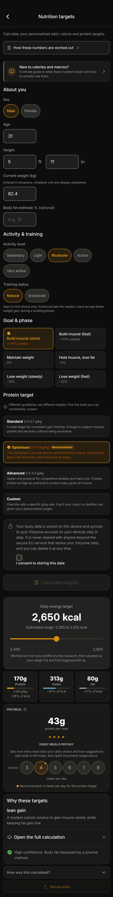 / 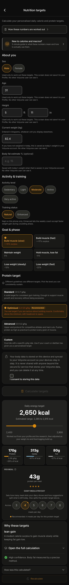, 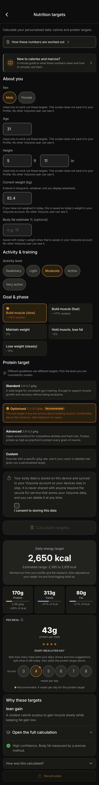, 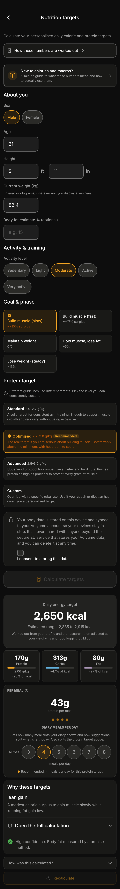, 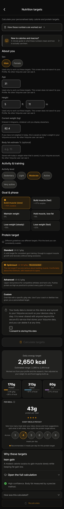, 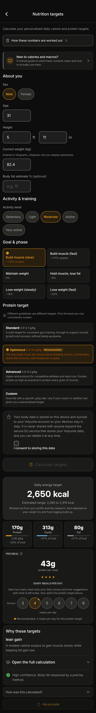. In calm and ED states Training status and its line are absent and "Aggressive cut" is filtered, same as before.

Not changing (calorie-adjacent, stated so you can see where the line is): `calculateNutritionTargets`, `kcalFloorForSex`, FFM floor, rapid-loss gate, energy-availability caution, `strictestBounds`, `floorInputsFromProfile`, `applyChoiceToResults`, `handleCalculate` (its first line `if (!formComplete) return;` already blocks a null sex and is untouched), consent gate, every default other than sex (activity 'moderate' is not touched; see questions). No floor or ED file is edited.

Files: `src/screens/NutritionTargetsScreen.js` only (initial state, `profileLoaded`, prefill guard, two `onSelect`s, summary line).

Safety and privacy: this change can only make the calculation refuse to run until sex is chosen; it removes a path where the male floor and FFM fraction applied by accident. It adds no new input to any engine call. ED states rendered above.

Data, sync, migrations: none. Native: no. Server migration: no.

Tests: new `src/screens/__tests__/NutritionTargetsScreen.noSexDefault.test.js` (4 tests, real screen with the data boundary mocked): neither pill selected and a tap ignored before load; no-sex profile leaves both empty then a tap chooses; male and female profiles show correctly; `'other'` is not shown as a choice. Verified to fail on the old screen: against base `NutritionTargetsScreen.js` 2 of the 4 fail (the two that assert "nothing selected"), the other two pass on both. After: 4 of 4 pass. Existing NT tests: `NutritionTargetsScreen.rangeValidate.test.js` had to change (it never chose a sex and relied on the default; its helper now taps "Male" first); the others (`returnTo`, `energySlider`, guards) pass unchanged. Files: also `src/screens/__tests__/NutritionTargetsScreen.rangeValidate.test.js`.

Effort: S. Risk: Low to Medium. Main risk: a person with a legacy profile now has to tap a pill once on this screen; nothing else changes for anyone whose profile has a sex.

Questions for the owner:
1. "Show nothing": pills visible but unselected (built), or pills hidden until the profile has loaded?
2. This screen still defaults `activity` to 'moderate' and `bfSource` to 'visual' before prefill. Not touched (not sex, and activity feeds TDEE). Want the same "no silent default" treatment there? It is a separate calorie-adjacent change.

---

## F7. "Date of birth" on an age field

Status: Confirmed.

Evidence:
- `src/screens/SettingsProfileScreen.js:288` label "Date of birth".
- `src/screens/SettingsProfileScreen.js:289` sub "Enter your age. Used for calorie floors and nutrition targets."
- The stored value is an age: the comment at `SettingsProfileScreen.js:149-150` says "captured as age everywhere in the app (there is no date picker)".
- No test pins "Date of birth". The only other occurrence in src is a code comment (`src/lib/effectiveMaintenance.js:121`).

Before / After:

| file:line | Before | After |
|---|---|---|
| src/screens/SettingsProfileScreen.js:288 | `Date of birth` | `Age` |

Not changing: the sub line at :289 (already says age), storage, calculations.

Files: `src/screens/SettingsProfileScreen.js:288`.
Safety and privacy: none touched (it is a health-adjacent field label; the wording makes it more accurate).
Data, sync, migrations: none. Native: no. Server: no.
Tests: none pinned. Optional: a source guard that the Profile label reads "Age".
Effort: S. Risk: Low.
Questions: none.

---

## F8. Website still sells Pro

Status: Confirmed. The live pages describe Free and Pro tiers, prices (£2.99/month, £19.99/year), a 14-day trial, Restore Purchases and refunds. The app is fully free (D137, `src/lib/proGate.js` `FULL_ACCESS_FOR_ALL = true`). Nothing in the copy may promise the app stays free.

Evidence and before / after, per file.

### public/index.html (homepage)

| # | file:line | Before (exact) | After (exact) |
|---|---|---|---|
| H1 | :203 | `<p>Log your sessions and, on Pro, your food. The local database on your device is the source of truth.</p>` | `<p>Log your sessions and your food. The local database on your device is the source of truth.</p>` |
| H2 | :255 | `<p class="lead">The training core is free and permanent, a real product on its own. Nutrition and the weekly coaching decision are Pro.</p>` | `<p class="lead">Volyume is free. Training, nutrition and the weekly coaching decision are all included in one app.</p>` |
| H3 | :257-268 (the Free plan card) | kicker `<h3>Free</h3><span class="price">Always free</span>`; `<p class="desc">The training core, permanent.</p>`; list of six items (Full workout logging; Plan library, 31 built-in training plans; Custom plan building; Exercise library, 551 exercises plus your own; Training history; Personal bests and progress tracking) | Single card: kicker `<h3>Free</h3><span class="price">Free</span>`; `<p class="desc">Everything in Volyume, in one app.</p>`; list = the six items above plus the seven Pro items (Nutrition, macros and food diary; Barcode scanning; Over 29,000 UK foods, searchable offline; Meal planning; Progress Scan, a progress score from your own photos; Weekly Precision Coaching, the change-or-hold decision; Advanced progression) |
| H4 | :269-283 (the Pro plan card, `class="plan pro"`) | whole card: `£2.99/month or £19.99/year`, "Everything nutrition and coaching." and its list | deleted |
| H5 | :286-296 (`<!-- TRIAL -->` section "Trying Pro", trial-box, two paragraphs and fine print) | "Start with 14 days of full Pro, no card needed..." and the two paragraphs and "The price Google Play shows at the point of purchase is the one that applies." | whole section deleted |
| H6 | :93 and :102-107 (CSS) | `.plan.pro{...}`; `.trial-box`, `.trial-box p`, `.trial-box p:last-child`, `.trial-box .concise`, `.trial-box .fine` | deleted (dead after H4 and H5). `.plan .price` at :96 stays (used by the Free card). |
| H7 | :357-370 (HTML comment block shipped in the page) | QA notes including "Free: ...", "Pro: ...", `Pricing "£2.99/month or £19.99/year"`, "Google Play price at purchase is authoritative", "Trial wording (14-day cardless in-app + 7-day store offer, up to 21 days, cancel any time)", "barcode scanning is Pro (never free)" | delete the nine lines that name Pro, price, trial or "never free"; keep the rest of the comment |

Kept unchanged on the homepage: the "What it looks like" section, the Steps section, "Privacy: no adverts" style lines, and the `<!-- deploy -->` comment at the foot.

### public/support/index.html

| # | file:line | Before (exact) | After (exact) |
|---|---|---|---|
| S1 | :7 meta description | `Help with Volyume: getting started, Pro subscriptions, billing, your data, and how to contact us.` | `Help with Volyume: getting started, your data, and how to contact us.` |
| S2 | :83 intro | `Help with Volyume — getting started, your Pro subscription, billing, your data, and how to reach us.` | `Help with Volyume — getting started, your data, and how to reach us.` |
| S3 | :88 | `Create an account, answer the onboarding questions about your training and goals, and Volyume builds your plan. The free tier includes the plan library, training builder, workout logging, the exercise library, personal bests, and progress stats.` | `Create an account, answer the onboarding questions about your training and goals, and Volyume builds your plan. Everything in Volyume is free, including the plan library, training builder, workout logging, the exercise library, personal bests and progress stats.` |
| S4 | :89 | `Pro adds the food diary, barcode scanning, smart meal suggestions, nutrition targets and macros, steps, weekly check-ins, and the Precision Coaching adjustments that adapt your plan as you go.` | `It also includes the food diary, barcode scanning, smart meal suggestions, nutrition targets and macros, steps, weekly check-ins, and the Precision Coaching adjustments that adapt your plan as you go.` |
| S5 | :92-99, section "2 Your Pro subscription" | heading `Your Pro subscription`; "Pro is available monthly or annually, and starts with a free trial. You can use everything in Pro during the trial, and you are reminded before it converts to a paid subscription."; two bullets (Monthly, Annual); "Prices are shown in your local currency at the point of purchase. Your subscription is billed by the App Store on iPhone and by Google Play on Android, and managed there." | heading `Subscriptions`; body `Volyume has no subscription and no price to pay. Nothing in the app asks you to pay.` Legacy text is kept only if Q-F8-1 says yes (see below). |
| S6 | :103-109, section "3 Manage, cancel, or change your plan" | "Subscriptions are controlled by the store..."; iPhone and Android bullets; "Refunds are handled by the store: Apple via reportaproblem.apple.com, Google via the Play Store order history." | section deleted. Kept only as legacy text if Q-F8-1 says yes. |
| S7 | :113-115, section "4 Restore a purchase" | "If you reinstall the app or switch devices, open the Subscription screen in Volyume and tap Restore Purchases. ... and Pro will return." | section deleted (no restore screen is registered; Stage 1 34). Kept only as legacy text if Q-F8-1 says yes. |
| S8 | :129, section 7 "Delete your account" | `If you have an active subscription, cancel it in the App Store or Google Play (step 3) so it does not renew.` | `If you have ever paid for Volyume through the App Store or Google Play, cancel it there so it does not renew.` Only if Q-F8-1 says yes; otherwise delete the sentence. |
| S9 | section numbers | 1, 2, 3, 4 are removed or replaced; 5, 6, 7 renumber to 2, 3, 4 | renumber; check "(step 3)" references |

Legacy text (use only if Q-F8-1 = yes), exact:
> If you bought Volyume Pro before it became free, your subscription is managed in the App Store or Google Play: open Settings, tap your name, then Subscriptions, then Volyume on iPhone; or open the Play Store app, tap your profile, then Payments and subscriptions, then Subscriptions, then Volyume on Android. Cancelling stops the next renewal.

### public/privacy.html, public/privacy/index.html, docs/web/privacy.html (three identical copies)

Byte-identical today. Tests require them to stay identical (`memberEmailWebsite.guard.test.js:287`, `privacyTruth.guard.test.js` "three hosted HTML copies"). Apply every edit to all three.

| # | line | Before (exact) | After (exact) |
|---|---|---|---|
| P1 | :160 | `<li>Apple App Store and Google Play for subscription purchases</li>` | Delete the line, if Q-F8-2 says there are no legacy purchases. If there are, keep it unchanged. |
| P2 | :185 | `... Your explicit consent, which you give when you join. Joining a challenge also keeps Volyume free for you for life.` | `... Your explicit consent, which you give when you join. Completing a challenge [rule pending owner Q1] also earns Volyume free for you for life.` |
| P3 | :192 | `We keep one thing after deletion: a one-way hash of your email address, held only to stop the 14-day free trial being restarted by deleting and re-registering. ...` | Owner decision Q-F8-3. Proposed text, if the hash is kept: `We keep one thing after deletion: a one-way hash of your email address, held to [purpose stated by the owner]. It holds no readable email or other personal data, and is never used to contact you or rebuild your account.` If the hash is no longer written, delete the sentence. The code still writes it on deletion (`supabase/migrate_097_deletion_log_anonymise.sql`, `user_email_hash`); this batch does not change that. |
| P4 | :214 | `If we discover an account belongs to someone under 13, we delete the account and refund any active subscription.` | If Q-F8-1 says no legacy subscribers: `If we discover an account belongs to someone under 13, we delete the account.` If yes: keep unchanged. |

Not changing: the default-on Community sharing paragraphs (pinned by privacyTruth.guard.test.js), the Article 9 and consent text, support addresses.

### public/privacy-policy.md (not in the four pages, same sentences; listed for completeness)
- :104 same sentence as P2 (edit identically).
- :73 table row `| Apple App Store / Google Play | Subscription purchases | ... |` follows Q-F8-2.
- :126 same as P4 (follows Q-F8-1).

Safety and privacy (F8):
- No safety rule, calorie, ED or consent text is touched. The privacy copy edits are legal wording, so the owner signs off the legal lines (Q-F8-2 to Q-F8-4).
- The hash line (P3) describes a data-retention step. This batch does not change what is stored.

Data, sync, migrations: none in this batch. Server behaviour for the hash is not changed. Native: no. Server: no.

Tests affected:
- `src/screens/__tests__/privacyTruth.guard.test.js`: forbidden-phrase list (lines 84-97) and default-on Community disclosure (identical copies). New copy must not use "Physique Scan metadata", "Download my data", "RevenueCat", etc. The new copy does not.
- `src/__tests__/memberEmailWebsite.guard.test.js:287`: identity of public/privacy/index.html and the two other copies.
- `src/__tests__/marketingClaimsGuard.test.js:60`: reads public/get/index.html (see item 34 row 14), not the homepage.
- No test reads public/index.html or public/support/index.html.
- Baseline: the suites above PASS on the unchanged tree.

Effort: M (about 40 lines across 4 files plus the mirror). Risk: Medium. Main risk: legal wording in the privacy pages (P1 to P4) and the legacy-subscriber question.

Questions for the owner:
- Q-F8-1: Did any user pay for Pro before it became free (App Store or Google Play subscriptions still active or in the refund window)? (a) No, delete the legacy text in S5 to S8 and P1 and P4. (b) Yes, keep the legacy paragraph and the store and refund lines. Which?
- Q-F8-2: Are there any store purchases left to process? If none, delete the processor line (P1, :73 in privacy-policy.md). If some, keep the line.
- Q-F8-3: The trial-abuse hash (P3): (a) keep it and name its purpose, (b) stop writing it (server change, not in this batch) and delete the sentence.
- Q-F8-4: Refund wording (S6, P4): only needed under Q-F8-1 (b). Confirm the refund wording with the store's current policy, not from this repo.

---

## 2. Same sign-in options on iPhone and Android

Status: Partly confirmed. Code side confirmed. The Supabase dashboard, Google Cloud and Apple Developer state are not readable from the repo, and I cannot read them.

### Evidence
- `src/components/auth/OAuthButtons.js:41` Apple only when `Platform.OS === 'ios'`; `:70` Google only when `Platform.OS !== 'ios'`; comment `:65-69` gives "failed to determine clientID" as the reason.
- `src/lib/supabase.js:574` `GoogleSignin.configure({ webClientId })`, no `iosClientId` anywhere. `:637` `signInWithApple` already falls back to `_signInWithOAuthProvider('apple')` on non-iOS, so Apple-on-Android needs no new app code, only the button and console setup.
- `app.json:254` Google plugin is a bare string, no options.
- No `linkIdentity`, `unlinkIdentity`, `getUserIdentities` or `updateUser` in `src` or `App.js`. `authDeepLink.js:168` `setSession` only signs the person in after a reset link; `AuthSheet.js:262-268` says "request half only".
- `SettingsAccountScreen.js:25` shows only `user?.email || 'Signed in'`.
- Installed supabase-js is declared `^2.43.4` (`package.json:85`). `node_modules` is the main checkout's, so I did not verify the installed minor. Check the installed version has `linkIdentity` and `unlinkIdentity` before building (INFERRED they exist in 2.4x; `getUserIdentities` may be later, and `user.identities` from `getUser()` is the fallback).

### Owner answers implemented
- "(a) Apple on Android plus linking." Apple button on Android; Google button on iPhone; both everywhere.
- "(b) rely on Supabase automatic linking for same verified email; report the current dashboard setting; for a different email (Apple relay) show on sign-in screen: 'If you signed up with Apple, use Apple to sign in.'"
- "Owner does all three setups." Steps below.
- "Yes: reset link lets people set a new password (new screen + updateUser)."
- "Yes, remove a method, never the last."

### Dashboard setting: what I can and cannot say
I cannot read the Supabase dashboard auth settings, so whether same-email automatic linking is on for this project is NOT CONFIRMED. The repo has no auth config file (`supabase/` holds migrations only). INFERRED from Supabase's documented default only: a sign-in whose provider returns the same verified email attaches to the existing user. The owner checks it in Supabase dashboard > Authentication > Sign In / Providers (the "User Signups" / account linking area; wording moves, so look for "Allow manual linking" and any automatic-linking note) and on each provider's page for "Confirm email". Manual linking (needed for the Sign-in methods section) is a separate switch, "Enable manual linking" in the same Authentication settings.

### Before and after: screens (annotated wireframes)
Before, iPhone sign-in sheet (`AuthSheet.js` via `OAuthButtons`):
```
[ Continue with Apple (native white button) ]
[ Continue with email ]
```
Before, Android:
```
[ G  Continue with Google ]
[ Continue with email ]
```
After, both platforms (prototype, `OAuthButtons.js`):
```
[ Continue with Apple ]        (native button on iPhone, styled button on Android)
[ G  Continue with Google ]
If you signed up with Apple, use Apple to sign in.     (muted caption, new `note` prop, passed by AuthSheet)
[ Continue with email ]  /  Forgot your password?
```
Prototype note: `type.caption` is not confirmed to exist in `theme.js`; the real build must pick an existing type token (`docs/rules/styling.md`). The same component is used by `ProOnboardingScreen.js:2518` (account step) and dormant `ProUpgradeScreen.js:572`; both inherit both buttons, so the onboarding account step also changes. The `ProUpgradeScreen.oauth.guard` regex still passes.

### Before and after: strings
| Where | Before | After |
|---|---|---|
| `OAuthButtons.js:41,70` | Apple iOS only, Google non-iOS only | both on both |
| AuthSheet, under the buttons (new) | none | "If you signed up with Apple, use Apple to sign in." |
| `SettingsAccountScreen.js` new section | none | "Sign-in methods": rows "Apple", "Google", "Email and password", each "Connected" or "Connect"; "Disconnect" on a connected row |
| Disconnect when only one left | n/a | row shows no Disconnect; sub text "This is your only way to sign in." |
| Disconnect confirm (new) | n/a | title "Disconnect Google?" body "You will no longer be able to sign in with Google. You can connect it again later." buttons "Cancel" / "Disconnect" |
| New screen "Choose a new password" | none | title "Choose a new password"; fields "New password", "Confirm new password"; button "Save password"; success toast "Password saved."; error "That did not work. Try again, or request a new link." |

Sign-in methods wireframe (Account):
```
Sign-in methods
  Apple              Connect
  Google             Connected    Disconnect
  Email and password Connected    (only method? then no Disconnect)
```
Linking mechanics (INFERRED, verify against installed supabase-js): `supabase.auth.linkIdentity({provider})` uses the browser OAuth flow, so linking Google on an iPhone goes through web OAuth, not the native sheet. Unlink is `unlinkIdentity(identity)`; Supabase itself refuses when only one identity remains, and the UI also hides the button. Email as a method is added with `updateUser({ email, password })`, which sends a confirmation mail (not linkIdentity).

Set-new-password screen (prototype not built, outline): opened from the recovery deep link once `authDeepLink.js:168` has signed the person in (`action: 'signedIn'` with the recovery kind from `authCallbackState`, :127-145). The handler routes to the new screen instead of Home; the screen calls `supabase.auth.updateUser({ password })`. It must stay behind RootNavigator's consent gate and must not be reachable without a session. Use existing password rules from `EmailPasswordFields.js`. Lib wrapper in `supabase.js`, never a screen calling the client directly.

### Phone-switch scenarios: today vs proposed
| Scenario | Today (function) | Proposed |
|---|---|---|
| Google on Android, now iPhone | iPhone shows Apple + email (`OAuthButtons.js:41,70`). No Google. Reaches the account only by Apple returning the same real email AND the project auto-linking (NOT CONFIRMED), else a new empty account | Google button on iPhone (`signInWithGoogle` with `iosClientId`). Same Google account, same user. Needs owner Google iOS setup |
| Apple, real email, iPhone, now Android | Google + email only. Reaches the account only if Google returns the same email and auto-link is on | Apple button on Android (`signInWithApple` -> `_signInWithOAuthProvider('apple')`). Same Apple identity, same user. Needs Apple Services ID setup |
| Apple "Hide my email", iPhone, now Android | No route. Google returns a different email, so a separate empty account | Sign in with Apple on Android gives the same Apple identity (the relay address is stable per app/team), so same account. Note under buttons tells people to use Apple. If they have already made a second Google account, auto-linking cannot merge it (different email). Not solved, see question 1 |
| Email account, either phone | Email form works. Reset link signs them in, no way to set a password | Same, plus the set-new-password screen after a reset link |
| Apple or Google account asks "Forgot password" | Reset email goes nowhere useful (INFERRED, no password) | Unchanged. Note under buttons is the only cue |
| Signed in, wants a second method | Not possible | Account > Sign-in methods > Connect (`linkIdentity`), needs manual linking enabled. Gives one user with several methods, which is also how an Apple-relay person can add Google or email on the phone they still have |

Honest limit: nothing in the app can merge two accounts that already exist. A person who made a second empty account before this change keeps two accounts. Linking works only from a signed-in session.

### Owner setup steps (exact; none done by me)
Dashboard names move, so match by label.
1. Google iOS client ID (Google Cloud Console, project that holds the existing web client)
   1. APIs and Services > Credentials > Create credentials > OAuth client ID > Application type iOS.
   2. Bundle ID `app.volyume` (`app.json:24`). Save; copy the iOS client ID and the "iOS URL scheme" (reversed client ID, `com.googleusercontent.apps.<id>`).
   3. Give me the iOS client ID and URL scheme. I put the client ID in `GoogleSignin.configure({ webClientId, iosClientId })` (`supabase.js:574`) and the scheme in `app.json` as the plugin option `["@react-native-google-signin/google-signin", { "iosUrlScheme": "<scheme>" }]` (native change).
   4. Supabase dashboard > Authentication > Sign In / Providers > Google > "Authorized Client IDs": add the iOS client ID after the web client ID, comma separated. Keep the nonce setting as it is today (INFERRED: the native sheet and `signInWithIdToken` need the client ID listed; verify against current Supabase Google docs).
2. Apple Services ID and key for Android (Apple Developer account)
   1. Identifiers > register a Services ID (for example `app.volyume.signin`), enable Sign in with Apple, Configure: primary App ID the existing `app.volyume`; Domains `<project-ref>.supabase.co`; Return URL `https://<project-ref>.supabase.co/auth/v1/callback`.
   2. Keys > create a key with Sign in with Apple enabled for `app.volyume`; download the `.p8` once; note Key ID and Team ID.
   3. Supabase > Authentication > Providers > Apple: enable; Client IDs = existing iOS bundle ID `app.volyume` plus the Services ID; paste the generated client secret (JWT built from the .p8, Key ID, Team ID, Services ID). INFERRED from Supabase docs: this secret expires after at most 6 months, so the owner needs a recurring reminder to regenerate it. If it lapses, Apple sign-in fails on Android only (the native iPhone path uses the ID token and is not affected, INFERRED).
   4. Supabase > Authentication > URL Configuration: confirm `volyume://` is in Redirect URLs (the Google web flow comment at `supabase.js:477-481` already assumes it).
3. Supabase identity linking
   1. Authentication settings: check and report the current automatic-linking behaviour (I cannot read it).
   2. Turn on "Enable manual linking" (needed for `linkIdentity`/`unlinkIdentity`).
   3. Confirm email confirmation is required for email sign-ups; automatic same-email linking is only safe when providers return verified emails.
   4. Tell me what you see before I build.

### Native/config flags
| Change | Native? |
|---|---|
| Google on iPhone: `iosUrlScheme` plugin option in `app.json` | YES, config change, needs a new iOS build |
| `iosClientId` in `GoogleSignin.configure` | JS only, but useless without the build above |
| Apple on Android | No native code. Button + owner console only. Ships OTA once the runtime matches |
| Sign-in methods section, new password screen | JS only |
| Supabase and provider settings | Dashboard, not repo |

### Not changing
Consent gate order, identity lock (no anonymous, sign-out wipe), `user_id` never mutated by linking, Apple button stays on iPhone (Guideline 4.8), email/password stays, `AUTH_COPY.duplicate`.

### Files
`src/components/auth/OAuthButtons.js`, `AuthSheet.js`, `src/screens/SettingsAccountScreen.js`, `src/lib/supabase.js`, `src/lib/authDeepLink.js` (route recovery to the new screen), new `SetNewPasswordScreen.js` + registration, `app.json`, the stale comment at `ProOnboardingScreen.js:2511-2515`.

### Safety and privacy
Consent gate untouched (all new paths land in RootNavigator). Identity lock kept. EU residency: token exchange with Supabase Dublin only; Apple and Google are the identity providers already used. No telemetry events added. Calorie/ED/calm rules not touched. No new dependencies.

### Data, sync, migrations
No local schema, no sync change, no migration. Auth settings are dashboard-only.

### Native code: yes (iOS plugin option only). Server migration: no.

### Tests
- Changed in the prototype: `src/components/auth/__tests__/authForm.test.js` "iOS hides Google (no iOS client id) and keeps Apple" now asserts Google IS shown on iOS. This test pins the old rule, so it is a pinned-test change for the owner's approval. It is not a founder-rule test (no CLAUDE.md rule covers it).
- New tests needed: Android shows Apple; the note renders; Sign-in methods hides Disconnect with one identity; set-new-password calls `updateUser` and handles errors; deep link recovery routes to the new screen only with a session.
- Run: the four suites above pass (614).

### Effort, Risk
Effort L (three owner setups + linking UI + new screen). Risk Med-High: wrong linking rules can strand accounts that hold health data; the Android Apple flow has not been run on a device.

### Questions for the owner
1. A person who already has two accounts (Apple relay on iPhone, new Google on Android) cannot be merged by this plan. Accept that, or add a manual merge request path later?
2. After a reset, should the new-password screen also appear for an Apple/Google-only account that requests a reset (no password yet), or only for accounts that already have a password?
3. Device check before shipping: Apple on Android is unproven on a real phone. Do you want it gated behind a remote flag, or ship straight?

---

## 03. Training-focus step (relabel only), plus the "Step 0 of 5" draft-resume risk

Status: Confirmed. The relabel is one string. The "Step 0 of 5" risk is confirmed by a render and a unit test; how often a person can reach it is not established (see Evidence, last bullet).

Owner answers implemented (quoted from ANSWERS.md): "Full setup from 'Set up coaching'; chip label 'Training focus'; protein stays after category; keep dropdown; no split. Also confirm the 'Step 0 of 5' risk when a full-setup draft resumes through coaching mode; propose the smallest fix (draft per mode, or clamp step to the mode's steps)."

Evidence:
- Chip text is `STEP_LABELS[step - 1]` (POS:365), printed by `ProOnboardingHeader` (POS:385-388). Internal step 7 is `'Targets'` at POS:132. Pinned by `ProOnboardingScreen.communityStep.guard.test.js:50` (the exact array).
- Coaching header number is `COACHING_STEPS.indexOf(step) + 1` with `COACHING_STEPS = [2, 3, 4, 7, 8]` (POS:361, 386). Any step not in that list prints 0.
- Coaching mode restores a draft with `setStep(s => Math.max(s, ... resumeStep))` (POS:1059 at base). The draft key is per user, not per mode (`proOnboardingDraft.js:21`, `draftKey`), and a full-setup run saves drafts for steps 2 to 7 (`MIN_STEP 2`, `MAX_STEP 7`, draft file :31-32).
- Coaching mode never leaves step 4 for 5: Continue from 4 goes to 7 (POS:1387 at base, 1392 on the branch), Back from 7 goes to 4 (POS:1105 at base, 1110 on the branch). So a restored step 5 or 6 is outside the mode's own flow, and Continue from it would walk through "Your gym" (with the Community join choice) and "Injuries" screens that coaching setup is meant to skip.
- Concrete repro, rendered (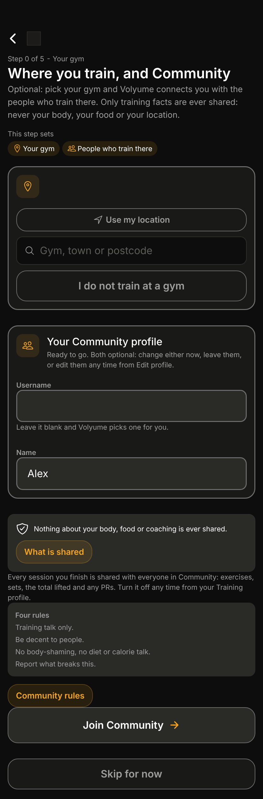): sign in as a person with a saved full-setup draft parked on step 5 (answers for steps 2 to 4 present), open `CoachingSetup` (route `mode: 'coaching'`, RootNavigator:727). Header reads **"Step 0 of 5 - Your gym"** above "Where you train, and Community". Same draft parked on step 6 gives "Step 0 of 5 - Injuries & limitations" (reproduced by the unit test's arithmetic, not separately rendered). Drafts parked on 2, 3, 4 or 7 print correctly in coaching mode.
- How a person gets there (OBSERVED vs not): `StartChoiceScreen` sends anyone with a saved draft straight to the full `ProOnboarding` (StartChoice:70-79) and `quickStart` is only reachable from the choice screen, so a draft and a completed first run together need a path I did not find. I could not name a user journey that produces it today. The code allows it, the render proves the symptom when it happens, and the clamp costs one line. Treat it as a latent defect, not an observed one. Not confirmed on a device.

Before: step 7 chip reads "Step 6 of 7 - Targets" (full, adult), "Step 5 of 6 - Targets" (under 18), "Step 4 of 5 - Targets" (coaching). Title "Set your training focus" is unchanged underneath.

After: same numbers, chip "Training focus". Per the owner's order nothing else on the step changes (order, dropdown, protein collapsible, no split).

String table:

| Where | Before | After | file:line (before to after) |
|---|---|---|---|
| Step 7 chip label | `Targets` | `Training focus` | POS:132 to POS:133 (`STEP_LABELS`) |
| Guard test pin | `... 'Injuries & limitations', 'Targets', 'Check-in rhythm'` | `... 'Injuries & limitations', 'Training focus', 'Check-in rhythm'` | `ProOnboardingScreen.communityStep.guard.test.js:50` |

Side effect to flag: the chip now reads "Step 6 of 7 - Training focus" directly above the title "Set your training focus", so label and title say the same thing. That follows from the owner's chosen label; if it reads as repetition on device, the title could change instead (question 1).

Renders, step 7 (both rendered at the same state, only the chip differs; `03-before-*` and `03-after-*`):
- Non-competitor (`trainingGoal: 'general'`): 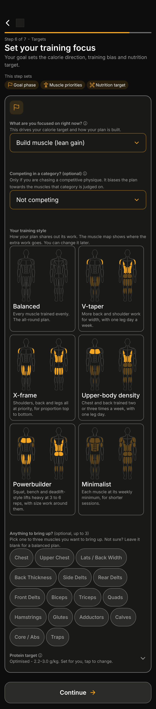, . Shows the style picker ("Your training style") because a non-competitor has one.
- Competitor (`classic_physique`): 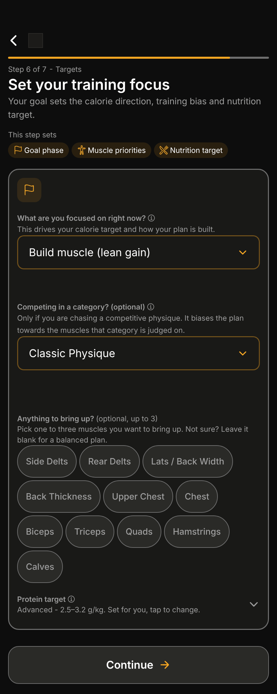, . No style picker (hidden for a competing category, POS:775), bring-up chips shown.
- Coaching mode, clean path (draft on step 7): 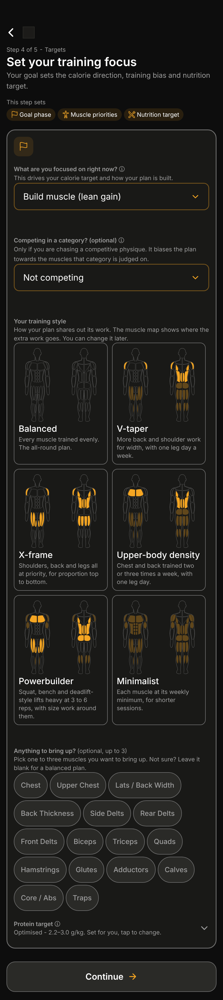, 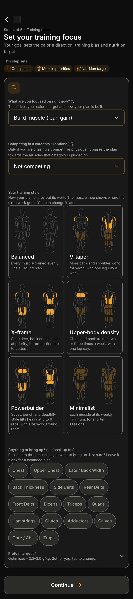 ("Step 4 of 5 - Targets" to "Step 4 of 5 - Training focus").
- Coaching mode, full-setup draft on step 5:  ("Step 0 of 5 - Your gym") and  ("Step 4 of 5 - Training focus", resumed on step 7).

Fix options for the draft risk, compared:

| | Draft per mode | Clamp the resumed step (prototyped) |
|---|---|---|
| Change | `draftKey(userId, mode)` adds a mode suffix; every caller (`StartChoiceScreen` resume check, `clearDraft` at POS:2397, `saveDraft`/`loadDraft`, `loadBuildProgress` pairing) passes the mode; a completed coaching run must clear both keys | One pure helper `clampResumeStep(step, modeSteps)` (`proOnboardingDraft.js`), one wrapper at the restore that clamps the loaded draft's step before the existing minor and sex-gate lines run (POS:1006-1011 on the branch) |
| Size | About 6 files plus tests; the build-progress record (`BUILD_KEY_PFX`) is keyed the same way and would need the same split | 1 helper, 1 changed line, no storage change |
| Effect on a parked full draft | A full draft is invisible to coaching setup: the person answers steps 2 to 4 again | Answers for steps 2 to 4 are reused (they are in the draft), and the person lands on step 7 |
| Existing stored drafts | Old keys have no mode, so they need a migration rule or are orphaned | No change to storage, nothing to migrate |
| Risk | Medium: StartChoice's "has a draft, skip the choice" check and the cleanup both depend on the key | Low: the sex-gate clamp (POS:1065, `Math.min(resumeStep, 2)` when sex is invalid) and the minor-on-step-5 rule are kept as they were |

Prototype (clamp): `clampResumeStep(5, COACHING_STEPS)` and `(6, ...)` return 7; steps already in the list are unchanged; beyond the last step it holds the last step; an empty or missing list changes nothing. Applied only when `coachingMode`.

Not changing: step order, the category dropdown, protein after category, the "This step sets" chips, telemetry step numbers, `TOTAL_STEPS = 8`, the draft ceiling, the sex gate, minor rule, Community step.

Files: `src/screens/ProOnboardingScreen.js` (label, resume line, import), `src/lib/proOnboardingDraft.js` (helper), `src/screens/__tests__/ProOnboardingScreen.communityStep.guard.test.js` (pin moves with the label).

Safety and privacy: none touched. No calorie floor, ED logic or consent gate is read or changed. The sex-gate clamp on restore is kept (pinned in the new test).

Data, sync, migrations: no schema, no sync, no telemetry change (`onboarding_step_viewed` still carries the internal step number, schema untouched). Native code: no. Server migration: no.

Tests:
- Existing, updated: `ProOnboardingScreen.communityStep.guard.test.js` (label pin only; the `resumeStep` pin at :247 is untouched).
- New: `src/lib/__tests__/proOnboardingDraft.coachingResume.test.js` (8 tests): the header arithmetic "Step 0" repro for steps 5 and 6, every draftable step 2 to 7 resumes on a step coaching runs, 5 and 6 go forward to 7 never back, the call is gated on `coachingMode`, the sex-gate clamp is still present, the label is "Training focus".
- Pinned founder-rule lines: `proOnboarding.sexGate.test.js:61-62` and `ProOnboardingScreen.communityStep.guard.test.js:247` pin the minor-on-step-5 line and the sex-gate `setStep` line verbatim. My first version rewrote the first of them and the full run caught it (1 failing guard). I changed the design, not the tests: the clamp now wraps the loaded draft before those lines, so both pinned lines are byte-for-byte unchanged and the sex clamp stays last. Both pass.
- Result: new test file 8 of 8 pass; both guards pass; 28 suites, 255 tests pass in the final targeted run (list in the record below).

Effort: S (relabel plus clamp). Risk: Low. The clamp is the only logic; the main risk is none beyond the pinned test moving.

Questions for the owner:
1. Label and title now both say "training focus" on one screen. Keep both, or change the title (for example "What are you focused on?")?
2. Clamp (prototyped, recommended by size only, your call) or draft per mode?
3. Where a draft is parked on step 5 or 6 and resumed through coaching: land on step 7 (prototyped), or on step 4 so the person reviews their training week first?

---

## 04. Sensitive questions: one "who can see this" line under every field

Status: Confirmed for wording. Owner answer quoted: "Every sensitive field in setup, Profile and Nutrition Targets. No 'Prefer not to say'. Each 'who can see this' line written from the actual sync behaviour." Sex stays two options, required, no default.

Which fields (all of them, per answer 1(a)): setup sex, age, height, body weight, body fat; Profile sex, height, "Date of birth" (age); Nutrition Targets sex, age, height, weight, body fat (each in both the quick card and the full form). Training status (NT:1265-1273 at base) already carries "Kept on this phone only." and is left as it is (below). Cycle tracking is on Settings > Coaching, outside the three screens named, so not touched.

### What syncs where (file:line proof)

| Field | Where it goes | Proof | Who can read the cloud copy |
|---|---|---|---|
| Sex | Cloud `user_body_profile.sex` and `profiles.sex`; the profile blob also travels with the preference sync | `sync.js:1559-1560` (`sex: p.sex ?? null`); `sync/tables/profiles.js:39` (`['sex','sex']`), `:64` (`_validSex`), `:253-256` (never unsets); `sync.js:1880-1884` (`@volyume_user_profile_` is a synced pref) | Own-row policies: `migrate_007_pro_rls_hardening.sql:30,51-52` (`user_body_profile`), `migrate_005_rls_hardening.sql:32-33` (`users_profile`) |
| Age | Saved as a date of birth worked out from the age (`dateOfBirthFromAgeYears`) to `user_body_profile.date_of_birth`; the profile blob's `age` also syncs | `sync.js:1562`; SP:169; POS:2110 ff. | same |
| Height | `user_body_profile.height_cm` and the profile blob | `sync.js:1563`; SP:144 | same |
| Body weight | `body_metrics.body_weight` (365-day push window) | `sync/tables/bodyComposition.js:84`, `:40` (`PUSH_WINDOW_DAYS`); setup writes it at POS:2086-2095 | `migrate_005_rls_hardening.sql:161-162` |
| Body fat % | `body_metrics.body_fat_percent`, `body_fat_source` | `bodyComposition.js:94-95` (`body_fat_percent`, `body_fat_source`) | same |
| Training status | Phone only: secure store, "never sent to the cloud, Sentry, analytics, the coach report or any share card" | `src/lib/trainingStatus.js:2-8` (file header), `KEY` :25 | n/a |
| Cycle tracking (outside the 3 screens) | Phone only, AsyncStorage, "Not synced to the cloud" | `src/lib/cyclePrefs.js:12-14` | n/a |
| Community / share cards | Weight, body fat, height and age are on the refusal list that Community checks before any write and again in SQL | `community/validation.js:65-68` (`SENSITIVE_COMMUNITY_KEYS`). Sex is NOT on that list; no code under `src/lib/community` or `src/lib/shareCard` reads sex (grep, non-test files) | n/a |
| Nutrition Targets inputs (sex, age, height) | Used to calculate and not written back by this screen: NT imports no `saveUserBodyProfile`, `saveLocalProfile` or `setUserProfile`; the saved targets row holds numbers only | NT save paths :683, :868 (`saveNutritionTargets`); `database.js:7682-7697` (INSERT lists bmr, tdee, kcal, macros, phase, goal, no sex/age/height) | targets row: `migrate_009_nutrition_targets.sql:39-42` |
| Nutrition Targets weight and body fat | If there is no weigh-in for today, written as today's weight and body fat to the body-metric log | NT:887-900 on the branch (`logBodyMetric`, guarded by `hasToday`) | as body weight |

What I did NOT verify and so did not write: that nobody at Volyume or Supabase can technically read these rows (the service role bypasses row policies by design). So the lines say "No other Volyume user can see it", which is exactly what the row policies and the Community refusal list establish, and nothing broader. If you want "only you", that is a stronger claim that needs your say-so (question 2).

### Wording (all strings new except where marked)

Shared in one new file `src/lib/sensitiveFieldNotes.js` so the three screens cannot drift and one test can guard them. Static copy: it never reads safety state and is the same in normal, calm and open-ED-flag states.

| # | Where | Before | After (line added under the field) | file:line (before to after) |
|---|---|---|---|---|
| 1 | Setup, sex | hint above: "Used by the calorie formula and safety floors. This stays private." | hint above: "Used by the calorie formula and safety floors." plus under the pills: "Saved to your Volyume account so it comes back if you change phone. No other Volyume user can see it." | POS:2602 to POS:2607, new line POS:2616 |
| 2 | Setup, age | hint: "Used with your height and weight to set your calorie targets." (kept) | plus: "Saved to your account as a date of birth worked out from your age, so it comes back if you change phone. No other Volyume user can see it." | POS:2615 (kept at :2621), new POS:2633 |
| 3 | Setup, height | hint: "Used with your weight and age to set your calorie targets." (kept) | plus: "Saved to your Volyume account so it comes back if you change phone. No other Volyume user can see it." | POS:2631 (:2638), new POS:2693 |
| 4 | Setup, body weight | hint: "This sets your starting trend and first calorie target. Update it from Today once setup is complete." (kept) | plus: "Saved with your weight history in your Volyume account. No other Volyume user can see it." | POS:2691 (:2699), new POS:2757 |
| 5 | Setup, body fat | hint: "Enter your best current estimate or a measured value. Leave it blank only if you genuinely do not know." (kept) | plus: "Saved with your weigh-ins in your Volyume account. No other Volyume user can see it." | POS:2807 (:2816), new POS:2845 |
| 6 | Profile, sex | sub: "Used for calorie floors and nutrition targets. Changes apply on your next weekly check-in." (kept) | plus under the chips: line 1 | SP:242 (:243), new SP:263 |
| 7 | Profile, height | sub: "Used for calorie floors and nutrition targets." (kept) | plus: line 3 | SP:270 (:272), new SP:283 |
| 8 | Profile, "Date of birth" | sub: "Enter your age. Used for calorie floors and nutrition targets." (kept) | plus: line 2 | SP:289 (:292), new SP:296 |
| 9 | NT, sex (quick and full) | none | "Used only to work out these targets. This screen does not save it to your Profile. No other Volyume user can see it." | new NT:1098, NT:1193 |
| 10 | NT, age (quick and full) | none | same sentence as 9 | new NT:1103, NT:1200 |
| 11 | NT, height (quick and full) | none | same sentence as 9 | new NT:1113, NT:1212 |
| 12 | NT, weight (quick and full) | only "Entered in kilograms, whatever unit you display elsewhere." (kept, NT:1115, :1212 at base) | plus under the field: "If you have not weighed in today, this is saved as today's weight in your Volyume account. No other Volyume user can see it." | new NT:1131, NT:1232 |
| 13 | NT, body fat (full form only; the quick card has no body-fat field) | none | "Saved with today's weight when that is saved, in your Volyume account. No other Volyume user can see it." | new NT:1246 |
| 14 | NT, training status | "Kept on this phone only. Enhanced lets the weekly coach accept faster weight gain during a building phase." | unchanged; already says who can see it, and the field stays hidden under calm mode or an open ED flag | NT:1265-1273 base |

Observation on 6 to 8: the Profile row labelled "Date of birth" takes an age. That mismatch is F7, a separate item for another batch; I left the label alone and wrote the age line so it reads right either way.

Observation on 9 to 11: three identical sentences in a row on the quick card is repetitive (see render). One shared line under the Height field of that card would read lighter, but the answer says "every sensitive field", so I kept one each (question 1).

The existing consent card on the quick card (NT:1131 at base, "Your body data is stored on this device and synced to your Volyume account ... never shared with anyone beyond the secure EU service that stores your Volyume data") already states the same thing in general terms; the new lines are consistent with it and do not repeat the EU wording. Sentry/telemetry: not part of any line (no value of these fields goes there; `sentryScrub` untouched).

Renders (normal state; helper lines are static so calm and open-ED-flag differ only by what the screen already hides):
- Setup baseline (sex, age, height, weight): 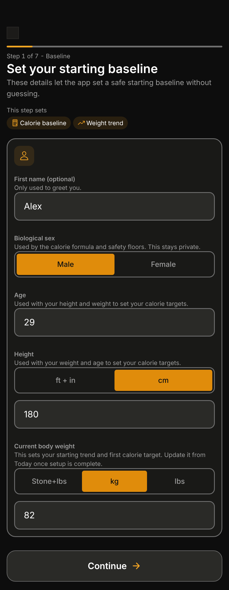, 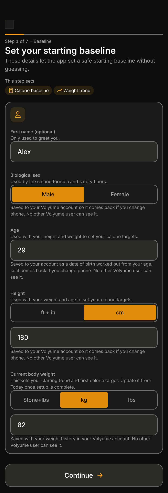.
- Setup body composition (body fat): 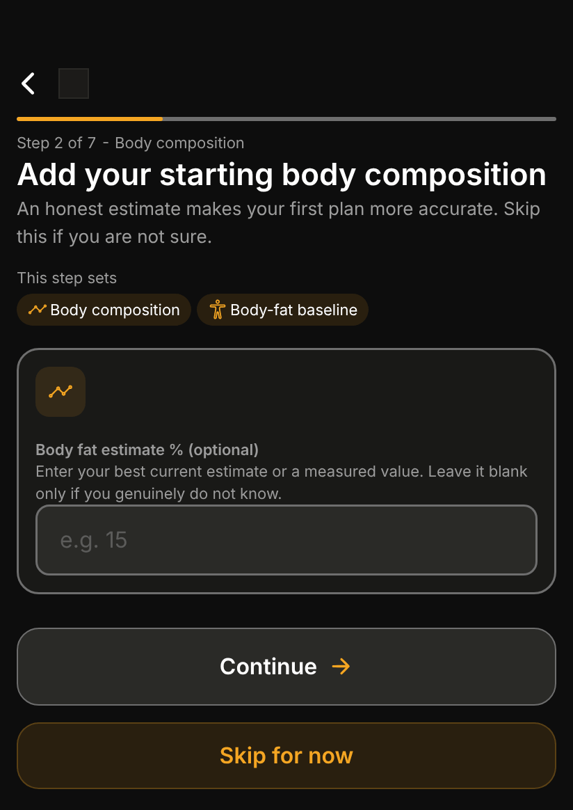, 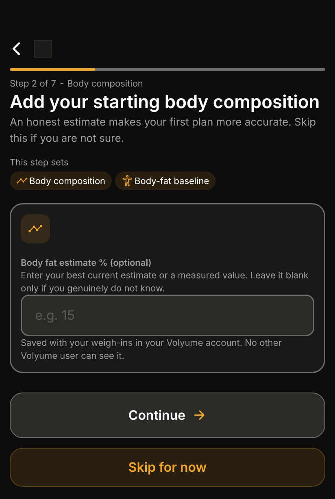.
- Settings Profile: 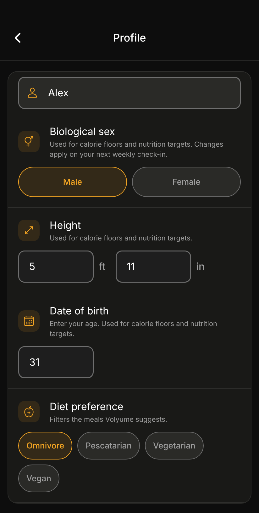, 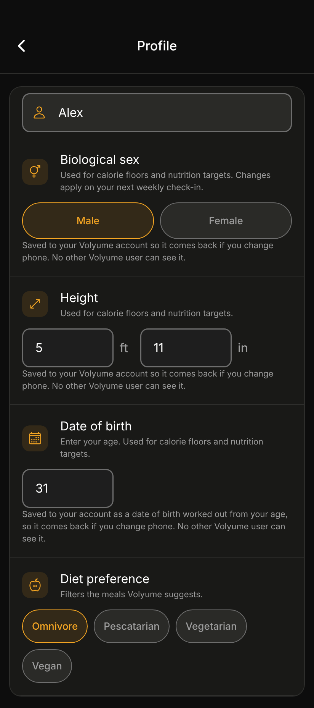.
- Nutrition Targets quick card (fresh account): 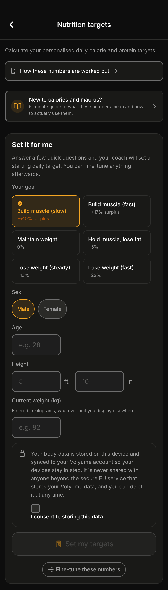, 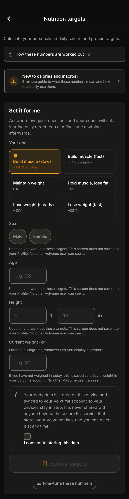.
- Nutrition Targets full form (persona, "Adjust" pressed): , .
- Calm and open-ED-flag renders of the full form are under F6 (, , , ); in both, "Training status" and its line are hidden exactly as before, and the new lines are present.
- Maximum accessibility text size: the harness renders at the default size only. A line of two to three short sentences under each field will wrap to more lines at the largest size; this needs the phone pass in the checklist.

Not changing: "Biological sex" stays two options with no "Prefer not to say" (the unknown-sex path is not defined end to end; Stage 1 table stands), required, no default; the "used for" hints; consent gate; training status line; Settings > Coaching cycle line.

Files: new `src/lib/sensitiveFieldNotes.js`; `src/screens/ProOnboardingScreen.js`, `src/screens/SettingsProfileScreen.js`, `src/screens/NutritionTargetsScreen.js` (render the lines, add one `sensitiveNote` style each).

Safety and privacy: no calorie floor, FFM floor, ED logic or consent gate read or changed. The new copy is static, never reads tier or safety state, no em dash (guarded), British English. The lines make privacy claims, so each one is pinned to the code it describes by `sensitiveFieldNotes.test.js` (a future change to what syncs fails the test instead of leaving a false line). Calm mode: unchanged.

Data, sync, migrations: none. Native: no. Server migration: no.

Tests: new `src/lib/__tests__/sensitiveFieldNotes.test.js` (10 tests, all pass): no dash, every line says who can see it, each field renders its line (NT: 2 of each in quick and full, body fat once), and the claims hold (user_body_profile push carries sex, date_of_birth, height_cm; body_metrics carries weight and body fat; Community refusal keys; NT never writes the profile; the targets INSERT holds no sex, age or height). No existing test changed for this item (`This stays private.` is not pinned anywhere).

Effort: S. Risk: Low (copy), with one real risk: a privacy line that stops being true. Mitigated by the claim tests.

Questions for the owner:
1. One line under every field (as built, three repeats on the NT quick card), or one shared line on that card?
2. "No other Volyume user can see it" is what the code proves. Do you want the stronger "Only you can see it"? That would need your confirmation about who at Volyume or Supabase can read rows.
3. Age line says "worked out from your age". Keep that detail, or the same plain sentence as sex and height?

---

## 06. Autonomy: Coached copy (wording only), and the "dead" deload branch

Status: Coached copy confirmed wrong and fixed in the prototype. **The deload branch is NOT dead; removal not done, report below.**

Owner answer quoted: "Leave control, keep choices, Manual as today. Coached copy 'Your coach applies each week's changes for you' is wrong: changes apply only when the Coaching decision screen is opened; propose matching wording. Remove dead deload branch CoachOutputScreen.js:2630 with a test showing behaviour unchanged."

### Copy

Evidence: the auto-apply is a `useEffect` on the Coaching decision screen (`CoachOutputScreen.js:2616-2680` at base; the screen title is "Coaching decision", :3156), gated on `output`, `user.id`, no apply in flight, no open hold (`output.autoApplyHoldActive`), and the current or last-reviewed week only (:2622-2631). No other caller found.

| Where | Before | After | file:line |
|---|---|---|---|
| Settings > Coaching, Autonomy, Coached chosen | "Your coach applies each week's changes for you. Anything safety-related still waits for your confirmation." | "Your coach applies each week's changes when you open your Coaching decision. Anything safety-related still waits for your confirmation." | SC:236 to SC:238 |
| Guard test | `toContain("Your coach applies each week's changes for you.")` | `toContain("Your coach applies each week's changes when you open your Coaching decision.")` and `not.toContain("changes for you.")` | `CoachOutputScreen.d16Autonomy.guard.test.js:163` |

Checked and left alone (still true): Collaborative "Your coach suggests each change. You tap to apply it." and Manual "Your coach shows each change and the reason. You make the change yourself." (SC); the Manual footer "Change modes in Settings, under Coaching." (CoachOutputScreen:2975); `MethodologyScreen.js:119` "Unless you have chosen Coached mode in Settings, every change it suggests waits until you accept it" (true: Coached applies on opening, and holds still wait).
Render: 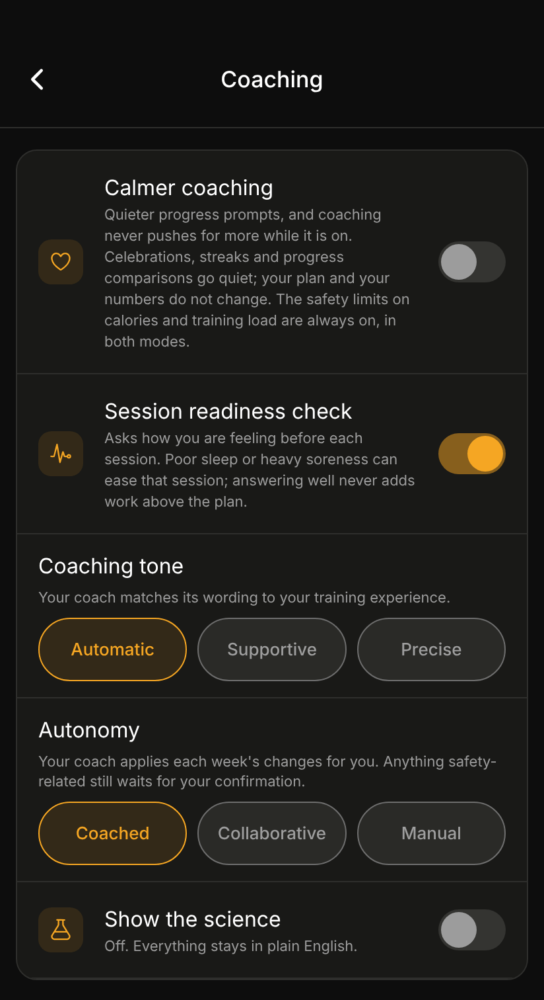, 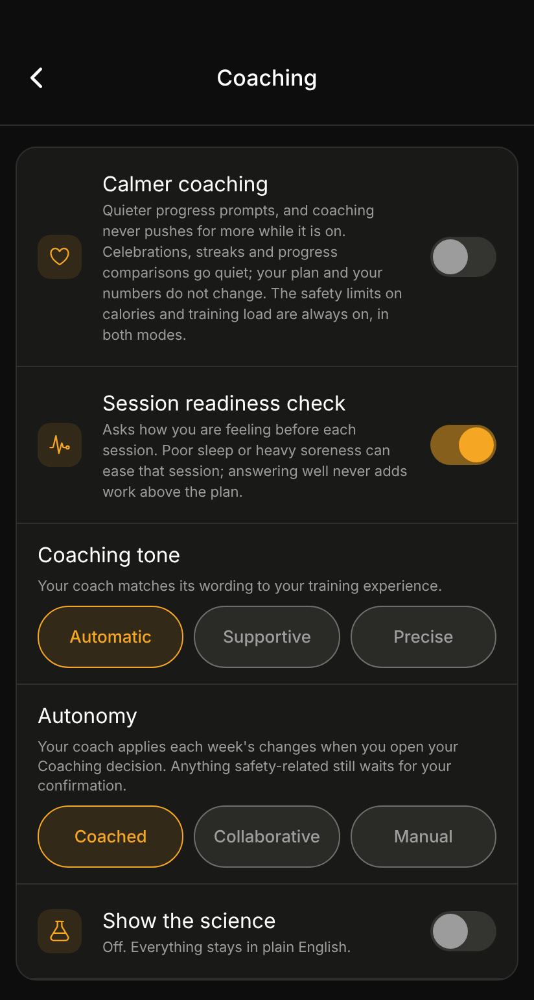 (persona with `coachAutonomy: 'coached'`).
Why "open your Coaching decision" and not "open the Coach tab": the effect lives in CoachOutputScreen only; the Coach tab itself does not apply anything. If you prefer, "when you open this week's Coaching decision".

### The deload branch (STOP: contradicts Stage 1)

Stage 1 said `deloadSuggested` is in the hold list (`weeklyCoach.js:2201-2211`), so `if (output.deloadSuggested)` at CoachOutputScreen:2630 (2652 at base HEAD; the brief's :2630 is the older number) can never be reached in Coached mode. That is true of the engine's own output and false of what the screen holds:

- `CoachOutputScreen.js:2174-2178` (base): after `runWeeklyCoach` returns, on an **authored plan** (`isActivePlanAuthored`) the screen overwrites `result.deloadSuggested = !!triggers?.suggested` and `result.deloadNote`. It does not touch `result.autoApplyHoldActive`, which the engine computed without knowing about this override (`weeklyCoach.js:2201-2211`).
- `result` is what becomes `output` (`setOutput(persistedResult)`, :2406).
- So for a Coached person on an authored plan whose reduction triggers fire, `output.deloadSuggested === true` and `output.autoApplyHoldActive === false`: the effect reaches line 2652 and calls `handleApplyDeload()`. That is live behaviour, and it is a deload being auto-applied, the one thing the Settings copy and the D16 comment ("deload forces confirm-first") say never happens.

So "remove the dead branch, behaviour unchanged" cannot be done as written: removing it changes what Coached users on authored plans experience (the deload would no longer auto-apply and the effect would fall through to the training and calorie applies below it, because the branch today ends with `return`).

I did not interpret. Options, no recommendation:
- (a) Leave the branch. Fix only the stale comment ("Deload supersedes...") if wanted. Behaviour unchanged, deload still auto-applies on authored plans.
- (b) Make it match the stated rule: the screen sets `result.autoApplyHoldActive = true` when it sets `result.deloadSuggested = true` (CoachOutputScreen:2175), then the branch really is dead and can be removed. Behaviour change: Coached users on authored plans get a tap-to-apply deload card like Collaborative users. Needs a test that pins both states.
- (c) Keep auto-applying the authored deload on purpose (it is the plan's own reduction week), keep the branch, and change the copy to say so. Safety-adjacent (it is a hold-list item in the engine), so this is your call.

Not done, nothing in the prototype touches CoachOutputScreen.js. No test was written for removal. Evidence for the claim above is source lines only; I did not run an authored-plan Coached scenario on a device.

Not changing: the three modes, their default (Collaborative), the stored `coachAutonomy`, Manual's "no Apply buttons", every hold, every clamp and floor in `coachApply.js`, the engine.

Files: `src/screens/SettingsCoachingScreen.js`; `src/screens/__tests__/CoachOutputScreen.d16Autonomy.guard.test.js`.

Safety and privacy: copy only. ED-safety, holds and floors untouched. The new sentence is more honest about when anything applies.

Data, sync, migrations: none (`coachAutonomy` still in the profile blob). Native: no. Server migration: no.

Tests: existing `CoachOutputScreen.d16Autonomy.guard.test.js` updated (anchor moved with the sentence); no new test (no logic changed).

Effort: S for copy. The deload decision is S to M depending on (a), (b) or (c). Risk: Low (copy); Medium for (b) or (c) because it decides whether a deload may apply without a tap.

Questions for the owner:
1. Deload: (a), (b) or (c) above?
2. Copy: "when you open your Coaching decision" as written, or "when you open this week's Coaching decision"?

---

## Batch B2: Test and lint record (prototype branch `proposal/03-setup-wording`, commits e7b41b2 and 4385939, local only)

- `npm run lint` (final tree): `eslint . --max-warnings 0`, exit 0, no output after the command line.
- Full `npm test -- --silent` (run on the first commit, 1,786 of 1,787 suites): `Test Suites: 3 failed, 1 skipped, 1783 passed`; `Tests: 8 failed, 17 skipped, 32114 passed, 32139 total`. The 3 failures and what became of them:
  1. `ProOnboardingScreen.communityStep.guard.test.js` (my change rewrote a pinned line): fixed in code as described under item 3; passes.
  2. `NutritionTargetsScreen.rangeValidate.test.js` (6 tests): the suite filled age, height, weight and consent but never chose a sex, passing only because of the silent 'male' default. That is F6 doing its job. I updated the suite's helper to tap "Male" first (it is a legitimate existing-test change, flagged for your sight); passes, 6 of 6.
  3. `ShareCardScreen.videoAudit2.test.js` (1 test, "Play before the tone"): timing-sensitive, in code this batch does not touch. It passes 21 of 21 on the base commit and 21 of 21 on this branch when run alone. I treat it as load flakiness (the full run was under CPU contention from the two render runs), not as caused by this batch; not investigated further.
- Targeted re-run after the fixes (`ShareCardScreen.videoAudit2`, `ProOnboardingScreen*`, `NutritionTargetsScreen*`, `CoachOutputScreen.d16*`, `sensitiveFieldNotes`, `proOnboardingDraft*`, `proOnboarding*`): `Test Suites: 28 passed, 28 total`, `Tests: 255 passed, 255 total`. I did not re-run the whole suite a second time (about 40 minutes under load); the two code fixes are inside the suites re-run above.
- Paper render after the final change: re-run, `21-...-coaching-draft5.png` is pixel-identical to the earlier after image.

---

## Batch B2: Device checklist (physical Android, EAS build; for the founder's phone pass, covers B2 only)

1. Start the app signed in with a profile that has a sex. Open Nutrition Targets. Expected: the Male or Female pill that matches Settings > Profile is selected; the "Used only to work out these targets..." line sits under Sex, Age and Height, and the weight line under Weight.
2. Sign in with an account whose profile has no sex (or use a quick-start account that has not done setup), open Nutrition Targets. Expected: neither pill selected; the main button stays off until you tap one. ED-safety: open Settings > Coaching, turn calm mode on, return. Expected: the screen still has no pre-selected sex; Training status is hidden; the new lines remain.
3. Open Settings > Profile. Expected: a line under the sex chips, under Height and under "Date of birth", each ending "No other Volyume user can see it."
4. Start the full setup (a new test account), reach "Set your starting baseline". Expected: sex hint no longer says "This stays private"; each of sex, age, height, weight has a line under it. Continue to "Add your starting body composition": line under body fat.
5. Continue to "Set your training focus". Expected: chip "Step 6 of 7 - Training focus" (adult). Under 18 shows "Step 5 of 6 - Training focus".
6. From a quick-start account use "Set up coaching" on the Coach tab. Expected: chip "Step 4 of 5 - Training focus" on that step. To test the draft case you need a full-setup draft parked on the gym step on an account that has completed first run; I could not construct that journey in the app, so the clamp is covered by the unit test only.
7. Settings > Coaching > Autonomy > Coached. Expected: "Your coach applies each week's changes when you open your Coaching decision. Anything safety-related still waits for your confirmation."
8. At the phone's largest text size, repeat steps 1, 3 and 4. Expected: every new line wraps and stays readable, nothing is cut off or overlaps the field above.

---

## 8. Injuries offer on Today (Part A only)

Status: Confirmed. Owner answer implemented: "Directly under the main card. 'No thanks' stays per phone. 'Skip for now' keeps today's behaviour. No question in coaching-mode setup."

Evidence: `src/screens/HomeScreen.js` offer block was at :2798-2803, before the "Primary workout area" ternary (:2822 to :3109). Show gate unchanged: `!initialLoading && hytNothingSetUp && !hytOfferDismissed && (totalSessions > 0 || welcomeDismissed) && shownBannerKey == null`.

Before: offer sits above the main card in every state (render 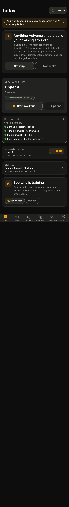: offer, then "Upper A" card). Day-zero before image 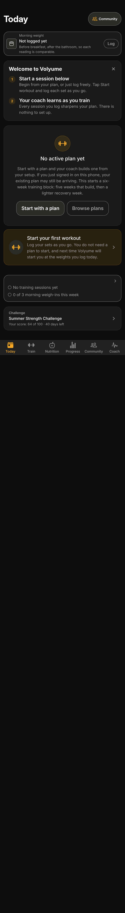 shows the Welcome card state (offer hidden by gate while Welcome shows).

After: the same JSX block moved to directly after the main-area ternary closes (now between the ternary and the post-hero cards: CoachingSetupCard / EvidencePanel, last-session footer, challenge row, Community intro). `PlanRebuildNote` and `PlanRebuildChoiceCard` now come before the main card, unchanged.
Renders (dark):
- Mid-plan, nothing set up: 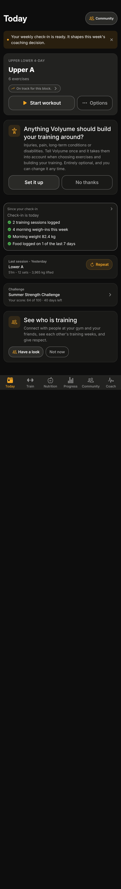 (Upper A card, then offer).
- New user, Welcome dismissed, no plan: 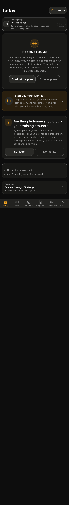 (no-plan card and "Start your first workout" card, then offer).
- After "No thanks" (key `@volyume_hyt_offer_<userId>` = 'true'): 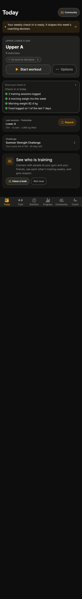 (offer absent).

Not changing: all text of the card, both buttons, the gate, the per-phone AsyncStorage dismissal, onboarding Step 6 "Skip for now", coaching-mode setup (no question added).

Behaviour table:
| Scenario | Today | Proposed |
|---|---|---|
| Eligible, plan with next workout | offer above hero card | offer directly under hero card |
| Eligible, active workout / week complete / block decision / no plan | above the main card | directly under it |
| Welcome card showing | offer hidden | hidden (gate unchanged) |
| Banner holds attention slot (`shownBannerKey != null`) | hidden | hidden |
| "No thanks" or "Set it up" | writes key, hidden for good on that phone | same |
| Onboarding "Skip for now" | nothing written, offer shown later | same |

Files: `src/screens/HomeScreen.js` (one block moved, comment updated). Safety and privacy: none touched; the capability data stays on its own consent path. Data/sync/migrations: none. Native: no. Server migration: no.
Tests: `howYouTrainEntries.guard.test.js` pins the gate string only; still passes. New position guard in `j2.settingsHapticsCommunity.test.js`: pass.
Effort S. Risk Low (position only; one open observation below).
Questions for the owner: (1) In the new-user render the offer lands above the weigh-in "0 of 3" strip but below "Start your first workout". If you meant it directly under the very first card only, say so; otherwise this is what "under the main card" gives.

---

## 10. Two setup screens (Option B)
Images: 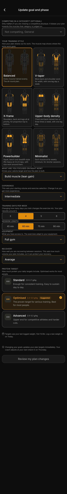, 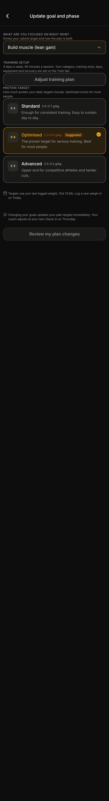, 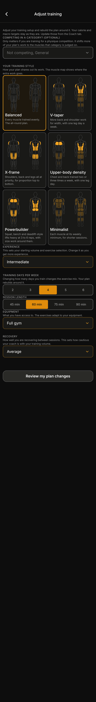, 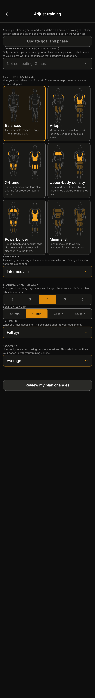

Status: Confirmed (Stage 1) and prototyped. Items marked PROTOTYPED are in the branch; DESCRIBED are specified here but not built.

### Evidence
Stage 1 section 10 (PROPOSALS.md). New observations this stage:
- The two forms offer different day choices: Coach form 3, 4, 5, 6 (render `10-before-coach...`); Train form 2, 3, 4, 5, 6 (`10-before-train...`). A person on 2 days sees no selection on the Coach form and a save there moves them off 2. Option B removes the Coach copy, so Train's 2-6 is the only one.
- `userProfile` inside each screen is a live store subscription (useShallow, ProGoalSetupScreen.js:~140, PlanUpdateScreen.js:~103), so the profile spread is current at render time. What goes stale is the FORM STATE (days, equipment, etc. seeded once with useState) and, inside one save, the render-time `userProfile` closure (F2).

### Field-by-field: today vs proposed, with storage
| Field | Today | Proposed owner | Stored in |
|---|---|---|---|
| Physique category `trainingGoal` | both screens | Train only | profile blob |
| Training style `trainingArchetype` | both | Train only | profile blob |
| Weak points `planWeakPoints` | both | Train only | profile blob |
| Experience | both | Train only | profile blob |
| Days per week | both (Coach 3-6, Train 2-6) | Train only (2-6) | profile blob |
| Session length | both | Train only | profile blob |
| Equipment (stored via `generationEquipmentFor`) | both | Train only | profile blob |
| Recovery rating | both | Train only | profile blob |
| Phase / focus (`trainingPhase`, `goalPhase`, `goal`, `phaseStartedAt` on change, `goalStartDate`) | Coach only | Coach only | profile blob |
| Protein approach | Coach only | Coach only | profile blob + `nutrition_targets` row |
| Show date | Coach only | Coach only | `peak_week_plans` row |
| Calorie and macro targets | Coach save recalculates; Train never | Coach only | AsyncStorage `NUTRITION_KEY` + `saveNutritionTargets` |
| `weightKg`, `bodyFatPct/Source` side writes | Coach | Coach | profile blob |

PROTOTYPED on the Coach form: category, style, weak points, experience, days, session, equipment, recovery removed (ProGoalSetupScreen.js, the render shows phase, a "Training setup" read-out with a link, then protein). The save no longer writes any of those keys (`updatedProfile` carries phase, goalPhase, goal, phaseStartedAt, proteinApproach, goalStartDate only, on top of the latest stored profile). The Coach form still reads days, session, experience and the category from the profile (no editing) because the target calculation, show-date applicability and plan preview need them.
Show date still appears for competition categories (read from the profile category).

### Strings (exact)
| Where | Before | After |
|---|---|---|
| YouScreen.js:549 row sub | "Change goal, phase, schedule, equipment or experience." | "Change your goal, phase, protein target or show date." |
| Coach form, new block (ProGoalSetupScreen.js, after the focus dropdown) | none | Label "Training setup"; "{n} days a week, {m} minutes a session. Your category, training style, days, equipment and recovery are set on the Train tab."; button "Adjust training plan" (opens PlanUpdate via navigateCrossTab 'PlansTab') |
| PlanUpdateScreen.js:~591 intro | "Adjust your training setup and rebuild the plan around it. Your calorie and macro targets stay as they are. Update those from the Coach tab." | "Adjust your training setup and rebuild the plan around it. Your goal, phase, protein target and calorie and macro targets are set on the Coach tab." plus button "Update goal and phase" (navigateCrossTab 'ProfileTab', 'ProGoalSetup') |
| Train form, under days, shown only when days or experience differ from the saved profile | none | "Your calorie and macro targets stay as they are. Your coach will update them at your next check-in on {day}." (no day: "...at your next check-in.") and button "Update now" (opens the Coach form, whose save recalculates targets) |
| PlansScreen.js:88-91 card sub | "Change schedule, equipment, experience, division or weak points. Volyume previews the rebuild before it replaces your active plan." | not changed in prototype; stays accurate under B |
| ProGoalSetupScreen footer | "Changing your goals updates your plan targets immediately. Your coach adjusts at your next check-in on {day}." | unchanged |
| Coach primary button "Review my plan changes" | label | unchanged in prototype. Stage 1 conflict 4 (it saves goal and targets, preview concerns plan only) still stands; with the new order the button now only commits after the preview, so the label becomes accurate for the plan half. Owner may still want "Review and save" (question 2). |

### Wireframe: Train form after, days changed (the render shows the unchanged state; the note appears only on change, not drawn by the harness)
```
< Adjust training
Adjust your training setup and rebuild the plan around it. Your goal, phase, protein
target and calorie and macro targets are set on the Coach tab.
[ Update goal and phase ]            (secondary)
... category / style / experience ...
TRAINING DAYS PER WEEK     [2][3][4][5*][6]      (5 changed from 4)
 Your calorie and macro targets stay as they are. Your coach will update them at your
 next check-in on Thursday.
 [ Update now ]                      (secondary)
SESSION LENGTH ...
```

### Behaviour: save order (scenario -> today -> proposed; real functions)
| Scenario | Today (ProGoalSetupScreen.runSave) | Proposed (PROTOTYPED) |
|---|---|---|
| Save, preview confirmed | targets (`saveNutritionTargets`, `NUTRITION_KEY`), `saveLocalProfile`, `setPeakWeekShowDate`, then `prepareStartWithPlan` -> sheet -> `commitStartWithPlan` | `prepareStartWithPlan` -> sheet -> `commitStartWithPlan`, then `persistGoalAndTargets()` (targets, profile, show date), then GoalChangeSummary |
| Preview declined ("Not yet", or "Allow more equipment" / avoided / manual exits that resolve false) | everything saved, plan not rebuilt (split-brain) | `previewDeclined` -> toast "Nothing was changed. Your goal, targets and plan stay as they were" and return; no profile, targets or show-date write (repro test) |
| Plan prepare fails (`!prep.ok`) or commit fails | goal and targets saved, warning toast | unchanged: `persistGoalAndTargets()` still runs, warning toast still shown (question 1) |
| Style-locked plan, library kit installed | save first, plan untouched | persist runs after the (non-)plan step; plan untouched |
| Mid-block confirm | `confirmPlanSwitchMidBlock` asked before the preview | unchanged position (before preview). Not changed in prototype; moving it after the preview is the item-10 conflict 3 fix and is DESCRIBED only |
| Block kept when exercises unchanged | Train: `keepsBlockOnRebuild` keeps it. Coach: `commitStartWithPlan` has no `keepBlock`, always new block | DESCRIBED, NOT built: pass the Coach preview's diff through `keepsBlockOnRebuild` (planDiff) and `keepBlock` into `generateAndSavePlan`. `startWithPlan.js:162-163` must accept it. Owner answer: "Always keep the block when exercises unchanged." |
| Train save | preview + diff first, `generateAndSavePlan(keepBlock)`, profile after plan succeeds (FF-002) | unchanged |
| Train days/experience change | targets untouched, intro says so | same, plus the line and "Update now" above |

### Safety and privacy
- Calm-mode aggressive-cut gate: lives only in NutritionTargetsScreen.js:1059 and :1282; neither setup screen offers an aggressive cut (`TRAINING_PHASES` has one cut, `mild_cut`). Unchanged and not weakened. The Coach form still cannot reach aggressive_cut.
- ED-neutral summary: GoalChangeSummaryScreen.js:181-191, 215-224 still reads `getOpenEdPatternFlag` directly (not safetyState.js) and is untouched in the prototype. The brief says safety reads go through safetyState.js; I did not re-implement or alter it. Proposed build step: replace that direct read with `useSafetyState()`/`deriveSafetyState`. Decision needed (question 3): `suppressed` also includes calm mode and failed reads, so under calm the summary would turn neutral, which it is not today. Not rendered: the three states (normal, calm, ED flag) of GoalChangeSummary are unchanged by this prototype, so no new before/after images are claimed for them.
- Calorie floors sit inside `calculateNutritionTargets`, untouched. Targets are still skipped (stored targets kept) when sex/age/height/weight is missing. The weight write now sends the latest weigh-in to the profile (F2).
- No tier reads, no new dependency, no migration.

### Data, sync, migrations
No schema change. Same profile blob and `saveLocalProfile` -> `syncAll`. The Coach save now writes fewer keys (it no longer includes the eight training keys; it spreads the latest stored profile so they are preserved). New pure helper `src/lib/setupFormSeed.js`.

### Native code / Server migration
No / No.

### Tests
- Existing, FAIL in the prototype (expected consequences of removing the Coach-form fields; these pin the old form, rewrite at build):
  - `src/screens/__tests__/ProGoalSetupScreen.styleLock.guard.test.js` ("the training-setup fields are withheld and the reason takes their place": expects setExperience, setDaysPerWeek... inside the `!styleLock` branch).
  - `src/screens/__tests__/equipmentOptions.shared.guard.test.js` (3 tests: Coach form passes `EQUIPMENT_OPTIONS`, stores `equipment: generationEquipmentFor(equipment)`, shows `libraryKitOfferLine`). These are F-16 guards for the kit answer. With B the kit-answer handling lives only on Train; the kit branch in the Coach form (`libraryKit`, `installLibraryPlanForKit`) is now dead and should be removed at build, with the guard moved to Train. These are not founder-rule tests; I have not edited them. Flagging per "pinned test conflict".
- Run in the worktree: `npx jest src/screens src/lib/__tests__/setupFormSeed.test.js src/__tests__/screen-mount.test.js`: Test Suites 2 failed, 382 passed, 384 total; Tests 4 failed, 4537 passed, 4541 total (the four above). ESLint on the changed files: 0 errors, 18 warnings (unused imports/setters left in the Coach form, to remove at build).
- New (committed): `src/lib/__tests__/setupFormSeed.test.js`, 5 passed (signature, focus reload wiring, F2 wiring, Coach save carries no training keys, declined returns before persist). Source-level only.
- New behavioural repros on the real screens (harness, not CI): `scripts/paper-render/c2-repro.test.js`.
- Not run: `npm run lint && npm test` for the whole repo (prototype). Device checklist not written (prototype, no build).

### Effort / Risk
Effort M-L (the block-kept-on-Coach change, the dead-kit-code removal and test rewrites are the L part). Risk Med: save-order and plan-rebuild paths for paying users.

### Questions for the owner
1. If the plan fails to build (an error, not a decline), keep today's "goal and targets saved, plan did not rebuild", or save nothing as for a decline? Prototype keeps today's.
2. Rename the Coach button from "Review my plan changes" (it also saves goal and targets) to "Review and save"?
3. Make the ED-neutral change summary use `safetyState.suppressed` (adds calm mode and failed-read) rather than the open-flag read it uses now?
4. Confirm the Coach form should still rebuild the plan on a phase change at all (the preview stays), given it no longer edits any training field.

---

## 11. Settings

Status: Confirmed; owner layout implemented. Owner answer quoted: "Layout: Training: Injuries & limitations, Coaching, Workout | Nutrition: Nutrition targets, Dietary needs | Reminders: Notifications, Coaching reminders | Display & accessibility: Display, Units, Home screen widget (Android) | Privacy & data: Your data, Privacy and legal, Community | Account & help: Account, Profile, Help and about."

Renders: 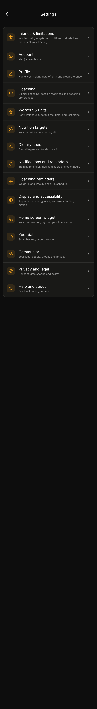 (flat card of 15 rows) and 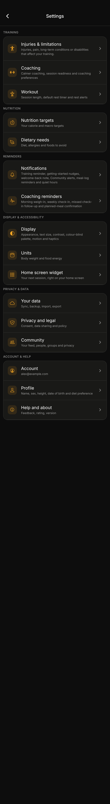 (six headings, 16 rows; the widget row shows because the harness is Android).

### Row mapping, old to new (nothing lost)
| Old row (SettingsScreen.js line) | New place | Notes |
|---|---|---|
| Injuries & limitations (:42) | Training, row 1 | text unchanged |
| Account (:52) | Account & help | unchanged |
| Profile (:57) | Account & help | unchanged |
| Coaching (:62) | Training, row 2 | unchanged |
| Workout & units (:73) | Training "Workout" | renamed; keeps session length, default rest timer, auto-start, open rest view, rest finished alert, sounds, exact alarms; body-weight control moved to Units |
| Nutrition targets (:78) | Nutrition | unchanged |
| Dietary needs (:83) | Nutrition | unchanged |
| Notifications and reminders (:96) | Reminders "Notifications" | renamed; screen title already "Notifications" |
| Coaching reminders (:101) | Reminders | unchanged label |
| Display and accessibility (:106) | Display & accessibility "Display" | renamed; page title "Display"; Energy units control moved to Units; Haptics switch added |
| (none) | Display & accessibility "Units" | NEW screen `SettingsUnitsScreen`: Body weight (Stone/Kg/Lbs, same store setter `setBodyWeightUnits`), Energy (kcal/kJ, same `accessibility.energyUnit`) |
| Home screen widget, Android only (:111) | Display & accessibility | unchanged alert |
| Your data (:122) | Privacy & data | unchanged |
| Community (:136) | Privacy & data | unchanged cross-tab jump |
| Privacy and legal (:144) | Privacy & data | unchanged |
| Help and about (:150) | Account & help | unchanged |

Contents of the Coaching, Dietary, Privacy, Data, Account, Profile and About screens are untouched. Headings use the existing `SectionHeader` primitive.

### Wording table
| Where | Before | After |
|---|---|---|
| SettingsScreen.js:73-77 | label "Workout & units", sub "Body weight unit, default rest timer and rest alerts" | label "Workout", sub "Session length, default rest timer and rest alerts" |
| :96-100 | label "Notifications and reminders", sub "Training reminder, meal reminders and quiet hours" | label "Notifications", sub "Training reminder, getting-started nudges, welcome-back note, Community alerts, meal-log reminders and quiet hours" |
| :101-105 | sub "Weigh-in and weekly check-in schedule" | sub "Morning weigh-in, weekly check-in, missed check-in follow-up and planned-meal confirmation" |
| :106-110 | label "Display and accessibility", sub "Appearance, energy units, text size, contrast, motion" | label "Display", sub "Appearance, text size, contrast, colour-blind palette, motion and haptics" |
| new | none | label "Units", sub "Body weight and food energy" |
| YouScreen.js:558-563 (Coach tab) | "Reminders for your weekly check-in, weigh-ins and logging." | "Reminders for your weigh-ins, weekly check-in, missed check-ins and planned meals." (the old "logging" implied food-log reminders, which live in Notifications) |
| SettingsWorkoutScreen.js page title | "Workout & units" | "Workout" |
| SettingsDisplayScreen.js page title | "Display & accessibility" | "Display" |
| SettingsDisplayScreen.js Reduce motion sub (:245) | "Turns off PR celebration particles, rest timer animations, and other large transitions. Useful if on-screen motion makes you feel unwell." | "...large transitions. Does not change vibration; use Haptics for that. Useful if on-screen motion makes you feel unwell." |
| new Haptics row | none | label "Haptics", sub "Small vibrations when you log a set, finish a rest or hit a PR. On by default. Separate from Reduce motion." |
| Stale references renamed | "under Workout and units" (HowYouTrainScreen.js:1437-1438), "Settings > Workout & units" (SettingsFaqScreen.js:38), comment restEnd.js:44 | "under Workout", "Settings > Workout", comment |

Two reminder screens are kept (owner: "Keep two reminder screens under one 'Reminders' heading; each subtitle lists full contents ... don't merge schedulers"). Planned-meal confirm stays on Coaching reminders. No scheduler code touched.

### Units (evidence for "height only if a real setting")
OBSERVED: no persisted height unit exists. Profile takes feet and inches only (`SettingsProfileScreen.js:82-130`, stored as cm); the metric/imperial switch is form-local state in onboarding (`ProOnboardingScreen.js:738`, `useState('imperial')`, never saved to the store). So Units has body weight and energy only, no height row. Gym weights stay kg-only; the Body weight text says "Gym weights stay in kg." The Body metrics "Weight units" door (`BodyMetricsScreen.js:1560`) now opens SettingsUnits (it used to open Workout); `SettingsUnits` is registered in the Profile-tab stack beside `SettingsDisplay` (`RootNavigator.js:713`). `SettingsWorkout` stays registered everywhere it was (HowYouTrain and capability routes rely on it).

### Haptics behaviour table
| Scenario | Today (`haptics.js` `reduceMotion()`) | Proposed (`hapticsOff()` reads `accessibility.hapticsEnabled === false`) |
|---|---|---|
| Fresh install | haptics on | on (`hapticsEnabled: true` default in `useAppStore.js` accessibility) |
| In-app Reduce motion on | all haptics silent | haptics still on; animations reduced |
| Phone's own reduce-motion/remove-animations on | all haptics silent (AX-09 side effect) | haptics still on |
| Haptics switch off | no such switch | every named haptic (impact, notification, selection, prAchieved, restDone and the iOS rich curves) is a no-op |
| Existing installs with a stored a11y blob lacking the key | n/a | key absent counts as on (`!== false`), so nobody is silenced by the upgrade |
| Persistence and sync | n/a | rides the existing `setAccessibilityPref` path: AsyncStorage `A11Y_PREFS_KEY` plus `pushPrefSoon`, exactly like `energyUnit`; no new key, no schema change |
Not covered: a person who previously had haptics silenced only because their phone's reduce-motion was on will now feel haptics again until they switch Haptics off. That follows from the owner answer; stating it so it is not a surprise. Rest-finished locked-phone alert is a notification, not this helper, and is untouched (INFERRED from stage 1, not re-traced).

Not changing: calm-mode `RecordLine` selection haptic, notification handler, rest alert sound/vibrate switches, all scheduler and ED-suppression code.
Files: `src/screens/SettingsScreen.js`, new `src/screens/SettingsUnitsScreen.js`, `SettingsWorkoutScreen.js` (body-weight block removed; leftover unused imports `Text`, `Ionicons`, `BODY_WEIGHT_UNIT_OPTIONS`, `bodyWeightUnits`, `setBodyWeightUnits`, `liveLocal` need removing in the build, they raise lint warnings only), `SettingsDisplayScreen.js`, `src/lib/haptics.js`, `src/store/useAppStore.js`, `src/navigation/RootNavigator.js`, `BodyMetricsScreen.js`, `YouScreen.js`, `HowYouTrainScreen.js`, `SettingsFaqScreen.js`, `src/lib/notifications/restEnd.js` (comment).
Safety and privacy: no ED-safety code, notification gating or consent touched; weight/food reminder suppression untouched. Haptics pref carries no personal data.
Data, sync, migrations: none. Pref syncs through the existing accessibility JSON. Native: no. Server migration: no.
Effort M. Risk Low to Med (many pinned copy tests, below; routes: `SettingsUnits` must be registered in any stack that links to it, today only the Profile tab does, and it is reached via `navigateCrossTab`).
Questions for the owner: (1) The Display row label and page title are now "Display" under the heading "Display & accessibility", as in your table. (2) Reduce motion text now says it does not change vibration; say if you prefer shorter. (3) Home screen widget row sits under Display & accessibility exactly as listed.

---

## 0. SAFETY FIRST (answer to the brief): YES, the screen showed the verdict under an open ED flag

Evidence: a real render of CoachOutputScreen (the live runWeeklyCoach recompute, persona with an open ED flag raised through database.raiseEdPatternFlag, stored check-in calsAdherence 'no'). Before: image 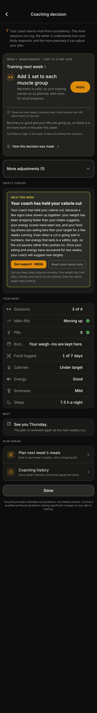. The rendered text contained "Calories / Under target" and "Food logged / 1 of 7 days" (weight rows were already withheld). Same under calm (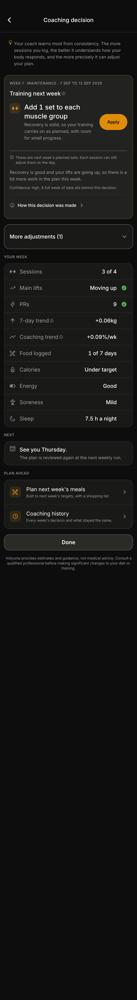). Cause: viewCopy.buildWeekRows had no suppressed input (viewCopy.js, CALORIE_VALUES row, `if (cals && CALORIE_VALUES[cals])`).
Fix (first change): buildWeekRows takes `suppressed`; CoachOutputScreen passes `safety.suppressed || edPatternOpen || calmMode` (safety = useSafetyState, i.e. src/lib/safetyState.js; nothing re-implemented). Suppressed: Calories row left out, every row's mark set to null. After render: image 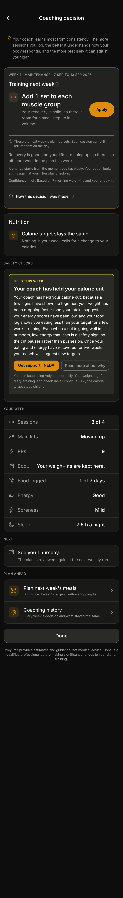 and 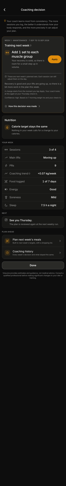: Calories row gone; Food logged count stays (a count, no verdict).
Judgement call to confirm (Q1 below): I kept the plain "Food logged n of 7 days" count and the confidence line under suppression (owner said the confidence line may stay). I also removed the attention marks (energy, soreness, sleep, joints) under suppression, per the owner's "no good/bad marker".

---

## Item 12

Status: Confirmed, prototyped.
Evidence: PROPOSALS.md item 12; owner answer "Min 5 logged food days... Tick only for good outcome, neutral marker for logged... Under suppressed (incl calm) hide Calories verdict and any good/bad marker; confidence line may stay."
Before / After (exact strings):

| Surface | Before | After | file |
|---|---|---|---|
| Today food row, 1 to 4 days | "Food logged on 1 of the last 7 days" with green tick | "Not enough food logged to judge (1 of the last 7 days)" with a small grey dot | home/evidencePanel.js (food row) |
| Today food row, 5+ days | tick, same label | tick, "Food logged on 5 of the last 7 days" | same |
| Today sessions row | tick when >=1 | neutral dot (logged is not a verdict); open ring if none | same |
| Today weigh-ins row | tick when target met | unchanged (a target met is a good outcome) | same |
| Today morning weight row | tick | neutral dot | same |
| Quick check-in Nutrition, under 5 diary days | "Off your target" / "Hit your target" + tick | "Not enough food logged to judge" + dot; quick path kept | WeeklyCheckInScreen.js renderFastCheckIn |
| Quick check-in Nutrition, 5+ days | tick always, even "Off your target" | tick only for "Hit your target"; "Off your target" gets a dot | same |
| Quick check-in Training | tick always | tick only for hit/exceeded; dot for struggled/dropped | same |
| Quick check-in Weight, Progress scan | tick | dot | same |
| Decision confidence | "Confidence: high. A full week of data sits behind this decision." plus "Only N morning weigh-in(s) was/were logged this week." under 4 | "Confidence: high. Based on 6 morning weigh-ins and your check-in." Medium: "Confidence: medium. Based on N morning weigh-ins and your check-in. That is less to go on than usual, so your coach waits an extra week before changing your calorie target." Low: "...Your weight trend is still taking shape, so your coach waits an extra week before changing your calorie target." | viewCopy.buildConfidenceLine |

Behaviour table:
| Scenario | Today | Proposed |
|---|---|---|
| Today panel, calm / ED flag / SCOFF / failed read | no rows (neutral variant) | unchanged (render shows identical text) |
| Quick check-in, calm / ED | Nutrition row dropped | unchanged; ticks also gone (all dots) |
| Decision screen, calm / ED | Calories verdict shown | hidden; no marks |
| Quick check-in with 1 to 4 logged days | verdict from deriveCalsAdherence | says cannot judge |
Not changing: deriveCalsAdherence, CALS_ADHERENCE_BAND, assessDataConfidence, any engine maths or floors. The confidence basis uses only the weigh-in count already on the screen (weigh-ins and check-in are exactly assessDataConfidence's inputs; sessions and food are not, so the line does not claim them).
Files: src/lib/home/evidencePanel.js, src/components/home/EvidencePanel.js, src/screens/WeeklyCheckInScreen.js, src/lib/coachOutput/viewCopy.js, src/screens/CoachOutputScreen.js.
Safety and privacy: suppression via safetyState only; no weight figure added; confidence line quotes a count, never a weight.
Data, sync, migrations: none. Native: none.
Images: , 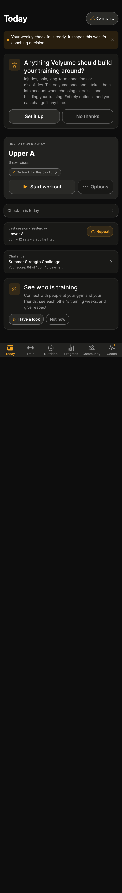, , 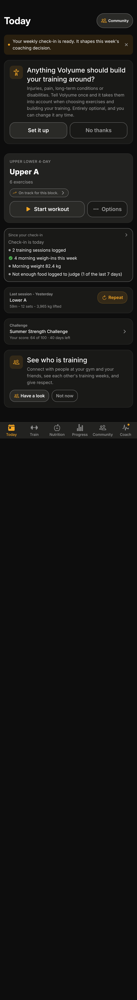, , 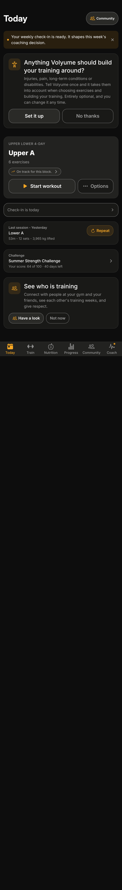, 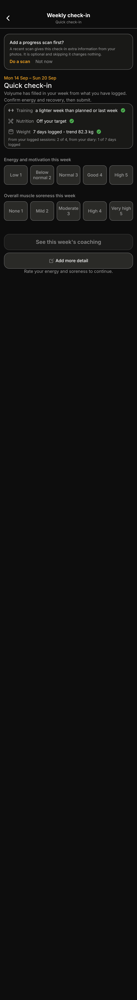, 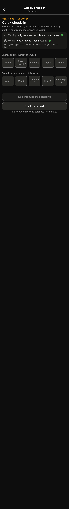, , 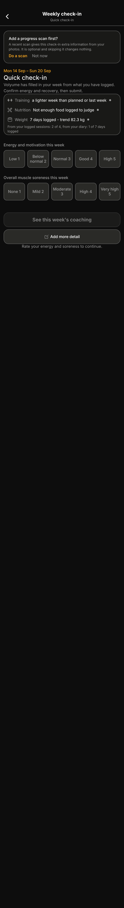, 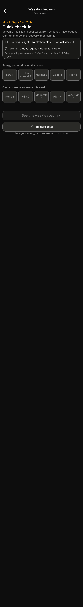, 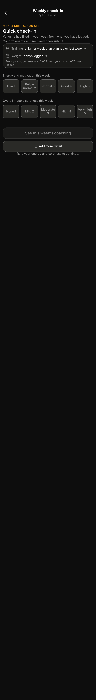, 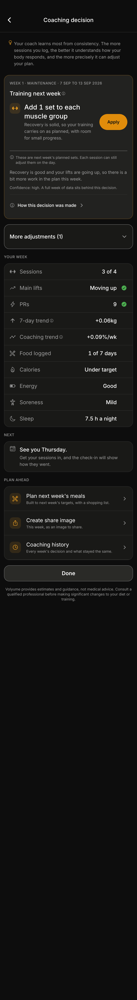, , , 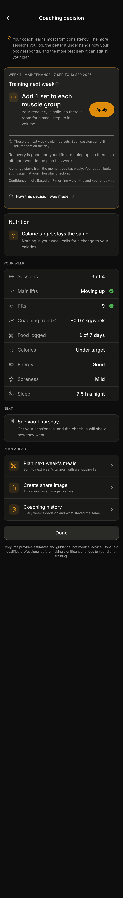, ,  (in ). Harness limit: the persona has 1 logged food day, so the 5+ day tick is shown by unit test, not an image.
Effort S to M, Risk Low-Medium (fast path wording only; stored answer unchanged).
Questions: Q1 keep "Food logged n of 7" under suppression (current prototype) or hide? Q2 below 5 days the quick check-in still submits the derived 'yes'/'no' (so the engine may count a one-day answer as reported adherence, coachContext.js:244-275). Should it store 'untracked' instead? That changes engine input, so I did not.

---

## 14. Volume words and colours
Status: Confirmed, built as prototype. Owner: "Strip: four tones as the figure legend... propose four tone words distinct from every group label. Separate by hue, checked in all four palettes incl colour-blind; no red for 'too much'; run theme contrast tests."

### Four tone words (none appears in any of the eight group labels)
| Band(s) | Sets/week | Group label (lists, unchanged) | Old tone word | NEW tone word | Old colour token | NEW colour token |
|---|---|---|---|---|---|---|
| below_maintenance | under 2 | Too few to hold size | Too few to hold size (same words as the group = clash) | **Low** | textMuted | textMuted |
| maintenance, between | 2 to 10 | Holds your size / Holds size, some growth | Holds size, some growth (same words as one group, wider meaning) | **Steady** | volumeMinimum | volumeMinimum |
| normal_growth, focus_range, above_normal, top_of_studied | 10 to 42 | Usual range for growth / Higher range for a focus / Above the usual range / Close to the upper limit | Range for growth | **Growing** | success | success |
| beyond_studied | over 42 | More than needed | More than needed | **Plenty** | macroCarb | **volumeBeyond (new)** |
The strip's third set ("Enough sets" 2 to 42, volumeStrip.js:95-100) is gone: the strip now uses these four.

### Colours (hex, hue, contrast on card surface, min CIELAB distance under simulated colour vision; script `$S/e2b/hue.js`, Machado 2009)
| Palette | Low / Steady / Growing / Plenty | BEFORE min dE (normal/deut/prot/trit) | AFTER min dE |
|---|---|---|---|
| dark | #9C9C9C / #56B4E9 / #4CAF50 / **#E69F00** (was #56B4E9) | 0 / 0 / 0 / 0 (Steady = Plenty) | 37.2 / 36.0 / 31.8 / 18.3 |
| light | #5C5C5A / #1E78B4 / #2E7D32 / **#9A5B00** (was #1E78B4) | 0 (Steady = Plenty) | 41.2 / 22.7 / 16.0 / 20.2 |
| dark colour-blind | #9C9C9C / **#009E73** (was #0072B2) / #56B4E9 / **#E69F00** (was #56B4E9) | 0 (Growing = Plenty) | 37.2 / 12.6 / 19.3 / 16.1 |
| light colour-blind | #5C5C5A / #009E73 / #0072B2 / **#9A5B00** (was #1E78B4) | 3.6 (Growing ~ Plenty) | 43.1 / 18.7 / 27.7 / 15.7 |
All tones >= 3:1 on card surface (lowest 3.42, light colour-blind Steady). No red or warning token. Orange is the one "Plenty" hue in every palette (violet was tried: fails deuteranopia, dE 3.2 dark / 1.3 light).
Renders: 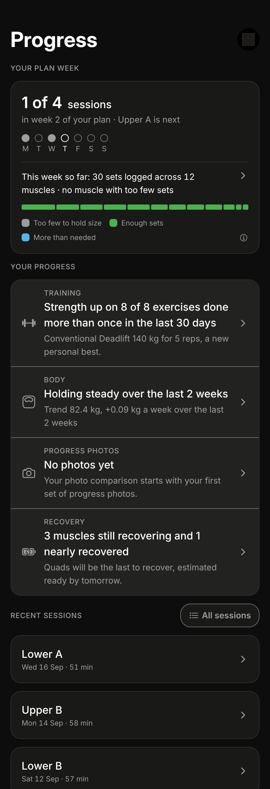, 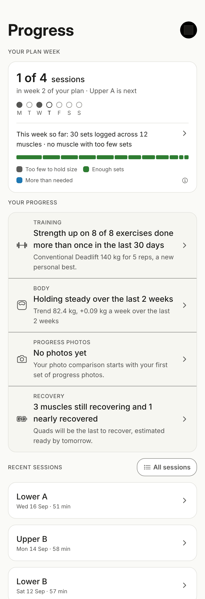, 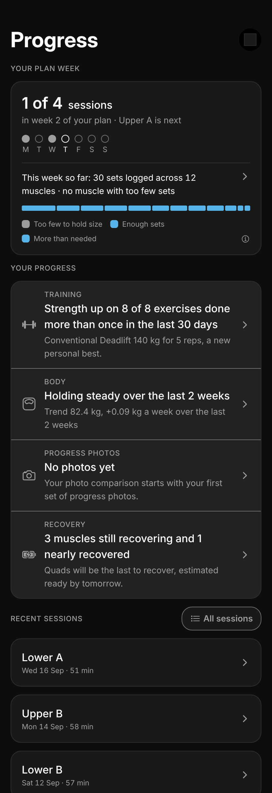, 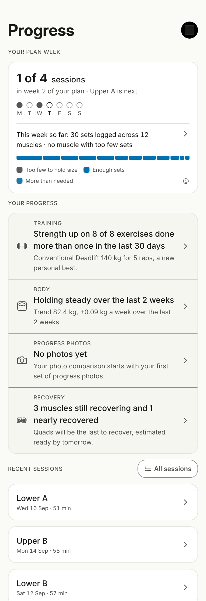, , , , , , , , , , , , , , , , , , , ,  (24 images, side by side).

### Surfaces
| Surface | Today | After |
|---|---|---|
| Progress strip legend (AnalyticsScreen via stripLegendItems) | Too few to hold size / Enough sets / More than needed (3) | Low / Steady / Growing / Plenty (4); bar segments by the same 4 tones |
| Heatmap figure legend (BodyDiagramHeatmap.js:303-306) | old tone words | new tone words (reads VOLUME_TONE_LABELS) |
| Heatmap lists, workout summary badges, weekly volume review (CoachReviewScreen VolumeRow) | 8 group labels | unchanged labels; badge/dot colour uses new Plenty colour |
| Recovery detail (muscleDetail.js:251) | sentence from judgement.line, no colour | not changed, not a legend surface |
| "Your week" = Weekly story screen | no volume status (WeeklyStoryScreen.js / weeklyStory.js have no band or volume code, grep) | LEFT OUT, as instructed |

### Tooltips read the shared tables (new `volumeGroupLines()`, `volumeToneLine()`, `VOLUME_GROUP_RANGES` in `volumeBandLabels.js`, ranges from `WEEKLY_BANDS`)
| Where | Before | After |
|---|---|---|
| WorkoutSummaryScreen.js:2105-2113 | 5 of 8 labels hand-typed, no "Holds size, some growth", "Above the usual range" or "Close to the upper limit" | all 8 "Label: range" lines + "The colours are Low (under 2 sets), Steady (2 to 10), Growing (10 to 42) and Plenty (over 42)." + credit sentence |
| volumeStrip.js STRIP_TOOLTIP (:74-81) | prose bands + "The colour labelled Enough sets covers 2 to 42 sets a week." | opening, credit sentence, "A muscle is read against these bands:" + same 8 lines, plan sentence, same colours line |
Example line: "Holds size, some growth: 6 to 10 sets".

### Dead code
Removed: `volumeColors`, `volumeStatusColors`, `volumeStatusColor`, `buildVolumeStatusColor` (theme.js, ~70 lines; no consumer in src) and `volumeStatusColor.test.js`.
NOT removed, needs your call: `getVolumeStatus` (algorithms.js:394). Zero src consumers, but pinned by the coach-validation ledger: rule T-VOLUME-01 (ledger.json, ORACLE-LOCK.md), scenarios TRN-62/63/64, TMP-R17, harness `landmarks`, plus tests in algorithms.test.js and adductors.test.js. Removing it means retiring a locked oracle rule. I kept it and corrected its stale comment.

Not changing: band thresholds, group labels, judgeWeek, recovery-week "Trained" neutral shade, macroCarb (food), volumeMinimum name.
Files: theme.js, volumeBandLabels.js, volumeJudgement.js (toneColors beyond), progress/volumeStrip.js, WorkoutSummaryScreen.js, algorithms.js (comment), tests below.
Safety and privacy: none touched (wording/colour only; no ED, calorie, telemetry or consent path). Whether volume surfaces hide under calm/ED flag: not changed, not checked. Data/sync/migrations: none. Native: no. Migration: no.
Tests changed: theme.test.js (new test: 4 tones distinct, >=3:1, not error/warning, dE>=10 under normal, deuteranopia, protanopia, tritanopia, in all 6 palettes; replaced the lightness test), volumeStrip.test.js, BodyDiagramHeatmap.test.js/.recovery.test.js, volumeJudgement.test.js, AnalyticsScreen.d214.guard / stateMatrix, WorkoutSummaryScreen.volumeWords.guard.
Effort M. Risk Low-Med: colour change visible to everyone; orange is near the brand amber in dark (#E69F00 vs #F5A623).
Questions: (1) Orange for Plenty OK, given it sits near brand amber? (2) Words Low / Steady / Growing / Plenty OK? (3) Retire oracle rule T-VOLUME-01 and getVolumeStatus, or keep the function?

---

## Item 15

Status: prototyped for the main decision types; goal-specific variants listed below as not yet rewritten.
Owner answers implemented: both cards expanded when two or fewer; coaching rate only in kg/week, scale reading in info sheet, hidden under withholdsWeightFigures; check-in day named; calm softens judgement words only; new outputs only (stored outputs keep old text).

Four-part shape: saw and means (engine note), what changes (the card headline, signed kcal or sets), from when and reviewed next (new footer line).

| Decision | Before | After (normal) | After (calm) | file |
|---|---|---|---|---|
| Cut, too slow | "Weight is coming down slower than the target rate." | "Your weight trend is coming down more slowly than the rate you chose. Taking a little off your daily calories should bring it back on pace." | "Your weight trend is coming down, at a pace a little under the rate you chose. Taking a little off ..." | weeklyCoach.js calNote |
| Cut, too fast | "Weight is dropping faster than the target rate. Slowing it down protects muscle." | "Your weight trend is dropping faster than the rate you chose. Adding a little to your daily calories slows it down, which protects muscle." | "...dropping at a pace a little above the rate you chose. Adding ..." | same |
| Bulk, too slow | "Weight gain is below the target rate." | "Your weight trend is rising more slowly than the rate you chose. Adding a little to your daily calories should bring it back on pace." | "...rising, at a pace a little under the rate you chose. ..." | same |
| Bulk, too fast | "Weight is going on faster than the target rate. Pulling back keeps fat gain in check." | "Your weight trend is rising faster than the rate you chose. Taking a little off your daily calories keeps fat gain in check." | "...rising at a pace a little above the rate you chose. ..." | same |
| No calorie change | "No change needed this week." | "Nothing in your week calls for a change to your calories." | same | CoachOutputScreen.js NextWeekCard |
| Volume +1 | "Recovery is solid, so your training carries on as planned, with room for small progress." | "Your recovery is solid, so there is room for a small step up in volume." | same | coachingGoals.js getTrainingNote (general) |
| Volume +2 | "Recovery is excellent and performance is climbing, so your coach sees room for more work." | "Your recovery is excellent and your lifts are going up, so there is room for a bigger step up in volume." | same | same |
| Volume hold | "Performance and recovery need to stabilise, so your coach is keeping your plan as it is before adding anything more." | "Your performance and recovery are still settling, so your volume stays as it is. Your coach adds nothing until both are steady." | same | same |
| Volume down | "Recovery dipped this week, so your coach is easing your volume back a little." | "Your recovery dipped this week, so your coach is taking some sets out of each muscle group to give it time to come back." | same | same |
| Fatigue (matrix deload note) | "Multiple signs are pointing to fatigue, so your coach is easing your training volume back." | "Several signs point to fatigue building up, so your coach is easing your training volume back." | same | same |
| Diet break body (last sentence) | "A short diet break, returning to maintenance calories for one to two weeks, can help your body settle back to its normal calorie burn and improve long-term fat loss. Consider taking a break before your next phase." | "A short break at maintenance calories, for one to two weeks, lets your body settle back and helps the next stretch of the cut work better. It is a suggestion, and setting maintenance calories changes your target from the moment you tap the button." | same | CoachOutputScreen.js DietBreakCard |
| Held: target not tried (5+ days) | "...Your logged intake averaged N kcal against a T kcal target, so this target has not really been tried yet. Worth giving it a fair run before the number changes." | "...You logged about N kcal a day against a T kcal target, so this target has not really been tried yet. Your coach gives it a fair run before changing the number." | same | weeklyCoach.js |
| Held: target not tried (<5 days) | "...Worth giving it a fair run before the number changes." | "...Your coach gives it a fair run before changing the number." | same | same |
| Held: awaiting last change | "...that change has not had long enough to show yet. Reversing it now would tell your coach nothing." | "...it has not had long enough to show in your weight trend. Changing it back now would tell your coach nothing." | same | same |
| Footer, new line (every decision) | none | change pending: "A change starts from the moment you tap Apply. Your coach looks at this again at your Thursday check-in." Hold or applied: "Your coach looks at this again at your Thursday check-in." Manual: "These are suggestions, so nothing changes unless you make the change yourself. ..." No known day: "...at your next check-in." | same | viewCopy.buildTimingLine |
| More adjustments | collapsed "More adjustments (1)" | both cards shown (collapse kept only for more than two) | | CoachOutputScreen.js |
| Your week weight rows | "7-day trend +0.06kg" and "Coaching trend +0.09%/wk" | one row "Coaching trend +0.07 kg/week"; info sheet adds "Your scale reading over the same seven days: +0.06kg." Nothing under withholdsWeightFigures (unchanged). Calm keeps it (weight figures stay visible under calm) | | viewCopy.buildWeekRows, formatCoachingRateKg |

Locked copy NOT touched, word for word (git diff shows no change to whyThisTemplates.js, nutritionEngine.js, edPatternDetector.js, wellbeing.js, coachApply.js):
- rapid-loss calNote "Weight is dropping faster than the target rate and energy is low. Adding calories straight away to protect recovery." (weeklyCoach.js rapidLossOverride branch);
- ffm_floor reason "Calorie target held. Your seven-day average intake of {n} kcal is at or below your safety floor of {f} kcal. Eating below this level for long stretches can compromise recovery and lean mass." and why "Your calorie target holds. Your seven-day average intake is at or below the safety floor for your lean mass.";
- rapid_loss_corrected reason and why; ED lockout, cleared and rapid-loss blocks and RapidLossAlert (whyThisTemplates.js);
- "Calories held. Wellbeing screen flagged restriction concerns."; intake_read_failed reason; the Beat UK block.
Not changing: the deload note "A lighter week: ... with the same exercises and weights" (tied to item 17 Q4, per owner); the nine goal-specific variants of each training note (only the `general` variant is rewritten in the prototype; the rest follow the same shape in the build); other held reasons, WHY_LIBRARY and dietBreakNote (unchanged); persisted outputs keep their stored text (the screen reads stored notes).
Safety and privacy: weight direction words stay under calm (owner Q4); only "slower/faster/below/above" judgement words soften. No kg figure under withholdsWeightFigures (rate row is inside that branch). No weight figure in any stored string (kg/week is computed on screen from stored %/wk and ewma7).
Data, sync, migrations: none (new outputs only). Native: none.
Images: , , , , , . Harness limit: the persona's decision has no calorie change or deload, so the calorie, deload, diet-break and held strings are shown from source diff and the engine, not rendered.
Effort M, Risk Medium (many pinned strings).
Questions: Q3 does the timing line belong on the hold-week card too (prototype: yes, always). Q4 kg/week for lb users (owner said kg/week; prototype always kg). Q5 goal-specific note variants: approve rewriting all 36 in the same shape?

---

## Batch D2: Tests
Pinned strings/sources I updated in the prototype (evidence, not the build): scenarios.training.data.js (2 strings), campaign2.comprehension, campaign10f, checkinIntegrity.a7.guard, CoachOutputScreen.photoCorroborationCaption (the D99 "thinness keyed to count" rule is now met by the basis line always naming the count), coachOutputWeekRows, evidencePanel tests; added item 12/15 tests to coachOutputWeekRows.test.js. No founder-rule conflict.
Full result: see final report line (npx jest and eslint on the worktree).

---

## Batch D2: Device checklist
1. Today with 2 logged food days: food row says "Not enough food logged to judge (2 of the last 7 days)" with a dot, no tick. With 5+: tick.
2. Quick check-in: Nutrition "Hit your target" ticks only with 5+ diary days; "Off your target" has a dot.
3. Coaching decision: footer names your check-in day; confidence reads "Based on N morning weigh-ins and your check-in."
4. Both Nutrition and Training cards show without opening anything.
5. ED-safety: turn on calm, then (test account) an open ED flag: no Calories row, no marks on the decision; Today shows no rows; quick check-in no Nutrition row. With the flag open no kg/week row.
6. Maximum text size: Today panel, quick check-in card and the decision footer wrap, nothing clips.

---

## 16. Rename "Help" in the exercise card

Status: Confirmed. Owner answer (ANSWERS.md, item 16): "Stage 2: yes. 'More'. Update the two pinned tests."

Evidence:
- `src/screens/ActiveWorkoutScreen.js:6368` passes `moreHint={showInfoTipPulse ? 'Help' : null}`.
- `src/components/workout/session/ExerciseSection.js:271` a11y label "More options for this exercise, including how logging works" (unchanged). `:273` renders the hint text beside the glyph.
- The hint shows only while `@volyume_seen_workout_info` is unset (Stage 1 16, ActiveWorkoutScreen.js:2708-2713), and retires on the details or overflow tap (:1527-1540).

Before / After (exact strings):

| file:line | Before | After |
|---|---|---|
| src/screens/ActiveWorkoutScreen.js:6368 | `moreHint={showInfoTipPulse ? 'Help' : null}` | `moreHint={showInfoTipPulse ? 'More' : null}` |
| src/components/workout/session/__tests__/ExerciseSection.test.js:171 | `const tree = render({ moreHint: 'Help' });` | `const tree = render({ moreHint: 'More' });` |
| src/components/workout/session/__tests__/ExerciseSection.test.js:172 | `textHost(tree, 'Help');` | `textHost(tree, 'More');` |
| src/__tests__/campaign5.firstUse.test.js:1401 | `expect(src).toContain("moreHint={showInfoTipPulse ? 'Help' : null}");` | `expect(src).toContain("moreHint={showInfoTipPulse ? 'More' : null}");` |

Not changing: the a11y label (ExerciseSection.js:271), the once-only display rule, the overflow menu contents (SessionSheets.js:627-914).

Files: ActiveWorkoutScreen.js, ExerciseSection test, campaign5.firstUse test.

Safety and privacy: none of the listed rules is touched. No data, no telemetry key, no notification.

Data, sync, migrations: none. Native code: no. Server migration: no.

Tests: the two pinned test edits above (three expectations in ExerciseSection.test.js and one in campaign5.firstUse.test.js). Baseline PASS. Expect PASS after edit.

Effort: S. Risk: Low. Main risk: a bare "More" tells a sighted user less than "Help" did. The accessibility label still says what it is for.

Questions for the owner: none (answered).

---

## 17. Weight and rep suggestions in the logger
Status: Confirmed. Owner answers implemented (quoted): "Layoff threshold 7 -> 14 days, load only, drop reps reset; show before/after for a once-a-week exercise whose day drifts one or two days. Topped range: up to last time's reps. Keep 2026-08-17 order (no card reason text); add reasons for layoff and consecutive-miss drop to existing Exercise info sheet, style of 'Eased for today'. Recovery week uses last week's weights with fewer sets/reps."

### Evidence (line numbers are in the worktree after the change; originals in brackets)
- Layoff test and reps reset: `src/lib/livePrescription.js` `determineWorkingLoad` [was :1157 `senior.layoffDays > 7`, :1163-1169 `repsOverride: band.min`, `seniorMultiplier 0.9`]. Day count: `ActiveWorkoutScreen.js:3008` `Math.floor((Date.now() - lastTs) / DAY)`, unchanged.
- Topped hold: `nextSessionOpeningLoad` returns `HOLD_EFFORT_UNKNOWN` / `HOLD_EFFORT_VERY_HARD` (:491-499 original). Rep target step 6 of `resolveSetPrescription` clamped to `band.max` through `expectedReps` (which itself clamps to the band, :563-565 and :578-580).
- Recovery week: `ActiveWorkoutScreen.js:3079-3100` called `getWeek1SetsForExercise` (`database.js:7318`) then `generateDeloadPrescription(week1Sets, true)` (`algorithms.js:1892`): weight kept, reps halved, RIR 4. Set COUNT in a recovery week does not come from this; it comes from `weeklyAllocation` (`ActiveWorkoutScreen.js:1295-1334`).
- Item-15 note: `weeklyCoach.js:1956` "A lighter week: fewer sets this week, with the same exercises and weights."

### Before
See behaviour table. Short version: an exercise last logged 8 or more days ago loses 10% and drops to the band-floor reps; a topped range with effort unknown/very hard is told the band max even if you did more; a recovery week anchors on block week 1 weights; nothing explains the layoff cut or the consecutive-miss drop.

### After
Behaviour table below. All numbers in the "today" and "proposed" columns were produced by running the real `resolveSetPrescription` (band 8-12, compound, 2.5 kg step, effort 2 unless stated; the history sessions are one week apart).

### Behaviour table: scenario -> today -> proposed (set 1, `resolveSetPrescription`)

A. Once-a-week exercise, last two sessions 72.5 x 10 and 72.5 x 9, day drifts (days since last log = `layoffDays`)
| Days since last logged | Today | Proposed |
|---|---|---|
| 7 | 72.5 x 11 (MATCH_LOAD_ADD_REP) | 72.5 x 11 (same) |
| 8 | 65.25 x 8 (SENIOR_RECOVERY_HOLD) | 72.5 x 11 |
| 9 | 65.25 x 8 | 72.5 x 11 |
| 10 | 65.25 x 8 | 72.5 x 11 |
| 13 | 65.25 x 8 | 72.5 x 11 |
| 14 | 65.25 x 8 | 72.5 x 11 (14 is not "more than 14") |
| 15 | 65.25 x 8 | 65.25 x 11 (load cut 10%, reps follow the ordinary rule) |
| 21 | 65.25 x 8 | 65.25 x 11 |

So a lift that drifts 7, 8, 9 days (or 13, 14) is never cut; at 15 it is, and the reps no longer fall from 11 to 8.

B. Other layoff cases
| Scenario | Today | Proposed |
|---|---|---|
| 8 days, last 72.5 x 12 topped, effort 2 | 65.25 x 8 | 75 x 8 (normal advance; not a layoff) |
| 15 days, last 72.5 x 12 topped, effort 2 | 65.25 x 8 | 65.25 x 12 (cap at last load x 0.9; no advance; reps unchanged) |
| 8 days, last 60 x 9 | 54 x 8 | 60 x 10 |
| 15 days, last 60 x 9 | 54 x 8 | 54 x 10 |
| 15 days AND two consecutive misses (72.5 x 7, 72.5 x 7) | 63 x 8 | 63 x 9 (drop to 70, then x 0.9) |
| Block finished, awaiting decision (7 days) | cap at last load, reps = band min | unchanged (reps still reset; only the layoff reset was dropped) |

C. Topped range, load holds (effort unknown or "very hard")
| Scenario | Today | Proposed |
|---|---|---|
| Last two sessions 72.5 x 15, effort unknown | 72.5 x 12 (HOLD_EFFORT_UNKNOWN) | 72.5 x 15 |
| Same, effort 5 | 72.5 x 12 (HOLD_EFFORT_VERY_HARD) | 72.5 x 15 |
| Same, effort 2 (supports advance) | 75 x 8 | 75 x 8 (unchanged) |
| Last 72.5 x 12, effort unknown (reps exactly band max) | 72.5 x 12 | 72.5 x 12 (unchanged) |
| Sets 15, 14, 13 last time, effort unknown | set 1: 72.5 x 12 | set 1: 72.5 x 15 (rule is "up to last time's reps at this position") |

Rule: only for the two hold provenances, rep target = max(ordinary target, last session's reps at that position), via `referenceFor`. Never past last time's reps.

D. Recovery week (planned, `isDeload`), real numbers
| Scenario | Today | Proposed |
|---|---|---|
| Week 5 last 72.5 x 8, block week 1 was 65 x 8 | 65 x 4, RIR 4 | 72.5 x 4, RIR 4 |
| Week 5 last 72.5 x 8, week 1 was 80 x 8 (a fall since) | 80 x 4 (heavier than last week) | 72.5 x 4 |
| No earlier session of this lift (new swap) | week-1 sets, else first-time | week-1 sets (fallback unchanged) |
| Second recovery session in the same week | week-1 again (stable) | skips sessions already inside the recovery week (`mesocycleWeekId` match), so reps are not halved twice |
| "Fewer sets" | from `weeklyAllocation` | unchanged (observed: the deload target row count is not what shortens the set count) |
The info-banner list (`describePrescriptionDifferences`) is now measured against last time's sets, so it can say "fewer reps per set" and never "lighter weights". Item 15's note "fewer sets this week, with the same exercises and weights" (`weeklyCoach.js:1956`) is now true of the weights. Cite for item 15 Q4. (Note: the stale comment at `recoveryState.js:216-222` saying the first half "keeps the load" is now accurate.)

E. Reasons (info sheet only, nothing on the card)
| Scenario | Today | Proposed |
|---|---|---|
| Layoff cut applied | no explanation | Exercise info sheet section after "Eased for today" |
| Consecutive-miss drop (two sessions below the rep floor) | no explanation | same section |
| Readiness "Eased for today" | shown | unchanged |
| Set card | no reason line | still none (2026-08-17 order kept; source guard comment at `ActiveWorkoutScreen.js:175-187` untouched) |

Exact strings (new; `src/lib/livePrescription.js` `prescriptionReasonCopy`, drawn in `SessionSheets.js` just above the instructions block):
| Case | Title | Reason | Signal line |
|---|---|---|---|
| Layoff | Eased after a break | It has been 15 days since you last did this lift, so today's suggestion starts a little lighter while you ease back in. | Last time you used 72.5 kg. Today's suggestion is 65.25 kg. |
| Consecutive miss | Lowered to rebuild | Your last two sessions at 72.5 kg finished below the rep range, so today's suggestion steps down a little to help you build your reps back up. | Last time you used 72.5 kg. Today's suggestion is 70 kg. |
No em dashes, British English, no shame wording. Kilograms only (gym weights kg). Reasons are computed from the start-of-exercise state, so they stay readable after sets are logged.

### Info sheet render
Not rendered. The paper-render harness reaches the Active workout screen (config 02) but `showExecution` is local `useState(false)` and the layoff needs seeded history of a specific age; forcing both is a harness edit out of proportion for a prototype whose wording is two short lines. Annotated wireframe (same card style as "Eased for today", sits between it and "Setup"):
```
BEFORE (exercise last done 15 days ago)         AFTER
Bench press                                     Bench press
Chest · Barbell                                 Chest · Barbell
3 sets of 8-12 reps                             3 sets of 8-12 reps
[Plan note]                                     [ pulse icon ] Eased after a break
Setup ...                                       It has been 15 days since you last did this lift,
Execution ...                                   so today's suggestion starts a little lighter while
Watch ...                                       you ease back in.
                                                Last time you used 72.5 kg. Today's suggestion is 65.25 kg.
                                                [Plan note] Setup ... Execution ... Watch ...
```
The screenshot/maximum-text-size pass belongs to the device checklist below.

### Not changing
The 0.9 factor and the 0.25 grid; the block-finished cap and its band-floor reps; readiness easing; the consecutive-miss drop itself (still 72.5 -> 70); the recovery week's halved reps and RIR 4; set counts; every within-session rule (`adjustWeaker`, `adjustStronger`); the set card (no reason text); ED/nutrition/calorie code (not touched).

### Files
`src/lib/livePrescription.js` (LAYOFF_DAYS, `isLayoff`, layoff reps, topped hold reps, new `explainPrescription`, `prescriptionReasonCopy`); `src/screens/ActiveWorkoutScreen.js` (recovery anchor from last session, `mesocycleWeekId` on raw history, `prescriptionReason` memo + prop); `src/components/workout/session/SessionSheets.js` (new section).

### Safety and privacy
Training load only. No calorie floor, ED flag, consent, or tier code touched; no safetyState read needed. Engine functions stay pure and deterministic (`explainPrescription` and `prescriptionReasonCopy` are pure, no I/O, no randomness). Not touched: telemetry schema (no new event; the PROVENANCE vocabulary pin of 13 codes still passes because the layoff keeps SENIOR_RECOVERY_HOLD), Sentry scrub. No personal data added.

### Data, sync, migrations
None. No schema, no sync change, no migration. Native code: no. Server migration: no.

### Tests (worktree, run exactly)
Changed pinned scenario tests and why:
| Test | Change | Why |
|---|---|---|
| `livePrescription.scenarios.test.js` 32 | `layoffDays` 10 -> 20, title says "20 days (threshold 7 to 14)" | 10 days is no longer a layoff |
| `livePrescription.test.js` "§10.5 layoff" | `layoffDays` 10 -> 20 | same; 72 (80 x 0.9) still asserted |
| `coachValidation/scenarios.liveset.data.js` LSO-24 | `layoffDays` 10 -> 20; `why` text ">14d" | oracle text for the threshold. LSO-25 (layoffDays 7, 80) still passes untouched. `coachValidation/ledger.json` mentions SENIOR_RECOVERY_HOLD/layoff; not edited (generated), flag for lead |
| `campaign6.longitudinal.test.js` "7-day exercise gap" | title; source regexes now `LAYOFF_DAYS = 14`, `> LAYOFF_DAYS`, `layoff ? 0.9`; second test `layoffDays` 10 -> 20 | the pins read the source text |
| `livePrescription.properties.test.js` flag `layoffDays>7` | label `layoffDays>14`, `layoffDays` 10 -> 20, AND the reps property relaxed for the layoff flag only: flagged reps may exceed baseline when flagged load is strictly lower | **Pinned-invariant conflict, see Questions.** Strict form fails because when the unflagged baseline ADVANCES the load, its reps restart at the band floor (8) while the layoff holds the old load with ordinary reps (up to 12). |
New tests: scenarios 32b (7, 8, 9, 13, 14 days never cut), 32c (15 days: 65.25 x 11, not x 8), 32d (block-finished still band-floor reps), 32e (topped hold goes to 15; 12 stays 12), 32f (explain/copy), and `src/__tests__/g2.recoveryWeekLastWeights.guard.test.js` (72.5 x 8 -> 72.5 x 4; wiring pinned; coach note wording pinned).
Results: targeted suites (`livePrescription*`, `campaign5/6`, `coachValidation`, `authoredCoach`, `algorithms`, `recoveryVisibility.production`, `ActiveWorkoutScreen.prVideo.guard`) all pass; `npm run lint` clean (eslint . --max-warnings 0, no output). Full `npx jest`: see line at the end of this file.

### Device checklist (physical Android, EAS build; written for the founder)
1. Pick a lift you did exactly 8 days ago (or edit a test lift's last date). Start a workout, open it. Expected: the box shows last time's weight (not 10% lighter) and reps one above last time; no coach line on the card.
2. Repeat at 15 days since last logged. Expected: weight about 10% lighter (rounded to 0.25), reps near last time's; tap the exercise info. Expected: "Eased after a break" with days and both weights.
3. Make two sessions at one weight below the rep floor, then open the lift. Expected: weight steps down one increment; the info sheet says "Lowered to rebuild".
4. Last time you did 15 reps in an 8-12 plan, effort not rated. Expected: same weight, 15 reps.
5. In a planned recovery week, open a lift: Expected: weight equals last session's, reps halved, banner lists "fewer reps per set". Do a second recovery session: reps are halved from the first session's original, not again.
6. Readiness check below par on a layoff day: both "Eased for today" and the break section show; loads compose downward.
7. Repeat 2 and 3 at the phone's maximum accessibility text size; the new section wraps and nothing is cut off.
ED-safety: not weight/food/notification-adjacent; no ED cases apply.

### Effort, Risk
Effort M. Risk Medium: the resolver is the single authority for every set. Main risk: layoff no longer resets reps, so the first session back asks for ordinary reps at 90% load; and the relaxed property pin.

### Questions for the owner
1. PINNED PROPERTY CONFLICT: the engine property "a senior flag never makes the prescription MORE aggressive" compared `repsTarget` strictly. Dropping the layoff reps reset makes a layoff session show MORE reps (e.g. 11) than an unflagged session that advances the load (75 x 8). I relaxed it for the layoff flag only (reps may rise only if load is strictly lower). Accept that, or keep the strict pin and keep the band-floor reps only when the unflagged session would have advanced load?
2. Boundary: "more than 14" (14 days is safe, 15 is a layoff, fortnightly lifts are cut) as built, or "14 or more" (a lift done every 14 days is cut)? I built the first because it keeps the existing "more than" wording.
3. After a layoff, reps = last time's reps plus one (ordinary rule: 10 -> 11). Prefer exactly last time's reps (no +1) for a first session back?
4. Recovery week "fewer sets": observed it comes from the weekly allocation, not the targets; I did not change set counts. Confirm that is what you meant by "fewer sets".
5. `coachValidation/ledger.json` lists layoff oracle IDs; regenerate it at build time?

### Full jest result (appended)
`npx jest` over the worktree: 1783 of 1784 suites passed, 32104 tests passed, 3 failed, all in `src/__tests__/screen-mount.test.js` (186 s, run while another jest was also running). Re-run alone: 604 of 604 pass. I read that as load-induced timeouts (inference, not proven on the base commit). `npm run lint`: clean.

---

## 18. Instructions easier to find (option A)
Status: Built. Owner: "Icon in the active header's empty right slot; render at largest text size; account for 'More'. Write the two missing Watch lines. Plan note stays above Setup. No custom prompt. Fix stale chevron comment."
Before (, ): active header = badge + name only. After (, ): `information-circle-outline` (20 dp, textSecondary) in the right slot (ExerciseSection.js, the existing 36 dp `state` column), directly above the footer's overflow, same centre line. Whole header remains the one button; glyph is hidden from screen readers (hint "Opens the exercise guide" unchanged); only on active + pressable.
"More" (item 16): the footer's pulse hint ("Help" today, renders in `18-after-*`) is a different row and column; the icon does not move it. At largest text the footer wraps (Film drops to a second row) as before; header name shrinks (min scale 0.75) and the icon keeps its 36 dp column. Harness limit: OS font scale not applied to Text; `-large` uses the app's larger-text table only.
Watch lines (families/barbell.js, voice and 20-120 character contract checked by corpus.guard):
| Exercise | New Watch line |
|---|---|
| Barbell Reverse Lunge | "Letting the front heel lift throws the load onto the knee, so keep your weight through the whole front foot." |
| Bulgarian Split Squat (Barbell) | "Standing too close to the bench drives the front knee forward, so step out until your shin is near vertical." |
Comment fix (ActiveWorkoutScreen.js ~6346): "the tap that used to open the details is its chevron" now says tapping the header opens the guide and an information glyph says so.
Not changing: Plan note above Setup, no custom prompt, footer items, event names. Files: ExerciseSection.js, ActiveWorkoutScreen.js (comment), barbell.js, ExerciseSection.test.js (new test). Safety/privacy: none. Data/native/migration: none. Effort S, Risk Low (header width at largest text).
Questions: none.

---

## 22. Meal cards: old names inside Meal 1 to 3 (plus F3)

Status: Confirmed (real users with old history reach it; the render reproduces it).
Owner answer implemented: "View-only: old-named meals (Breakfast/Lunch/Dinner) show inside Meal 1-3 with names kept as labels; nothing in storage moves; a 'snack' entry keeps its own card only when it holds food. Pre/post-workout stay hidden. Diary and meal-plan counts stay separate. F3 part of this." F3: "default to the numbered meal for the time of day."

Evidence: ladder = Meal 1..N plus any slot holding rows (`buildMealSlots`, MSL:141-150); old keys were added as extra cards (DS:974). Seed `seedPersona.js:408-410` shows it.

Before: a day with Breakfast/Lunch/Dinner food shows those three cards AND empty Meal 1 to 4 (, ). Mixed day (Breakfast plus Meal 1 food): two separate cards ().
After: Breakfast, Lunch, Dinner rows are drawn inside Meal 1, 2, 3, each old-named group under a small label (the old name, shown once per group; own rows listed first; no label when the card was renamed to the same word). Empty Meal 4 remains. Snacks keeps its own card only because it holds food (, , ). Totals per card include the folded rows.

Behaviour table (real functions):
| Stored `meal_slot` | Today | Proposed |
|---|---|---|
| breakfast / lunch / dinner (4 meals) | own card + empty Meal 1-3 | inside Meal 1 / 2 / 3, labelled |
| dinner with 2 meals/day | own card | inside Meal 2 (`foldedMealSlot`, never past last meal) |
| snack with food | own "Snacks" card | unchanged |
| snack, no food | no card | unchanged |
| meal_N, preworkout, postworkout | as is | unchanged (pre/post hidden unless opted in or logged) |
| edit sheet, delete, cloud row | stored key | unchanged (rows keep `meal_slot`) |

String/code table:
| Where | Before | After |
|---|---|---|
| MSL (new) | none | `foldedMealSlot(slotKey, mealsPerDay)`, `foldedRowLabel(entrySlot, cardKey, cardLabel)` (after MSL:163-185) |
| DS:756-762 `entriesBySlot` | keyed on `e.meal_slot` | keyed on `foldedMealSlot(e.meal_slot, mealsPerDay)`, moved below `mealsPerDay` |
| DS:974 | `buildMealSlots(viewEntries, ...)` | `buildMealSlots(slotRows, ...)` (throwaway folded rows) |
| MS rows | plain list | `rows` memo, small label above an old-named group |
| FSS:122 | `route?.params?.mealSlot ?? 'snack'` | route slot, else `inferMealSlotForHour(hour, ladder)` on today, Meal 1 on another day; ladder from `@volyume_meals_per_day` (default 4) |

### F3. Add-food default meal (part of item 22)

F3 note: every in-app route to the add-food screen passes a meal today (DS:1070, 1344, MM, RecipeBuilder, scanner), so the default is a safety net for deep or future routes; I did not find a live route that hits it. Not device-tested.
Side effect to know: usuals/yesterday chips (DS:1007-1052) previously lent Breakfast recents to an empty Meal 1 only when Breakfast had no card; Breakfast now never has one, which is the same outcome for an empty Meal 1 (Meal 1 holding Breakfast food is not empty, so no chip).
Not changing: storage, sync, import mapping, Add another meal, meal counts, pre/post.
Files: MSL, DS, MS, FSS (+ tests). Safety/privacy: none touched (no floors, ED, consent, telemetry). Data/sync/migrations: none. Native: no. Server migration: no.
Tests: new `MealSection.item22and23.test.js`, `H2.sourceGuards.test.js`, fold block in `mealSlots.test.js`. Effort M. Risk Med: the edit-sheet and Mark-as-eaten paths still use stored keys (checked: planned rows are always `meal_N`); Mark as eaten acts on `slot.key` = the folded card, planned rows are never legacy.
Questions for the owner: (1) label placement is above the first row of the group; fine, or put the old name as a card sub-line instead?

---

## 23. Seasoning tip only on planned, not-yet-eaten rows

Status: Confirmed. Owner: "Tip only on planned, not-yet-eaten rows (existing is_planned; no new marker). Same wording as curated sheet."
Before: shows on any curated-looking meal, planned, eaten or logged straight from the curated sheet; text "Optional extras, add any you fancy: <list>." (MS:299). ,  (tip present on both).
After: only when the meal has `is_planned` rows, and it reads only those rows; text is the curated sheet's `ADDITIONS_INTRO`: "Optional extras. Add any you fancy for flavour. They will not change the meal's numbers." then the list. Gone after Mark as eaten ( no tip;  tip with new wording).
| Scenario | Today | Proposed |
|---|---|---|
| Plan added, not eaten | tip | tip (new wording) |
| Marked eaten | tip stays | gone |
| Curated meal logged directly | tip | gone |
| Half eaten, planned rows too few to match | tip from all rows | none (only planned rows read) |
Allergen filter (`filterAdditionsForProfile`) kept as is.
Files: MS; pin `MealSection.additionsCopy.guard.test.js` updated to the new wording (the old string is the thing the owner asked to change; this is a deliberate re-point). Safety: allergen filter untouched. Effort S. Risk Low.

---

## 24. Add this day / Add this week (plus F4)

Status: Partly confirmed (as Stage 1). Owner: "Add only plan meals whose diary meal is empty. Replace all planned rows on that day; no schema change. Name added and skipped. Week button offers 'Replace planned meals' too. F4 part of this."
Rule implemented: a plan meal is added only if its diary meal holds no EATEN row (old-named rows count toward the meal they are drawn in). Planned rows never block; all planned rows on the date are cleared first (`clearPlannedDay`, once, and only when something is going to be added). Eaten rows never touched. New: `planDayMergePlan`, `applyPlanDayMerging`, `describeDayMerge`, `describeWeekMerge` (MPS); `applyPlanWeekToDiary(userId, plan, {startDate, planned: 'leave'|'replace'})` now returns `days[]` as well.

Behaviour table (plan has Meals 1 to 4):
| Scenario | Today (Day / Week) | Proposed Day | Proposed Week |
|---|---|---|---|
| Empty day | adds all; toast "N foods added to X" / day counted | same, toast "Added Meal 1, Meal 2, Meal 3 and Meal 4 to X." | day added |
| One coffee in Meal 1 | Day: alert, adds alongside / Week: whole day skipped | alert "Food already logged": coffee stays, "Skipped, already logged: Meal 1. The rest of the plan is added."; toast "Added Meal 2, Meal 3 and Meal 4 to X. Skipped Meal 1, already logged." | adds Meals 2 to 4; summary "Skipped, already logged: Meal 1 on Wed." |
| Coffee in a meal the plan lacks (e.g. Snacks) | as above | no skip, adds straight away, no alert | adds whole day |
| Plan already added (planned only) | Day: "Replace planned meals?" / Week: skipped, no choice | unchanged alert, Replace clears all planned rows then adds all | alert "Replace planned meals?": Cancel / "Leave those days" / "Replace planned meals" |
| Planned plus some eaten | Day: alert, clears planned, adds all / Week: skipped | alert lists skip and "Planned meals already on this day are replaced."; Meal with eaten food skipped | Replace: same per day; Leave: whole day left |
| Every plan meal already eaten | Day adds alongside | alert "Every meal in this plan already has food logged on X (...), so nothing would be added." (OK only) | counted skipped, nothing cleared |
| Water only | treated empty | same | same |
| Future day | no special case | same (mark-eaten still hidden) | same |
| Week button, no planned rows in 7 days | runs | n/a | runs straight away, no extra tap |
Week toast: "3 days added to your diary. Skipped, already logged: Meal 1 on Wed. Left as planned: Tue." Nothing added: "Nothing added. Tue already has planned meals." etc.

F4 and card strings:
| Where | Before | After |
|---|---|---|
| MPL:1617 day card | "Adds these meals to today. Existing logged food is left alone." | "Adds the meals that are still empty on {today or date label}. Food you have logged stays, and planned meals already there are replaced." |
| MPL:1618 week card | "Adds the week from the date shown. Any day that already has food logged is left alone." | "Adds the week from the date shown, into meals that are still empty. Food you have logged stays, and you can choose to replace planned meals." |
| MPL:1274 Build week card | "...shopping list. Existing logged food is left alone." | "...shopping list. Nothing is added to your diary until you tap Add this week." |
| MPL:529 Day alert 'Food already logged' | "...This will not remove it; the planned meals are added alongside." | see table |
Images: ,  (plan for today), ,  (opened for a date two days ahead: before the card said "today"), , , , . Before and after differ only in these sentences.
Not changing: "Replace planned meals?" alert for planned-only days, toast on replace, navigation to Diary with `justAddedPlan`, bank re-sync (`resyncBankedPlannedFood`), planned rows stay local-only.
Safety: none (no weight/ED/notification path; the planned-meal nudge re-check inside `clearPlannedDay` still runs). Data: no schema. Native/server: no.
Tests: updated `MealPlanScreen.test.js` (card strings) and `mealPlanService.test.js` (week test re-pointed: the old "skip any day with food" test pinned the rule the owner replaced; new tests for skip, leave/replace, fold, nothing-to-add-clears-nothing, sentences). `campaign17c` slice guard still passes (no `upsertSlotRecent`). Effort M. Risk Med: writes to the diary. Main risk: a skipped meal's plan food is simply absent that day; the owner chose this.
Open: Replace in the Day alert path clears planned rows even in meals the new plan does not cover (the owner's "replace all planned rows on that day"). Week "Leave those days" skips a whole day that has any planned row (to avoid doubles); say if you want it finer.

---

## 25. Oily fish weekly cap
Status: Confirmed, prototype built.
Evidence: assembleWeekPlan Repeat branch builds one day x7 (mealPlanAssembler.js ~1100); variety penalty is per meal id only.
Owner answers implemented: "Repeat mode: repeated day has no oily-fish meal. Count meals. Plain note on 5- and 7-day chips... Explicit swap/Keep always wins. Phone-only setting. Add NHS species keys now... Default cap 2."
Before / After (same pescatarian persona, target 2400 kcal, seeds 1 to 6; digits = oily meals per day, days 1 to 7):

| Mode | Seed | Today | Proposed (cap 2) |
|---|---|---|---|
| Repeat | 1 | 14 (2222222) | 0 |
| Repeat | 2 | 7 (1111111) | 0 |
| Repeat | 3 | 14 | 0 |
| Repeat | 4 | 7 | 0 |
| Mixed | 1 | 5 (2001101) | 2 (2000000) |
| Mixed | 2 | 6 (1110111) | 2 (1100000) |
| Mixed | 3 | 7 (2011012) | 2 (2000000) |
| Mixed | 4 | 7 (1101112) | 2 (1100000) |
| Varied | 1 | 5 (2001200) | 2 (2000000) |
| Varied | 2 | 6 | 2 (1100000) |
| Varied | 3 | 7 | 2 (2000000) |
| Varied | 5 | 5 | 2 (2000000) |
(Mixed/Varied seeds 5, 6 and Varied 4, 6 also reach exactly 2; full 18-row output: $S/i2-oily-table.txt.) Observation: the cap is used up on the first days, so oily fish clusters early in the week. A spread rule is possible; owner call (Q1).
Behaviour (real functions): assembleWeekPlan({oilyFishCap=2}) passes oilyAllowed to assembleDayPlan: Repeat = 0 (or Infinity if cap >= 7); Mixed/Varied = cap minus meals used so far. Pins are placed first, are counted, and are never removed (test: pinned salmon meal stays in Repeat). Saved meals counted via items[].foodRef; slots get oily:true. Day plan (Build today): no cap. Tinned tuna (tuna_water) never counts. Deterministic: same seed same week (test).
Chip note (MealPlanScreen.js shopping sheet, shown when dayCount 1, repeat 5 or 7, day has oily fish): "This day has an oily fish meal, so 5 days of it is 5 oily fish meals." / plural "This day has 2 oily fish meals, so 7 days of it is 14 oily fish meals." Not rendered (modal); no health lecture.
NHS keys added (oilyFish.js): salmon, smoked_salmon, trout, mackerel, herring, kippers, sardines, pilchards, sprats, whitebait, anchovies, eel, carp, jack_fish, swordfish, fresh_tuna. Source: NHS at least one portion (~140 g cooked) a week; max 2 if pregnant, breastfeeding or planning; tinned tuna excluded. NHS page not fetched (no network); list is from the owner's answer, plus species named in Stage 1 spec.
Not changing: day plans, Add this day/week, swaps (explicit choice wins), ED/calorie logic, nutritionEngine.
Files: src/lib/food/oilyFish.js (new), mealPlanAssembler.js, MealPlanScreen.js, tests oilyFishCap.test.js (7 tests).
Safety/privacy: none touched. Data: cap is a function argument defaulting to 2; the phone-only user setting (profile key + store allowlist setMealPlanPrefs, store/useAppStore.js ~2351, local-only like other mealPlan* keys) is NOT built in the prototype. No migration, no native, no telemetry.
Effort M, Risk M (Repeat semantics; swap paths unchecked: swapMealInPlan/swapFoodInMeal can add salmon after build, by design).
Questions: (1) spread oily meals across the week instead of the first days? (2) Setting UI wording and where it lives (not built). (3) Cap above 7 or "off" option?

---

## 26. Meal plan readability
Status: Confirmed, prototype built. Owner: "History message once at top. '·' everywhere listed. Whole grams everywhere incl swap sheet and Today's Plate (add missing 'g'). 'Don't suggest again' everywhere: new button, alert, hint."
| Where | Before | After |
|---|---|---|
| MealPlanScreen.js:1526 meal macros | P 41 g - C 23.9 g - F 19.5 g | P 41 g · C 24 g · F 20 g (render: "P 43 g · C 50 g · F 14 g") |
| :1603 day total | 2,649 kcal - P 170.3 g - C 312.8 g - F 80.2 g | 2,649 kcal · P 170 g · C 313 g · F 80 g |
| :1719 and :1819 swap rows (+ a11y labels) | 832 kcal - P 41.3 g | 832 kcal · P 41 g |
| TodaysPlateTeaser.js:68 | 2,649 kcal - P 170.3 - C 312.8 - F 80.2 | 2,649 kcal · P 170 g · C 313 g · F 80 g |
| Per-meal GENERIC_START line (:1532) | shown under every open meal | removed; header line (explainDay) stays once |
| Hint :1434 | Tap a food to swap it. Hold a swappable food to leave it out of future plans. | Tap a food to swap it. Hold a swappable food, or open its swap list, and choose "Don't suggest again" to leave it out of future plans. |
| Alert button :874 | Don't suggest it | Don't suggest again |
| A11y label :1487 | ...long press to leave it out for good. | ...long press for Don't suggest again. |
| Food swap sheet | no action | new "Don't suggest again" button (closes sheet, calls handleFlagFood, same alert and exclusion path) |
Rounding is display only; stored totals stay 1 dp, so rounded meal figures can differ from the rounded day total by 1 g. Render images: ,  and , . Not changed (out of lane): the Food Search row wording (FoodRow.js/FoodSearchScreen.js) still says its own text; coherence.test.js:172 pins it. Plan macros are not gated by calm or ED state today (unchanged; not checked beyond that).
Files: MealPlanScreen.js, TodaysPlateTeaser.js. Tests: updated as listed. Native/server/data: none. Effort S, Risk L. Questions: should FoodRow's "don't suggest" wording also become "Don't suggest again"? (needs FoodSearch lane after I2/diary batch).

---

## 27. Raw/cooked conversions
Status: Partly confirmed. Owner: "Average lentil ratio ~3.14 with source note. Prawns as listed. 'Weigh as listed' only on foods named cooked/dry with no pair. Turkey mince and quinoa as listed."
New pairs (only one):
| Food | Conserved | CoFID rows | Values (g/100 g) | Ratio (g cooked per g dry) |
|---|---|---|---|---|
| lentils | protein | 13-089 green/brown raw 24.3; 13-657 red split raw 25.6; 13-661 boiled 7.8; 13-658 boiled 8.1 | mean raw 24.95, mean boiled 7.95 | 3.138 (varieties 3.12 and 3.16) |
No pair: prawns (as listed, 0.749 raw-to-grilled not used), turkey mince (no raw mince row), quinoa (no cooked row).
Source note (cookYield.js comment on the lentils entry): "the curated 'Lentils (cooked)' does not say which lentil, so the ratio is the mean of the two CoFID varieties, protein as the conserved nutrient". Each source row is pinned by cookYield.test.js against assets/seed/cofid_uk.dat. Lentils now get the Raw/Cooked chips via the existing STATE 'cooked' entry; macros never change.
"Weigh as listed": new weighAsListed(foodKey, name) in cookYield.js: true when there is no toggle and the name contains "cooked" or "dry". Shown as a muted line under the food row in the plan (render plan24: under "Turkey breast mince (cooked)" and "Quinoa (cooked)") and as " as listed" after grams in the shopping list for unpaired items. Eggs, vegetables, oats (name has no cooked/dry word) get nothing. Food detail sheet NOT done (FoodDetailSheet is shared with the concurrent diary batch); proposed there as a one-line "Weigh as listed" under the serving when no toggle: owner call.
Stale comments fixed: MealPlanScreen.js (the NA-nutrition-1 comment above handleSetDayWeightState, now at ~909) and foodRoles.js defaultWeightStateFor doc (was 310-322). cookYield.js header no longer says lentils are unpaired. Also noticed, not changed: hasWeightChoice doc (foodRoles.js ~300) still says it drives the choice; it is now hasCookToggle.
Tests: cookYield.test.js (averaged-pair row check, ratio 3.14, weighAsListed cases). Native/server: none. Effort S, Risk L (curated lentil macros are the app's own, not CoFID). Questions: add the label to the food detail sheet now?

---

## Batch I2: Device checklist (Android, EAS build)
1. Settings, build a Mixed or Varied week on a pescatarian diet: at most 2 oily-fish meals across 7 days. Repeat: none, unless you Keep one.
2. Build today with salmon, Shopping list, tap 5 days: the plain note appears; 1 and 3 days: none.
3. Plan screen: macros read "P 41 g · C 24 g · F 20 g"; day total whole grams; swap rows whole grams; Nutrition tab Today's Plate shows "· P 171 g".
4. Open a food's swap list: "Don't suggest again" opens the existing confirm; long press does the same.
5. Lentils show Raw/Cooked chips; quinoa and turkey mince show "Weigh as listed".
6. Maximum text size on the plan screen and shopping sheet. ED/calm: no change expected (no weight or calorie rules touched).

---

## 28. Repeat logging: the extra close after adding a saved meal

Status: Not confirmed on a device (inferred from stack structure). Owner: "Only fix the extra close after adding a saved meal; confirm on device first (give the device check). No whole-meal chip."
Before (MM:194 at base): after "Add to <meal>" it calls `navigation.goBack()`, landing back on the add-food screen it was opened over.
After: if the route directly beneath MyMeals is `FoodSearch` and not in its pick-a-food mode (`pickMode`), `navigation.pop(2)` closes both and lands on the diary with the Undo toast; any other case, or any error, falls back to the old single `goBack()`. The edit-meal "Add a food" round trip (`pickMode: 'recipe'`) is not affected.
Device check (Android, EAS build), before relying on this:
1. Nutrition tab, tap "Add food" on an empty meal, tap More, tap Saved meals, tap a meal, tap "Add to Meal N". Expected before the fix: toast "<meal> added to Meal N." with Undo, but you are on the add-food screen. Expected after: you are on the Diary with the meal in Meal N and the Undo toast.
2. Same, then tap Undo: the foods leave the diary.
3. Add-food, type a food, add it (plate "Log 1"): closes to the Diary as before (unchanged).
4. Saved meals, tap a meal, "Edit this meal", "Add a food", pick one: returns to the edit sheet, not the Diary.
5. Recent tab row for a previously logged saved meal, "Add to Meal N": Diary.
6. Largest phone text size: toast and Undo still readable and reachable.
ED-safety: not weight/food-target adjacent (no energy figure computed). Files: MM. Tests: `H2.sourceGuards.test.js` (source guard only; navigation not unit-testable here). Effort S. Risk Low (fallback to old behaviour).

---

## Batch H2: Device checklist for the batch (physical Android, EAS build; also 22/23/24)
1. A day with Breakfast/Lunch/Dinner food (old history): meals sit inside Meal 1 to 3 with the old name as a small label; Snacks only if it holds food; no empty duplicate cards. Tap a row: edit sheet opens, meal chip shows the old name selected.
2. Add a meal plan day: tip under a planned meal; tap Mark as eaten: tip disappears.
3. Add this day: empty day; day with one coffee in Meal 1; day already planned; all four read as in the table.
4. Add this week twice; second time offers Replace / Leave.
5. Maximum accessibility text size on Diary and the plan card (long sentences wrap; labels do not clip).
6. Calm mode / open ED flag: no change in these screens (no safety state is read); confirm meal plan screen and diary look as before.

---

## Batch H2: Tests
Targeted: `npx jest` over the diary, food and screens folders ran before my test additions with only the four expected re-points failing; after: the touched suites (mealSlots, mealPlanService, MealPlanScreen, MealSection guards, new files) pass 97+10 tests. Full `npm run lint && npm test` result is appended below.

Full run in the worktree: `npm run lint` (eslint --max-warnings 0) clean; `npm test`: Test Suites 1785 passed, 1 skipped (1786); Tests 32119 passed, 17 skipped (32136), 0 failed.

---

## 30. Privacy and transparent coaching: Welcome screen lines

Status: Confirmed. Welcome today has no privacy or coaching-nature line (Stage 1 30). Owner answer: "Welcome screen only. Don't touch consent screen; keep 'What leaves your phone'."

Evidence:
- `src/screens/WelcomeScreen.js:105` headline "Everything you need to build your physique."
- `src/screens/WelcomeScreen.js:108` support "Training, nutrition, progress and coaching, connected in one app."
- `src/screens/WelcomeScreen.js:146` "Completely free · No ads" (kept, owner answer item 34).
- `src/screens/WelcomeScreen.js:147` "Get started"; `:150` sign-in link.
- Harness: `scripts/paper-render/welcome.js` draws only the product captures, so no before/after image.

Before (exact strings on Welcome today):
- Headline, support line, "Completely free · No ads", "Get started", "Already have an account? Sign in". No privacy or coaching-nature line.

After (exact new strings, both new, same style as the existing free line `styles.free`, WelcomeScreen.js:198 and :218):

| where | Before | After |
|---|---|---|
| new line 1, directly under WelcomeScreen.js:146 | (none) | Your progress photos and workout videos stay on this phone. |
| new line 2, directly under line 1 | (none) | Your coach isn't an AI chatbot. It follows fixed rules. |

Text wireframe (Welcome, narrow phone, after):
```
[Volyume mark]
Everything you need to build your physique.
Training, nutrition, progress and coaching, connected in one app.
[ three app screenshots, hero ]
Completely free · No ads
Your progress photos and workout videos stay on this phone.
Your coach isn't an AI chatbot. It follows fixed rules.
[ Get started ]
Already have an account? Sign in
```

Not changing: the Article 9 consent screen (`src/screens/Article9ConsentScreen.js`, including "What leaves your phone" at :233-236), the headline, the support line, the free line, the buttons.

Files: `src/screens/WelcomeScreen.js` only.

Safety and privacy:
- Consent gate (RootNavigator and Article9ConsentScreen): not touched.
- Claim accuracy (Stage 1 30): "stay on this phone" is true for progress photo image files and workout videos. It does not cover label photos sent to Open Food Facts when that opt-in is on (`SettingsPrivacyScreen.js:114-115`, off by default), nor the anonymous measurement numbers from progress analysis (`Article9ConsentScreen.js:233-236`). The owner chose this wording, so the sentence is per the owner's answer, and the consent screen still discloses the rest.
- "isn't an AI chatbot": Stage 1 found on-device machine-learning models (label text recognition, body-scan segmentation). The line says "chatbot" and "fixed rules", not "no AI". Flag for the owner (Q30-2).
- Usage data: none. Error reports: none.

Data, sync, migrations: none.
Native code: no. Server migration: no.

Tests: no existing test pins Welcome copy (WelcomeScreen is only mounted by screen-mount and similar suites). New test recommended: a source guard that both strings are in WelcomeScreen.js and that Article9ConsentScreen.js is unchanged. Re-run `screen-mount` and `LoginScreen` suites after the change.

Effort: S. Risk: Medium. Main risk: the actions block is measured (`onLayout` sets actionsH) and the hero height follows the free height, so the hero shrinks by the added text height on small phones. Not checked on a device; needs a 360dp and maximum-text pass.

Questions for the owner:
- Q30-1: placement. Proposed: directly under the free line (above Get started). Alternative: above the free line, under the support line. (Owner chose the text, not the position.)
- Q30-2: "isn't an AI chatbot" is accurate for the coach, but the app has on-device recognition models. Confirm you accept the wording as written (per answer, yes), or add a clause naming on-device recognition.

---

## 31. Community defaults

Status: Confirmed with one correction to stage 1. Owner answer quoted: "Gym feed if gym set else Everyone, until 5 follows; then Following automatically. Keep switch + audience chips, Followers preselected. Onboarding same default (Followers), sentence updated, no new control. Server fallback unchanged."

New finding (OBSERVED, `CommunityJoinScreen.js:210` before the change): the Join screen's `tpShare` started from `TP_DEFAULT_SHARE`, which has no `sessions_audience`, so no audience chip was selected and the create sent `sessions_audience: undefined`; the server then stored 'everyone' for an adult (migrate_186:252). So the "Everyone" default on Join came from the server fallback, not from a visible preselected chip.

### Behaviour table
| Scenario | Today | Proposed |
|---|---|---|
| Joined member opens Feed (`CommunityHubScreen.js` effect) | always `'following'` | `defaultFeedScope({joined, followingCount: me.profile.following_count, gymId: me.profile.gym_id})` |
| Joined, gym set, < 5 follows | Following | My gym |
| Joined, no gym, < 5 follows | Following | Everyone |
| Joined, >= 5 follows | Following | Following |
| Joined, follow count not in the payload | Following | Following (unknown count keeps today's value) |
| Not joined | Everyone, read-only | Everyone, read-only |
| Person taps a chip | their choice | their choice; the default never overrides it again (`scopeChosenRef`) |
| Count or gym arrives after first paint | n/a | feed re-resolves once, only if no chip tapped |
| Server cannot serve a scope (`out.fallback === 'scope'`) | back to Following | unchanged |
| New adult, Join screen | no chip selected, server stores everyone, switch on | switch on, Followers chip preselected, sent explicitly; visibility chips unchanged ("Anyone" default) |
| New adult, onboarding step | hard-coded `sessions_audience: 'everyone'` (`onboardingJoin.js:215-218`) | `JOIN_DEFAULT_SESSIONS_AUDIENCE` = 'followers' |
| Existing members | stored settings | unchanged: reader default `DEFAULT_SESSIONS_AUDIENCE = 'everyone'` (`trainingProfile.js:491`) is left alone; a new separate constant is used only at create |
| Under 18 or age unknown | followers-only, share off until chosen, audience forced to followers; 'everyone' refused by server | unchanged (code paths for `isMinor` untouched) |
| Build that omits the audience | server stores 'everyone' (adult) | unchanged (migration not proposed, per the owner) |

Wording: `ProOnboardingScreen.js:3094`
- Before: "Every session you finish is shared with everyone in Community: exercises, sets, the total lifted and any PRs. Turn it off any time from your Training profile."
- After: "Every session you finish is shared with the people who follow you in Community: exercises, sets, the total lifted and any PRs. Turn it off any time from your Training profile."
The Join screen needs no new words; the existing chips Followers / My groups / Everyone now show Followers selected, and `sessionsSharingSentence('followers')` already reads "Your sessions are shared with people who follow you."

Renders:  (member, Following default);  (0/1 follows, gym set: "My gym" feed with "Nobody at your gym has posted yet.");  (Everyone);  (5 follows: Following);  (Join screen with Followers preselected; the harness mounts it without a handle typed).

Follow-count source (stage 1 open point): `me.profile.following_count` is the same field `HomeScreen.js:894` already reads. OBSERVED: the self card JSON carries `following_count` and `gym_id` in the card builder (`migrate_163:1585`). NOT TRACED: that `community_get_me`'s `v_card` (migrate_191:1363 `'profile', v_card`) is built by that same function. If it were not, the rule falls to "unknown = Following", today's behaviour, so nothing breaks. Please confirm on a real account with the device check below. Note the harness seed puts `following_count` at the top level of `me`, not in `profile`; I wrote the render variants into `profile`.

Not changing: server (`migrate_184/186/187`), minors' clamps, the ED/calm withhold on automatic posts, visibility chips, "Four rules", existing members' stored audience.
Files: `src/lib/community/trainingProfile.js` (new `JOIN_DEFAULT_SESSIONS_AUDIENCE`, `FEED_FOLLOWING_THRESHOLD`, `defaultFeedScope`), `src/lib/community/onboardingJoin.js`, `src/screens/CommunityJoinScreen.js`, `src/screens/CommunityHubScreen.js`, `src/screens/ProOnboardingScreen.js`. The two screens import from `trainingProfile` directly, not the barrel, because many existing hub tests mock the barrel.
Safety and privacy: the Followers default narrows sharing (privacy-positive). Posting still goes through `sessionShareGateState` and the server withhold under ED flag; minors untouched; no new telemetry.
Data, sync, migrations: none. Native: no. Server migration: no.
Effort S to M. Risk Med: a Followers-only default means a new member's sessions reach nobody until follows exist; the feed (gym/Everyone) shows others' public posts, so the feed is not empty but their own posts are less visible. Stated for the owner, not a recommendation either way.
Questions for the owner: (1) Where an existing member has no gym and under 5 follows they will now open on Everyone instead of Following; owner said existing members are unchanged for sharing defaults only. Confirm the feed rule should apply to existing members too (as built), or only to new ones. (2) "My gym" feed with nobody posting shows the quiet line "Nobody at your gym has posted yet." and no Everyone fallback; confirm that is wanted rather than falling to Everyone when the gym feed is empty.

---

## Batch J2: Tests (exact)
Failing, all pinned to old behaviour the owner's answers change; to update in the build, not in this prototype:
- Settings landing and units: `settingsDiscoverability.item9ab.guard.test.js` (row "Notifications and reminders"), `SettingsWorkoutScreen.navigation.test.js` (CP-6 row, "Workout & units" title, body-weight control in Workout), `p15UnitDisplayCopy.guard.test.js` (body-weight label on Workout), `campaign3.discoverability.test.js`, `BodyMetricsScreen.weightUnitsAndDate.guard.test.js`, `BodyMetricsScreen.d214.test.js` (the weight-units door now opens SettingsUnits), `HowYouTrainScreen.capabilityFlows.guard.test.js` (T2-27 copy "Workout and units").
- Haptics: `src/lib/__tests__/haptics.richCurves.test.js` ("reduce-motion setting suppresses both paths", two tests) pins the old rule documented as open in `haptics.js`; owner has now answered it.
- Community: `onboardingJoin.test.js` (four tests: "sharing on (to everyone)" and the join order), `ProOnboardingScreen.communityStep.guard.test.js` ("shared with everyone" sentence).
Passing and relevant: `CommunityHub.states/joinReceipt/challenge` suites (existing member default stays Following when `following_count` is absent from the payload), `howYouTrainEntries.guard.test.js`.
New: `j2.settingsHapticsCommunity.test.js`, 7 passed (headings and row order, haptics default and Reduce-motion independence, feed rule, Followers default, offer position).
Full `npm run lint && npm test` was not run end to end; lint on touched files is clean except unused-variable warnings in `SettingsWorkoutScreen.js`.

---

## Batch J2: Device checklist (physical Android, EAS build; for the build, not run here)
1. Fresh account, finish setup, dismiss Welcome: Today shows the plan card first, then the injuries offer. Tap "No thanks": it disappears and stays gone after closing the app.
2. Account mid-plan with nothing set up: offer sits under the Start workout card.
3. Settings: six headings in order; Notifications and Coaching reminders subtitles list everything; Units shows Stone/Kg/Lbs and kcal/kJ and changing each updates Body metrics and the diary; Body metrics "Weight units" opens Units.
4. Display: turn Reduce motion on, log a set: still vibrates. Turn Haptics off: no vibration on set, rest end, PR. Turn the phone's own remove-animations on with Haptics on: still vibrates.
5. Community, new member with a gym and no follows: opens on My gym. No gym: Everyone. Follow 5 people, reopen: Following. Tap another chip: it stays.
6. Join: "Share what I did" switch on with Followers selected; after joining Training profile shows followers. Onboarding step reads the new sentence.
7. Under-18 account (if available): unchanged, followers only, sharing off until chosen.
8. Maximum accessibility text size on Settings, Units and the Join screen: no clipped subtitles.
ED-safety: none of these changes is weight, food or notification gating, so there is no ED-specific case; confirm that an open ED flag still withholds automatic Community posts (unchanged).

---

## 32. Challenge board
Status: Built. Owner: "Count rows shown; 'Top N' when fewer than 10; keep zero-row text; confirm padding with narrow-layout render."
| Scenario | Today | Proposed (`boardTitle(topRows.length)`, ChallengeScreen.js) |
|---|---|---|
| 10 rows | Top 10 | Top 10 |
| 8 rows (render) | Top 10 over 8 names | Top 8 |
| 1 to 9 rows | Top 10 | Top N |
| 0 rows | "Top 10" + "Nobody is on the board yet." | title stays "Top 10", zero-row line kept (I avoided "Top 0"; say if you want a different title) |
Count source: rows shown (`topRows`), not server `counts.entrants`; the "You" off-board row is not counted.
Padding: counts footer was `styles.counts` paddingHorizontal spacing.lg (24); now `{ paddingHorizontal: t.screenPadding }` (24 normal, 16 under 390 dp). Renders , , , : at 360 dp the "before" footer sat 8 dp inside the rows' edge; after, aligned (visual check on the after image: footer text left edge matches the rows).
Not changing: server board, winners, safety withholding (usePhotoSuppression), copy elsewhere. Files: ChallengeScreen.js, ChallengeScreen.test.js (3 new tests; the 'Top 10' pins hold with 10 rows). Safety: board still withheld under safety state as before. Data/native/migration: none. Effort S, Risk Low.
Questions: zero-row title wording.

---

## Batch E2b: Tests
See tail of this file for exact lint + full test output.

### Test result (worktree, this branch)
`npm run lint`: clean (eslint . --max-warnings 0, no output after the header).
`npm test` full run: 3 suites failed on first run. Two were my pinned-word tests (VolumeHeatmapScreen.test.js legend, volumeBandLabels.test.js tone words), updated and now pass (107/107). The third, screen-mount.test.js (5 timeouts of 15 s at 278 s under full-suite load: ActiveWorkoutScreen tap chains x4, CoachingRemindersScreen, DebugLogScreen), passes when run alone for ActiveWorkout (7 passed); the other two were rerun alone, see lead note. First run totals: 1779 suites passed, 8 tests failed of 32110. The two paper-render runs: 0 FAIL, all variant PNGs produced. Commit is local on `proposal/14-volume-instructions` only.

---

## 34. "Free" strings: free-for-life and the rest (strings only)

Status: Partly confirmed (Stage 1 34). Owner answers: start-choice line says nothing about price and keeps "You can change your mind later."; keep "Completely free · No ads" on Welcome; free-for-life is earned by completing a challenge, rule [pending owner Q1]; Everything in scope including the homepage (F8); nothing is built until Q1 is answered.

Count read (owner, production 2026-10-20): 0 grants and 0 challenges. No one holds the free-for-life promise today, so the new wording breaks no promise made to anyone.

Rows marked "pending owner Q1" keep the bracketed text until the rule is answered. The rule text is never guessed here.

### Live app and web strings

| # | file:line | Before (exact) | After (exact) | Pinned by (edit needed) |
|---|---|---|---|---|
| 1 | src/screens/StartChoiceScreen.js:137 | `Coaching is free, like everything else in Volyume. You can change your mind later.` | `You can change your mind later.` | src/screens/__tests__/StartChoiceScreen.test.js:207 (edit literal) |
| 2 | src/screens/WelcomeScreen.js:146 | `Completely free · No ads` | unchanged (owner) | none |
| 3 | src/lib/challenges/copy.js:37 (FREE_FOR_LIFE_JOIN_LINE) | `Joining also keeps Volyume free for you for life, even if we ever introduce paid plans.` | `Completing a challenge [rule pending owner Q1] earns Volyume free for you for life, even if we ever introduce paid plans.` | src/screens/__tests__/ChallengeJoinScreen.test.js:159-160 (edit literal) |
| 4 | src/lib/challenges/copy.js:38 (FREE_FOR_LIFE_LANDING_LINE) | `Volyume is free. Join through the challenge and it stays free for you for life, even if we ever introduce paid plans.` | `Volyume is free. Completing a challenge [rule pending owner Q1] earns it free for you for life, even if we ever introduce paid plans.` | ChallengeJoinScreen.test.js:182-183 (the test reads public/c/index.html and compares; edit with row 7) |
| 5 | src/screens/ChallengeJoinScreen.js:398 | renders row 3 | no edit | none |
| 6 | src/screens/PrivacyPolicyScreen.js:235 | `Joining a challenge also keeps Volyume free for you for life. Deleting your account deletes all of it, ...` | `Completing a challenge [rule pending owner Q1] also earns Volyume free for you for life. Deleting your account deletes all of it, ...` (rest of the sentence unchanged) | none pinned (privacyTruth checks default-on sharing only) |
| 7 | public/c/index.html:106 | `<p class="lead" id="free">Volyume is free. Join through the challenge and it stays free for you for life, even if we ever introduce paid plans.</p>` | `<p class="lead" id="free">Volyume is free. Completing a challenge [rule pending owner Q1] earns it free for you for life, even if we ever introduce paid plans.</p>` | src/lib/challenges/__tests__/landingPage.test.js:85 (literal) |
| 8 | public/challenge-terms/index.html:180 (heading) | `Free for life` | unchanged (heading only; the body carries the rule) | src/__tests__/challengeTermsPage.guard.test.js:67 |
| 9 | public/challenge-terms/index.html:181 | `Joining a challenge keeps Volyume free for you for life, even if we ever introduce paid plans.` | `Completing a challenge [rule pending owner Q1] earns Volyume free for you for life, even if we ever introduce paid plans.` | src/__tests__/challengeTermsPage.guard.test.js:90 (literal) |
| 10 | public/challenge-terms/index.html:111 | `Entry is free, and you can leave at any time.` | unchanged (describes entry, no promise) | none found |
| 11 | public/challenge-terms/index.html:128 | `Entry is free and no purchase is needed. ... Volyume is free.` | unchanged (describes today) | src/__tests__/challengeTermsPage.guard.test.js:77 |
| 12 | public/privacy.html:185, public/privacy/index.html:185, docs/web/privacy.html:185 | `... Your explicit consent, which you give when you join. Joining a challenge also keeps Volyume free for you for life.` | `... Your explicit consent, which you give when you join. Completing a challenge [rule pending owner Q1] also earns Volyume free for you for life.` (same as F8 P2) | identity guard memberEmailWebsite.guard.test.js:287 (keep the three copies identical) |
| 13 | public/privacy-policy.md:104 | `... Joining a challenge also keeps Volyume free for you for life.` | same change as row 6 | none |
| 14 | public/get/index.html:133 | `<p class="offer"><b>Free. No card, no time limit.</b> ...` | `<p class="offer"><b>Free. No card needed.</b> ...` (removes "no time limit", which promises the app stays free) | src/__tests__/marketingClaimsGuard.test.js:60 (re-run) |
| 15 | public/get/index.html:186 | "No ads, and your data is never sold." | unchanged | none |
| 16 | docs/rules/billing.md:93-101 | "FREE FOR LIFE PROMISE ... Everyone who joins a gym challenge is promised..." | record only: needs the Q1 decision; not edited in this batch | none |

### Dormant strings (not reachable: payments barrel refuses while FULL_ACCESS_FOR_ALL is on; screens unregistered, RootNavigator.js:199-202, 745)

These are listed for completeness. Proposed: no edit in this batch. Rewrite on re-arm under the then-current decision. Where a string promises permanence, the proposed text removes the promise.

| file:line | Before (exact) | Proposed after (on re-arm) |
|---|---|---|
| src/screens/SubscriptionPolicyScreen.js:44 | title `What stays free` | `What is free` |
| src/screens/SubscriptionPolicyScreen.js:59 | `The core logbook is free on every account.` | unchanged (describes today) |
| src/screens/SubscriptionPolicyScreen.js:134 | title `Your free trial` | delete section (no trial, decision 2026-09-03) |
| src/screens/SubscriptionPolicyScreen.js:137 | `New accounts get Pro free for 14 days. ...` | delete with the trial section |
| src/screens/SubscriptionPolicyScreen.js:142 | `The Free tier has no time limit: the plan library, your own training, and your progress charts stay free.` | `Training, plans and progress are free.` (drops the promise) |
| src/screens/SubscriptionPolicyScreen.js:161 | `We won't quietly raise prices, change what's free, or hold your data behind a paywall.` | delete (a promise about future behaviour) |
| src/screens/ProUpgradeScreen.js:57 | `... None of it is ever taken away.` | delete `None of it is ever taken away.` |
| src/screens/ProUpgradeScreen.js:61 | `No payment card needed. New accounts get full Pro free for 14 days (one trial per account), ...` | delete with the trial |
| src/components/PostLapseSheet.js:31 | `Training, plans and progress stay free.` | `Training, plans and progress are free.` |
| src/lib/notifications/scheduler.js:837 | `Your free Pro trial ends in two days` | delete (trial re-lay removed, scheduler.js:1976) |
| src/lib/notifications/scheduler.js:841 | `You're back on the free plan` | delete (no free tier) |

Files (live rows): src/screens/StartChoiceScreen.js:137; src/lib/challenges/copy.js:37-38; src/screens/PrivacyPolicyScreen.js:235; public/c/index.html:106; public/challenge-terms/index.html:181; public/privacy.html, public/privacy/index.html, docs/web/privacy.html (:185); public/privacy-policy.md:104; public/get/index.html:133. Tests to edit: StartChoiceScreen.test.js:207; ChallengeJoinScreen.test.js:159-160 and :182; landingPage.test.js:85; challengeTermsPage.guard.test.js:90; marketingClaimsGuard (re-run only).

Safety and privacy: none of the five safety rules is touched. The free-for-life rule touches an entitlement write (server, not in this batch) and legal promises; billing rules (docs/rules/billing.md) say changes need a founder decision. Flag, do not change.

Data, sync, migrations: none in this batch. The grant rule itself would need a migration after Q1 (the join writes the grant at migrate_201:569-571; the grant is removed only by account deletion). Not proposed here.

Native: no. Server migration: no (for this batch).

Effort: S now (strings). L once Q1 and the grant rule land (rule, migration, tests, legal copy).
Risk: High. A promise about free access is legal-adjacent and affects what was promised to people who join.

Questions for the owner:
- Q1 (pending): What counts as "completed" for the free-for-life promise? (a) final score at or above 50 at close (the lean noted in your answer), (b) final score at or above 70, (c) training activity in the challenge, (d) still a member at close, (e) other. Written at close by the founder, per your answer. Until answered, every bracketed row above stays as written.
- Q34-2: Start-choice line: confirmed as "You can change your mind later." alone. Any other one-line replacement must avoid price (your answer). Is this the wording you want?

---

## 36. Calm mode: Settings text (Calmer coaching)

Status: Partly confirmed (Stage 1 36). Owner answer: "Keep D228 posts choice. Keep calm out of the notification handler. Settings text lists Community, notification and photo effects. Weight figures stay visible under calm."

Evidence (each effect, from Stage 1 36, file:line):
- Community: calm withholds the consistency counters, presence, group boards and profile card: `supabase/migrate_180_community_consistency_server_gate.sql:337-346`, `migrate_191` gates. Gym challenge board, entries and draws: `migrate_201:269, 425, 566, 672, 706`. New automatic posts not made on the device: `src/lib/community/ambient.js:166-169`. Existing automatic posts stay: `supabase/migrate_192_community_posts_withheld_under_flag.sql:1-14` (D228 addendum).
- Notifications: win-back cancelled `src/lib/notifications/scheduler.js:1069-1080`; return nudge cancelled `:1451-1463`; monthly recap neutral `:2109`. Foreground banners are NOT changed by calm (`src/lib/notifications/handler.js` never reads calm); the text must not claim they are quieted.
- Photos: photo prompts, compare views and share cards suppressed: `src/lib/usePhotoSuppression.js` (via `safetyState.js`), `src/screens/ProgressPhotosScreen.js:291`.
- Weight figures: visible under calm, withheld only by an open ED flag (`src/lib/safetyState.js:86-91`). Unchanged.

Before (exact, `src/screens/SettingsCoachingScreen.js:146-147`):
- label: `Calmer coaching`
- sub: `Quieter progress prompts, and coaching never pushes for more while it is on. Celebrations, streaks and progress comparisons go quiet; your plan and your numbers do not change. The safety limits on calories and training load are always on, in both modes.`

After (exact, replaces the sub at :147; the label is unchanged):
> Quieter progress prompts, and coaching never pushes for more while it is on. Celebrations, streaks and progress comparisons go quiet. Your plan, your calorie and training limits and your weight figures stay as they are. Calmer coaching also changes three things. Community: your Community counts, presence, group boards and challenge board are hidden from other members, and new automatic posts from your workouts are not made. Posts already on the feed stay. Notifications: reminders to come back are not sent, and the monthly recap uses neutral wording. Your other reminders are unchanged. Progress photos: photo prompts, comparisons and share cards are switched off. The safety limits on calories and training load are always on, in both modes.

Behaviour table (what the text promises, checked against code):

| Text claim | Code | Holds? |
|---|---|---|
| Counts, presence, boards hidden from others | migrate_180:337-346, migrate_191, migrate_201 | Yes (server) |
| No new automatic posts | ambient.js:166-169 | Yes (device) |
| Existing posts stay | migrate_192:1-14 | Yes (calm only; an open ED flag withholds them, which is separate) |
| Come-back reminders not sent | scheduler.js:1069-1080, :1451-1463 | Yes |
| Monthly recap neutral | scheduler.js:2109 | Yes |
| Other reminders unchanged | handler.js (no calm read); scheduler gates on ED flag only | Yes |
| Photo prompts, compare, share cards off | usePhotoSuppression.js; ProgressPhotosScreen.js:291 | Yes |
| Weight figures stay | safetyState.js:86-91 | Yes |

Not changing: the handler (calm stays out of it), the D228 posts choice, the switch and its persistence, the calorie and training limit sentence.

Files: `src/screens/SettingsCoachingScreen.js:147`.

Safety and privacy:
- Calm and ED: the text describes calm only, names no weight figure, no ED flag and no safety state.
- Notifications: the text does not imply foreground banners are silenced (they are not).
- Usage data: none. Error reports: none.

Data, sync, migrations: none. Native code: no. Server migration: no.

Tests: no test pins "Calmer coaching" or this sub (grep, none). New test recommended: a copy guard that the sub names Community, notifications and progress photos.

Effort: S. Risk: Low. Main risk: the text makes claims about calm behaviour. It must be re-checked whenever calm behaviour changes (item 36 table in Stage 1).

Layout note: SettingRow takes one `sub` string (SettingsCoachingScreen.js:144-147). The proposal uses plain sentences, not bullets, so no component change is needed. The text is longer than today; check the row at maximum text size.

Questions for the owner:
- Q36-1: Two calm effects are not in your list: the PR haptic becomes a plain tap (`src/components/RecordLine.js:131`), and Home comparison prompts go quiet (`src/screens/HomeScreen.js:796, 891`). Add them to the text, or leave them out?
- Q36-2: Keep the plain-sentence form (no bullets, no change to SettingRow), or add a list layout to SettingRow?

---

## 41 + F9. Over-the-air updates and update-check reporting

Status: Partly confirmed. IMPORTANT finding: `app.json` has no `updates.url`, and Android release builds are made on a GitHub runner with `expo prebuild` + gradle (`build-android.yml:301,529`), not by `eas build`. So an `eas.json` `channel` is NOT injected into Android builds; the channel must be in `app.json`. iOS goes through `eas build` (`build-ios.yml:232`), where `eas.json` channels apply.

### Owner answers implemented
"runtimeVersion policy fingerprint. Download in background, apply next cold start; remove 'Restart now' alert. Channels production and preview. F9 part of this."

### Config diff
`app.json`:
```diff
-    "runtimeVersion": {
-      "policy": "appVersion"
-    },
+    "runtimeVersion": {
+      "policy": "fingerprint"
+    },
+    "updates": {
+      "url": "https://u.expo.dev/2f60a6ed-8b37-4cd6-8057-60ee04e39ea8",
+      "checkAutomatically": "ON_LOAD",
+      "fallbackToCacheTimeout": 0
+    },
```
- `url` uses the existing `extra.eas.projectId` (`app.json:7`). Without it the installed expo-updates has nothing to ask (INFERRED; the no-URL runtime behaviour is NOT confirmed, `node_modules` was not inspected).
- `fallbackToCacheTimeout: 0` = launch the cached bundle at once, download in the background, apply next cold start. That matches the answer and means a slow network never delays launch.
- `checkAutomatically: ON_LOAD` plus the manual check in `App.js` duplicates the fetch. Decision for owner: keep the manual check (needed for F9 reporting) and set `checkAutomatically` to `"NEVER"` so there is one path. I have shown `ON_LOAD` above as the library default; the proposal is `NEVER` with the explicit check in `App.js`. Confirm in question 1.
- Android (local prebuild) channel header, in `app.json` `updates`: `"requestHeaders": { "expo-channel-name": "production" }`. Iphone builds via EAS get it from `eas.json`. Because the same `app.json` feeds the preview APK, preview builds need their own value; the simplest route is `app.config.js` choosing it from `APP_VARIANT` (the variable already exists in `eas.json` env). `app.json` is static JSON today, so this is a decision (question 2).

`eas.json`:
```diff
     "preview": {
       "developmentClient": false,
       "distribution": "internal",
+      "channel": "preview",
       "env": {
     "production": {
       "node": "20.19.4",
       "autoIncrement": true,
+      "channel": "production",
       "env": {
```

`App.js` (prototype, committed in the worktree, `git diff HEAD~1 -- App.js`): the `Alert.alert('Update available', ... 'Restart now' ...)` block is removed. The check now fetches in the background and leaves it staged. F9: the `catch (_)` that swallowed errors becomes `logError('App.otaUpdate', e, { stage })` where `stage` is `'check'` or `'fetch'`. Context carries only the stage name, no user or device data; `logError` runs the existing scrub (`sentryScrub.js` locked patterns) and feeds Sentry. I did not touch `sentryScrub`. It stays non-fatal (wrapped in a try so reporting can never throw). The error-boundary reload at `App.js:373` is unchanged. The `Alert` import stays used elsewhere (not verified: lint not run).

### F9. Update-check error reporting (part of item 41)

### Strings
| Where | Before | After |
|---|---|---|
| `App.js:642-651` | Alert "Update available" / "A new version of Volyume has been downloaded. Restart to apply it." / "Later" / "Restart now" | removed, no user-facing text |
| `App.js:653-655` | `catch (_) { /* Silently ignore */ }` | `logError('App.otaUpdate', e, { stage })` |

### Behaviour table
| Scenario | Today | Proposed |
|---|---|---|
| Production launch, update available | Downloads, interrupts with the alert; "Restart now" reloads mid-use | Downloads silently; applies on the next cold start. Nothing interrupts a workout |
| Check fails (offline, server error) | Swallowed | Reported to Sentry with `stage`; INFERRED volume may include normal offline failures. `captureException` may have an offline-noise filter like `captureWarning`'s `_isExpectedOfflineNoise`; not verified for the exception path. If noisy, switch to `logWarn` (breadcrumb when offline) |
| Dev build | Skipped (`__DEV__`) | Same |
| Binary whose runtime differs from the update | Update never offered (runtime match is the safety) | With fingerprint, runtime changes automatically whenever native inputs change, so a mismatched JS bundle is not served |

### Risks to state plainly
- The first binary that carries `updates.url` and the fingerprint runtime is a new store build. Already-installed 3.2.0 binaries keep policy `appVersion`; they cannot receive fingerprint-runtime updates. Expect no OTA until users update to that build.
- Fingerprint is computed from native inputs. `android/` is gitignored and generated at build; the fingerprint is computed on `eas update` from the project plus config. A mismatch between the fingerprint at the Android gradle build and at publish is the main failure mode (an update that no binary matches, so it silently reaches nobody). Check with `npx expo-updates fingerprint:generate` (or `eas update` output) against the build's recorded runtime before relying on it. NOT verified here (no network, node_modules not exercised for this).
- `eas.json` production has `EAS_SKIP_AUTO_FINGERPRINT: "1"` (`eas.json` env). I did not determine what it skips; confirm it does not affect the runtime fingerprint for iOS builds.
- Do not publish anything without the owner's go; I have run no `eas` command.

### Release runbook (proposed)
1. Decide OTA vs store build with the table below.
2. OTA: from a clean main, `npm run lint && npm test`; then `eas update --channel production --message "<what changed>"` (owner runs; I never publish). Test on `preview` first: `eas update --channel preview`, install a preview APK, cold start twice (first downloads, second applies).
3. Verify: app version unchanged; second cold start shows the change; Sentry shows no `App.otaUpdate` errors for the release.
4. Rollback: republish the previous known-good bundle to the same channel (`eas update:republish` for the earlier group, or `eas update:rollback`; EAS CLI name varies by version, check `eas update --help`). Users get it at their next cold start, so a rollback takes effect after one more launch. A bad update that crashes at launch: expo-updates falls back to the embedded bundle after repeated launch failures (INFERRED from library behaviour, not tested here).
5. Store builds: owner's explicit go per build (CLAUDE.md "Builds cost money"). Version bump rule applies to builds, not OTA.

| Can ship OTA (JS and assets only, same runtime) | Needs a store build |
|---|---|
| Screens, copy, logic, Zustand, sync client code, prompts, images bundled via JS | `app.json` native config or plugin changes (the `iosUrlScheme` above), new or upgraded native modules or Expo SDK, permissions, `infoPlist`, Live Activity / widget modules, anything that changes the fingerprint |
| Cloud-side changes (migrations, edge functions) are not OTA at all; they are separate and founder-gated | Android and iOS binaries must carry `updates.url` first (this proposal) |

Also: an OTA bundle must stay compatible with the deployed cloud schema; a JS update that expects a migration not yet applied is the main hazard.

### Not changing
`FULL_ACCESS_FOR_ALL`, consent gate, ED rules, error boundary reload, Sentry scrub patterns, dependencies (`expo-updates ~29.0.20` already present), `package.json`.

### Files
`app.json`, `eas.json`, `App.js`; possibly `app.config.js` (new, see question 2); `scripts` for the fingerprint check if wanted.

### Safety and privacy
Nothing safety-adjacent. Reported error holds only the library's message and `stage`; routed through the existing scrub. No new telemetry event (Sentry, not the usage-data schema). EU residency: OTA bundles are served by Expo's CDN (not Dublin); the bundle holds code only, no user data; the privacy policy should be checked for how it describes this (not checked by me).

### Data, sync, migrations: none.
### Native code: YES (app.json `runtimeVersion`/`updates` are native-config changes; need a new store build for both platforms). Server migration: no.

### Tests
Prototype passes the suites above (`screen-mount.test.js` includes App-level mounts). No existing test pins the "Restart now" alert (grep: no hit in tests). New tests: a source guard that `App.js` has no `Alert.alert('Update available'` and no `reloadAsync` in the check; the catch calls `logError('App.otaUpdate'`; `app.json` has `runtimeVersion.policy === 'fingerprint'`, `updates.url` containing the project ID; `eas.json` production/preview channels.

### Effort, Risk
Effort M. Risk Med: a wrong fingerprint/channel pairing means updates reach nobody (fails quietly) or reach the wrong build.

### Questions for the owner
1. `checkAutomatically`: `NEVER` (one explicit check in `App.js`, my proposal) or leave `ON_LOAD`?
2. Android builds come from `app.json`, not `eas.json`, so the channel needs to be in app config. OK to introduce `app.config.js` that reads `APP_VARIANT` to set channel `production` or `preview`, or keep static `app.json` with `production` only and give preview builds their channel at publish time?
3. If check failures are noisy (offline phones), report as a warning (breadcrumb when offline) rather than an error?

---

## 20. Rest timer when the phone is locked: phone checklist (verification only, Stage 2 "no")

Status: Stages 1 and 2 already exist in the repo (Stage 1 20). This is a checklist to verify them on your phone. Nothing is built. The iPhone Live Activity (Stage 3) is not part of it.

Behaviour sources: `src/lib/notifications/restEnd.js` (end alert "Rest done", body "Your next set is ready when you are.", :52-53, id `volyume_rest_end`, re-scheduled on +/- at :2080, cancelled on stop and when the switch is off); `src/lib/notifications/restForeground.js:37` (`REST_FOREGROUND_MAX_MS = 170_000`, Android foreground service with "+15s" and "Skip rest" buttons); `src/components/RestTimer.js:158-210` (service start, app active only), `:228-262` (plain chronometer beyond 170 s); `src/lib/notifications/restTimerActions.js`; `RestCueReceiver.kt` (3-2-1 cues via AlarmManager when the app leaves the foreground); Settings `src/screens/SettingsWorkoutScreen.js:225-226` ("Rest finished alert"), `:245-248` ("Rest timer sounds"), `:261-267` ("Make rest alerts exact", Android only).

Before you start: Settings > Workout & units: "Rest finished alert" on, "Rest timer sounds" on. Android: if "Make rest alerts exact" shows, tap it and grant exact alarms. iPhone: iOS Settings > Notifications > Volyume: Allow Notifications on, Sounds on, Alerts on. Record the phone model and OS version at the top of your results.

Android (numbered, expected result under each step):
1. Log one set, then start a rest of 90 seconds. Expected: the in-app rest row counts down; 3-2-1 pips and the end tone play (if "Rest timer sounds" is on).
2. Leave the app with the home button during the rest. Expected: a persistent notification shows a live countdown with two buttons, "+15s" and "Skip rest".
3. Tap "+15s". Expected: the countdown on the notification and the in-app row both go up by 15 seconds.
4. Lock the phone during a new rest. Expected: the countdown is visible on the lock screen; you hear or feel the 3-2-1 cues at the right moments. (Not confirmed on every Android 12 to 15 vendor skin.)
5. Let a rest finish with the phone locked. Expected: a "Rest done" notification with sound and vibration, body "Your next set is ready when you are." The countdown notification goes away.
6. Start a rest, lock the phone, then tap "+15s" once and let it finish. Expected: "Rest done" arrives about 15 seconds after the original end time (re-scheduled on adjust).
7. Start a rest, leave the app, tap "Skip rest" on the notification. Expected: the rest ends and no "Rest done" notification arrives afterwards.
8. If your rest length setting allows more than 170 seconds (not confirmed; skip if it does not): start one and leave the app. Expected: a plain chronometer notification with no "+15s" or "Skip rest" buttons.
9. Turn "Rest finished alert" off, start a rest, lock the phone. Expected: no "Rest done" notification at the end.
10. Turn the alert back on. Revoke exact alarms in Android settings (Alarms and reminders). Expected: "Make rest alerts exact" appears under the switch. Rest end may then arrive a little late. Grant the permission again afterwards.
11. Turn Calmer coaching on (Settings > Coaching). Start a rest and lock the phone. Expected: "Rest done" still arrives. The alert is intentionally not gated by calm mode (Stage 1 20).
12. Check the "Rest done" text contains no weight or food words. Expected: it does not. (The ED-safety suppression does not apply to this notification because it carries no such content.)

iPhone (numbered, expected result under each step):
1. Start a rest of 90 seconds, then leave the app. Expected: no countdown on the lock screen or Dynamic Island (no Live Activity ships). This is the expected state, not a fault.
2. Lock the phone and wait out the rest. Expected: a "Rest done" notification with the default sound, body "Your next set is ready when you are."
3. Start a rest, leave the app, then come back before it ends. Expected: the in-app row shows the correct remaining time (wall-clock catch-up).
4. Turn the Silent switch on, then run a short rest and lock the phone. Expected: record what happens (sound muted, banner shown?). Not confirmed; Stage 1 inferred the sound may be muted.
5. Turn a Focus mode on, then run a short rest. Expected: record whether "Rest done" is shown or held. Not confirmed; the notification is not time-sensitive (restEnd.js:50-55).
6. In the app, tap the rest +/- buttons. Expected: the end time moves, and "Rest done" follows the new end time.
7. Start a rest and tap Skip in the app. Expected: no "Rest done" notification afterwards.
8. Turn "Rest finished alert" off, run a rest, lock the phone. Expected: no notification at the end.
9. Turn Calmer coaching on, then run a rest and lock the phone. Expected: "Rest done" still arrives.

Record each step as Pass, Fail, or Not tested, with a short note. Send the results back with the phone model and OS.

---

## Batch W: Verification done for this batch

- Worktree created and clean. No commits, no pushes, no edits to /home/user/ADPhysique.
- Baseline (unchanged tree): 11 suites, 328 tests, all PASS (command: `npx jest` on the 11 suites named at the top).
- Not run: the ActiveWorkoutScreen.usability.guard.test.js suite (F5 pin), SettingsCoachingScreen and WelcomeScreen suites. Run them after any edit.

## Stage 2: noticed, not proposed

- [W] public/index.html and public/support/index.html are not the only copies: docs/web/index.html:202-208, 331-368 and marketing/hq/site-staging/index.html:199, 292 still describe Free and Pro (Stage 1 34). Not edited.
- [W] docs/web/privacy.html must stay identical to public/privacy.html (test-enforced). Edits above apply to it too.
- [W] CSS dead after H4 and H5 is listed; the homepage CSS file list was not audited beyond that block.
- [W] The homepage screenshots (`public/screenshots/*.jpg`) may show Pro labels. Not checked (images).
- [W] The privacy copy's "14-day free trial" sentence (P3) is the only trial-abuse wording found in a public page besides the dormant screens; Q-F8-3 covers it.
- [I2] Also noticed, not changed: hasWeightChoice doc (foodRoles.js ~300) still says it drives the choice; it is now hasCookToggle.
